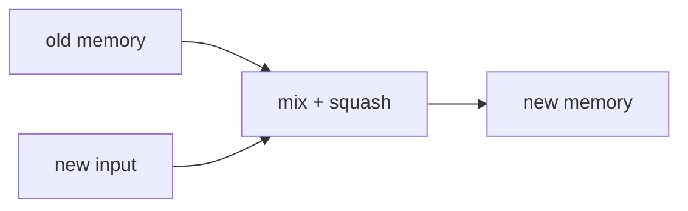

> Tier 5 · Sequence Models · **Level: beginner** · Reading time: about 8 minutes

# 5.11 Hidden state

**Metadata** — Tier: 5 · Phase: 1 · Priority: P0 · Difficulty: 2/5 · Interview: High · Hands-on: High
Prerequisites: 5.10 RNN · Leads to: 5.12 BPTT, 5.15 Cell state

> **In plain words**
> The **hidden state** is the RNN's **memory**: a vector (say 128 numbers) that summarizes everything the network has read so far. Nobody tells it what to remember; training shapes it to keep whatever helps the task. It is **fixed in size**, so it must compress: the farther back an input was, the more it tends to be overwritten.

**You need first:** 5.10 RNN.

> **Figure 5.11-1 — the state is the only channel from past to future**
>
> ```mermaid
> flowchart LR
>     P["everything read so far<br/>x₁ … x(t−1)"] --> H["h(t−1)<br/>fixed-size summary"]
>     H --> C["cell"]
>     X["xₜ"] --> C
>     C --> N["hₜ"]
>     N --> Y["prediction for step t"]
> ```
>
> *How to read it:* whatever the model knows about the past must pass through the small box `h`. If the state is too small, or the cell overwrites it too aggressively, information is lost. This is the bottleneck behind most RNN limitations.

**Words you'll meet on this page**

| Word | What it means here |
|---|---|
| hidden state | the memory vector `hₜ` |
| initial state `h₀` | the starting memory (zeros or learned) |
| state size / hidden size `H` | how many numbers the memory has |
| stateful | carry `h` across batches instead of resetting |
| detach | cut the gradient link to the past state |
| encoding | the final state used as a summary of the whole sequence |
| capacity | how much the state can store |

### 1. What is it?
The vector `hₜ ∈ ℝ^H` produced by the recurrent cell at step `t`. It is both the output passed to the next layer/step and the memory passed to the next time step.

### 2. Why does it exist?
A model that predicts the next word needs to know what came before. The hidden state is the learned, compressed version of that context.

### 3. Detailed explanation
- **What gets stored** is learned. In a character model, some units track "inside a quote" or "line length"; others represent the current word. Looking at the units reveals interpretable features (Karpathy et al., 2015; REVIEW_REQUIRED).
- **Fixed capacity.** `H` numbers must summarize everything; the longer the history, the more is lost. Larger `H` helps but costs `O(H²)` per step.
- **Initial state.** Usually zeros. For stateful training, the final state of one chunk is the initial state of the next.
- **Fading memory.** In a vanilla RNN the influence of an early input on the current state shrinks roughly like `(‖W_hh‖·tanh')^distance` (5.13). Code ② measures it.
- **As a summary.** In sequence-to-sequence models (5.20–5.21) the encoder's final state is the "thought vector" handed to the decoder: a bottleneck that attention (5.24) relieves.
- **Layers.** Stacked RNNs have one state per layer.
- **Bidirectional.** Two states per step (forward and backward).
- **Truncating history.** In long sequences, detach the state every `k` steps so backpropagation only goes `k` steps back (truncated BPTT, 5.12) while the *values* still carry forward.
- **Resetting.** Reset the state at the start of each independent sequence (document, user session); otherwise information leaks between them.
- **Streaming inference.** Keep `h` between incoming tokens: constant memory regardless of how long the conversation is, unlike a Transformer's growing KV cache (Tier 11).

### 4. How does it work?
Each step rewrites the memory as a mix of the old memory (through `W_hh`) and the new input (through `W_xh`), squashed by `tanh`.



### 5. Simple example
A whiteboard with room for only ten lines: each new fact may require erasing something. What stays is what the task needed most.

**By hand.** With `h_t = 0.5·h_{t-1} + x_t` (a linear toy), the first input `x₁ = 1` contributes `1, 0.5, 0.25, 0.125` to the state after 1, 2, 3, 4 steps: its influence halves every step.

### 6. Technical example
Streaming speech recognition keeps the recurrent state between audio chunks so it does not recompute the past.

### 7. Code
**① By hand (plain Python).** Fading memory in a linear toy RNN.

```python
h = 0.0
contribution = []
for t, x in enumerate([1.0, 0.0, 0.0, 0.0, 0.0, 0.0], start=1):
    h = 0.5 * h + x
    contribution.append(round(h, 4))
print("state after each step (first input was 1, the rest 0):", contribution)
print("the influence of the first input halves every step")
```

```text
state after each step (first input was 1, the rest 0): [1.0, 0.5, 0.25, 0.125, 0.0625, 0.0312]
the influence of the first input halves every step
```

**② With NumPy.** How much does the first input still matter after many steps?

```python
import numpy as np

rng = np.random.default_rng(0)
H, T = 16, 30
Wxh, Whh = rng.normal(0, 0.5, (H, 2)), rng.normal(0, 0.9 / np.sqrt(H), (H, H))        # recurrent weights of modest size
def run(x):
    h = np.zeros(H); states = []
    for t in range(T):
        h = np.tanh(Wxh @ x[t] + Whh @ h); states.append(h)
    return np.array(states)

x = rng.normal(size=(T, 2)); x2 = x.copy(); x2[0] += 1.0                                  # change ONLY the first input
diff = np.linalg.norm(run(x) - run(x2), axis=1)
print("effect of changing the first input on the state, after steps 1, 5, 10, 20, 30:")
print("  ", [f"{diff[i - 1]:.1e}" for i in (1, 5, 10, 20, 30)])
```

```text
effect of changing the first input on the state, after steps 1, 5, 10, 20, 30:
   ['2.2e+00', '6.4e-01', '4.5e-02', '2.3e-03', '1.3e-04']
```

**③ With PyTorch.** Carrying the state between chunks, resetting, and detaching.

```python
import torch

torch.manual_seed(0)
rnn = torch.nn.RNN(3, 6, batch_first=True)
seq = torch.randn(1, 20, 3)
full, _ = rnn(seq)

out1, h = rnn(seq[:, :10])                                             # first half
out2, _ = rnn(seq[:, 10:], h)                                          # second half, starting from the carried state
print("chunked with the carried state equals one pass:", torch.allclose(torch.cat([out1, out2], 1), full, atol=1e-6))
out2_reset, _ = rnn(seq[:, 10:])                                       # forgot to carry the state
print("without the carried state the outputs differ:", not torch.allclose(out2_reset, out2))

h_detached = h.detach()
print("state requires grad:", h.requires_grad, "-> after detach:", h_detached.requires_grad, "(values kept, link to the past cut)")
```

```text
chunked with the carried state equals one pass: True
without the carried state the outputs differ: True
state requires grad: True -> after detach: False (values kept, link to the past cut)
```

### 8. Input → Process → Output
`old state + new input → new state → (prediction) → carried to the next step`

<details>
<summary><b>Beyond the basics (sections 9–16)</b> — real-world use, limits, mistakes. Skip on a first read.</summary>

### 9. Enterprise use case
Stateful stream processing (fraud detection on a transaction stream) keeps a per-customer state.

### 10. AI engineering connection
The recurrent state is the alternative to a growing KV cache; modern linear-recurrent models aim for it at scale (Tier 12).

### 11. Advantages
Constant memory per step; learned summary.

### 12. Limitations
Fixed capacity; information fades; hard to interpret.

### 13. Trade-offs
Bigger state remembers more but costs `H²` per step and more parameters.

### 14. Common mistakes
Not resetting between sequences; not detaching between batches (memory grows, graph spans batches); initial state of the wrong shape or device.

### 15. Performance / cost
State per sequence is `H` numbers per layer; trivial to store.

### 16. Security
State carried across users leaks data; reset per session.

</details>

### 17. Interview explanation
"The hidden state is the RNN's learned, fixed-size summary of the past, updated at every step; the model can only use history that passes through it. It fades for old inputs in a vanilla RNN, is reset between independent sequences, and is detached between chunks to bound backpropagation."

### 18. Rapid-fire answer
Fixed-size learned memory `hₜ`; only channel from past to future; fades; reset per sequence; detach between chunks.

### 19. Interview questions
- **Basic:** What does the hidden state represent?
- **Intermediate:** What happens if you forget to detach the state between batches?
- **Advanced:** How does the hidden state size trade off against cost?
- **Scenario:** A chatbot RNN leaks one user's context into the next. Why?

### 20. Hands-on exercise
**Goal:** measure memory length.

1. Use the code ② setup with recurrent weight scale `0.9/√H`, and again with `0.3/√H`.
2. Print the effect of the first input after 10 steps for each.

<details>
<summary>Show a solution</summary>

```python
import numpy as np

H, T = 16, 30
for scale in (0.9, 0.3):
    rng = np.random.default_rng(0)
    Wxh, Whh = rng.normal(0, 0.5, (H, 2)), rng.normal(0, scale / np.sqrt(H), (H, H))
    def run(x):
        h = np.zeros(H); out = []
        for t in range(T):
            h = np.tanh(Wxh @ x[t] + Whh @ h); out.append(h)
        return np.array(out)
    x = rng.normal(size=(T, 2)); x2 = x.copy(); x2[0] += 1.0
    d = np.linalg.norm(run(x) - run(x2), axis=1)
    print(f"recurrent scale {scale}: effect of the first input after 10 steps = {d[9]:.1e}")
```

```text
recurrent scale 0.9: effect of the first input after 10 steps = 4.5e-02
recurrent scale 0.3: effect of the first input after 10 steps = 7.9e-06
```

</details>

### 21. Revision questions
1. Why is the state a bottleneck?
2. When do you reset it?
3. What does detach do?

### 22. Related concepts
5.10 RNN · 5.12 BPTT · 5.13 RNN gradient problems · 5.15 Cell state · 5.20 Encoder-decoder

### 23. One-line memory hook
**Hidden state: a notepad of fixed size that is rewritten at every step.**

<details>
<summary><b>For reviewers</b> (not part of the lesson)</summary>

- Status: DRAFT, learner-first layout (Author: Claude). Code is executed by `tests/test_md_snippets.py`.
- REVIEW_REQUIRED: interpretable character-RNN units (Karpathy, Johnson & Fei-Fei 2015).
</details>
