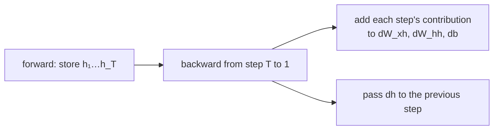

> Tier 5 · Sequence Models · **Level: intermediate** · Reading time: about 10 minutes

# 5.12 Backpropagation through time (BPTT)

**Metadata** — Tier: 5 · Phase: 1 · Priority: P0 · Difficulty: 3/5 · Interview: High · Hands-on: High
Prerequisites: 3.20 Backpropagation, 5.10 RNN, 5.11 Hidden state · Leads to: 5.13 RNN gradient problems

> **In plain words**
> **BPTT** is ordinary backpropagation applied to an RNN that has been **unrolled in time**. The weights are shared across all time steps, so each step contributes its own share of the gradient and **the shares are added up**. The gradient also has to travel **backwards through every time step** along the memory path, which is where it can shrink or blow up (5.13). For long sequences we cut the path every `k` steps (**truncated BPTT**).

**You need first:** 3.20 Backpropagation, 5.10 RNN, 5.11 Hidden state.

> **Figure 5.12-1 — the gradient flows back through the unrolled network**
>
> ```mermaid
> flowchart RL
>     L3["loss₃"] --> h3["h₃"]
>     L2["loss₂"] --> h2["h₂"]
>     L1["loss₁"] --> h1["h₁"]
>     h3 -->|"∂h₃/∂h₂"| h2
>     h2 -->|"∂h₂/∂h₁"| h1
>     h1 -->|"∂h₁/∂h₀"| h0["h₀"]
>     h3 -.-> W["shared weights W: add up the contributions of every step"]
>     h2 -.-> W
>     h1 -.-> W
> ```
>
> *How to read it:* the arrows point backwards. Step 3's loss sends signal into `h₃`, then into `h₂`, `h₁`… through the factor `∂hₜ/∂h_{t-1}`. Each step also deposits a gradient on the *same* weight matrix `W`; the total gradient for `W` is the sum of all those deposits.

**Words you'll meet on this page**

| Word | What it means here |
|---|---|
| BPTT | backprop on the unrolled RNN |
| unrolled graph | one copy of the cell per time step |
| shared weights | the same `W` in every copy: gradients add |
| Jacobian `∂hₜ/∂h_{t-1}` | how the state at `t` depends on the previous state |
| truncated BPTT | backprop only through the last `k` steps |
| chunk | a window of `k` consecutive steps |
| `detach` | stop the gradient at a state |

### 1. What is it?
The gradient computation `∂L/∂θ = Σ_t ∂L/∂θ|_{step t}` for an RNN, found by running backprop (3.20) on the unrolled computation graph.

### 2. Why does it exist?
The loss at step `t` depends on the weights through every earlier step. To train, we need those gradients; unrolling turns the recurrent loop into an ordinary acyclic graph where autodiff (3.21) applies.

### 3. Detailed explanation
- **Forward:** `a_t = W_xh x_t + W_hh h_{t-1} + b`, `h_t = tanh(a_t)`, `y_t = W_hy h_t`, loss `L = Σ L_t`.
- **Backward:** go from the last step to the first. At step `t` the gradient on `h_t` is `dL_t/dh_t + (W_hh)ᵀ·(dh_{t+1} ∘ tanh')` (the second term comes from the *future*). Then `da_t = (1 − h_t²) ∘ dh_t`, and contributions are added to `dW_xh`, `dW_hh`, `db`.
- **The recurrence of gradients:** `dh_{t} ← W_hhᵀ (tanh'(a_{t+1}) ∘ dh_{t+1}) + local`. Repeated multiplication by `W_hhᵀ` and by `tanh' ≤ 1` is the root of the problems in 5.13.
- **Cost.** Time `O(T)` and memory `O(T·H)` because all states must be kept (like activations, 4.41).
- **Truncated BPTT.** For long streams, process chunks of `k` steps: carry the state *values* forward but `detach()` the state so gradients stop at the chunk boundary. Memory is `O(k)`; the model can still use longer context in the forward pass but cannot *learn* dependencies longer than `k` (code ③).
- **Gradient clipping** is standard for RNNs (4.15) because the shared matrix can make gradients explode.
- **Verification.** Compare with finite differences (code ②), as in 3.20.
- **Autograd does it automatically** in PyTorch; writing it by hand once is the best way to understand it.
- **Real-time recurrent learning (RTRL)** is a forward-mode alternative, too costly in practice (REVIEW_REQUIRED).

### 4. How does it work?
Run the forward pass storing every state; go backwards accumulating gradients for the shared weights and passing the state-gradient to the previous step.



### 5. Simple example
Tracing blame through a chain of messengers: the final mistake could come from the last messenger or be inherited from earlier ones. You trace each hand-off backwards, and each messenger's own contribution (the shared rulebook) adds up.

**By hand.** Scalar RNN `h_t = tanh(w·h_{t-1} + x_t)`, `L = h₂`. `dL/dw = (1 − h₂²)(h₁ + w·(1 − h₁²)·h₀)`: the first term is step 2's own use of `w`, the second the effect through `h₁`. With `h₀ = 0`, only the first term remains.

### 6. Technical example
Training a language model on a book with truncated BPTT of 200 characters: each batch is a 200-character chunk; the state carries over, gradients stop at the chunk edge.

### 7. Code
**① By hand (plain Python).** BPTT for a scalar RNN, verified by finite differences.

```python
import math

def forward(w, xs):
    h, hs = 0.0, [0.0]
    for x in xs:
        h = math.tanh(w * h + x); hs.append(h)
    return hs

xs, w = [0.5, -0.3, 0.8], 0.9
hs = forward(w, xs)                          # L = h_T
dh, dw = 1.0, 0.0
for t in range(len(xs), 0, -1):
    da = (1 - hs[t] ** 2) * dh               # through tanh
    dw += da * hs[t - 1]                     # this step's use of the shared weight
    dh = da * w                              # passed to the previous state
eps = 1e-6
numeric = (forward(w + eps, xs)[-1] - forward(w - eps, xs)[-1]) / (2 * eps)
print("BPTT gradient dL/dw :", round(dw, 6))
print("finite differences  :", round(numeric, 6))
```

```text
BPTT gradient dL/dw : 0.25459
finite differences  : 0.25459
```

**② With NumPy.** A full character RNN with manual BPTT, checked numerically.

```python
import numpy as np

rng = np.random.default_rng(0)
V, H = 5, 6
Wxh, Whh, Why = rng.normal(0, 0.4, (H, V)), rng.normal(0, 0.4, (H, H)), rng.normal(0, 0.4, (V, H))
xs, ys = [0, 3, 1, 4, 2, 2], [3, 1, 4, 2, 2, 0]

def run(Wxh, Whh, Why):
    hs, probs, loss = {-1: np.zeros(H)}, {}, 0.0
    for t, (x, y) in enumerate(zip(xs, ys)):
        hs[t] = np.tanh(Wxh[:, x] + Whh @ hs[t - 1])
        z = Why @ hs[t]; probs[t] = np.exp(z - z.max()) / np.exp(z - z.max()).sum(); loss -= np.log(probs[t][y])
    return loss, hs, probs

loss, hs, probs = run(Wxh, Whh, Why)
dWxh, dWhh, dWhy, dh_next = np.zeros_like(Wxh), np.zeros_like(Whh), np.zeros_like(Why), np.zeros(H)
for t in reversed(range(len(xs))):
    dy = probs[t].copy(); dy[ys[t]] -= 1
    dWhy += np.outer(dy, hs[t])
    dz = (1 - hs[t] ** 2) * (Why.T @ dy + dh_next)                      # gradient from the loss at t AND from the future
    dWxh[:, xs[t]] += dz; dWhh += np.outer(dz, hs[t - 1]); dh_next = Whh.T @ dz

h = 1e-6; i, j = 2, 3
Wp = Whh.copy(); Wp[i, j] += h; Wm = Whh.copy(); Wm[i, j] -= h
numeric = (run(Wxh, Wp, Why)[0] - run(Wxh, Wm, Why)[0]) / (2 * h)
print("dL/dWhh[2,3]  BPTT:", round(dWhh[i, j], 6), "   finite differences:", round(numeric, 6))
```

```text
dL/dWhh[2,3]  BPTT: 0.11262    finite differences: 0.11262
```

**③ With PyTorch.** Truncated BPTT: detaching the state limits how far gradients travel.

```python
import torch

torch.manual_seed(0)
rnn = torch.nn.RNN(1, 8, batch_first=True)
x = torch.randn(1, 40, 1, requires_grad=True)

h = torch.zeros(1, 1, 8); loss_full = 0
out, _ = rnn(x, h); loss_full = out[:, -1].sum(); loss_full.backward()
g_full = x.grad.abs().squeeze()
print("full BPTT: gradient reaches the FIRST input:", g_full[0].item() > 0)

x.grad = None
h = torch.zeros(1, 1, 8); outs = []
for chunk in x.split(10, dim=1):                                       # chunks of 10 steps
    h = h.detach()                                                     # cut the graph at the chunk boundary
    o, h = rnn(chunk, h); outs.append(o)
torch.cat(outs, 1)[:, -1].sum().backward()
g_trunc = x.grad.abs().squeeze()
print("truncated BPTT (k = 10): gradient on inputs 0-29 is exactly zero:", bool((g_trunc[:30] == 0).all()), "   on the last 10 inputs:", bool((g_trunc[30:] > 0).all()))
```

```text
full BPTT: gradient reaches the FIRST input: True
truncated BPTT (k = 10): gradient on inputs 0-29 is exactly zero: True    on the last 10 inputs: True
```

### 8. Input → Process → Output
`forward (store states) → backward through time (sum shared-weight contributions) → gradients`

<details>
<summary><b>Beyond the basics (sections 9–16)</b> — real-world use, limits, mistakes. Skip on a first read.</summary>

### 9. Enterprise use case
Truncated BPTT lets streaming models train on arbitrarily long logs with bounded memory.

### 10. AI engineering connection
Backprop through the unrolled steps also appears in differentiating through iterative decoders and meta-learning.

### 11. Advantages
Exact gradients for recurrent models; reuses standard backprop.

### 12. Limitations
Memory ∝ unrolled length; gradient vanishing/explosion; sequential.

### 13. Trade-offs
Longer truncation learns longer dependencies at higher memory cost.

### 14. Common mistakes
Forgetting to detach the state (the graph grows forever); truncating shorter than the dependency you want; not clipping gradients; losses not averaged over valid positions.

### 15. Performance / cost
`O(T)` time and `O(T H)` memory; checkpointing can trade compute for memory (4.41).

### 16. Security
No direct issue.

</details>

### 17. Interview explanation
"BPTT unrolls the RNN over time and backpropagates through the unrolled graph; because weights are shared, the gradient for each weight is the sum of its contributions at every step. The state-to-state Jacobians multiply along the way, which causes vanishing/exploding gradients, and for long sequences I use truncated BPTT with detached states plus gradient clipping."

### 18. Rapid-fire answer
Backprop on the unrolled graph; sum shared-weight gradients over time; `dh_t = local + W_hhᵀ(tanh' ∘ dh_{t+1})`; truncate with `detach`; clip.

### 19. Interview questions
- **Basic:** What does BPTT do?
- **Intermediate:** Why are gradients summed over time steps?
- **Advanced:** What does truncated BPTT change, and what does it not?
- **Scenario:** Memory usage grows with every batch of your RNN training loop. Why?

### 20. Hands-on exercise
**Goal:** measure memory vs unrolled length.

1. For `T = 10, 100, 1000` and hidden size 128, compute the number of stored state numbers (batch 32) for BPTT.

<details>
<summary>Show a solution</summary>

```python
H, batch = 128, 32
for T in (10, 100, 1000):
    stored = T * batch * H
    print(f"T = {T:>4}: {stored:>10,} state numbers = {stored * 4 / 1e6:6.1f} MB float32 (plus pre-activations)")
```

```text
T =   10:     40,960 state numbers =    0.2 MB float32 (plus pre-activations)
T =  100:    409,600 state numbers =    1.6 MB float32 (plus pre-activations)
T = 1000:  4,096,000 state numbers =   16.4 MB float32 (plus pre-activations)
```

</details>

### 21. Revision questions
1. Why do the gradients of shared weights add up?
2. What does `detach` do in truncated BPTT?
3. Memory cost of BPTT?

### 22. Related concepts
3.20 Backpropagation · 3.25–3.26 Gradient problems · 4.15 Clipping · 5.13 RNN gradient problems

### 23. One-line memory hook
**BPTT: unroll, backprop, and add up the shared weights' share from every step.**

<details>
<summary><b>For reviewers</b> (not part of the lesson)</summary>

- Status: DRAFT, learner-first layout (Author: Claude). Code is executed by `tests/test_md_snippets.py`.
- TESTED earlier: `code/test_seqmodels.py::test_bptt_matches_finite_differences`. REVIEW_REQUIRED: RTRL remark.
</details>
