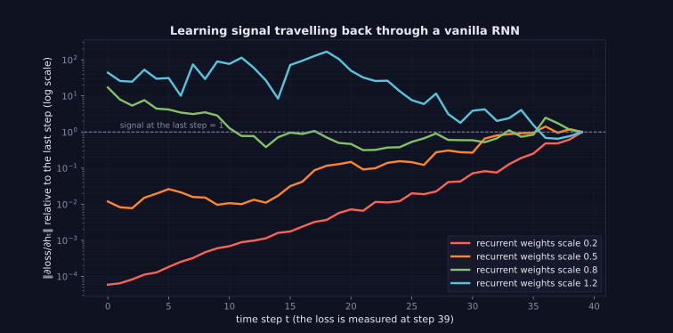
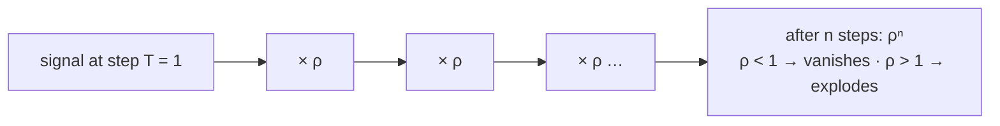

> Tier 5 · Sequence Models · **Level: intermediate** · Reading time: about 10 minutes

# 5.13 RNN gradient problems

**Metadata** — Tier: 5 · Phase: 1 · Priority: P0 · Difficulty: 3/5 · Interview: Very high · Hands-on: High
Prerequisites: 3.25 Vanishing gradients, 3.26 Exploding gradients, 5.12 BPTT · Leads to: 5.14 LSTM

> **In plain words**
> In an RNN the learning signal has to travel **backwards through many time steps**, and at each step it is multiplied by about the same matrix. Multiply a number by something smaller than 1 fifty times and it vanishes; by something larger than 1 and it explodes. So a vanilla RNN **cannot learn from events many steps in the past** (vanishing), and sometimes its training **blows up** (exploding). This is the problem LSTM and GRU were invented to solve.

**You need first:** 3.25 Vanishing gradients, 3.26 Exploding gradients, 5.12 BPTT.

> **Figure 5.13-1 — the learning signal travelling back in time**
>
> 
>
> *How to read it:* the loss is measured at the last step (time 39, value 1). Each line shows how much gradient reaches an earlier step, for a different size of the recurrent weights. With small weights (red, orange) the signal reaching the first steps is 10⁻⁵–10⁻² of the final one: **vanishing**, so early inputs hardly influence learning. With large weights (blue) it grows to 10¹–10²: **exploding**. Only a narrow range in between keeps the signal alive.
>
> *Generated by* `tier-05-sequence-models/figures/src/t5_figures.py` from `code/seqmodels.py` (`NumpyRNN.signal_from_last_step`).

**Words you'll meet on this page**

| Word | What it means here |
|---|---|
| vanishing gradient | the signal shrinks exponentially with distance |
| exploding gradient | the signal grows exponentially with distance |
| long-range dependency | a prediction that depends on something many steps earlier |
| spectral radius | the largest absolute eigenvalue of `W_hh` |
| gradient clipping | rescale a too-large gradient (4.15) |
| identity initialization | start `W_hh` as the identity so the state is copied |
| gating | LSTM/GRU control of what to keep (5.14, 5.19) |

### 1. What is it?
The tendency of `∂L_T/∂h_t = Π_{k=t+1}^{T} W_hhᵀ diag(tanh'(a_k))` (a product of `T − t` matrices) to go to zero or infinity as `T − t` grows.

### 2. Why does it exist?
Repeated multiplication by the same matrix scales a vector by roughly `ρ^(T−t)`, where `ρ` combines the largest singular value of `W_hh` and the `tanh'` factor (at most 1). If `ρ < 1`: vanishing; if `ρ > 1`: exploding (Bengio et al., 1994; Pascanu et al., 2013; REVIEW_REQUIRED).

### 3. Detailed explanation
- **Vanishing** is the dangerous one. The tanh derivative is ≤ 1 and usually well below it when units saturate, so even `W_hh` with singular values near 1 shrinks the signal. The effect: the network learns short-range patterns easily and long-range ones not at all (code ③, 5.14).
- **Exploding** gives huge updates and NaNs. The cure is **gradient clipping** (4.15): cheap and standard for RNNs.
- **Why clipping does not fix vanishing:** you cannot amplify a signal that is not there.
- **Practical consequence:** a vanilla RNN's effective memory is about 10–20 steps.
- **Mitigations before gating:** careful initialization (orthogonal or identity `W_hh`, scaled to spectral radius ≈ 1), ReLU with identity init (IRNN), truncating, shortening sequences.
- **Gated architectures** add an additive path (the cell state, 5.15) along which gradients flow with multiplication by a gate close to 1 rather than by `W_hh`: LSTM (5.14) and GRU (5.19).
- **Skip connections / attention** create short paths between distant steps (5.24, Tier 7), the ultimate solution (5.26–5.27).
- **Detection.** Log the gradient norm per time step; look for NaNs and loss spikes (4.37–4.38).
- **Relation to 3.25–3.26:** the same phenomenon as in deep feed-forward networks, with depth = time.
- **Echo state / reservoir computing** avoids the problem by not training `W_hh` (REVIEW_REQUIRED).

### 4. How does it work?
Each backward step multiplies the signal by `W_hhᵀ·tanh'`; after `n` steps the factor is about `ρⁿ`.



### 5. Simple example
Whispering a message down a line of 50 people: each person passes on 80% of the volume. After 50 people only `0.8⁵⁰ ≈ 0.00001` of the volume is left. If each person instead shouted at 120%, the last person would be deafened.

**By hand.** Per-step factor 0.9: after 10 steps `0.35`; 50 steps `0.005`; 100 steps `0.00003`. Factor 1.1: 10 steps `2.6`; 50 steps `117`; 100 steps `13,780`.

### 6. Technical example
A language model must connect a pronoun to its noun 30 words earlier; a vanilla RNN cannot learn it because the gradient from the pronoun's error is almost zero by the time it reaches the noun.

### 7. Code
**① By hand (plain Python).** The arithmetic of repeated multiplication.

```python
for rho in (0.9, 1.0, 1.1):
    print(f"per-step factor {rho}: after 10 steps {rho ** 10:10.3g}   50 steps {rho ** 50:10.3g}   100 steps {rho ** 100:10.3g}")
```

```text
per-step factor 0.9: after 10 steps      0.349   50 steps    0.00515   100 steps   2.66e-05
per-step factor 1.0: after 10 steps          1   50 steps          1   100 steps          1
per-step factor 1.1: after 10 steps       2.59   50 steps        117   100 steps   1.38e+04
```

**② With NumPy.** The real thing: the norm of `∂L_T/∂h_t` in a tanh RNN.

```python
import numpy as np

rng = np.random.default_rng(0)
H, T = 16, 40
x = rng.normal(size=(T, 2)); Wxh = rng.normal(0, 0.5, (H, 2))
for scale in (0.1, 0.2, 0.5, 1.2):                                                       # standard deviation of the entries of W_hh
    Whh = rng.normal(0, scale, (H, H))
    h, hs = np.zeros(H), []
    for t in range(T):
        h = np.tanh(Wxh @ x[t] + Whh @ h); hs.append(h)
    g = np.ones(H) / np.sqrt(H); norms = [np.linalg.norm(g)]
    for t in range(T - 1, 0, -1):
        g = Whh.T @ ((1 - hs[t] ** 2) * g); norms.append(np.linalg.norm(g))
    norms = norms[::-1]
    print(f"W_hh entry std {scale}: signal at step 0 relative to the last step = {norms[0] / norms[-1]:.1e}   at step 20 = {norms[20] / norms[-1]:.1e}")
```

```text
W_hh entry std 0.1: signal at step 0 relative to the last step = 6.3e-21   at step 20 = 8.3e-11
W_hh entry std 0.2: signal at step 0 relative to the last step = 1.4e-06   at step 20 = 1.3e-04
W_hh entry std 0.5: signal at step 0 relative to the last step = 1.3e-01   at step 20 = 1.4e-01
W_hh entry std 1.2: signal at step 0 relative to the last step = 3.3e+03   at step 20 = 3.3e+01
```

**③ With PyTorch.** Gradient from the final loss to the first input (relative to the last), at growing length: vanilla RNN, LSTM, and LSTM with its forget gate initialized open.

```python
import torch

def first_input_gradient(kind, T, forget_bias=0.0, seed=0):
    torch.manual_seed(seed)
    rnn = {"rnn": torch.nn.RNN, "lstm": torch.nn.LSTM}[kind](4, 16, batch_first=True)
    if forget_bias:                                                        # LSTM bias layout: input, forget, cell, output gates
        for name, p in rnn.named_parameters():
            if name.startswith("bias"):
                p.data[16:32] = forget_bias
    x = torch.randn(1, T, 4, requires_grad=True)
    out, _ = rnn(x)
    out[:, -1].pow(2).sum().backward()
    return x.grad[0, 0].norm().item() / x.grad[0, -1].norm().item()

print(f"{'steps':>6} {'vanilla RNN':>13} {'LSTM':>10} {'LSTM, forget bias 1':>21}")
for T in (5, 20, 50, 100):
    print(f"{T:>6} {first_input_gradient('rnn', T):>13.1e} {first_input_gradient('lstm', T):>10.1e} {first_input_gradient('lstm', T, 1.0):>21.1e}")
```

```text
 steps   vanilla RNN       LSTM   LSTM, forget bias 1
     5       1.7e-02    9.8e-02               9.2e-01
    20       1.5e-05    2.0e-05               1.7e-01
    50       1.6e-13    2.1e-10               2.5e-01
   100       0.0e+00    4.5e-20               4.0e-02
```

### 8. Input → Process → Output
`long chain of ×(W_hh · tanh') → signal ∝ ρⁿ → vanishing (ρ<1) or exploding (ρ>1)`

<details>
<summary><b>Beyond the basics (sections 9–16)</b> — real-world use, limits, mistakes. Skip on a first read.</summary>

### 9. Enterprise use case
Why production sequence models used LSTMs/GRUs and later Transformers for anything beyond short context.

### 10. AI engineering connection
Motivates gating (5.14), attention (5.24) and Transformers (Tier 8); modern recurrent designs keep the recurrence stable by construction (Tier 12).

### 11. Advantages
Understanding it explains every later design.

### 12. Limitations
Mitigations only extend the range; gating is not a guarantee.

### 13. Trade-offs
Gating adds parameters and compute for stable memory.

### 14. Common mistakes
Using clipping and expecting it to cure vanishing; very long sequences with vanilla RNNs; not logging gradient norms; poor recurrent initialization.

### 15. Performance / cost
Mitigations are cheap; architecture change is the real fix.

### 16. Security
No direct issue.

</details>

### 17. Interview explanation
"Backprop through time multiplies the gradient by the recurrent Jacobian at every step, so it scales like ρ to the power of the distance: below one it vanishes and the RNN cannot learn long-range dependencies, above one it explodes. Clipping controls explosions; gating architectures like LSTM and GRU create an additive path that keeps the gradient alive."

### 18. Rapid-fire answer
Gradient ∝ ρⁿ over n steps; vanishing → short memory; exploding → clip; fix with LSTM/GRU, good init, attention.

### 19. Interview questions
- **Basic:** Why do RNNs have vanishing gradients?
- **Intermediate:** Why does clipping not fix vanishing gradients?
- **Advanced:** How does the LSTM cell state avoid the repeated matrix multiplication?
- **Scenario:** An RNN predicts the next token well but never uses context older than ~10 tokens. Why?

### 20. Hands-on exercise
**Goal:** find the memory horizon.

1. With a per-step factor of 0.9, after how many steps does the signal fall below 1%? With 0.8?

<details>
<summary>Show a solution</summary>

```python
import math

for rho in (0.9, 0.8, 0.5):
    steps = math.ceil(math.log(0.01) / math.log(rho))
    print(f"factor {rho}: below 1% after {steps} steps")
```

```text
factor 0.9: below 1% after 44 steps
factor 0.8: below 1% after 21 steps
factor 0.5: below 1% after 7 steps
```

</details>

### 21. Revision questions
1. What is multiplied at every backward step?
2. What fixes explosions?
3. What fixes vanishing?

### 22. Related concepts
3.25 Vanishing gradients · 3.26 Exploding gradients · 4.15 Clipping · 5.12 BPTT · 5.14 LSTM · 5.19 GRU

### 23. One-line memory hook
**RNN gradients: a long chain of multiplications that either fades out or blows up.**

<details>
<summary><b>For reviewers</b> (not part of the lesson)</summary>

- Status: DRAFT, learner-first layout (Author: Claude). Code is executed by `tests/test_md_snippets.py`.
- TESTED earlier: `code/test_seqmodels.py::test_rnn_gradient_signal_decays_with_distance_when_the_recurrent_weights_are_small`, `lab/...::test_gradient_signal_decays_for_small_weights_and_grows_for_large_ones`.
- REVIEW_REQUIRED: Bengio et al. 1994, Pascanu et al. 2013 attributions; echo-state remark; the "10–20 steps" effective memory.
</details>
