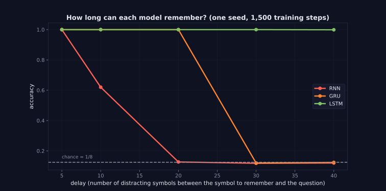
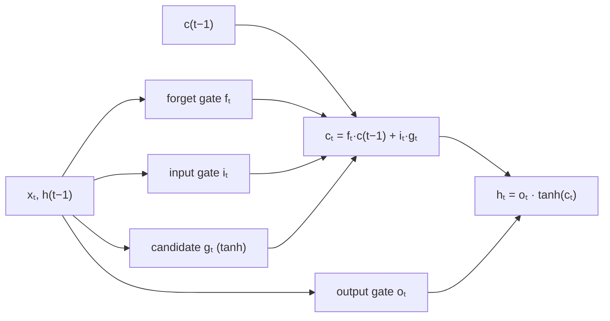

> Tier 5 · Sequence Models · **Level: intermediate** · Reading time: about 12 minutes

# 5.14 LSTM (long short-term memory)

**Metadata** — Tier: 5 · Phase: 1 · Priority: P0 · Difficulty: 3/5 · Interview: Very high · Hands-on: Very high
Prerequisites: 5.10 RNN, 5.13 RNN gradient problems · Leads to: 5.15–5.18 (cell state and the three gates), 5.19 GRU

> **In plain words**
> An **LSTM** is an RNN with a **separate long-term memory** (the *cell state*) and **three gates** that decide what to **forget**, what to **write** and what to **show**. Because the long-term memory is updated by *adding* to it (not by squashing it through a matrix every step), information and gradients can travel across many steps. LSTMs (Hochreiter & Schmidhuber, 1997) were the standard sequence model for about two decades.

**You need first:** 5.10 RNN, 5.13 RNN gradient problems.

> **Figure 5.14-1 — how long can each model remember?**
>
> 
>
> *How to read it:* the task is to remember one symbol while 5–40 distracting symbols go by, then repeat it. Chance is 1/8. The vanilla RNN (red) works only for short delays; the GRU (orange) reaches a bit further; the LSTM (teal), with its forget-gate bias started open, still solves delay 40. One seed and 1,500 training steps, so the exact breaking points vary between runs; the ordering is the lesson.
>
> *Generated by* `tier-05-sequence-models/figures/src/t5_figures.py` from `lab/lab_05_sequence_comparison.py` (`ex_5_14_memory_vs_delay`).

**Words you'll meet on this page**

| Word | What it means here |
|---|---|
| cell state `cₜ` | the long-term memory, updated additively |
| hidden state `hₜ` | the short-term output of the cell |
| forget gate `fₜ` | how much of the old memory to keep (0–1) |
| input gate `iₜ` | how much of the new candidate to write |
| output gate `oₜ` | how much of the memory to reveal |
| candidate `gₜ` | the proposed new content (`tanh`) |
| gate | a sigmoid (0–1) that scales something elementwise |

### 1. What is it?
A recurrent cell with two states: `cₜ = fₜ ⊙ c_{t-1} + iₜ ⊙ gₜ`, `hₜ = oₜ ⊙ tanh(cₜ)`, where `fₜ, iₜ, oₜ = σ(W·[xₜ, h_{t-1}] + b)` and `gₜ = tanh(W_g·[xₜ, h_{t-1}] + b_g)`.

### 2. Why does it exist?
The vanilla RNN rewrites its whole state through `tanh(W h)` at every step, so information and gradients decay (5.13). The LSTM adds a "conveyor belt" (`c`) that, when the forget gate is near 1 and the input gate near 0, passes information along **unchanged**, so gradients along it are multiplied by `fₜ ≈ 1` instead of `W_hh`.

### 3. Detailed explanation
- **The four parts** each use the same inputs (`xₜ`, `h_{t-1}`) with separate weights: forget, input, candidate, output. Parameters: `4·(d_in·H + H·H + H)` (+ another bias in PyTorch), about 4× a vanilla RNN of the same size (code ②).
- **Cell-state update is additive:** `cₜ = fₜ⊙c_{t-1} + iₜ⊙gₜ`. The gradient `∂cₜ/∂c_{t-1} = fₜ` (plus indirect terms), a gate value rather than a matrix.
- **Gates are soft switches** in `(0, 1)`, one value per memory unit, computed from the current input and previous output. They are learned, not hand-set.
- **Forget-gate bias trick.** Initialize the forget gate's bias to 1 (so `f ≈ 0.73` at the start): the model starts by remembering, which helps long-range learning a lot (Jozefowicz et al., 2015; REVIEW_REQUIRED). Code ③ and Figure 5.14-1 use it.
- **Outputs.** `hₜ` is what the next layer and the next step see; `cₜ` stays inside (5.15–5.18 explain each gate).
- **Stacking and bidirectional** versions work exactly as for RNNs.
- **Gradient clipping** is still used; LSTMs mostly cure vanishing, less so exploding (4.15).
- **Peepholes and coupled gates** (forget = 1 − input) are variants; the GRU (5.19) is the most popular simplification.
- **Cost.** About 4× the parameters and compute of a vanilla RNN; still sequential over time (5.26).
- **Use.** Language models, speech recognition, translation (with attention, 5.24), time-series forecasting, handwriting recognition; replaced by Transformers for most language tasks after 2017.

### 4. How does it work?
Look at the input and the last output; decide what to erase, what to write and what to show; update the long-term memory; produce the new output.



### 5. Simple example
A student's notebook: each lecture they decide which old notes to cross out (forget), which new points to write down (input), and, during an exam, which notes to look at (output).

**By hand.** Previous cell `c = 2.0`, forget gate 0.9, input gate 0.5, candidate 0.4: `c_new = 0.9·2.0 + 0.5·0.4 = 2.0`. With forget gate 0.1: `c_new = 0.2 + 0.2 = 0.4`: most of the memory was erased.

### 6. Technical example
Google Neural Machine Translation (2016) used 8-layer LSTM encoder and decoder stacks with attention.

### 7. Code
**① By hand (plain Python).** One scalar LSTM step with chosen gate values.

```python
import math
sigmoid = lambda z: 1 / (1 + math.exp(-z))

c_prev, h_prev, x = 2.0, 0.5, 1.0
# each gate looks at x and h_prev (weights chosen by hand for the demo)
f = sigmoid(2.0 * x + 1.0 * h_prev + 0.0)
i = sigmoid(-1.0 * x + 0.5 * h_prev + 0.0)
g = math.tanh(0.8 * x - 0.4 * h_prev)
o = sigmoid(1.5 * x + 0.0 * h_prev)
c = f * c_prev + i * g
h = o * math.tanh(c)
print(f"forget {f:.2f}  input {i:.2f}  candidate {g:.2f}  output {o:.2f}")
print(f"new cell state c = {f:.2f}*{c_prev} + {i:.2f}*{g:.2f} = {c:.3f}")
print(f"new hidden state h = {o:.2f} * tanh({c:.3f}) = {h:.3f}")
```

```text
forget 0.92  input 0.32  candidate 0.54  output 0.82
new cell state c = 0.92*2.0 + 0.32*0.54 = 2.021
new hidden state h = 0.82 * tanh(2.021) = 0.789
```

**② With NumPy.** The LSTM equations on vectors, checked against PyTorch, and the parameter count.

```python
import numpy as np
import torch

torch.manual_seed(0)
m = torch.nn.LSTM(3, 5, batch_first=True); x = torch.randn(2, 4, 3)
ref, (hn, cn) = m(x)
Wih, Whh = m.weight_ih_l0.detach().numpy(), m.weight_hh_l0.detach().numpy()
b = (m.bias_ih_l0 + m.bias_hh_l0).detach().numpy()
sig = lambda z: 1 / (1 + np.exp(-z))

h = np.zeros((2, 5)); c = np.zeros((2, 5)); outs = []
for t in range(4):
    z = x[:, t].numpy() @ Wih.T + h @ Whh.T + b
    i, f, g, o = np.split(z, 4, axis=-1)                                # PyTorch order: input, forget, candidate, output
    c = sig(f) * c + sig(i) * np.tanh(g)
    h = sig(o) * np.tanh(c); outs.append(h)
print("matches torch.nn.LSTM:", np.allclose(np.stack(outs, 1), ref.detach().numpy(), atol=1e-6), "  cell state too:", np.allclose(c, cn[0].detach().numpy(), atol=1e-6))
rnn = torch.nn.RNN(3, 5)
print("parameters  LSTM:", sum(p.numel() for p in m.parameters()), "  vanilla RNN of the same size:", sum(p.numel() for p in rnn.parameters()), " (4x)")
```

```text
matches torch.nn.LSTM: True   cell state too: True
parameters  LSTM: 200   vanilla RNN of the same size: 50  (4x)
```

**③ With PyTorch.** The memory task: an LSTM keeps what a vanilla RNN loses.

```python
import torch
from torch import nn

def run(kind, delay, steps=1200, seed=0):
    torch.manual_seed(seed); g = torch.Generator().manual_seed(seed + 1)
    emb, rnn, out = nn.Embedding(9, 16), {"rnn": nn.RNN, "lstm": nn.LSTM}[kind](16, 32, batch_first=True), nn.Linear(32, 8)
    if kind == "lstm":
        for name, p in rnn.named_parameters():
            if name.startswith("bias"):
                p.data[32:64] = 1.0                                       # open the forget gate at the start
    opt = torch.optim.Adam([*emb.parameters(), *rnn.parameters(), *out.parameters()], lr=0.01)
    def batch(n, gen):
        first = torch.randint(0, 8, (n,), generator=gen)
        x = torch.cat([first[:, None], torch.randint(0, 8, (n, delay), generator=gen), torch.full((n, 1), 8)], 1)
        return x, first
    for _ in range(steps):
        x, y = batch(64, g)
        loss = nn.functional.cross_entropy(out(rnn(emb(x))[0][:, -1]), y); opt.zero_grad(); loss.backward()
        nn.utils.clip_grad_norm_([*emb.parameters(), *rnn.parameters(), *out.parameters()], 1.0); opt.step()
    x, y = batch(1000, torch.Generator().manual_seed(99))
    with torch.no_grad():
        return (out(rnn(emb(x))[0][:, -1]).argmax(1) == y).float().mean().item()

for delay in (5, 20):
    print(f"delay {delay:>2}:  vanilla RNN accuracy {run('rnn', delay):.2f}   LSTM accuracy {run('lstm', delay):.2f}   (chance 0.12)")
```

```text
delay  5:  vanilla RNN accuracy 1.00   LSTM accuracy 1.00   (chance 0.12)
delay 20:  vanilla RNN accuracy 0.12   LSTM accuracy 1.00   (chance 0.12)
```

### 8. Input → Process → Output
`xₜ, h(t−1), c(t−1) → gates → cₜ = f·c(t−1) + i·g → hₜ = o·tanh(cₜ)`

<details>
<summary><b>Beyond the basics (sections 9–16)</b> — real-world use, limits, mistakes. Skip on a first read.</summary>

### 9. Enterprise use case
Time-series forecasting, anomaly detection on sensor streams, speech and handwriting recognition on devices where Transformers are too heavy.

### 10. AI engineering connection
Historical baseline for all sequence tasks; gated recurrence ideas reappear in modern linear-recurrent models (Tier 12).

### 11. Advantages
Learns dependencies of hundreds of steps; stable training; constant-memory inference.

### 12. Limitations
Sequential (slow to train); 4× parameters of an RNN; still finite memory; outperformed by Transformers at scale.

### 13. Trade-offs
LSTM versus GRU: expressiveness versus size and speed.

### 14. Common mistakes
Forgetting the forget-gate bias trick; forgetting to reset `(h, c)` between sequences; not clipping gradients; mixing up `batch_first`.

### 15. Performance / cost
Fused cuDNN kernels make LSTMs fast; compute ∝ `T·4H²`.

### 16. Security
As RNNs: state must be reset between users.

</details>

### 17. Interview explanation
"An LSTM adds a cell state updated additively, `c = f⊙c_prev + i⊙g`, with forget, input and output gates that are sigmoids of the current input and previous output. Because the gradient along the cell state is multiplied by the forget gate rather than by a weight matrix, it avoids the vanishing gradient of vanilla RNNs, at roughly four times the parameters."

### 18. Rapid-fire answer
`c = f⊙c + i⊙g`, `h = o⊙tanh(c)`; gates = sigmoids; additive cell path; forget-bias init; 4× RNN parameters; GRU is the lighter cousin.

### 19. Interview questions
- **Basic:** What are the LSTM's gates?
- **Intermediate:** Why does the cell state help gradients?
- **Advanced:** Why initialize the forget-gate bias to 1?
- **Scenario:** Your LSTM's loss is stuck on a task needing 100-step memory. What do you try?

### 20. Hands-on exercise
**Goal:** count parameters.

1. For `input = 128`, `hidden = 256`, how many parameters do a vanilla RNN, a GRU and an LSTM have (PyTorch convention)?

<details>
<summary>Show a solution</summary>

```python
import torch

for name, cls in (("RNN", torch.nn.RNN), ("GRU", torch.nn.GRU), ("LSTM", torch.nn.LSTM)):
    n = sum(p.numel() for p in cls(128, 256).parameters())
    print(f"{name:<5}: {n:,} parameters")
```

```text
RNN  : 98,816 parameters
GRU  : 296,448 parameters
LSTM : 395,264 parameters
```

</details>

### 21. Revision questions
1. Write the cell-state update.
2. What does each gate control?
3. Why is the gradient path better?

### 22. Related concepts
5.10 RNN · 5.13 RNN gradient problems · 5.15 Cell state · 5.16–5.18 Gates · 5.19 GRU

### 23. One-line memory hook
**LSTM: a notebook with an eraser, a pen and a window, all controlled by learned gates.**

<details>
<summary><b>For reviewers</b> (not part of the lesson)</summary>

- Status: DRAFT, learner-first layout (Author: Claude). Code is executed by `tests/test_md_snippets.py`.
- TESTED earlier: `code/test_seqmodels.py::test_lstm_cell_matches_torch`, `test_lstm_remembers_longer_than_a_vanilla_rnn`, `lab/...::test_memory_gets_harder_with_delay_for_the_vanilla_rnn_but_not_for_the_lstm`.
- REVIEW_REQUIRED: Hochreiter & Schmidhuber 1997 attribution, Jozefowicz et al. 2015 forget-bias result, GNMT description. The memory-task result is single-seed.
</details>
