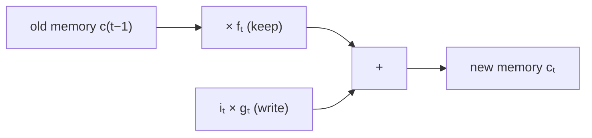

> Tier 5 · Sequence Models · **Level: intermediate** · Reading time: about 8 minutes

# 5.15 Cell state

**Metadata** — Tier: 5 · Phase: 1 · Priority: P0 · Difficulty: 3/5 · Interview: High · Hands-on: High
Prerequisites: 5.14 LSTM · Leads to: 5.16 Forget gate, 5.17 Input gate, 5.18 Output gate

> **In plain words**
> The **cell state** is the LSTM's **long-term memory**: a vector that runs along the whole sequence like a **conveyor belt**. At each step the gates can remove some of it and add some new content, but if they do nothing the belt carries the content **unchanged**. That unchanged path is what lets information (and the learning signal) survive hundreds of steps.

**You need first:** 5.14 LSTM.

> **Figure 5.15-1 — the conveyor belt**
>
> ```mermaid
> flowchart LR
>     C0["c(t−1)"] -->|"× forget gate"| M["+"]
>     N["new content<br/>(input gate × candidate)"] --> M
>     M --> C1["cₜ"]
>     C1 -->|"× forget gate at t+1"| M2["+ …"]
> ```
>
> *How to read it:* the top line is the cell state. At each step it is scaled (by the forget gate) and has new content added. There is no matrix multiplication and no squashing on this line, so a forget gate near 1 passes the memory through almost untouched.
>
> *Generated by:* diagram only. The behaviour of the gates inside a trained LSTM is in Figure 5.16-1.

**Words you'll meet on this page**

| Word | What it means here |
|---|---|
| cell state `cₜ` | the long-term memory vector |
| additive update | new = scaled old + new content |
| constant error carousel | the original name for the unchanged gradient path |
| unbounded | the cell state is not squashed by `tanh`, so it can grow |
| `h` vs `c` | `h = o ⊙ tanh(c)` is the visible part of `c` |
| gradient highway | the path along which gradients flow with factor `f` |
| memory cell | one coordinate of `c` |

### 1. What is it?
The vector `cₜ ∈ ℝ^H` in `cₜ = fₜ ⊙ c_{t-1} + iₜ ⊙ gₜ`. It is internal: the next layer sees only `hₜ = oₜ ⊙ tanh(cₜ)`.

### 2. Why does it exist?
To give gradients an uncluttered route through time. In a vanilla RNN the state is multiplied by `W_hh` and squashed at every step; here the route is `c → f·c`, so the derivative `∂cₜ/∂c_{t-1} = fₜ` is a gate in `(0, 1)` that the model can keep near 1 for as long as the memory is needed.

### 3. Detailed explanation
- **Gradient path.** `∂c_T/∂c_t = Π_{k=t+1}^{T} f_k` (elementwise), so if the forget gates stay around 0.99, the signal after 100 steps is `0.99¹⁰⁰ ≈ 0.37`, versus `~0` for a vanilla RNN (code ②).
- **Why it can still vanish.** If `f` is around 0.9, the product shrinks (0.9¹⁰⁰ ≈ 3×10⁻⁵). That is why the forget-bias initialization trick matters (5.14, 5.16).
- **Why it can grow.** There is no squashing on `c`: with `f ≈ 1` and a steady positive input, `c` can grow without bound; `tanh(c)` in the output keeps `h` bounded. Some designs clip the cell (REVIEW_REQUIRED).
- **One scalar per memory cell.** Each of the `H` coordinates is its own memory cell with its own gates; different cells learn different time scales (some fast, some slow).
- **What gets stored** is learned: a quote opened, a counter, a subject's number (singular/plural) (Karpathy et al., 2015; REVIEW_REQUIRED).
- **Initial state.** `c₀ = 0` (or learned).
- **State returned by libraries:** `(h_n, c_n)`, each `(layers, batch, H)`. Seq2seq models pass both from encoder to decoder (5.20–5.21).
- **GRU (5.19)** merges `c` and `h` into one state.
- **Relation to residual connections:** `c` is to an LSTM what the skip connection is to a ResNet (3.27): an identity-like path that makes depth (here time) trainable.

### 4. How does it work?
`cₜ = fₜ ⊙ c_{t-1} + iₜ ⊙ gₜ`: scale the old memory elementwise, add the new content elementwise.



### 5. Simple example
A train carrying cargo along a track: at each station workers can unload part of the cargo (forget gate) and load new cargo (input gate). If they do neither, the cargo arrives unchanged.

**By hand.** Memory `c = 1`, `f = 0.99`, no writes: after 100 steps `c = 0.99¹⁰⁰ = 0.37`. With `f = 0.9`: `c = 0.00003`.

### 6. Technical example
`out, (h_n, c_n) = lstm(x)`; the decoder of a translation model is initialized with the encoder's `(h_n, c_n)`.

### 7. Code
**① By hand (plain Python).** The conveyor belt, with and without forgetting.

```python
def run(forget, writes):
    c, trace = 0.0, []
    for w in writes:
        c = forget * c + w
        trace.append(round(c, 3))
    return trace

writes = [1.0] + [0.0] * 9                                   # write once at the first step, then nothing
print("forget 0.99:", run(0.99, writes))
print("forget 0.50:", run(0.50, writes))
```

```text
forget 0.99: [1.0, 0.99, 0.98, 0.97, 0.961, 0.951, 0.941, 0.932, 0.923, 0.914]
forget 0.50: [1.0, 0.5, 0.25, 0.125, 0.062, 0.031, 0.016, 0.008, 0.004, 0.002]
```

**② With NumPy.** The gradient along the cell state is a product of forget gates.

```python
import numpy as np

for f in (0.99, 0.95, 0.9):
    path = f ** np.array([10, 50, 100])
    print(f"forget gate {f}: gradient factor after 10, 50, 100 steps = {path[0]:.3g}, {path[1]:.3g}, {path[2]:.3g}")
rng = np.random.default_rng(0)
f_t = rng.uniform(0.9, 1.0, 100)                              # forget gates that vary per step
print("product of 100 varying forget gates (0.9-1.0):", f"{np.prod(f_t):.3g}")
print("a vanilla RNN with factor 0.9 per step (tanh' x W) after 100 steps:", f"{0.9 ** 100:.3g}")
```

```text
forget gate 0.99: gradient factor after 10, 50, 100 steps = 0.904, 0.605, 0.366
forget gate 0.95: gradient factor after 10, 50, 100 steps = 0.599, 0.0769, 0.00592
forget gate 0.9: gradient factor after 10, 50, 100 steps = 0.349, 0.00515, 2.66e-05
product of 100 varying forget gates (0.9-1.0): 0.00934
a vanilla RNN with factor 0.9 per step (tanh' x W) after 100 steps: 2.66e-05
```

**③ With PyTorch.** Both states, their shapes, and the cell state being unbounded.

```python
import torch

torch.manual_seed(0)
lstm = torch.nn.LSTM(4, 8, num_layers=2, batch_first=True)
x = torch.randn(3, 12, 4)
out, (h_n, c_n) = lstm(x)
print("output:", tuple(out.shape), "  h_n:", tuple(h_n.shape), "  c_n:", tuple(c_n.shape), "  (layers, batch, hidden)")

with torch.no_grad():                                          # force a steady positive drive to see the cell state grow
    lstm2 = torch.nn.LSTM(1, 1, batch_first=True)
    for name, p in lstm2.named_parameters():
        p.zero_()
        if name == "bias_ih_l0":
            p[:] = torch.tensor([3.0, 5.0, 2.0, 3.0])          # input gate open, forget gate open, candidate positive, output open
    o, (h, c) = lstm2(torch.zeros(1, 200, 1))
print(f"after 200 steps: cell state c = {c.item():.1f} (unbounded), hidden h = {h.item():.2f} (bounded by tanh)")
```

```text
output: (3, 12, 8)   h_n: (2, 3, 8)   c_n: (2, 3, 8)   (layers, batch, hidden)
after 200 steps: cell state c = 101.4 (unbounded), hidden h = 0.95 (bounded by tanh)
```

### 8. Input → Process → Output
`c(t−1) → ×f → + i·g → cₜ (carried forward; h reads it through o·tanh)`

<details>
<summary><b>Beyond the basics (sections 9–16)</b> — real-world use, limits, mistakes. Skip on a first read.</summary>

### 9. Enterprise use case
Long-horizon forecasting where slowly changing context (seasonality, customer state) must persist.

### 10. AI engineering connection
The additive-memory idea inspired residual streams in Transformers (3.27) and gated linear recurrences (Tier 12).

### 11. Advantages
Stable long-range gradient path; multiple time scales.

### 12. Limitations
Unbounded growth; fixed size; hard to interpret.

### 13. Trade-offs
Longer memory versus capacity and forgetting.

### 14. Common mistakes
Passing only `h` between encoder and decoder; not resetting `c`; assuming `c` is bounded.

### 15. Performance / cost
Twice the state of an RNN (`h` and `c`).

### 16. Security
Carried state can leak across sessions.

</details>

### 17. Interview explanation
"The cell state is the LSTM's long-term memory, updated additively as forget gate times old memory plus input gate times candidate. Its gradient through time is a product of forget gates, not weight matrices, so it can stay near one over many steps; the hidden state is a gated, squashed view of it."

### 18. Rapid-fire answer
`c = f⊙c_prev + i⊙g`; gradient = product of forget gates; unbounded; `h = o⊙tanh(c)` reads it; return `(h_n, c_n)`.

### 19. Interview questions
- **Basic:** What is the difference between `h` and `c`?
- **Intermediate:** Why is the gradient along `c` better than along `h`?
- **Advanced:** What can still go wrong with forget gates around 0.9?
- **Scenario:** Your seq2seq decoder only receives the encoder's `h`. What is lost?

### 20. Hands-on exercise
**Goal:** how close to 1 must the forget gate be?

1. For a memory of 200 steps, what constant forget gate keeps at least 10% of the signal?

<details>
<summary>Show a solution</summary>

```python
steps, keep = 200, 0.10
f = keep ** (1 / steps)
print(f"forget gate must be at least {f:.4f}  (check: {f:.4f}^{steps} = {f ** steps:.2f})")
```

```text
forget gate must be at least 0.9886  (check: 0.9886^200 = 0.10)
```

</details>

### 21. Revision questions
1. What is the cell-state update?
2. What multiplies the gradient along `c`?
3. Why is `h` bounded but `c` not?

### 22. Related concepts
5.14 LSTM · 5.16–5.18 Gates · 5.19 GRU · 3.27 Residual connections

### 23. One-line memory hook
**Cell state: the conveyor belt that carries memory unchanged unless a gate acts.**

<details>
<summary><b>For reviewers</b> (not part of the lesson)</summary>

- Status: DRAFT, learner-first layout (Author: Claude). Code is executed by `tests/test_md_snippets.py`.
- The ③ demonstration sets biases by hand to force growth; it illustrates unboundedness, not trained behaviour. REVIEW_REQUIRED: "constant error carousel" naming, cell clipping remark, character-LSTM interpretability.
</details>
