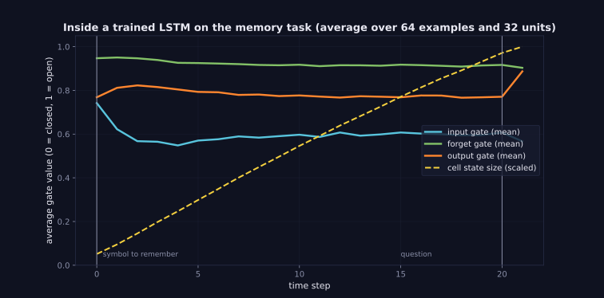
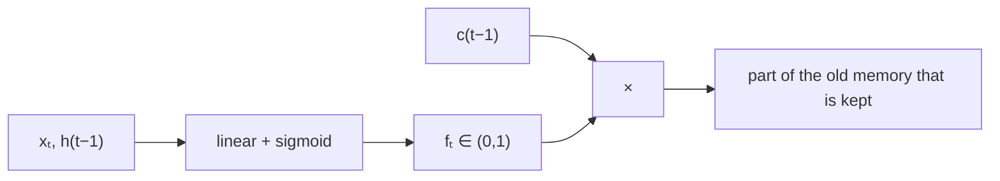

> Tier 5 · Sequence Models · **Level: intermediate** · Reading time: about 8 minutes

# 5.16 Forget gate

**Metadata** — Tier: 5 · Phase: 1 · Priority: P0 · Difficulty: 3/5 · Interview: High · Hands-on: High
Prerequisites: 5.14 LSTM, 5.15 Cell state · Leads to: 5.17 Input gate

> **In plain words**
> The **forget gate** decides, for each memory cell and at each step, **how much of the old memory to keep**. A value of 1 means "keep everything", 0 means "erase". It looks at the current input and the previous output, so it can learn rules like *"a new sentence starts, so forget the old subject"* or *"nothing relevant happened, so keep the number I was holding"*.

**You need first:** 5.14 LSTM, 5.15 Cell state.

> **Figure 5.16-1 — gates inside a trained LSTM on the memory task**
>
> 
>
> *How to read it:* an LSTM trained to remember a symbol across 20 distracting symbols. The curves are gate values averaged over 64 examples and over all 32 memory cells (0 = closed, 1 = open). The forget gate (teal) stays close to 1 during the delay: the memory is kept. The yellow dashed line is the cell-state size. Averages hide the fact that individual cells specialize; the figure shows the typical behaviour.
>
> *Generated by* `tier-05-sequence-models/figures/src/t5_figures.py` using `lstm_cell` from `code/seqmodels.py` on a trained model.

**Words you'll meet on this page**

| Word | What it means here |
|---|---|
| forget gate `fₜ` | per-cell keep factor in (0, 1) |
| sigmoid | squashes any number into (0, 1) |
| keep / erase | `f ≈ 1` / `f ≈ 0` |
| forget-gate bias | the constant added before the sigmoid |
| time scale | how long a cell tends to remember (set by typical `f`) |
| leaky memory | `f < 1` gradually fades old content |
| `W_f` | the forget gate's weights |

### 1. What is it?
`fₜ = σ(W_f [xₜ, h_{t-1}] + b_f)`, applied elementwise to the old cell state: `fₜ ⊙ c_{t-1}`.

### 2. Why does it exist?
Without a way to erase, the cell state would just accumulate everything. The original LSTM (1997) had only input and output gates; the forget gate was added by Gers et al. (2000) after it became clear that memory must be reset, for example at the start of a new sequence or topic (REVIEW_REQUIRED: attribution).

### 3. Detailed explanation
- **Role in the gradient.** `∂cₜ/∂c_{t-1} = fₜ`. Keeping `f` near 1 where memory matters is what lets gradients flow (5.15).
- **Context-dependent.** The gate sees `xₜ` and `h_{t-1}`: it can erase when a delimiter (a period, an end-of-document token) appears and keep otherwise.
- **Per cell.** Each of the `H` cells has its own `f`; some cells have `f ≈ 1` almost always (slow, long-term), others flip often (fast, local).
- **Bias initialization.** `b_f = 1` gives `σ(1) = 0.73` at the start; with zero weights the cell begins by remembering rather than forgetting (Jozefowicz et al., 2015). Some use larger values (2–5) for very long dependencies. The memory-task results in 5.14 depend on this trick.
- **Saturation.** If pre-activations are very large or small, `f` saturates at 1 or 0 and learning of that gate stalls (sigmoid slope, 3.10).
- **Effective memory length.** With a steady forget value `f`, the memory halves every `ln 2 / (−ln f)` steps (`f = 0.99` → 69 steps; `f = 0.9` → 6.6 steps; code ②).
- **Peeking.** Gate activations are inspectable: plotting `f` over a text shows where the model resets.
- **GRU analogue.** The update gate `z` plays the combined role of forget and input gate (5.19).
- **Degenerate cases.** `f ≡ 1`: pure accumulator (no forgetting, memory saturates). `f ≡ 0`: no memory (a feed-forward net on the current input).

### 4. How does it work?
Compute `f` from the current input and previous output, multiply the old cell state by it.



### 5. Simple example
A shopkeeper's whiteboard of today's special offers: at closing time they erase it (f = 0), during the day they keep it (f = 1), and a change of one item erases just that line.

**By hand.** A hand-built cell that stores a number, and erases it when a "reset" flag arrives: `f = 1` normally, `f = 0` when `reset = 1`.

### 6. Technical example
In language models some cells' forget gates drop to 0 at sentence boundaries and stay near 1 inside a sentence (an observed pattern; REVIEW_REQUIRED).

### 7. Code
**① By hand (plain Python).** A memory cell with a reset-controlled forget gate.

```python
import math
sigmoid = lambda z: 1 / (1 + math.exp(-z))

c = 0.0
stream = [  # (value to store, reset flag)
    (1.0, 0), (0.0, 0), (0.0, 0), (0.0, 1), (0.5, 0), (0.0, 0)]
for t, (value, reset) in enumerate(stream, start=1):
    f = sigmoid(10 - 20 * reset)                            # hand-set weights: reset=0 -> f≈1 (keep), reset=1 -> f≈0 (erase)
    i = 1.0 if value != 0 else 0.0                          # write only when there is something to write
    c = f * c + i * value
    print(f"t={t}  reset={reset}  forget gate={f:.2f}  cell state={c:.2f}")
```

```text
t=1  reset=0  forget gate=1.00  cell state=1.00
t=2  reset=0  forget gate=1.00  cell state=1.00
t=3  reset=0  forget gate=1.00  cell state=1.00
t=4  reset=1  forget gate=0.00  cell state=0.00
t=5  reset=0  forget gate=1.00  cell state=0.50
t=6  reset=0  forget gate=1.00  cell state=0.50
```

**② With NumPy.** How long does a given forget value remember?

```python
import numpy as np

for f in (0.5, 0.9, 0.99, 0.999):
    half_life = np.log(2) / -np.log(f)
    print(f"forget gate {f:>5}: memory halves every {half_life:8.1f} steps;  fraction left after 100 steps = {f ** 100:.3g}")
sig = lambda z: 1 / (1 + np.exp(-z))
print("initial forget gate with bias 0:", round(float(sig(0.0)), 2), "   bias 1:", round(float(sig(1.0)), 2), "   bias 3:", round(float(sig(3.0)), 2))
```

```text
forget gate   0.5: memory halves every      1.0 steps;  fraction left after 100 steps = 7.89e-31
forget gate   0.9: memory halves every      6.6 steps;  fraction left after 100 steps = 2.66e-05
forget gate  0.99: memory halves every     69.0 steps;  fraction left after 100 steps = 0.366
forget gate 0.999: memory halves every    692.8 steps;  fraction left after 100 steps = 0.905
initial forget gate with bias 0: 0.5    bias 1: 0.73    bias 3: 0.95
```

**③ With PyTorch.** The forget-gate bias decides how far the learning signal reaches at initialization.

```python
import torch

def signal_to_first_input(forget_bias, T=60, H=16, seed=0):
    torch.manual_seed(seed)
    lstm = torch.nn.LSTM(4, H, batch_first=True)
    for name, p in lstm.named_parameters():
        if name.startswith("bias"):
            p.data[H:2 * H] = forget_bias / 2                               # bias_ih and bias_hh both add: total = forget_bias
    x = torch.randn(1, T, 4, requires_grad=True)
    lstm(x)[0][:, -1].pow(2).sum().backward()
    return x.grad[0, 0].norm().item() / x.grad[0, -1].norm().item()

for b in (0.0, 1.0, 2.0, 4.0):
    print(f"forget-gate bias {b}: gradient reaching input 0 relative to the last = {signal_to_first_input(b):.1e}")
```

```text
forget-gate bias 0.0: gradient reaching input 0 relative to the last = 1.6e-13
forget-gate bias 1.0: gradient reaching input 0 relative to the last = 1.1e-06
forget-gate bias 2.0: gradient reaching input 0 relative to the last = 1.1e-01
forget-gate bias 4.0: gradient reaching input 0 relative to the last = 1.5e+00
```

### 8. Input → Process → Output
`xₜ, h(t−1) → σ(W·[…] + b) → fₜ → keep fₜ of the old memory`

<details>
<summary><b>Beyond the basics (sections 9–16)</b> — real-world use, limits, mistakes. Skip on a first read.</summary>

### 9. Enterprise use case
Per-customer behaviour models where "reset on new session" must be learned.

### 10. AI engineering connection
Data-dependent decay is the core of modern gated recurrences (Mamba-style selective state spaces; Tier 12).

### 11. Advantages
Learned, context-dependent forgetting; protects the gradient path.

### 12. Limitations
Saturation; one scalar per cell, not per feature; small risk of forgetting too eagerly.

### 13. Trade-offs
High `f` for long memory versus the need to adapt quickly.

### 14. Common mistakes
Forgetting the bias trick; interpreting a gate average as a single-cell behaviour; not resetting state at sequence boundaries.

### 15. Performance / cost
One of four matrix products in the cell.

### 16. Security
No direct issue.

</details>

### 17. Interview explanation
"The forget gate is a sigmoid of the current input and previous output that scales the old cell state elementwise. Its value is also the factor by which the gradient flows back along the cell state, so I initialize its bias to 1 to start with memory, and it learns to drop to zero at boundaries where context should reset."

### 18. Rapid-fire answer
`f = σ(W[x,h] + b)`; scales `c_prev`; `∂c/∂c_prev = f`; init bias ≈ 1; learned resets.

### 19. Interview questions
- **Basic:** What does the forget gate do?
- **Intermediate:** Why initialize its bias to 1?
- **Advanced:** What is the memory half-life for a forget gate of 0.95?
- **Scenario:** Your LSTM cannot learn dependencies beyond ~20 steps. What do you try?

### 20. Hands-on exercise
**Goal:** half-lives.

1. For `f = 0.95, 0.98, 0.995`, find the number of steps after which half of the memory remains.

<details>
<summary>Show a solution</summary>

```python
import math

for f in (0.95, 0.98, 0.995):
    print(f"f = {f}: half of the memory remains after {math.log(0.5) / math.log(f):.1f} steps")
```

```text
f = 0.95: half of the memory remains after 13.5 steps
f = 0.98: half of the memory remains after 34.3 steps
f = 0.995: half of the memory remains after 138.3 steps
```

</details>

### 21. Revision questions
1. What does `f = 1` mean?
2. How is `f` computed?
3. What does the bias trick do?

### 22. Related concepts
5.14 LSTM · 5.15 Cell state · 5.17 Input gate · 5.19 GRU · 3.10 Sigmoid

### 23. One-line memory hook
**Forget gate: the eraser, with a learned rule for when to use it.**

<details>
<summary><b>For reviewers</b> (not part of the lesson)</summary>

- Status: DRAFT, learner-first layout (Author: Claude). Code is executed by `tests/test_md_snippets.py`.
- REVIEW_REQUIRED: Gers, Schmidhuber & Cummins 2000 attribution; Jozefowicz et al. 2015; sentence-boundary observation; the selective-state-space remark.
</details>
