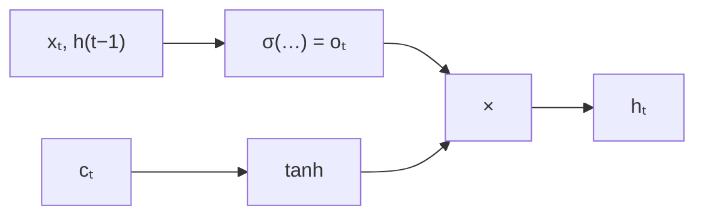

> Tier 5 · Sequence Models · **Level: intermediate** · Reading time: about 7 minutes

# 5.18 Output gate

**Metadata** — Tier: 5 · Phase: 1 · Priority: P0 · Difficulty: 3/5 · Interview: Medium · Hands-on: Medium
Prerequisites: 5.15 Cell state, 5.17 Input gate · Leads to: 5.19 GRU

> **In plain words**
> The **output gate** decides **how much of the long-term memory to reveal** to the rest of the network at this step. The cell can *hold* information without *using* it: memory stays safely inside until the output gate opens. The visible output is `h = o ⊙ tanh(c)`: the memory, squashed to a tidy range and scaled by the gate.

**You need first:** 5.15 Cell state, 5.17 Input gate.

> **Figure 5.18-1 — hold now, reveal later**
>
> ```mermaid
> flowchart LR
>     C["cell state cₜ<br/>(long-term memory)"] --> T["tanh(cₜ)<br/>squash to (−1, 1)"]
>     O["output gate oₜ = σ(W[xₜ, h(t−1)] + b)"] --> M["×"]
>     T --> M
>     M --> H["hₜ: what the next layer<br/>and the next step see"]
> ```
>
> *How to read it:* the memory itself (left) is never exposed directly. A gate between 0 and 1 scales its squashed version. With the gate closed `h ≈ 0` even though the memory is full; the information is kept for later. In Figure 5.16-1 the output gate (orange) is high at the end, when the model must answer.
>
> *Generated by:* diagram; gate averages from a trained LSTM are in Figure 5.16-1.

**Words you'll meet on this page**

| Word | What it means here |
|---|---|
| output gate `oₜ` | how much of the memory to show, in (0, 1) |
| hidden state `hₜ` | the visible output `oₜ ⊙ tanh(cₜ)` |
| expose | let the memory influence the next layer |
| hold | keep information internal and unused |
| `tanh(c)` | squashes the unbounded cell state |
| readout | the layer that turns `hₜ` into a prediction |
| selective attention to memory | which memory cells matter right now |

### 1. What is it?
`oₜ = σ(W_o [xₜ, h_{t-1}] + b_o)` and `hₜ = oₜ ⊙ tanh(cₜ)`.

### 2. Why does it exist?
Information that must be remembered is not always information that should affect the current output. A model may need to hold a name for 50 steps without it influencing the next-word guess until the right moment. The output gate separates storing from using. It also protects later layers from the unbounded cell state.

### 3. Detailed explanation
- **`h` feeds everything else.** The next time step's gates (via `h_{t-1}`), the next layer and the output layer all read `hₜ`, not `cₜ`. So the output gate controls what the model's *other* parts can see of its memory.
- **Squashing.** `tanh(c)` bounds the output even if `c` has grown (5.15).
- **Per cell.** Each memory cell is revealed independently: at a given step some cells are visible, others hidden.
- **Dynamic:** the gate depends on the current input and previous output, so a *question* token can open the gate that reveals a stored answer (code ②).
- **Gradient.** `∂hₜ/∂cₜ = oₜ ⊙ (1 − tanh²(cₜ))`. A closed gate blocks gradient from reaching the cell at this step, but the cell state's own path through the forget gate is untouched.
- **Initial value.** Bias 0 gives about 0.5; some implementations use a negative bias to start hidden.
- **Ablations.** Studies found that the forget gate and output activation matter most for performance; removing the output gate hurts less in some tasks (Greff et al., 2017; REVIEW_REQUIRED). GRUs have no output gate (5.19).
- **Seq2seq:** the final `h` (and `c`) summarize the input for the decoder (5.20–5.21).
- **Visible versus latent.** Think of `c` as the model's private memory and `h` as what it says out loud.

### 4. How does it work?
Compute the gate from the current input and previous output; squash the memory with `tanh`; multiply.



### 5. Simple example
A safe with a window: the contents (cell state) are inside; the window (output gate) opens only when the owner asks "what's in there?".

**By hand.** Memory `c = 1.5`, `tanh(1.5) = 0.905`. Gate `o = 0.9` → `h = 0.81`; gate `o = 0.05` → `h = 0.05`: the memory is still 1.5 inside.

### 6. Technical example
A model reading "The keys to the cabinet … are" keeps "keys: plural" in the cell for many words, but only the position just before the verb opens the gate that reveals it for the agreement decision.

### 7. Code
**① By hand (plain Python).** The same memory, shown or hidden.

```python
import math

c = 1.5
for o in (0.9, 0.5, 0.05):
    print(f"output gate {o:>4}: h = {o} * tanh({c}) = {o * math.tanh(c):.3f}   (the memory itself is still {c})")
```

```text
output gate  0.9: h = 0.9 * tanh(1.5) = 0.815   (the memory itself is still 1.5)
output gate  0.5: h = 0.5 * tanh(1.5) = 0.453   (the memory itself is still 1.5)
output gate 0.05: h = 0.05 * tanh(1.5) = 0.045   (the memory itself is still 1.5)
```

**② With NumPy.** A memory cell that stores a value and reveals it only on a "query".

```python
import numpy as np

sig = lambda z: 1 / (1 + np.exp(-z))
# input x = [value, write_flag, query_flag]
stream = [(1.0, 1, 0), (0.3, 0, 0), (-0.4, 0, 0), (0.0, 0, 1), (0.2, 0, 0), (0.0, 0, 1)]
c = 0.0
for t, (value, write, query) in enumerate(stream, start=1):
    f = sig(10 - 20 * write)                   # keep the memory unless we write
    i = sig(20 * write - 10)                   # write only when flagged
    o = sig(20 * query - 10)                   # reveal only on a query
    c = f * c + i * np.tanh(value)
    h = o * np.tanh(c)
    print(f"t={t}  write={write} query={query}  cell state={c:+.2f}  output gate={o:.2f}  visible h={h:+.2f}")
```

```text
t=1  write=1 query=0  cell state=+0.76  output gate=0.00  visible h=+0.00
t=2  write=0 query=0  cell state=+0.76  output gate=0.00  visible h=+0.00
t=3  write=0 query=0  cell state=+0.76  output gate=0.00  visible h=+0.00
t=4  write=0 query=1  cell state=+0.76  output gate=1.00  visible h=+0.64
t=5  write=0 query=0  cell state=+0.76  output gate=0.00  visible h=+0.00
t=6  write=0 query=1  cell state=+0.76  output gate=1.00  visible h=+0.64
```

**③ With PyTorch.** `h` is bounded by the gate and `tanh`; `c` is not.

```python
import torch

torch.manual_seed(0)
lstm = torch.nn.LSTM(3, 6, batch_first=True)
x = torch.randn(4, 50, 3) * 3
out, (h, c) = lstm(x)
print("max |h| over all steps (bounded by tanh and the gate):", round(out.abs().max().item(), 3))
print("max |c| at the last step                           :", round(c.abs().max().item(), 3), "(not bounded by 1)")
print("every h value lies in (-1, 1):", bool(out.abs().max() < 1))
```

```text
max |h| over all steps (bounded by tanh and the gate): 0.659
max |c| at the last step                           : 1.364 (not bounded by 1)
every h value lies in (-1, 1): True
```

### 8. Input → Process → Output
`cₜ → tanh → × oₜ → hₜ (visible)`

<details>
<summary><b>Beyond the basics (sections 9–16)</b> — real-world use, limits, mistakes. Skip on a first read.</summary>

### 9. Enterprise use case
Models that track state silently and only report when asked (monitoring, dialogue state).

### 10. AI engineering connection
Separating storage from readout recurs in memory-augmented networks and in attention (queries decide what to read, Tier 7).

### 11. Advantages
Decouples memory from output; bounded output.

### 12. Limitations
Extra parameters; benefit varies by task.

### 13. Trade-offs
More control versus more computation; GRU drops it.

### 14. Common mistakes
Reading `c` instead of `h`; assuming `h` equals the memory; forgetting that `h` is bounded.

### 15. Performance / cost
One of four gate computations.

### 16. Security
Hidden memory can still influence behaviour later; clear it between users.

</details>

### 17. Interview explanation
"The output gate scales the squashed cell state to produce the visible hidden state `h = o ⊙ tanh(c)`. It lets the LSTM store information internally without it affecting predictions until needed, and keeps `h` bounded."

### 18. Rapid-fire answer
`h = o⊙tanh(c)`; separates storing from using; `h` bounded, `c` not; GRU has no output gate.

### 19. Interview questions
- **Basic:** What does the output gate control?
- **Intermediate:** Why does the LSTM apply `tanh` to `c` before the gate?
- **Advanced:** What is the effect of removing the output gate?
- **Scenario:** Your LSTM "knows" the answer inside `c` but predictions are wrong. What may be happening?

### 20. Hands-on exercise
**Goal:** make a cell that reveals only on even steps.

1. Hand-set `o = σ(20·(t mod 2 == 0) − 10)`, constant memory `c = 1`.
2. Print `h` for 6 steps.

<details>
<summary>Show a solution</summary>

```python
import math
sig = lambda z: 1 / (1 + math.exp(-z))
c = 1.0
for t in range(1, 7):
    o = sig(20 * (t % 2 == 0) - 10)
    print(f"t={t}  output gate={o:.2f}  h={o * math.tanh(c):.2f}")
```

```text
t=1  output gate=0.00  h=0.00
t=2  output gate=1.00  h=0.76
t=3  output gate=0.00  h=0.00
t=4  output gate=1.00  h=0.76
t=5  output gate=0.00  h=0.00
t=6  output gate=1.00  h=0.76
```

</details>

### 21. Revision questions
1. Write `h` in terms of `c` and `o`.
2. Why is `h` bounded?
3. Which state is passed to the next layer?

### 22. Related concepts
5.14 LSTM · 5.15 Cell state · 5.17 Input gate · 5.19 GRU · Tier 7 Attention

### 23. One-line memory hook
**Output gate: keep the memory in the safe, open the window only when asked.**

<details>
<summary><b>For reviewers</b> (not part of the lesson)</summary>

- Status: DRAFT, learner-first layout (Author: Claude). Code is executed by `tests/test_md_snippets.py`.
- REVIEW_REQUIRED: Greff et al. 2017 ablation conclusions; agreement example.
</details>
