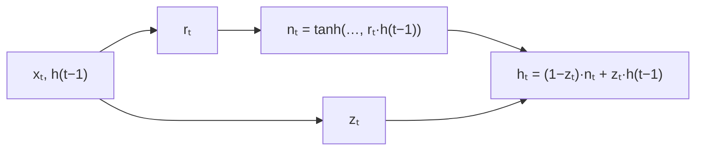

> Tier 5 · Sequence Models · **Level: intermediate** · Reading time: about 9 minutes

# 5.19 GRU (gated recurrent unit)

**Metadata** — Tier: 5 · Phase: 1 · Priority: P0 · Difficulty: 3/5 · Interview: High · Hands-on: High
Prerequisites: 5.14 LSTM, 5.15–5.18 · Leads to: 5.20 Encoder-decoder

> **In plain words**
> The **GRU** (Cho et al., 2014) is a **lighter LSTM**: it merges the long-term and short-term memories into **one state** and uses **two gates** instead of three. The **update gate** decides how much of the old state to keep versus replace with new content (it combines the roles of the forget and input gates); the **reset gate** decides how much of the old state to use when proposing new content. About 25% fewer parameters than an LSTM and often just as good.

**You need first:** 5.14 LSTM, 5.15–5.18 (gates).

> **Figure 5.19-1 — GRU versus LSTM**
>
> ```mermaid
> flowchart LR
>     subgraph GRU["GRU: one state, two gates"]
>     G1["h(t−1)"] --> G2["reset gate r"]
>     G1 --> G3["update gate z"]
>     G2 --> G4["candidate n"]
>     G3 --> G5["hₜ = (1−z)·n + z·h(t−1)"]
>     G4 --> G5
>     end
>     subgraph LSTM["LSTM: two states, three gates"]
>     L1["c, h"] --> L2["forget f"]
>     L1 --> L3["input i"]
>     L1 --> L4["output o"]
>     end
> ```
>
> *How to read it:* the GRU's `hₜ` is a **blend** of the old state and a new candidate, controlled by one gate `z`: `z` near 1 means "keep the old state" (long memory, like a forget gate at 1), `z` near 0 means "replace it". There is no separate cell state and no output gate: the state is exposed directly.

**Words you'll meet on this page**

| Word | What it means here |
|---|---|
| update gate `zₜ` | how much of the old state to keep |
| reset gate `rₜ` | how much of the old state feeds the candidate |
| candidate `nₜ` | proposed new state |
| blend | `hₜ = (1 − zₜ)⊙nₜ + zₜ⊙h_{t-1}` |
| coupled gates | one gate does both keep and write |
| parameter count | `3(d_in·H + H² + H)` (×1 bias set in theory) |
| Cho et al. | introduced the GRU with the encoder-decoder (2014) |

### 1. What is it?
`rₜ = σ(W_r[xₜ, h_{t-1}])`, `zₜ = σ(W_z[xₜ, h_{t-1}])`, `nₜ = tanh(W_n xₜ + rₜ⊙(U_n h_{t-1}))`, `hₜ = (1 − zₜ)⊙nₜ + zₜ⊙h_{t-1}` (PyTorch's convention for the blend).

### 2. Why does it exist?
The LSTM works but is heavy. The GRU keeps its key idea (a gated, additive path for the state) with fewer parts, making training faster and sometimes better on small data.

### 3. Detailed explanation
- **The blend is the memory path.** If `zₜ ≈ 1`, then `hₜ ≈ h_{t-1}`: the state is copied and the gradient `∂hₜ/∂h_{t-1} ≈ 1` flows unharmed, like the LSTM's forget path (5.15).
- **Reset gate.** When `r ≈ 0` the candidate ignores the old state, so the unit can start afresh on new content; when `r ≈ 1` it behaves like a vanilla RNN update.
- **One state.** No hidden/cell distinction, no output gate; all of `hₜ` is visible to the next layer, so there is no way to hold memory silently as the LSTM's output gate allows.
- **Size.** 3 gate-like blocks versus 4: for input 128, hidden 256 the GRU has 296,448 parameters versus 395,264 for the LSTM (5.14 exercise).
- **Performance.** On many tasks GRU ≈ LSTM; on tasks needing very precise counting or long memory, the LSTM sometimes wins; on small datasets the GRU can win (Chung et al., 2014; REVIEW_REQUIRED). In the memory test of 5.14 (Figure 5.14-1) the GRU remembered longer than a vanilla RNN but less than the LSTM with an open forget bias.
- **Initialization.** The update gate's bias plays the role of the LSTM forget bias: a positive value starts the GRU in "keep" mode (in PyTorch the bias layout is reset, update, new).
- **Variants.** Minimal gated unit (one gate), Light GRU for speech.
- **Use.** Seq2seq encoder-decoders (the original use), speech recognition, small language models, where speed matters.
- **Compared with Transformers:** both gated recurrence and attention provide short paths; recurrence is sequential.

### 4. How does it work?
Compute reset and update gates from the input and previous state; propose a candidate using the reset-scaled old state; blend old state and candidate.



### 5. Simple example
A whiteboard where, at each step, you decide one thing: *how much of the board to keep as it is* (`z`) and fill the rest with new writing based on what you remember (`r` says how much of the board you consult while thinking).

**By hand.** Old state `h = 0.8`, candidate `n = −0.2`. `z = 0.9` → `h_new = 0.1·(−0.2) + 0.9·0.8 = 0.70`; `z = 0.1` → `0.9·(−0.2) + 0.1·0.8 = −0.10`.

### 6. Technical example
`nn.GRU(input_size=256, hidden_size=512, num_layers=2, bidirectional=True)` as the encoder of an early neural machine-translation system.

### 7. Code
**① By hand (plain Python).** One scalar GRU step with chosen gates.

```python
import math
sigmoid = lambda z: 1 / (1 + math.exp(-z))

h_prev, x = 0.8, 1.0
r = sigmoid(0.5 * x - 1.0 * h_prev)                       # reset gate
z = sigmoid(1.0 * x + 1.0 * h_prev)                       # update gate
n = math.tanh(0.7 * x + r * (0.6 * h_prev))               # candidate uses the reset-scaled old state
h = (1 - z) * n + z * h_prev
print(f"reset {r:.2f}  update {z:.2f}  candidate {n:.2f}")
print(f"new state = (1 - {z:.2f}) * {n:.2f} + {z:.2f} * {h_prev} = {h:.3f}")
```

```text
reset 0.43  update 0.86  candidate 0.72
new state = (1 - 0.86) * 0.72 + 0.86 * 0.8 = 0.788
```

**② With NumPy.** The GRU equations on vectors, checked against PyTorch.

```python
import numpy as np
import torch

torch.manual_seed(0)
m = torch.nn.GRU(3, 5, batch_first=True); x = torch.randn(2, 4, 3)
ref, _ = m(x)
Wih, Whh, bih, bhh = [p.detach().numpy() for p in (m.weight_ih_l0, m.weight_hh_l0, m.bias_ih_l0, m.bias_hh_l0)]
sig = lambda z: 1 / (1 + np.exp(-z))
h = np.zeros((2, 5)); outs = []
for t in range(4):
    gi, gh = x[:, t].numpy() @ Wih.T + bih, h @ Whh.T + bhh
    ir, iz, in_ = np.split(gi, 3, axis=-1); hr, hz, hn = np.split(gh, 3, axis=-1)
    r, z = sig(ir + hr), sig(iz + hz)
    n = np.tanh(in_ + r * hn)
    h = (1 - z) * n + z * h; outs.append(h)
print("matches torch.nn.GRU:", np.allclose(np.stack(outs, 1), ref.detach().numpy(), atol=1e-6))
print("parameters  GRU:", sum(p.numel() for p in m.parameters()), "  LSTM:", sum(p.numel() for p in torch.nn.LSTM(3, 5).parameters()), "  RNN:", sum(p.numel() for p in torch.nn.RNN(3, 5).parameters()))
```

```text
matches torch.nn.GRU: True
parameters  GRU: 150   LSTM: 200   RNN: 50
```

**③ With PyTorch.** A GRU and an LSTM learn the same small task; compare size and result.

```python
import torch
from torch import nn

def run(kind, seed=0):
    torch.manual_seed(seed)
    emb, rnn, head = nn.Embedding(10, 16), {"gru": nn.GRU, "lstm": nn.LSTM}[kind](16, 32, batch_first=True), nn.Linear(32, 10)
    if kind == "lstm":
        for name, p in rnn.named_parameters():
            if name.startswith("bias"):
                p.data[32:64] = 1.0                                              # the usual forget-gate bias trick, to be fair to the LSTM
    params = [*emb.parameters(), *rnn.parameters(), *head.parameters()]
    opt = torch.optim.Adam(params, lr=0.01)
    def batch(n):
        x = torch.randint(0, 10, (n, 12)); return x, x[:, 0]                  # remember the first digit across 11 distractors
    for _ in range(600):
        x, y = batch(64); loss = nn.functional.cross_entropy(head(rnn(emb(x))[0][:, -1]), y)
        opt.zero_grad(); loss.backward(); nn.utils.clip_grad_norm_(params, 1.0); opt.step()
    x, y = batch(1000)
    with torch.no_grad():
        return (head(rnn(emb(x))[0][:, -1]).argmax(1) == y).float().mean().item(), sum(p.numel() for p in rnn.parameters())

for kind in ("gru", "lstm"):
    acc, n = run(kind)
    print(f"{kind.upper():<5}: recurrent parameters {n:>5,}   accuracy remembering the first of 12 digits {acc:.2f}   (chance 0.10)")
```

```text
GRU  : recurrent parameters 4,800   accuracy remembering the first of 12 digits 1.00   (chance 0.10)
LSTM : recurrent parameters 6,400   accuracy remembering the first of 12 digits 1.00   (chance 0.10)
```

### 8. Input → Process → Output
`xₜ, h(t−1) → r, z → candidate n → hₜ = (1−z)n + z·h(t−1)`

<details>
<summary><b>Beyond the basics (sections 9–16)</b> — real-world use, limits, mistakes. Skip on a first read.</summary>

### 9. Enterprise use case
Speed-sensitive sequence models on devices; fast baselines.

### 10. AI engineering connection
The coupled "keep or replace" gate resembles the gating in modern linear recurrences and in highway/residual networks (Tier 12).

### 11. Advantages
Fewer parameters, faster, strong on small data.

### 12. Limitations
No silent memory (no output gate); sometimes weaker than an LSTM on very long dependencies.

### 13. Trade-offs
Speed and size versus the LSTM's expressiveness.

### 14. Common mistakes
Assuming GRU gate conventions are identical across frameworks (the blend may be written `z·n + (1−z)·h`); forgetting to reset state; unclipped gradients.

### 15. Performance / cost
About 75% of an LSTM's compute and parameters.

### 16. Security
As other RNNs: reset state between users.

</details>

### 17. Interview explanation
"A GRU has a single state and two gates: the update gate blends the old state with a candidate, so a gate near one copies the state and passes gradients unchanged, and the reset gate controls how much of the old state is used to form the candidate. It has about 25% fewer parameters than an LSTM and usually performs similarly."

### 18. Rapid-fire answer
One state; reset `r`, update `z`; `h = (1−z)·n + z·h_prev`; ~25% fewer parameters than LSTM; no output gate.

### 19. Interview questions
- **Basic:** How many gates does a GRU have and what are they?
- **Intermediate:** How does the update gate relate to the LSTM's forget and input gates?
- **Advanced:** Why is there no way for a GRU to hide its memory?
- **Scenario:** You need a faster recurrent model with similar accuracy. What do you try?

### 20. Hands-on exercise
**Goal:** verify the 3:4 ratio.

1. For several hidden sizes, compute the ratio of GRU to LSTM parameters (input 64).

<details>
<summary>Show a solution</summary>

```python
import torch

for H in (32, 128, 512):
    gru = sum(p.numel() for p in torch.nn.GRU(64, H).parameters())
    lstm = sum(p.numel() for p in torch.nn.LSTM(64, H).parameters())
    print(f"hidden {H:>3}: GRU {gru:>9,}  LSTM {lstm:>9,}  ratio {gru / lstm:.2f}")
```

```text
hidden  32: GRU     9,408  LSTM    12,544  ratio 0.75
hidden 128: GRU    74,496  LSTM    99,328  ratio 0.75
hidden 512: GRU   887,808  LSTM 1,183,744  ratio 0.75
```

</details>

### 21. Revision questions
1. What do `r` and `z` do?
2. Write the state update.
3. How does the GRU differ from the LSTM?

### 22. Related concepts
5.14 LSTM · 5.15 Cell state · 5.16–5.18 Gates · 5.20 Encoder-decoder · 3.27 Residual connections

### 23. One-line memory hook
**GRU: an LSTM on a diet: one state, two gates, and a blend of old and new.**

<details>
<summary><b>For reviewers</b> (not part of the lesson)</summary>

- Status: DRAFT, learner-first layout (Author: Claude). Code is executed by `tests/test_md_snippets.py`.
- TESTED earlier: `code/test_seqmodels.py::test_gru_cell_matches_torch`.
- REVIEW_REQUIRED: Cho et al. 2014 and Chung et al. 2014 attributions and conclusions; the blend-convention remark.
</details>
