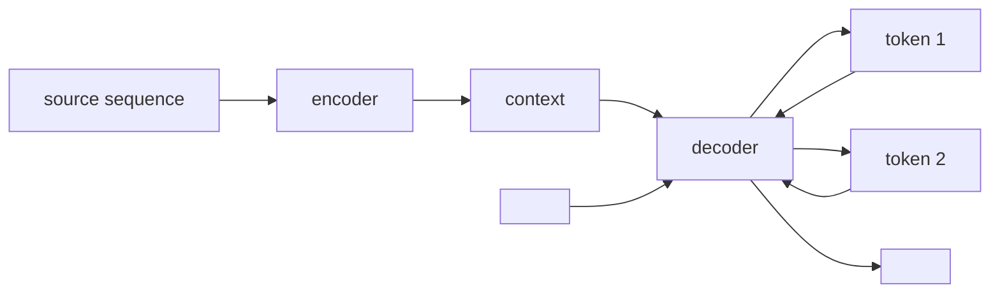

> Tier 5 · Sequence Models · **Level: intermediate** · Reading time: about 9 minutes

# 5.20 Encoder-decoder

**Metadata** — Tier: 5 · Phase: 1 · Priority: P0 · Difficulty: 3/5 · Interview: Very high · Hands-on: High
Prerequisites: 5.14 LSTM or 5.19 GRU · Leads to: 5.21 Seq2Seq, 5.24 Bahdanau attention

> **In plain words**
> Many tasks turn **one sequence into another of a different length**: a French sentence into an English sentence, a long article into a short summary. The **encoder-decoder** design uses two networks: an **encoder** reads the whole input and squeezes it into a summary (a vector); a **decoder** starts from that summary and **writes the output one token at a time**. It is the architecture behind early neural machine translation, and still the shape of T5, Whisper and many modern models.

**You need first:** 5.14 LSTM or 5.19 GRU.

> **Figure 5.20-1 — read everything, then write**
>
> ```mermaid
> flowchart LR
>     subgraph Encoder
>     X1["x₁"] --> E1["RNN"] --> E2["RNN"] --> E3["RNN"]
>     X2["x₂"] --> E2
>     X3["x₃"] --> E3
>     end
>     E3 -->|"context vector<br/>(final state)"| D1
>     subgraph Decoder
>     D1["RNN"] --> D2["RNN"] --> D3["RNN"]
>     D1 --> Y1["y₁"]
>     D2 --> Y2["y₂"]
>     D3 --> Y3["y₃"]
>     end
> ```
>
> *How to read it:* the encoder consumes `x₁…x₃` and hands over only its **final state**. The decoder is initialized with it and produces `y₁, y₂, y₃`, feeding each output back as the next input. The input and output may have different lengths and even different vocabularies.

**Words you'll meet on this page**

| Word | What it means here |
|---|---|
| encoder | network that reads the input and builds a representation |
| decoder | network that generates the output step by step |
| context vector | the fixed-size summary passed between them |
| `<bos>` / `<eos>` | start-of-output and end-of-output tokens |
| autoregressive | each output token is fed back as the next input |
| bottleneck | everything must fit through the context vector |
| conditional language model | a language model of the output given the input |

### 1. What is it?
A model `P(y₁…y_m | x₁…x_n)` built from two RNNs (or later Transformers): `context = Encoder(x)`, then `yₜ ~ Decoder(y_{<t}, context)`.

### 2. Why does it exist?
A single RNN producing one output per input step cannot change length or reorder (translation changes word order, summaries are shorter). Splitting reading from writing lets the output be any length and structure (Sutskever et al., 2014; Cho et al., 2014).

### 3. Detailed explanation
- **Encoder.** Runs over `x₁…x_n`; its last hidden (and cell) state is the context. (Often bidirectional.)
- **Decoder.** A conditional language model (5.2): starts with `<bos>`, repeatedly predicts the next token given the previous output token and its own state, until it emits `<eos>`.
- **Training.** The decoder receives the *true* previous token (teacher forcing, 5.22); loss is cross-entropy at each step (4.3).
- **Inference.** The decoder feeds on its *own* predictions: greedy or beam search (5.21).
- **The bottleneck.** A fixed-size vector must carry the whole input. Quality drops for long inputs (Figure 5.21-1 at length 16 shows a plain encoder-decoder failing). Attention (5.24–5.25) lets the decoder look back at all encoder states.
- **Tricks from the original papers:** reverse the source sentence (puts the first words close to the first outputs); use deep (4-layer) LSTMs.
- **Different modalities.** The encoder can be a CNN (image captioning), an audio network (speech recognition) or a Transformer; the decoder is usually autoregressive.
- **Modern descendants.** The Transformer was introduced as an encoder-decoder (Tier 8); T5/BART keep the shape; decoder-only LLMs drop the encoder.
- **Variable lengths** are handled by `<eos>`: the decoder decides when to stop.
- **Evaluation.** BLEU/ROUGE for text, word-error rate for speech (Tier 15), and exact match on toy tasks.
- **Memory.** Encoder states for each input position are kept only if attention is used.

### 4. How does it work?
Encode the input into a state; initialize the decoder with it; generate token by token, each time feeding the previous token and the decoder state, until `<eos>`.



### 5. Simple example
A human interpreter: they listen to the whole sentence (encode), hold the gist in their head (context), then speak the translation (decode), starting a new sentence of a different length.

**By hand.** Input "I am hungry" (3 tokens) → context → output "Tengo hambre" (2 tokens): different length, different order, one context vector in between.

### 6. Technical example
Google's 2016 neural translation system used an 8-layer LSTM encoder-decoder with attention; Whisper uses a Transformer encoder (audio) and decoder (text).

### 7. Code
**① By hand (plain Python).** The bottleneck: a fixed-size summary of a variable-length input.

```python
def encode(tokens, size=3):
    """A deliberately lossy 'encoder': a fixed-size summary (sum of token ids modulo, in `size` buckets)."""
    summary = [0] * size
    for i, t in enumerate(tokens):
        summary[i % size] += t
    return summary

def decode(summary, length):
    """A 'decoder' that can only use the summary."""
    return [summary[i % len(summary)] for i in range(length)]

short, long_ = [3, 1, 4], [3, 1, 4, 1, 5, 9, 2, 6]
print("summary of the short input :", encode(short), "-> decoded:", decode(encode(short), 3))
print("summary of the long input  :", encode(long_), "-> decoded:", decode(encode(long_), 8))
print("same summary size for 3 and 8 inputs; the long input cannot be reconstructed (information was lost)")
```

```text
summary of the short input : [3, 1, 4] -> decoded: [3, 1, 4]
summary of the long input  : [6, 12, 13] -> decoded: [6, 12, 13, 6, 12, 13, 6, 12]
same summary size for 3 and 8 inputs; the long input cannot be reconstructed (information was lost)
```

**② With NumPy.** The fixed-size context for any input length, and a decoder step.

```python
import numpy as np

rng = np.random.default_rng(0)
H, E, V = 8, 4, 10
emb = rng.normal(0, 0.5, (V, E))
Wx, Wh = rng.normal(0, 0.4, (H, E)), rng.normal(0, 0.4, (H, H))
Wout = rng.normal(0, 0.4, (V, H))
cell = lambda x, h: np.tanh(Wx @ x + Wh @ h)

def encode(ids):
    h = np.zeros(H)
    for i in ids:
        h = cell(emb[i], h)
    return h

for n in (3, 30, 300):
    ctx = encode(rng.integers(0, V, n))
    print(f"input length {n:>3}: context vector shape {ctx.shape}")

h = encode([3, 1, 4]); token = 0                                              # decoder starts from the context with a <bos> id
generated = []
for _ in range(4):
    h = cell(emb[token], h); token = int(np.argmax(Wout @ h)); generated.append(token)
print("untrained decoder output (greedy):", generated, "(random: the weights are not trained)")
```

```text
input length   3: context vector shape (8,)
input length  30: context vector shape (8,)
input length 300: context vector shape (8,)
untrained decoder output (greedy): [4, 0, 4, 1] (random: the weights are not trained)
```

**③ With PyTorch.** A small GRU encoder-decoder trained to reverse 6 digits.

```python
import torch
from torch import nn

PAD, BOS, EOS, V = 10, 11, 12, 13
class EncDec(nn.Module):
    def __init__(self, H=64):
        super().__init__()
        self.emb = nn.Embedding(V, 16)
        self.enc = nn.GRU(16, H, batch_first=True)
        self.dec = nn.GRU(16, H, batch_first=True)
        self.out = nn.Linear(H, V)
    def forward(self, src, tgt_in):
        _, context = self.enc(self.emb(src))                                  # context = final encoder state (1, B, H)
        h, _ = self.dec(self.emb(tgt_in), context)                           # decoder starts from the context
        return self.out(h)

def make(n, L, gen):
    d = torch.randint(0, 10, (n, L), generator=gen)
    bos, eos = torch.full((n, 1), BOS), torch.full((n, 1), EOS)
    return d, torch.cat([bos, d.flip(1)], 1), torch.cat([d.flip(1), eos], 1)

torch.manual_seed(0); gen = torch.Generator().manual_seed(1)
model = EncDec(); opt = torch.optim.Adam(model.parameters(), lr=0.005)
for step in range(500):
    src, ti, to = make(64, 6, gen)
    loss = nn.functional.cross_entropy(model(src, ti).reshape(-1, V), to.reshape(-1)); opt.zero_grad(); loss.backward(); opt.step()

src, _, to = make(500, 6, torch.Generator().manual_seed(9))
with torch.no_grad():
    _, h = model.enc(model.emb(src)); tok = torch.full((500, 1), BOS); out = []
    for _ in range(7):                                                       # free-running greedy decoding
        o, h = model.dec(model.emb(tok), h); tok = model.out(o).argmax(-1); out.append(tok)
    pred = torch.cat(out, 1)
print(f"final training loss {loss.item():.3f}   exact-match accuracy on new inputs {(pred == to).all(1).float().mean().item():.2f}")
print("the context vector has shape", tuple(model.enc(model.emb(src[:1]))[1].shape), "whatever the input length")
```

```text
final training loss 0.056   exact-match accuracy on new inputs 0.94
the context vector has shape (1, 1, 64) whatever the input length
```

### 8. Input → Process → Output
`source → encoder → context → decoder (token by token, feeding itself) → target`

<details>
<summary><b>Beyond the basics (sections 9–16)</b> — real-world use, limits, mistakes. Skip on a first read.</summary>

### 9. Enterprise use case
Translation, summarization, speech-to-text, code generation from descriptions, text-to-SQL.

### 10. AI engineering connection
T5, BART, Whisper and many multimodal models are encoder-decoders; decoder-only LLMs treat the input as a prefix instead (Tier 8, 11).

### 11. Advantages
Handles different input/output lengths and vocabularies; modular.

### 12. Limitations
Fixed-size bottleneck without attention; slow sequential decoding; error accumulation.

### 13. Trade-offs
Separate encoder gives bidirectional reading of the input; decoder-only models are simpler and scale better.

### 14. Common mistakes
Passing only `h` and not `c`; forgetting `<eos>`; mismatched padding; using the training-time decoder (teacher forcing) at inference.

### 15. Performance / cost
Decoding costs one step per output token; encoder cost once per input.

### 16. Security
Generated output can leak training data; filter and monitor.

</details>

### 17. Interview explanation
"An encoder-decoder compresses a source sequence into a context state with an encoder, and a decoder, which is a conditional language model, generates the target token by token starting from `<bos>` until `<eos>`. It handles different lengths, but a single fixed-size context is a bottleneck for long inputs, which attention fixes."

### 18. Rapid-fire answer
Encoder → context vector → decoder generates autoregressively; any lengths; bottleneck; attention fixes it; teacher forcing in training.

### 19. Interview questions
- **Basic:** What do the encoder and decoder each do?
- **Intermediate:** Why is the context vector a bottleneck?
- **Advanced:** How do training and inference differ for the decoder?
- **Scenario:** Translation quality drops sharply for sentences over 30 words. Why and how do you fix it?

### 20. Hands-on exercise
**Goal:** the bottleneck, measured.

1. Train the model of ③ on length 6, then test on length 10 inputs (decode 11 tokens).
2. Print the accuracy and explain.

<details>
<summary>Show a solution</summary>

```python
import torch
from torch import nn

PAD, BOS, EOS, V = 10, 11, 12, 13
class EncDec(nn.Module):
    def __init__(self, H=64):
        super().__init__()
        self.emb = nn.Embedding(V, 16); self.enc = nn.GRU(16, H, batch_first=True); self.dec = nn.GRU(16, H, batch_first=True); self.out = nn.Linear(H, V)
    def forward(self, src, tgt_in):
        _, ctx = self.enc(self.emb(src)); h, _ = self.dec(self.emb(tgt_in), ctx); return self.out(h)

def make(n, L, gen):
    d = torch.randint(0, 10, (n, L), generator=gen)
    return d, torch.cat([torch.full((n, 1), BOS), d.flip(1)], 1), torch.cat([d.flip(1), torch.full((n, 1), EOS)], 1)

def accuracy(model, L):
    src, _, to = make(500, L, torch.Generator().manual_seed(9))
    with torch.no_grad():
        _, h = model.enc(model.emb(src)); tok = torch.full((500, 1), BOS); out = []
        for _ in range(L + 1):
            o, h = model.dec(model.emb(tok), h); tok = model.out(o).argmax(-1); out.append(tok)
    return (torch.cat(out, 1) == to).all(1).float().mean().item()

torch.manual_seed(0); gen = torch.Generator().manual_seed(1)
model = EncDec(); opt = torch.optim.Adam(model.parameters(), lr=0.005)
for _ in range(500):
    src, ti, to = make(64, 6, gen)
    loss = nn.functional.cross_entropy(model(src, ti).reshape(-1, V), to.reshape(-1)); opt.zero_grad(); loss.backward(); opt.step()
print(f"trained on length 6 -> accuracy on length 6: {accuracy(model, 6):.2f}   on length 10: {accuracy(model, 10):.2f}")
```

```text
trained on length 6 -> accuracy on length 6: 0.94   on length 10: 0.00
```

The model never saw longer inputs, and its fixed context cannot carry them; this is a failure of length generalization as well as of capacity.
</details>

### 21. Revision questions
1. What is passed from encoder to decoder?
2. Why `<bos>` and `<eos>`?
3. What limits long inputs?

### 22. Related concepts
5.2 Language as sequence · 5.19 GRU · 5.21 Seq2Seq · 5.24 Bahdanau attention · Tier 8 Transformer

### 23. One-line memory hook
**Encoder-decoder: read it all, keep the gist, then write the answer word by word.**

<details>
<summary><b>For reviewers</b> (not part of the lesson)</summary>

- Status: DRAFT, learner-first layout (Author: Claude). Code is executed by `tests/test_md_snippets.py`.
- REVIEW_REQUIRED: Sutskever et al. 2014 / Cho et al. 2014 attributions, the source-reversal trick, GNMT and Whisper descriptions, T5/BART mentions. The exercise outcome (length generalization) depends on the seed.
</details>
