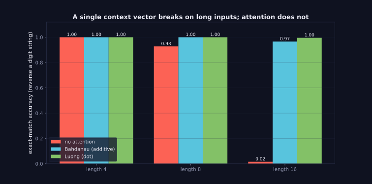
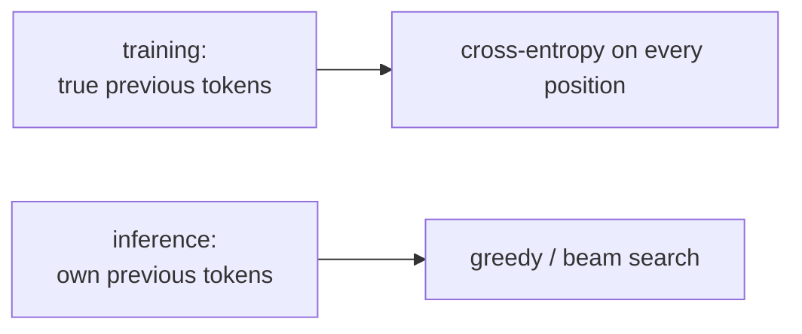

> Tier 5 · Sequence Models · **Level: intermediate** · Reading time: about 10 minutes

# 5.21 Seq2Seq (sequence-to-sequence learning)

**Metadata** — Tier: 5 · Phase: 1 · Priority: P0 · Difficulty: 3/5 · Interview: Very high · Hands-on: Very high
Prerequisites: 5.20 Encoder-decoder, 5.2 Language as sequence · Leads to: 5.22 Teacher forcing, 5.24 Attention

> **In plain words**
> **Seq2Seq** is the complete recipe for training and using an encoder-decoder (5.20): the data format (source, target), the loss (cross-entropy on every output token), the training trick (teacher forcing, 5.22), and how to **generate** at test time (greedy decoding or **beam search**). Our test task is a toy that exposes the main weakness: **reversing a string of digits**, where a plain Seq2Seq works for short inputs and collapses for long ones, while the same model with attention does not.

**You need first:** 5.20 Encoder-decoder, 5.2 Language as sequence.

> **Figure 5.21-1 — Seq2Seq with and without attention**
>
> 
>
> *How to read it:* each group of bars is a test length. A plain GRU Seq2Seq (red) is perfect at length 4, around 93% at length 8 and near 0% at length 16: the single context vector cannot hold 16 digits in order. With attention (blue, teal) accuracy stays near 100% at every length. Same model size, same data, same training budget (1,200 steps).
>
> *Generated by* `tier-05-sequence-models/figures/src/t5_figures.py` from `lab/lab_05_sequence_comparison.py` (`ex_5_21_seq2seq_vs_length`).

**Words you'll meet on this page**

| Word | What it means here |
|---|---|
| seq2seq | a model mapping a source sequence to a target sequence |
| exact match | the whole output must be right |
| greedy decoding | at each step pick the most likely token |
| beam search | keep the `k` best partial outputs at each step |
| beam width `k` | how many candidates to keep |
| log-probability | sum of `log P` of the tokens; used to rank candidates |
| length normalization | divide by length so short outputs are not favoured |

### 1. What is it?
Training an encoder-decoder by maximizing `Σ_t log P(y_t | y_{<t}, x)` over a dataset of `(x, y)` pairs, and decoding by searching for a high-probability `y` (Sutskever, Vinyals & Le, 2014).

### 2. Why does it exist?
It put translation, summarization, dialogue and speech recognition under one trainable, data-driven framework, replacing pipelines of hand-built components.

### 3. Detailed explanation
- **Data.** Pairs `(source, target)`. The decoder input is the target shifted right (`<bos>`, y₁, …), the label is the target followed by `<eos>`.
- **Loss.** Token-level cross-entropy, masked for padding (4.3). Reported as per-token perplexity or by task metrics.
- **Decoding choices.**
  - *Greedy:* take the argmax at each step. Fast; can paint itself into a corner.
  - *Sampling:* draw from the distribution (creative text; Tier 11).
  - *Beam search:* keep the `k` highest-scoring partial sequences; expand each; keep the best `k`. Often better translations; cost ∝ `k`. Use length normalization to avoid preferring short outputs (code ①, ②).
- **Results of the toy task** (reverse a digit string, GRU 64): length 4 → 100% without attention; length 8 → 93%; length 16 → 2%. With attention: 100% at all three (Figure 5.21-1; `lab` test asserts the gap).
- **Why reversal?** The correct output at step 1 depends on the last input. A single context must keep every digit and its position; capacity and gradient flow break at length ~16.
- **Fixes.** Attention (5.24, 5.25), bigger/deeper encoders, reversing the source, and eventually Transformers (Tier 8).
- **Stopping.** Generation ends at `<eos>` or a maximum length; limit it to avoid infinite loops.
- **Exposure bias** arises because training feeds true tokens but inference feeds predictions (5.22–5.23).
- **Evaluation.** Exact match here; BLEU/ROUGE, human preference for text (Tier 15).
- **Batching.** Sort by length to reduce padding (4.26).
- **Beyond text.** Same recipe for speech, images (captioning), code, protein sequences.

### 4. How does it work?
Training: feed the source and the *true* previous target tokens, predict the next target token. Inference: feed the source, then loop, feeding back the model's own previous token, until `<eos>`.



### 5. Simple example
Learning to translate by example sentences: in practice you hear the correct previous words (training); on the exam you must continue from your own words (inference).

**By hand.** Beam search with `k = 2`: step 1 candidates "A" (0.6) and "B" (0.4). Step 2 expands both; the best two completions overall might be "B C" (0.4×0.9 = 0.36) and "A D" (0.6×0.5 = 0.30), so "B C" beats the greedy path "A…" (the best first step is not always the start of the best sentence).

### 6. Technical example
Neural machine translation with beam size 4–10 and length penalty; speech recognition decoding with beam search plus a language model.

### 7. Code
**① By hand (plain Python).** Greedy versus beam search on a tiny probability table.

```python
import math

# P(next | previous) for a toy decoder over {A, B, C, D, </s>}
table = {
    "<s>": {"A": 0.6, "B": 0.4},
    "A":   {"C": 0.3, "D": 0.35, "</s>": 0.35},
    "B":   {"C": 0.9, "D": 0.05, "</s>": 0.05},
    "C":   {"</s>": 1.0},
    "D":   {"</s>": 1.0},
}

def greedy():
    seq, p, tok = [], 1.0, "<s>"
    while tok != "</s>":
        tok, q = max(table[tok].items(), key=lambda kv: kv[1]); seq.append(tok); p *= q
    return seq, p

def beam(k=2):
    beams = [(["<s>"], 0.0)]
    for _ in range(3):
        new = []
        for seq, lp in beams:
            if seq[-1] == "</s>":
                new.append((seq, lp)); continue
            for tok, q in table[seq[-1]].items():
                new.append((seq + [tok], lp + math.log(q)))
        beams = sorted(new, key=lambda b: -b[1])[:k]
    return beams[0][0][1:], math.exp(beams[0][1])

print("greedy:", greedy()[0], f"probability {greedy()[1]:.2f}")
print("beam(2):", beam(2)[0], f"probability {beam(2)[1]:.2f}")
```

```text
greedy: ['A', 'D', '</s>'] probability 0.21
beam(2): ['B', 'C', '</s>'] probability 0.36
```

**② With NumPy.** Length normalization: why beam search needs it.

```python
import numpy as np

candidates = {"short": [0.5], "medium": [0.8, 0.6], "long": [0.9, 0.8, 0.8, 0.8]}
print(f"{'candidate':<8}{'log-prob':>10}{'per-token':>11}")
for name, probs in candidates.items():
    lp = float(np.sum(np.log(probs)))
    print(f"{name:<8}{lp:>10.2f}{lp / len(probs):>11.2f}")
best_raw = max(candidates, key=lambda n: np.sum(np.log(candidates[n])))
best_norm = max(candidates, key=lambda n: np.mean(np.log(candidates[n])))
print("best by raw log-probability :", best_raw, "(prefers shorter, because every token costs probability)")
print("best by per-token average   :", best_norm)
```

```text
candidate  log-prob  per-token
short        -0.69      -0.69
medium       -0.73      -0.37
long         -0.77      -0.19
best by raw log-probability : short (prefers shorter, because every token costs probability)
best by per-token average   : long
```

**③ With PyTorch.** Train the tier's Seq2Seq (code/seqmodels.py) with and without attention on long inputs.

```python
import sys
sys.path.insert(0, "code")                       # the tier library; run this from the tier-05-sequence-models folder
import seqmodels as S

for attention in (None, "luong"):
    model = S.train_seq2seq(attention, length=16, steps=1200)
    print(f"attention = {str(attention):<6}: exact-match accuracy when reversing 16 digits = {S.seq2seq_accuracy(model, 16):.1f}")
```

```text
attention = None  : exact-match accuracy when reversing 16 digits = 0.0
attention = luong : exact-match accuracy when reversing 16 digits = 1.0
```

### 8. Input → Process → Output
`(source, shifted target) → cross-entropy training; at inference: source → greedy / beam search → output`

<details>
<summary><b>Beyond the basics (sections 9–16)</b> — real-world use, limits, mistakes. Skip on a first read.</summary>

### 9. Enterprise use case
Machine translation, email reply suggestion, summarization, speech transcription, SQL generation.

### 10. AI engineering connection
Decoding strategies (greedy, beam, sampling, top-p) carry over unchanged to LLMs (Tier 11).

### 11. Advantages
General, end-to-end trainable.

### 12. Limitations
Fixed context without attention; exposure bias; repetitive outputs; hallucination.

### 13. Trade-offs
Beam width: quality versus cost; larger beams can produce bland or too-short outputs.

### 14. Common mistakes
No length normalization; not masking padding in the loss; using teacher-forced accuracy as the metric; unlimited generation length.

### 15. Performance / cost
Decoding cost ∝ beam × output length; batch beams on GPU.

### 16. Security
Generated text may reveal memorized data or be manipulated by crafted inputs; validate outputs.

</details>

### 17. Interview explanation
"Seq2seq trains an encoder-decoder with token-level cross-entropy while feeding the decoder the true previous token, and generates with greedy or beam search by feeding back its own predictions. A plain version bottlenecks on long inputs, which attention solves, and the train/inference mismatch is called exposure bias."

### 18. Rapid-fire answer
Encoder-decoder + token cross-entropy + teacher forcing; decode greedy/beam (with length normalization); attention fixes long inputs; exposure bias.

### 19. Interview questions
- **Basic:** How do you train a seq2seq model?
- **Intermediate:** How does beam search work and why normalize by length?
- **Advanced:** Why can beam search be worse than greedy for open-ended generation?
- **Scenario:** Your translation model drops the end of long sentences. What do you try?

### 20. Hands-on exercise
**Goal:** the beam width effect.

1. Using the table of code ①, run beam search with `k = 1, 2, 3` and print the best sequence and probability.

<details>
<summary>Show a solution</summary>

```python
import math

table = {"<s>": {"A": 0.6, "B": 0.4}, "A": {"C": 0.3, "D": 0.35, "</s>": 0.35}, "B": {"C": 0.9, "D": 0.05, "</s>": 0.05}, "C": {"</s>": 1.0}, "D": {"</s>": 1.0}}
def beam(k):
    beams = [(["<s>"], 0.0)]
    for _ in range(3):
        new = []
        for seq, lp in beams:
            if seq[-1] == "</s>":
                new.append((seq, lp)); continue
            new += [(seq + [t], lp + math.log(q)) for t, q in table[seq[-1]].items()]
        beams = sorted(new, key=lambda b: -b[1])[:k]
    return beams[0][0][1:], math.exp(beams[0][1])

for k in (1, 2, 3):
    seq, p = beam(k)
    print(f"beam width {k}: {seq}  probability {p:.2f}")
```

```text
beam width 1: ['A', 'D', '</s>']  probability 0.21
beam width 2: ['B', 'C', '</s>']  probability 0.36
beam width 3: ['B', 'C', '</s>']  probability 0.36
```

</details>

### 21. Revision questions
1. What are the decoder input and the label?
2. Greedy versus beam search?
3. Why does plain seq2seq fail on long inputs?

### 22. Related concepts
5.20 Encoder-decoder · 5.22 Teacher forcing · 5.23 Exposure bias · 5.24–5.25 Attention · Tier 11 Decoding

### 23. One-line memory hook
**Seq2Seq: train with the answer key beside you, decode on your own.**

<details>
<summary><b>For reviewers</b> (not part of the lesson)</summary>

- Status: DRAFT, learner-first layout (Author: Claude). Code is executed by `tests/test_md_snippets.py`; ③ imports the tier library, so it must run from `tier-05-sequence-models/` (the snippet runner does this).
- TESTED earlier: `lab/...::test_attention_beats_the_plain_encoder_decoder_on_long_inputs`.
- REVIEW_REQUIRED: Sutskever et al. 2014 attribution; beam-search behaviour in open-ended generation.
</details>
