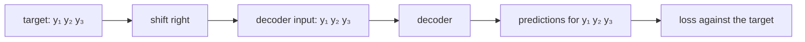

> Tier 5 · Sequence Models · **Level: intermediate** · Reading time: about 8 minutes

# 5.22 Teacher forcing

**Metadata** — Tier: 5 · Phase: 1 · Priority: P0 · Difficulty: 2/5 · Interview: High · Hands-on: High
Prerequisites: 5.21 Seq2Seq · Leads to: 5.23 Exposure bias

> **In plain words**
> When training a decoder, at every step we have a choice: feed it **its own previous prediction** or the **correct previous token** from the training data. **Teacher forcing** means always feeding the correct one, like a teacher who corrects each answer before the student continues. It makes training **fast and stable** (each step gets a clean input), but the student never practises continuing from its own mistakes, which causes **exposure bias** (5.23).

**You need first:** 5.21 Seq2Seq.

> **Figure 5.22-1 — what the decoder sees at step t**
>
> ```mermaid
> flowchart LR
>     subgraph TF["teacher forcing (training)"]
>     A1["true y(t−1)"] --> D1["decoder step t"]
>     end
>     subgraph FR["free running (inference)"]
>     A2["predicted ŷ(t−1)"] --> D2["decoder step t"]
>     end
> ```
>
> *How to read it:* the only difference is the input token to the decoder. In training with teacher forcing it is always the ground truth. At inference there is no ground truth, so the model's own earlier prediction is fed back; an early error then changes everything after it. Between the two lies **scheduled sampling**: with probability `p` use the ground truth, otherwise the model's own prediction.

**Words you'll meet on this page**

| Word | What it means here |
|---|---|
| teacher forcing | feed the ground-truth previous token during training |
| free running | feed the model's own previous prediction |
| scheduled sampling | mix both, gradually trusting the model more |
| teacher-forcing ratio | probability of using the ground truth |
| autoregressive | each output feeds the next step |
| parallel training | with teacher forcing all steps can be computed at once (Transformers) |
| error compounding | an early mistake spoils later steps |

### 1. What is it?
A training procedure for autoregressive models in which the decoder's input at step `t` is the true target token `y_{t-1}` rather than the model's prediction `ŷ_{t-1}`.

### 2. Why does it exist?
Early in training the model's predictions are mostly wrong. Feeding them back would give the decoder garbage inputs, making learning slow and unstable. With teacher forcing each step is an independent, clean supervised problem: "given the correct prefix, predict the next token."

### 3. Detailed explanation
- **Benefits.** Faster convergence; stable; every position's loss is computed in one parallel pass for Transformers and even for RNN decoders (when inputs are known) (code ③ trains a full sequence per call).
- **Cost.** A train/test mismatch: exposure bias (5.23).
- **Free running training** (ratio 0): the model learns to recover from its own mistakes but trains slowly and the gradient through discrete argmax choices is not defined; implementations feed argmax tokens as inputs while computing loss against the true targets.
- **Scheduled sampling** (Bengio et al., 2015): start at ratio 1 and decay toward 0 over training; helped some tasks, hurt others; it is not a principled likelihood objective (REVIEW_REQUIRED).
- **On the toy task of 5.21** (length 8 reversal, 800 steps) the three ratios end up within a few points of each other (code ③). The easy task has little room for exposure bias to bite; real tasks with long outputs show larger gaps.
- **Alternatives to fix exposure bias:** sequence-level training (minimum risk training, reinforcement learning, RLHF in Tier 10), data noising, label smoothing, larger beams, or simply scale.
- **Transformers** are trained with teacher forcing via causal masking (Tier 7–8): all positions at once.
- **LLM pre-training** is teacher forcing on text: each position predicts the next *true* token.
- **Evaluation** must be free running; teacher-forced accuracy is optimistic.

### 4. How does it work?
Shift the target right by one to make the decoder input; compute the loss on every position at once.



### 5. Simple example
Learning to write essays with a teacher who, after every sentence, replaces your sentence with the correct one before you write the next. You learn quickly, but in the exam, with no teacher, one early slip sends the rest off course.

**By hand.** Per-token accuracy 95% and a 20-token output. If an early error always ruins the rest: sequence accuracy ≈ `0.95²⁰ = 0.36`, though each token looks 95% right when scored with the true prefix.

### 6. Technical example
`decoder_input = torch.cat([bos, target[:, :-1]], dim=1)`; `loss = cross_entropy(model(src, decoder_input), target)`.

### 7. Code
**① By hand (plain Python).** Build the shifted decoder input.

```python
target = ["the", "cat", "sat", "<eos>"]
decoder_input = ["<bos>"] + target[:-1]
for step, (inp, label) in enumerate(zip(decoder_input, target), start=1):
    print(f"step {step}: decoder sees {inp!r:>8}  must predict {label!r}")
```

```text
step 1: decoder sees  '<bos>'  must predict 'the'
step 2: decoder sees    'the'  must predict 'cat'
step 3: decoder sees    'cat'  must predict 'sat'
step 4: decoder sees    'sat'  must predict '<eos>'
```

**② With NumPy.** Compounding errors: per-token accuracy versus whole-sequence accuracy.

```python
import numpy as np

for p in (0.99, 0.95, 0.90):
    row = {L: p ** L for L in (5, 20, 50)}
    print(f"per-token accuracy {p}: whole-sequence accuracy after 5 / 20 / 50 tokens = {row[5]:.2f} / {row[20]:.2f} / {row[50]:.2f}")

rng = np.random.default_rng(0)
trials = 100000
p, L = 0.95, 20
free = (rng.random((trials, L)) < p).all(axis=1).mean()
print(f"simulated free-running sequences (p = {p}, L = {L}) fully correct: {free:.2f}   (teacher-forced scoring would report {p})")
```

```text
per-token accuracy 0.99: whole-sequence accuracy after 5 / 20 / 50 tokens = 0.95 / 0.82 / 0.61
per-token accuracy 0.95: whole-sequence accuracy after 5 / 20 / 50 tokens = 0.77 / 0.36 / 0.08
per-token accuracy 0.9: whole-sequence accuracy after 5 / 20 / 50 tokens = 0.59 / 0.12 / 0.01
simulated free-running sequences (p = 0.95, L = 20) fully correct: 0.36   (teacher-forced scoring would report 0.95)
```

**③ With PyTorch.** Different teacher-forcing ratios on the reversal task (tier library).

```python
import sys
sys.path.insert(0, "code")
import seqmodels as S

for ratio in (1.0, 0.5, 0.0):
    model = S.train_seq2seq(None, length=8, steps=800, teacher_forcing=ratio)
    print(f"teacher-forcing ratio {ratio}: exact-match accuracy (free-running decoding) = {S.seq2seq_accuracy(model, 8):.2f}")
```

```text
teacher-forcing ratio 1.0: exact-match accuracy (free-running decoding) = 0.83
teacher-forcing ratio 0.5: exact-match accuracy (free-running decoding) = 0.82
teacher-forcing ratio 0.0: exact-match accuracy (free-running decoding) = 0.86
```

### 8. Input → Process → Output
`true target shifted right → decoder input → parallel loss on every position`

<details>
<summary><b>Beyond the basics (sections 9–16)</b> — real-world use, limits, mistakes. Skip on a first read.</summary>

### 9. Enterprise use case
Standard in every text-generation training pipeline.

### 10. AI engineering connection
LLM pre-training and supervised fine-tuning are teacher forcing; RLHF later exposes the model to its own samples (Tier 10).

### 11. Advantages
Fast, stable, parallel.

### 12. Limitations
Exposure bias; optimistic training metrics.

### 13. Trade-offs
Scheduled sampling reduces the mismatch but complicates training.

### 14. Common mistakes
Reporting teacher-forced accuracy as the final metric; off-by-one in the shift; including padding in the loss.

### 15. Performance / cost
Teacher forcing allows full-sequence parallelism for Transformers.

### 16. Security
No direct issue.

</details>

### 17. Interview explanation
"Teacher forcing feeds the decoder the ground-truth previous token during training, which makes each step a clean supervised problem and allows parallel training, but at inference the model sees its own predictions, so errors compound. That train/test mismatch is exposure bias; mitigations include scheduled sampling and sequence-level or RL fine-tuning."

### 18. Rapid-fire answer
Train with true previous tokens (shifted target); fast and parallel; mismatch with inference → exposure bias; fixes: scheduled sampling, sequence-level objectives; evaluate free-running.

### 19. Interview questions
- **Basic:** What is teacher forcing?
- **Intermediate:** Why does it speed up training?
- **Advanced:** What is scheduled sampling and why is it not a proper likelihood objective?
- **Scenario:** Training accuracy is 98% but generated outputs are bad. Why?

### 20. Hands-on exercise
**Goal:** the compounding arithmetic.

1. For a free-running model with per-token accuracy 0.97 find the longest output length at which at least half of the sequences are fully correct.

<details>
<summary>Show a solution</summary>

```python
import math

p = 0.97
L = math.floor(math.log(0.5) / math.log(p))
print(f"per-token accuracy {p}: half of the sequences are fully correct up to length {L}  ({p}^{L} = {p ** L:.2f})")
```

```text
per-token accuracy 0.97: half of the sequences are fully correct up to length 22  (0.97^22 = 0.51)
```

</details>

### 21. Revision questions
1. What is the decoder input in teacher forcing?
2. What problem does it cause?
3. What is scheduled sampling?

### 22. Related concepts
5.21 Seq2Seq · 5.23 Exposure bias · 4.3 Loss · Tier 7 Causal masking · Tier 10 RLHF

### 23. One-line memory hook
**Teacher forcing: practise with the answer key; take the exam without it.**

<details>
<summary><b>For reviewers</b> (not part of the lesson)</summary>

- Status: DRAFT, learner-first layout (Author: Claude). Code is executed by `tests/test_md_snippets.py`.
- TESTED earlier: `lab/...::test_teacher_forcing_probability_is_not_the_main_factor_on_this_easy_task`.
- REVIEW_REQUIRED: Bengio et al. 2015 scheduled sampling and its theoretical critique.
</details>
