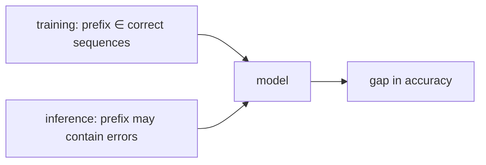

> Tier 5 · Sequence Models · **Level: intermediate** · Reading time: about 8 minutes

# 5.23 Exposure bias

**Metadata** — Tier: 5 · Phase: 1 · Priority: P1 · Difficulty: 3/5 · Interview: High · Hands-on: Medium
Prerequisites: 5.22 Teacher forcing · Leads to: 5.24 Bahdanau attention

> **In plain words**
> **Exposure bias** is the gap between how a sequence model is **trained** (always shown the correct previous tokens) and how it is **used** (shown its own previous tokens). During training it is never "exposed" to its own mistakes, so when a mistake happens at test time it is in unfamiliar territory and tends to make more. Small early errors snowball.

**You need first:** 5.22 Teacher forcing.

> **Figure 5.23-1 — the snowball**
>
> ```mermaid
> flowchart LR
>     S1["step 1: correct"] --> S2["step 2: small error"]
>     S2 -->|"never seen this prefix in training"| S3["step 3: more likely wrong"]
>     S3 --> S4["step 4: further off"]
> ```
>
> *How to read it:* after a wrong token the model sees a prefix it never met in training (all training prefixes were correct). Its next prediction is worse than average, which makes a second error more likely. In the experiment below the per-token accuracy drops from 93% (true history) to 84% (own history) on a 12-digit reversal task.

**Words you'll meet on this page**

| Word | What it means here |
|---|---|
| exposure bias | train/test mismatch in what the decoder is fed |
| distribution shift | the inputs at test time differ from training inputs |
| error compounding | mistakes feed later mistakes |
| free-running accuracy | accuracy using the model's own history |
| teacher-forced accuracy | accuracy using the true history |
| MLE | maximum-likelihood training (teacher forcing) |
| sequence-level objective | a loss on the whole generated sequence |

### 1. What is it?
The mismatch between the training distribution of decoder inputs (ground-truth prefixes) and the inference distribution (model-generated prefixes) in autoregressive models (Ranzato et al., 2016; the term goes back to Bengio et al., 2015; REVIEW_REQUIRED).

### 2. Why does it exist?
Maximum-likelihood training with teacher forcing optimizes `P(y_t | y_{<t}^{true}, x)` only. It never evaluates the model on `y_{<t}^{generated}`. Yet generation must live with its own prefixes.

### 3. Detailed explanation
- **Measuring it.** Compare per-token accuracy with true history versus own history (code ③). A large gap means exposure bias is a problem for this model/task.
- **Where it hurts.** Long outputs, open-ended tasks, and tasks where one early error is fatal. It hurts less when the model is very accurate (few errors) or the task tolerates errors.
- **It is partly a myth in large LMs.** Very large models trained on huge data are accurate enough, and their errors are often fluent, that the practical impact is debated (REVIEW_REQUIRED). Exposure-bias-like effects remain visible in repetition and drift in long generations.
- **Mitigations.**
  - *Scheduled sampling* (5.22): sometimes feed own predictions.
  - *Sequence-level training*: minimum risk training, REINFORCE on BLEU, and RLHF for LLMs (Tier 10).
  - *Noise/dropout on decoder inputs* to make the model robust to imperfect prefixes.
  - *Better decoding*: beam search with length normalization, constrained decoding.
  - *Bigger models and more data.*
- **Relation to imitation learning.** Teacher forcing is behaviour cloning; exposure bias is the covariate shift of behaviour cloning, solved there by DAgger (REVIEW_REQUIRED: analogy).
- **Not the same as hallucination,** though both can follow from a bad prefix.
- **Detecting in practice.** Plot accuracy by output position under free running; a falling curve suggests compounding.
- **Cost of fixes.** Sequence-level methods are slower and noisier; most production systems accept the bias and rely on scale.

### 4. How does it work?
Training prefixes are always right; generated prefixes are sometimes wrong. A wrong prefix is out-of-distribution, so the next prediction is less reliable, increasing the chance of another error.



### 5. Simple example
A pilot trained only in flight simulators that never include turbulence: the first gust in a real flight puts them in a situation they never practised, and corrections may make things worse.

**By hand.** True-history token accuracy 93%; own-history 84%. For a 12-token output, whole-sequence success under teacher forcing scoring would be misread as `0.93¹² ≈ 42%`, while the free-running reality is lower (code ③ prints the measured values).

### 6. Technical example
Neural machine translation systems showed worse outputs on long sentences than teacher-forced perplexity suggested; sequence-level training improved BLEU (Ranzato et al., 2016).

### 7. Code
**① By hand (plain Python).** An error changes the prefix the model sees.

```python
truth = "abcdef"
def next_char(prefix):                       # a toy 'model' that only knows the true alphabet order... and gets confused by unfamiliar prefixes
    known = {"": "a", "a": "b", "ab": "c", "abc": "d", "abcd": "e", "abcde": "f"}
    return known.get(prefix, "?")             # unseen prefix -> no idea

prefix, forced, free = "", "", ""
for t in range(6):
    forced += next_char(truth[:t]) if next_char(truth[:t]) != "?" else "?"
for t in range(6):
    guess = next_char(free)
    if t == 2:
        guess = "x"                           # one early mistake
    free += guess
print("teacher-forced predictions:", forced)
print("free-running with one slip :", free, "-> after the slip every prefix is unseen")
```

```text
teacher-forced predictions: abcdef
free-running with one slip : abx??? -> after the slip every prefix is unseen
```

**② With NumPy.** Accuracy falls with output position when errors compound.

```python
import numpy as np

rng = np.random.default_rng(0)
trials, L = 20000, 12
p_clean, p_after_error = 0.95, 0.70                  # accuracy given a correct prefix / given a prefix that already has a mistake
wrong_so_far = np.zeros(trials, dtype=bool); correct_by_pos = []
for t in range(L):
    p = np.where(wrong_so_far, p_after_error, p_clean)
    ok = rng.random(trials) < p
    correct_by_pos.append(ok.mean())
    wrong_so_far |= ~ok
print("per-position accuracy (free running):", np.round(correct_by_pos, 2))
print("teacher-forced accuracy at every position: 0.95")
print("whole-sequence accuracy:", round(float((~wrong_so_far).mean()), 2))
```

```text
per-position accuracy (free running): [0.95 0.94 0.92 0.92 0.9  0.89 0.88 0.88 0.87 0.86 0.85 0.84]
teacher-forced accuracy at every position: 0.95
whole-sequence accuracy: 0.54
```

**③ With PyTorch.** Measure the gap on the reversal task (tier library).

```python
import sys
sys.path.insert(0, "code")
import torch
import seqmodels as S

model = S.train_seq2seq(None, length=12, steps=1200, teacher_forcing=1.0)
src, ti, to = S.reverse_batch(500, 12, torch.Generator().manual_seed(999))
with torch.no_grad():
    forced = (model(src, ti, teacher_forcing=1.0).argmax(-1) == to).float().mean().item()
    free = (model(src, ti, teacher_forcing=0.0).argmax(-1) == to).float().mean().item()
print(f"per-token accuracy fed the TRUE previous tokens: {forced:.2f}")
print(f"per-token accuracy fed ITS OWN previous tokens : {free:.2f}")
print("gap caused by exposure bias:", round(forced - free, 2))
```

```text
per-token accuracy fed the TRUE previous tokens: 0.93
per-token accuracy fed ITS OWN previous tokens : 0.84
gap caused by exposure bias: 0.09
```

### 8. Input → Process → Output
`train on correct prefixes → generate with own prefixes → accuracy gap and compounding errors`

<details>
<summary><b>Beyond the basics (sections 9–16)</b> — real-world use, limits, mistakes. Skip on a first read.</summary>

### 9. Enterprise use case
Quality monitoring of generated text should use free-running evaluation, not training loss.

### 10. AI engineering connection
RLHF and other post-training stages expose LLMs to their own samples, partly addressing it (Tier 10).

### 11. Advantages
Understanding it explains why teacher-forced loss can mislead.

### 12. Limitations
Mitigations add complexity; the size of the effect varies.

### 13. Trade-offs
Stability of teacher forcing versus fidelity to inference conditions.

### 14. Common mistakes
Trusting validation loss alone; never evaluating with free-running decoding; overusing scheduled sampling without checking.

### 15. Performance / cost
Sequence-level training needs sampling during training: several times the cost.

### 16. Security
No direct issue.

</details>

### 17. Interview explanation
"Exposure bias is the mismatch between teacher-forced training, where the decoder only sees correct prefixes, and inference, where it sees its own, possibly wrong, prefixes. Errors compound because wrong prefixes are out of distribution. I measure it as the gap between teacher-forced and free-running accuracy and mitigate it with scheduled sampling, sequence-level or RL fine-tuning, and robust decoding."

### 18. Rapid-fire answer
Train on true prefixes, test on own prefixes → errors compound; measure the free-running vs teacher-forced gap; fixes: scheduled sampling, sequence-level/RL training, scale.

### 19. Interview questions
- **Basic:** What is exposure bias?
- **Intermediate:** How would you measure it?
- **Advanced:** How is it related to covariate shift in imitation learning?
- **Scenario:** Generated text degrades in long outputs although validation loss is great. Why?

### 20. Hands-on exercise
**Goal:** accuracy by position.

1. For the model of ③ compute free-running per-token accuracy at each output position.
2. Does it fall along the output?

<details>
<summary>Show a solution</summary>

```python
import sys
sys.path.insert(0, "code")
import torch
import seqmodels as S

model = S.train_seq2seq(None, length=12, steps=1200)
src, ti, to = S.reverse_batch(500, 12, torch.Generator().manual_seed(999))
with torch.no_grad():
    pred = model(src, ti, teacher_forcing=0.0).argmax(-1)
acc = (pred == to).float().mean(0)
print("free-running accuracy by output position:", [round(a, 2) for a in acc.tolist()])
```

```text
free-running accuracy by output position: [0.99, 0.98, 0.94, 0.86, 0.81, 0.78, 0.77, 0.79, 0.79, 0.75, 0.72, 0.72, 0.99]
```

</details>

### 21. Revision questions
1. Why is a wrong prefix "out of distribution"?
2. How do you measure exposure bias?
3. Name two mitigations.

### 22. Related concepts
5.21 Seq2Seq · 5.22 Teacher forcing · Tier 10 RLHF · Tier 11 Decoding

### 23. One-line memory hook
**Exposure bias: trained on perfect prefixes, tested on its own messy ones.**

<details>
<summary><b>For reviewers</b> (not part of the lesson)</summary>

- Status: DRAFT, learner-first layout (Author: Claude). Code is executed by `tests/test_md_snippets.py`.
- TESTED earlier: `lab/...::test_exposure_bias_free_running_is_worse_than_teacher_forced`.
- REVIEW_REQUIRED: attribution of the term (Ranzato et al. 2016, Bengio et al. 2015), "partly a myth" discussion, DAgger analogy. The ① toy is deliberately schematic.
</details>
