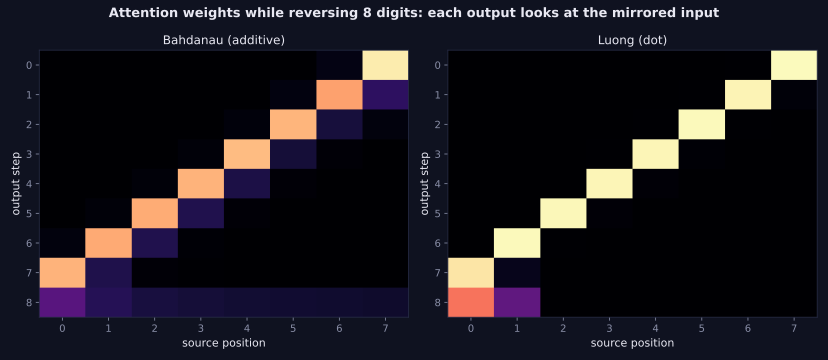
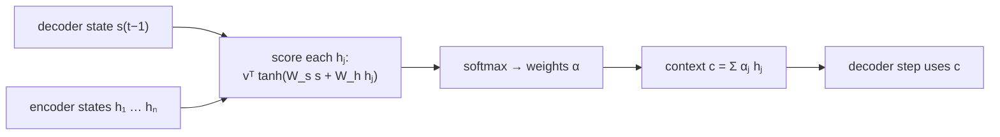

> Tier 5 · Sequence Models · **Level: intermediate** · Reading time: about 11 minutes

# 5.24 Bahdanau attention

**Metadata** — Tier: 5 · Phase: 1 · Priority: P0 · Difficulty: 3/5 · Interview: Very high · Hands-on: High
Prerequisites: 5.20 Encoder-decoder, 5.21 Seq2Seq, 1.10 Dot product · Leads to: 5.25 Luong attention, Tier 7 Attention

> **In plain words**
> Bahdanau attention (2014) fixes the encoder-decoder bottleneck. Instead of squeezing the whole input into one vector, the encoder keeps **one vector per input position**. At **every output step** the decoder **looks back at all of them**, scores how relevant each one is right now, turns the scores into weights that add up to 1, and reads a **weighted average** of the encoder vectors (the *context*). The decoder learns **where to look** at each step. This is the idea that grew into Transformers.

**You need first:** 5.20 Encoder-decoder, 5.21 Seq2Seq, 1.10 Dot product.

> **Figure 5.24-1 — where the decoder looks (reversing 8 digits)**
>
> 
>
> *How to read it:* rows are output steps, columns are input positions; bright means high weight. To reverse a string, output step 1 should read the **last** input, step 2 the second-to-last, and so on, which draws a bright **anti-diagonal**. The model found this alignment by itself, from the output loss alone. (Left: Bahdanau; right: Luong, 5.25; the last row is the `<eos>` step.)
>
> *Generated by* `tier-05-sequence-models/figures/src/t5_figures.py` from trained models in `code/seqmodels.py`.

**Words you'll meet on this page**

| Word | What it means here |
|---|---|
| annotation `hⱼ` | the encoder's vector for input position `j` |
| query `s_{t-1}` | the decoder's previous state: "what do I need now?" |
| score / alignment `e_tj` | relevance of input `j` for output step `t` |
| attention weights `α_tj` | softmax of the scores; sum to 1 |
| context vector `c_t` | `Σ_j α_tj hⱼ`, the weighted summary |
| additive attention | scores computed with a small feed-forward net |
| alignment | which input matches which output |

### 1. What is it?
An attention mechanism (Bahdanau, Cho & Bengio, 2014; "additive" or "concat" attention): `e_tj = vᵀ tanh(W_s s_{t-1} + W_h h_j)`, `α_t = softmax(e_t)`, `c_t = Σ_j α_tj h_j`, and the decoder step uses `[y_{t-1}, c_t]` to compute `s_t`.

### 2. Why does it exist?
A single context vector must carry all of the input, so quality collapses for long inputs (Figure 5.21-1). Attention gives the decoder direct access to every input position and lets it choose what to read when, shortening the path between any output and any input from `n` steps to one.

### 3. Detailed explanation
- **Encoder.** Bidirectional in the original paper: each annotation `hⱼ` summarizes the input around position `j` in both directions.
- **Scoring.** A small network compares the decoder's previous state (the query) with each annotation. Because it adds the two projections inside a `tanh`, it is called *additive* attention.
- **Softmax** turns scores into weights: all positive, sum to 1 (code ② prints them).
- **Context** is the weighted average; if one weight is ≈1 the model "points" at one input; otherwise it blends.
- **Decoder update.** In Bahdanau's design the context is computed **before** the RNN step from the **previous** state `s_{t-1}` and used as an extra input. (Luong's variant, 5.25, uses the **current** state.)
- **Learned alignment, soft.** No alignment labels are given; the weights emerge because they help predict the output. In translation they resemble word alignments, including reordering (adjectives after nouns).
- **Results.** In the toy reversal task the plain model reaches 2% at length 16; with Bahdanau attention 97–100% (Figure 5.21-1).
- **Cost.** `O(n·m)` scores for `n` inputs and `m` outputs: the first appearance of the quadratic cost of attention (5.26).
- **Interpretability.** Heat maps like Figure 5.24-1 are informative but not guaranteed to be explanations (REVIEW_REQUIRED).
- **Next step.** Self-attention (Tier 7) lets a sequence attend to itself and removes the RNN entirely (5.27).
- **Masking.** Padded input positions must get weight 0: set their scores to −∞ before the softmax.

### 4. How does it work?
For every output step: score every encoder state against the decoder state, softmax, average, feed the average to the decoder.



### 5. Simple example
Translating a long sentence with the source text in front of you: for each word you write, you glance at the part of the source that matters, instead of relying on memory of the whole sentence.

**By hand.** Three input annotations (scalars) `h = [1, 5, 2]`, scores `e = [0.1, 2.0, 0.3]`. `softmax` → `[0.11, 0.75, 0.14]`, then `c = 0.11·1 + 0.75·5 + 0.14·2 ≈ 4.1`: mostly the middle annotation.

### 6. Technical example
The original paper improved English-French translation on sentences longer than 30 words, where the plain encoder-decoder degraded; Google's GNMT also used attention.

### 7. Code
**① By hand (plain Python).** Scores → weights → context for three encoder states.

```python
import math

h = [[1.0, 0.0], [0.0, 1.0], [1.0, 1.0]]                 # three encoder annotations (2-D)
scores = [0.1, 2.0, 0.3]                                  # relevance of each to the current decoder state
exp = [math.exp(s) for s in scores]
weights = [e / sum(exp) for e in exp]
context = [sum(w * vec[d] for w, vec in zip(weights, h)) for d in range(2)]
print("attention weights:", [round(w, 2) for w in weights], "  sum =", round(sum(weights), 2))
print("context vector   :", [round(c, 2) for c in context], " (mostly the second annotation)")
```

```text
attention weights: [0.11, 0.75, 0.14]   sum = 1.0
context vector   : [0.25, 0.89]  (mostly the second annotation)
```

**② With NumPy.** Additive scoring `vᵀ tanh(W_s s + W_h hⱼ)` and masking padding.

```python
import numpy as np

rng = np.random.default_rng(0)
n, H, A = 5, 6, 4                                         # 5 input positions, state size 6, attention size 4
enc = rng.normal(size=(n, H)); s = rng.normal(size=H)
Ws, Wh, v = rng.normal(0, 0.5, (A, H)), rng.normal(0, 0.5, (A, H)), rng.normal(0, 0.5, A)
scores = np.array([v @ np.tanh(Ws @ s + Wh @ enc[j]) for j in range(n)])
mask = np.array([1, 1, 1, 0, 0], dtype=bool)              # the last two positions are padding
scores = np.where(mask, scores, -np.inf)
w = np.exp(scores - scores[mask].max()); w /= w.sum()
print("weights:", w.round(3), "  sum:", w.sum().round(3), "  weight on padding:", w[~mask].sum())
context = w @ enc
print("context vector shape:", context.shape)
```

```text
weights: [0.152 0.704 0.145 0.    0.   ]   sum: 1.0   weight on padding: 0.0
context vector shape: (6,)
```

**③ With PyTorch.** The tier's Bahdanau Seq2Seq learns the mirror alignment by itself.

```python
import sys
sys.path.insert(0, "code")
import torch
import seqmodels as S

model = S.train_seq2seq("bahdanau", length=8, steps=1200)
src, _, to = S.reverse_batch(300, 8, torch.Generator().manual_seed(3))
pred, att = model.greedy(src, 9)
print("exact-match accuracy:", round((pred == to).all(1).float().mean().item(), 2))
print("each row of attention weights sums to 1:", bool(torch.allclose(att.sum(-1), torch.ones(300, 9), atol=1e-5)))
mirror = (att[:, :8].argmax(-1) == torch.arange(7, -1, -1)).float().mean().item()
print(f"output step t looks at input position 7 - t in {mirror:.0%} of cases (the anti-diagonal)")
```

```text
exact-match accuracy: 1.0
each row of attention weights sums to 1: True
output step t looks at input position 7 - t in 100% of cases (the anti-diagonal)
```

### 8. Input → Process → Output
`decoder state + all encoder states → scores → softmax weights → context → next token`

<details>
<summary><b>Beyond the basics (sections 9–16)</b> — real-world use, limits, mistakes. Skip on a first read.</summary>

### 9. Enterprise use case
Translation and summarization systems before Transformers; alignment visualizations for debugging.

### 10. AI engineering connection
Direct ancestor of Transformer attention (queries, keys, values; Tier 7) and of cross-attention in encoder-decoder models and diffusion models.

### 11. Advantages
Solves the bottleneck; learns alignment; shorter gradient paths.

### 12. Limitations
Quadratic cost; still recurrent (sequential) encoder and decoder; extra parameters.

### 13. Trade-offs
Additive scoring is flexible but slower than dot-product scoring.

### 14. Common mistakes
Not masking padding; using the current instead of the previous state without adapting the equations; reading attention maps as proof of reasoning.

### 15. Performance / cost
`O(n·m·A)` for scoring; memory for all encoder states.

### 16. Security
Attention maps can reveal which inputs influenced an output; be careful exposing them.

</details>

### 17. Interview explanation
"Bahdanau attention keeps all encoder states and, for each output step, scores each state against the previous decoder state with a small feed-forward network, softmaxes the scores into weights, and feeds the weighted average (the context) into the decoder. It removes the fixed-vector bottleneck and learns a soft alignment, and it is the precursor of Transformer attention."

### 18. Rapid-fire answer
`e = vᵀtanh(W_s s + W_h h_j)`, `α = softmax(e)`, `c = Σ α h`; uses the previous decoder state; additive attention; learns alignment; fixes the bottleneck.

### 19. Interview questions
- **Basic:** What problem does attention solve in seq2seq?
- **Intermediate:** Write the Bahdanau scoring function.
- **Advanced:** How does Bahdanau differ from Luong attention?
- **Scenario:** Your attention puts weight on padding tokens. What went wrong?

### 20. Hands-on exercise
**Goal:** sharp versus blurry attention.

1. Compute attention weights for scores `[1, 2, 3]` and for the same scores multiplied by 5.
2. What does scaling the scores do?

<details>
<summary>Show a solution</summary>

```python
import numpy as np

softmax = lambda z: np.exp(z - z.max()) / np.exp(z - z.max()).sum()
base = np.array([1.0, 2.0, 3.0])
print("scores [1, 2, 3]   ->", softmax(base).round(3))
print("scores x 5         ->", softmax(5 * base).round(3), "(sharper: almost a hard choice)")
print("scores / 5         ->", softmax(base / 5).round(3), "(blurrier: close to a uniform average)")
```

```text
scores [1, 2, 3]   -> [0.09  0.245 0.665]
scores x 5         -> [0.    0.007 0.993] (sharper: almost a hard choice)
scores / 5         -> [0.269 0.329 0.402] (blurrier: close to a uniform average)
```

</details>

### 21. Revision questions
1. What are the query and the keys here?
2. Why a softmax?
3. What is the context vector?

### 22. Related concepts
5.20 Encoder-decoder · 5.21 Seq2Seq · 5.25 Luong attention · 5.26 Why RNNs became a bottleneck · Tier 7 Attention

### 23. One-line memory hook
**Bahdanau attention: at every word you write, glance back at the whole source and weigh it.**

<details>
<summary><b>For reviewers</b> (not part of the lesson)</summary>

- Status: DRAFT, learner-first layout (Author: Claude). Code is executed by `tests/test_md_snippets.py`.
- TESTED earlier: `code/test_seqmodels.py::test_attention_weights_are_a_distribution_and_peak_on_the_mirrored_position` (Luong); the Bahdanau variant is checked in ③ and in `lab/...::test_attention_beats_the_plain_encoder_decoder_on_long_inputs`.
- REVIEW_REQUIRED: Bahdanau et al. 2014 attribution, long-sentence BLEU claim, GNMT attention, interpretability caveat.
</details>
