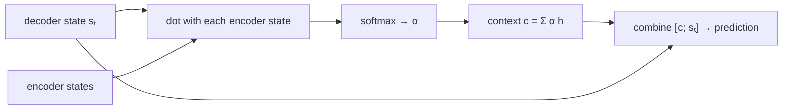

> Tier 5 · Sequence Models · **Level: intermediate** · Reading time: about 9 minutes

# 5.25 Luong attention

**Metadata** — Tier: 5 · Phase: 1 · Priority: P1 · Difficulty: 3/5 · Interview: High · Hands-on: High
Prerequisites: 5.24 Bahdanau attention · Leads to: 5.26 Why RNNs became a bottleneck, Tier 7 Attention

> **In plain words**
> Luong attention (2015) is the simpler, faster cousin of Bahdanau attention. Two differences: (1) the decoder first runs its RNN step, and **then** looks back at the encoder using its **current** state, and (2) the relevance score can be a plain **dot product** (or a lightly weighted one) instead of a small neural network. Dot-product scoring is the version that became the core of Transformer attention.

**You need first:** 5.24 Bahdanau attention.

> **Figure 5.25-1 — the order of operations**
>
> ```mermaid
> flowchart LR
>     subgraph Bahdanau["Bahdanau (5.24)"]
>     B1["s(t−1)"] --> B2["attend → context"] --> B3["RNN step with context"] --> B4["s_t → predict"]
>     end
>     subgraph Luong["Luong (5.25)"]
>     L1["RNN step → s_t"] --> L2["attend with s_t → context"] --> L3["combine [s_t, context] → predict"]
>     end
> ```
>
> *How to read it:* Bahdanau looks back **before** the RNN step and feeds the context into it. Luong runs the RNN step first, then uses the new state to look back, and combines the two for the prediction. The attention maps they learn on the reversal task are almost identical (Figure 5.24-1).

**Words you'll meet on this page**

| Word | What it means here |
|---|---|
| dot score | `s·hⱼ` |
| general score | `sᵀ W hⱼ` |
| concat score | `vᵀ tanh(W[s; hⱼ])` (Bahdanau's form) |
| global attention | attend to all input positions |
| local attention | attend to a window around a predicted position |
| attentional vector | `tanh(W_c [c_t; s_t])`, used for the prediction |
| input feeding | feed the previous attentional vector into the next step |

### 1. What is it?
Attention (Luong, Pham & Manning, 2015) with `score(s_t, h_j) ∈ {s_tᵀh_j (dot), s_tᵀW h_j (general), vᵀtanh(W[s_t;h_j]) (concat)}`, `α = softmax(scores)`, `c_t = Σ α_j h_j`, `h̃_t = tanh(W_c[c_t; s_t])`, `P(y_t) = softmax(W_y h̃_t)`.

### 2. Why does it exist?
To simplify and speed up attention while keeping the benefit: the dot product is one matrix multiplication for all positions at once, with no extra parameters.

### 3. Detailed explanation
- **Three score functions:** dot (no parameters, needs encoder and decoder states of the same size), general (a learned matrix `W`), concat (the Bahdanau form). The paper found dot and general work well; concat was not better.
- **Global versus local.** Global attention looks at all source positions; local attention looks only at a window, cutting cost for long inputs. Global is what survived.
- **Input feeding.** Concatenating the previous attentional vector with the next input lets the decoder know what it attended to before (avoids repeated attention).
- **Dot-product vs scaled dot product.** For large dimensions dot products grow in magnitude and saturate the softmax; Transformers divide by `√d` (Tier 7).
- **Efficiency.** Scores for all `n` positions: `enc @ s` is one matrix-vector product; for a whole sequence of queries one matrix-matrix product (code ②).
- **Quality.** Comparable to Bahdanau in most experiments; on our toy task both reach ≈100% at length 16 (Figure 5.21-1 and code ③).
- **Relation to Transformers.** Queries = decoder states, keys and values = encoder states; dot-product scoring and the weighted sum of values are exactly Transformer cross-attention (Tier 7).
- **Differences in practice.** Luong attention is easier to batch, because it attends after the RNN step for the whole target sequence at once during teacher-forced training.
- **Limits.** Still recurrent underneath.

### 4. How does it work?
Run the decoder RNN step; dot its new state with every encoder state; softmax; weighted sum; combine with the state; predict.



### 5. Simple example
A student answering exam questions with the textbook open: after thinking about the question (the RNN step), they flip to the pages that match their current thought (dot product with the pages) and then write the answer using both thought and page.

**By hand.** Decoder state `s = [1, 0]`; encoder states `[2, 0]`, `[0, 3]`, `[1, 1]`: dot scores `[2, 0, 1]` → softmax `[0.66, 0.09, 0.24]` → the first state gets the most weight.

### 6. Technical example
OpenNMT and many early production NMT systems used global Luong-style attention with "general" scoring.

### 7. Code
**① By hand (plain Python).** Three scoring functions on the same query.

```python
import math

s = [1.0, 0.0]
enc = [[2.0, 0.0], [0.0, 3.0], [1.0, 1.0]]
W = [[1.0, 0.5], [0.0, 1.0]]                                 # the 'general' score's matrix

dot = [sum(a * b for a, b in zip(s, h)) for h in enc]
general = [sum(s[i] * W[i][j] * h[j] for i in range(2) for j in range(2)) for h in enc]
softmax = lambda z: [round(math.exp(x) / sum(math.exp(y) for y in z), 2) for x in z]
print("dot scores    :", dot, "->", softmax(dot))
print("general scores:", general, "->", softmax(general))
```

```text
dot scores    : [2.0, 0.0, 1.0] -> [0.67, 0.09, 0.24]
general scores: [2.0, 1.5, 1.5] -> [0.45, 0.27, 0.27]
```

**② With NumPy.** All queries at once: scores are a single matrix product.

```python
import numpy as np

rng = np.random.default_rng(0)
n_in, n_out, H = 6, 4, 8
enc, dec = rng.normal(size=(n_in, H)), rng.normal(size=(n_out, H))
scores = dec @ enc.T                                           # (n_out, n_in): every output step against every input position
weights = np.exp(scores - scores.max(1, keepdims=True)); weights /= weights.sum(1, keepdims=True)
context = weights @ enc                                         # (n_out, H)
print("score matrix shape:", scores.shape, "  each row sums to 1:", np.allclose(weights.sum(1), 1))
print("context shape:", context.shape)
scaled = (dec @ enc.T) / np.sqrt(H)
print("typical |score| unscaled:", round(float(np.abs(scores).mean()), 2), "  scaled by sqrt(H):", round(float(np.abs(scaled).mean()), 2))
```

```text
score matrix shape: (4, 6)   each row sums to 1: True
context shape: (4, 8)
typical |score| unscaled: 1.81   scaled by sqrt(H): 0.64
```

**③ With PyTorch.** Luong and Bahdanau side by side on long inputs (tier library).

```python
import sys
sys.path.insert(0, "code")
import seqmodels as S

for attention in ("bahdanau", "luong"):
    model = S.train_seq2seq(attention, length=16, steps=1200)
    print(f"{attention:<9}: exact-match accuracy reversing 16 digits = {S.seq2seq_accuracy(model, 16):.2f}")
```

```text
bahdanau : exact-match accuracy reversing 16 digits = 0.97
luong    : exact-match accuracy reversing 16 digits = 1.00
```

### 8. Input → Process → Output
`decoder step → sₜ → dot with encoder states → weights → context → [c; sₜ] → prediction`

<details>
<summary><b>Beyond the basics (sections 9–16)</b> — real-world use, limits, mistakes. Skip on a first read.</summary>

### 9. Enterprise use case
Fast attention for production translation and speech recognition before Transformers.

### 10. AI engineering connection
Dot-product attention with queries/keys/values is the Transformer's core operation (Tier 7).

### 11. Advantages
Simple, fast, parameter-free (dot).

### 12. Limitations
Dot score needs equal dimensions; unscaled dot products can saturate; still quadratic.

### 13. Trade-offs
Dot (fast, rigid) versus general/concat (flexible, heavier).

### 14. Common mistakes
Mixing up when the state is taken (before/after the RNN step); forgetting to mask padding; no scaling at large dimension.

### 15. Performance / cost
`O(n·m·H)` with matrix products.

### 16. Security
As Bahdanau attention.

</details>

### 17. Interview explanation
"Luong attention scores the decoder's current state against the encoder states, typically with a dot product or a bilinear form, softmaxes, and combines the context with the state to predict. It differs from Bahdanau in using the current rather than previous state and in cheaper scoring, and its dot-product form is the template for Transformer attention."

### 18. Rapid-fire answer
After the RNN step; scores: dot / general / concat; `α = softmax`, `c = Σ α h`, `h̃ = tanh(W[c;s])`; global vs local; ancestor of dot-product attention.

### 19. Interview questions
- **Basic:** Name the Luong score functions.
- **Intermediate:** How does Luong differ from Bahdanau?
- **Advanced:** Why scale dot-product scores by `√d`?
- **Scenario:** Attention weights are nearly one-hot from the start of training. Why might that be bad?

### 20. Hands-on exercise
**Goal:** why scaling matters.

1. For `H = 4, 64, 1024` compute the typical magnitude of the dot product of two random unit-variance vectors, unscaled and divided by `√H`.

<details>
<summary>Show a solution</summary>

```python
import numpy as np

rng = np.random.default_rng(0)
for H in (4, 64, 1024):
    a, b = rng.normal(size=(2, 2000, H))
    dots = (a * b).sum(1)
    print(f"H = {H:>4}: typical |a.b| = {np.abs(dots).mean():6.2f}   after dividing by sqrt(H): {np.abs(dots / np.sqrt(H)).mean():.2f}")
```

```text
H =    4: typical |a.b| =   1.51   after dividing by sqrt(H): 0.76
H =   64: typical |a.b| =   6.23   after dividing by sqrt(H): 0.78
H = 1024: typical |a.b| =  26.21   after dividing by sqrt(H): 0.82
```

</details>

### 21. Revision questions
1. Which decoder state does Luong attention use?
2. Name the three scores.
3. Why is the dot product popular?

### 22. Related concepts
5.24 Bahdanau attention · 5.26 Why RNNs became a bottleneck · 5.27 Transition to Transformers · Tier 7 Attention

### 23. One-line memory hook
**Luong attention: think first, then look things up with a simple dot product.**

<details>
<summary><b>For reviewers</b> (not part of the lesson)</summary>

- Status: DRAFT, learner-first layout (Author: Claude). Code is executed by `tests/test_md_snippets.py`.
- The tier library's `luong` option is dot-product attention without input feeding; the attentional vector is a concatenation passed to the output layer (no extra `tanh` layer): simplified relative to the paper.
- REVIEW_REQUIRED: Luong et al. 2015 attribution, the claims about dot/general/concat and local attention, OpenNMT usage.
</details>
