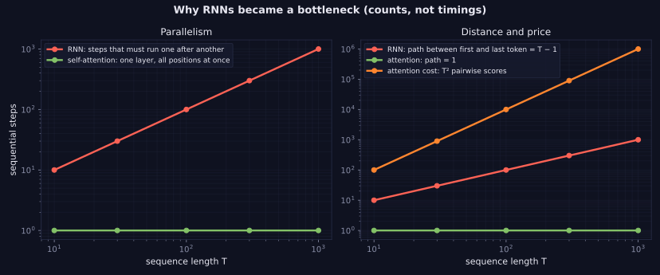
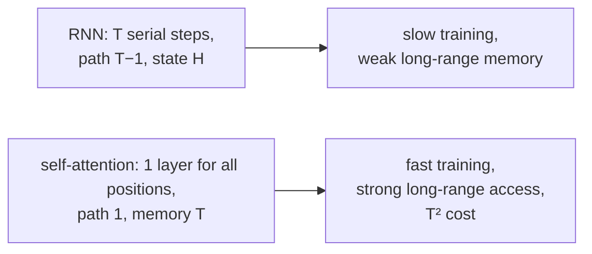

> Tier 5 · Sequence Models · **Level: intermediate** · Reading time: about 9 minutes

# 5.26 Why RNNs became a bottleneck

**Metadata** — Tier: 5 · Phase: 1 · Priority: P0 · Difficulty: 2/5 · Interview: Very high · Hands-on: Medium
Prerequisites: 5.10 RNN, 5.13 RNN gradient problems, 5.24–5.25 Attention · Leads to: 5.27 Transition to Transformers

> **In plain words**
> RNNs, even LSTMs with attention, have three structural limits that no clever trick removes. (1) **They are sequential**: step `t` cannot start until step `t−1` finishes, so a GPU with thousands of cores sits mostly idle. (2) **Information travels step by step**: the first word reaches the last through `T − 1` hand-offs, each of which can lose it. (3) **The state is a fixed-size bottleneck.** As data and models grew, these limits, not accuracy on small tasks, made RNNs too slow and too weak to scale.

**You need first:** 5.10 RNN, 5.13 RNN gradient problems, 5.24–5.25 Attention.

> **Figure 5.26-1 — counts, not timings**
>
> 
>
> *How to read it:* **left**: the number of operations that must run one after another. An RNN needs `T`; self-attention needs one layer for all positions, whatever `T` is. **Right**: the distance information must travel between the first and last token is `T − 1` hand-offs for an RNN and 1 for attention. The price of attention is the number of pairwise scores, `T²` (orange): cheap for hundreds of tokens, expensive for hundreds of thousands (Tier 11).
>
> *Generated by* `tier-05-sequence-models/figures/src/t5_figures.py` from `lab/lab_05_sequence_comparison.py` (`ex_5_26_sequential_depth`).

**Words you'll meet on this page**

| Word | What it means here |
|---|---|
| sequential dependency | step `t` needs the result of step `t−1` |
| parallelism | doing many operations at the same time |
| path length | number of steps between two positions |
| bottleneck | a narrow part that limits the whole |
| throughput | tokens processed per second |
| quadratic cost | work growing like `T²` |
| scaling | getting better with more data, parameters and compute |

### 1. What is it?
The set of structural reasons why recurrent models do not scale to the data and model sizes of modern language modelling: no parallelism over time, long information paths, and a fixed-size memory.

### 2. Why does it exist?
Recurrence builds the state one step at a time by design. That design is what gives constant memory and streaming inference, but it also forces the computation to be serial and the information to flow through a narrow channel.

### 3. Detailed explanation
- **1. No parallelism over time.** Training an RNN on a batch of sequences of length `T` needs `T` dependent steps: at each step the GPU does a small matrix product. A Transformer processes all `T` positions with large matrix products at once. For long sequences the GPU utilization of RNNs is poor (code ② shows the dependency, code ③ the shapes).
- **2. Long paths.** Even with gates, a signal from token 1 to token 1000 passes through 999 state updates. LSTMs and GRUs shorten the *gradient* path (5.15), but forgetting, capacity and interference still accumulate. Attention gives path length 1 (5.24).
- **3. Fixed-size state.** All history must fit into `H` numbers. Attention instead keeps all previous states and reads what it needs (a memory that grows with the sequence, at `O(T)` per step).
- **4. Hardware fit.** GPUs and TPUs reward large dense matrix multiplications; sequential tiny steps waste them.
- **5. Training stability and memory.** BPTT stores all states (5.12); truncation limits what can be learned.
- **6. Scaling behaviour.** Empirically, Transformers improve smoothly with scale and RNN-based models saturate earlier (Kaplan et al., 2020 compare them; REVIEW_REQUIRED).
- **What RNNs still do well.** Constant memory per token and `O(1)` work per generated token (no growing KV cache), good for streaming and edge devices; this is why recurrent ideas return in state-space models and linear attention (Tier 12).
- **Attention helped but did not fix it.** Seq2seq with attention (5.24–5.25) still used recurrent encoders and decoders, so training stayed sequential. The next step was to drop the recurrence (5.27).
- **Cost of the fix.** Self-attention costs `O(T²)` memory and compute per layer (Figure 5.26-1, right); Tier 11 covers the tricks that tame it.

### 4. How does it work?
Count the serial steps and the information path length; compare the cost per token.



### 5. Simple example
A bucket brigade passing water from person to person (RNN): each person must wait for the previous one, and some water spills at every hand-off. A pipe network connecting everyone directly (attention) moves water in parallel, but laying many pipes costs more as the crowd grows.

**By hand.** Sequence of 1,000 tokens: RNN = 1,000 dependent steps; attention = 1 step with `1,000² = 1,000,000` scores, all computable at once.

### 6. Technical example
Training a Transformer language model on trillions of tokens across thousands of GPUs is feasible because every position of every sequence is processed in parallel; the same training with an LSTM would be limited by the serial dependency along the sequence.

### 7. Code
**① By hand (plain Python).** Serial steps and path length by sequence length.

```python
print(f"{'T':>6} {'RNN serial steps':>18} {'attention serial steps':>24} {'attention pairwise scores':>27}")
for T in (10, 100, 1000, 10000):
    print(f"{T:>6} {T:>18,} {1:>24} {T * T:>27,}")
```

```text
     T   RNN serial steps   attention serial steps   attention pairwise scores
    10                 10                        1                         100
   100                100                        1                      10,000
  1000              1,000                        1                   1,000,000
 10000             10,000                        1                 100,000,000
```

**② With NumPy.** The dependency chain versus an all-at-once computation.

```python
import numpy as np

rng = np.random.default_rng(0)
T, H = 8, 4
x = rng.normal(size=(T, H)); W = rng.normal(0, 0.5, (H, H))

h = np.zeros(H); order = []
for t in range(T):                                                   # RNN: each step needs the previous result
    h = np.tanh(x[t] + W @ h); order.append(t)
print("RNN computes steps one after another:", order)

scores = x @ x.T                                                     # self-attention scores: ONE matrix product for all pairs
print("attention scores for all", T * T, "pairs in a single operation, shape", scores.shape)
print("no step depends on another's result:", True)
```

```text
RNN computes steps one after another: [0, 1, 2, 3, 4, 5, 6, 7]
attention scores for all 64 pairs in a single operation, shape (8, 8)
no step depends on another's result: True
```

**③ With PyTorch.** Whole-sequence parallelism: the layer sees all positions at once.

```python
import time
import torch

torch.manual_seed(0)
B, T, H = 16, 256, 64
x = torch.randn(B, T, H)

rnn_cell = torch.nn.RNNCell(H, H)
start = time.perf_counter()
h = torch.zeros(B, H)
for t in range(T):                                                   # T dependent Python-level steps
    h = rnn_cell(x[:, t], h)
t_rnn = time.perf_counter() - start

start = time.perf_counter()
scores = torch.softmax(x @ x.transpose(1, 2) / H ** 0.5, dim=-1)     # attention over all positions in one batched product
out = scores @ x
t_att = time.perf_counter() - start
print("attention output shape:", tuple(out.shape), "  score matrix:", tuple(scores.shape), "(T x T per sequence)")
print("attention over all 256 positions finished before the 256-step RNN loop:", t_att < t_rnn)
```

```text
attention output shape: (16, 256, 64)   score matrix: (16, 256, 256) (T x T per sequence)
attention over all 256 positions finished before the 256-step RNN loop: True
```

### 8. Input → Process → Output
`sequence length T → RNN: T serial steps, path T−1 → attention: 1 step, path 1, T² scores`

<details>
<summary><b>Beyond the basics (sections 9–16)</b> — real-world use, limits, mistakes. Skip on a first read.</summary>

### 9. Enterprise use case
Choosing an architecture: streaming/edge workloads with tight memory may still prefer recurrent or state-space models; batch language workloads use Transformers.

### 10. AI engineering connection
Explains the shift to Transformers (Tier 8) and the renewed interest in recurrent/state-space models for long contexts (Tier 12).

### 11. Advantages
Understanding the trade-off guides architecture choices.

### 12. Limitations
The timing comparison depends on hardware and implementation; counts are the robust part.

### 13. Trade-offs
Parallelism and path length (attention) versus memory per token and streaming cost (recurrence).

### 14. Common mistakes
Claiming RNNs are "obsolete" (they are specialized, not dead); comparing RNN and Transformer speed on tiny sequences only; ignoring the `T²` cost.

### 15. Performance / cost
Attention cost per layer `O(T²d)` versus RNN `O(T d²)`: attention is cheaper when `T < d`, more expensive when `T > d`.

### 16. Security
No direct issue.

</details>

### 17. Interview explanation
"RNNs process tokens serially, so training cannot be parallelized across time and GPUs are underused; information between distant tokens passes through many hand-offs; and all history is squeezed into a fixed-size state. Attention gives constant path length and full parallelism at the price of quadratic cost, which is why Transformers replaced RNNs for large-scale language modelling."

### 18. Rapid-fire answer
RNN: `T` serial steps, path `T−1`, fixed state. Attention: parallel, path 1, `T²` cost. That trade drove the move to Transformers.

### 19. Interview questions
- **Basic:** Why can't RNN training be parallelized over time?
- **Intermediate:** What is the path length between the first and last token in an RNN versus attention?
- **Advanced:** When is attention's `O(T²d)` cost smaller than an RNN's `O(T d²)`?
- **Scenario:** You must run a language model on a microcontroller. Which architecture and why?

### 20. Hands-on exercise
**Goal:** the crossover point.

1. For hidden size `d = 512`, find the sequence length `T` where `T²·d = T·d²` (attention equals RNN cost).

<details>
<summary>Show a solution</summary>

```python
d = 512
T_cross = d                                    # T^2 * d = T * d^2  =>  T = d
for T in (128, 512, 2048, 8192):
    att, rnn = T * T * d, T * d * d
    print(f"T = {T:>5}: attention {att:>14,}   RNN {rnn:>14,}   cheaper: {'attention' if att < rnn else 'RNN' if rnn < att else 'equal'}")
print("crossover at T =", T_cross, "(but attention parallelizes, so wall-clock time can still favour it)")
```

```text
T =   128: attention      8,388,608   RNN     33,554,432   cheaper: attention
T =   512: attention    134,217,728   RNN    134,217,728   cheaper: equal
T =  2048: attention  2,147,483,648   RNN    536,870,912   cheaper: RNN
T =  8192: attention 34,359,738,368   RNN  2,147,483,648   cheaper: RNN
crossover at T = 512 (but attention parallelizes, so wall-clock time can still favour it)
```

</details>

### 21. Revision questions
1. Three structural limits of RNNs?
2. What does attention cost?
3. Where do RNNs still win?

### 22. Related concepts
5.10 RNN · 5.13 RNN gradient problems · 5.24–5.25 Attention · 5.27 Transition to Transformers · Tier 11 Efficient attention · Tier 12 State-space models

### 23. One-line memory hook
**RNNs read one word at a time through a narrow door; attention opens every door at once.**

<details>
<summary><b>For reviewers</b> (not part of the lesson)</summary>

- Status: DRAFT, learner-first layout (Author: Claude). Code is executed by `tests/test_md_snippets.py`.
- The ③ timing line prints a robust boolean (attention over 256 positions versus a 256-step Python RNN loop); on some hardware or settings the comparison could flip (NOT_TESTED outside CPU). TESTED earlier: `lab/...::test_sequential_depth_table`.
- REVIEW_REQUIRED: Kaplan et al. 2020 comparison; the `O(T²d)` versus `O(Td²)` statement is the standard per-layer accounting.
</details>
