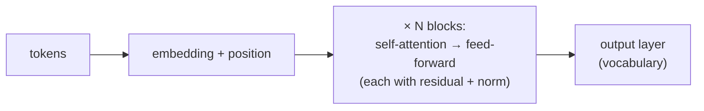

> Tier 5 · Sequence Models · **Level: intermediate** · Reading time: about 9 minutes

# 5.27 Transition to Transformers

**Metadata** — Tier: 5 · Phase: 1 · Priority: P0 · Difficulty: 2/5 · Interview: Very high · Hands-on: Medium
Prerequisites: 5.24–5.26 · Leads to: Tier 7 Attention, Tier 8 Transformer architecture

> **In plain words**
> The 2017 paper "Attention Is All You Need" took the idea from 5.24–5.25 to its conclusion: **if attention can connect any two positions directly, throw the recurrence away.** Let every token **attend to every other token** (self-attention), add information about **position** (since nothing reads in order any more), and stack the layers. Training becomes fully parallel and long-range access is one step. This page is the bridge; Tier 7 and 8 build the details.

**You need first:** 5.24–5.26 (attention and the RNN bottleneck).

> **Figure 5.27-1 — what changed from seq2seq with attention**
>
> ```mermaid
> flowchart LR
>     A["RNN encoder-decoder + attention<br/>(5.24)"] --> B["remove the recurrence"]
>     B --> C["self-attention:<br/>every token attends to every token"]
>     C --> D["+ positional information"]
>     D --> E["+ feed-forward layers,<br/>residuals, normalization"]
>     E --> F["Transformer"]
> ```
>
> *How to read it:* each box keeps one idea from before and drops the rest. Attention stays; the sequential RNN goes; position must be added explicitly because attention itself treats its inputs as an unordered set; the building blocks of Tier 3 (feed-forward layers, residual connections, layer normalization) make deep stacks trainable.

**Words you'll meet on this page**

| Word | What it means here |
|---|---|
| self-attention | tokens in one sequence attend to each other |
| query / key / value | the three projections used in attention |
| scaled dot-product | `softmax(QKᵀ/√d) V` |
| positional encoding | numbers added to tell the model where each token is |
| multi-head | several attention patterns in parallel |
| causal mask | hide future tokens when generating |
| cross-attention | decoder attending to encoder outputs (what 5.24 did) |

### 1. What is it?
The step from recurrent seq2seq-with-attention models to the Transformer (Vaswani et al., 2017): an architecture built from self-attention, position-wise feed-forward layers, residual connections and layer normalization, with no recurrence.

### 2. Why does it exist?
The three limits of 5.26 (serial, long paths, fixed state) all vanish when every position can attend to every other in one parallel operation, and when depth rather than recurrence builds up representations.

### 3. Detailed explanation
- **Scaled dot-product attention.** `Attention(Q, K, V) = softmax(QKᵀ / √d_k) V`. In 5.25 the query was the decoder state and the keys/values the encoder states; in **self**-attention all three come from the same sequence.
- **Queries, keys, values.** Each token is projected three ways: *query* (what I am looking for), *key* (what I offer), *value* (what I pass on if selected) (Tier 7).
- **Position.** Since `softmax(QKᵀ)V` ignores token order (permuting inputs permutes outputs), position is added with sinusoidal or learned vectors, or applied inside attention (RoPE; Tier 7).
- **Multi-head.** Several attention operations with different projections run in parallel and are concatenated.
- **Encoder and decoder stacks.** The encoder uses full self-attention; the decoder uses **causal** self-attention (a token cannot see the future, so it can be trained with teacher forcing on all positions at once, 5.22) and cross-attention to the encoder (exactly 5.24).
- **Everything else is Tier 3.** Feed-forward blocks (3.17), residual connections (3.27), LayerNorm (3.31), dropout (3.28), initialization (3.22–3.24).
- **What the Transformer fixed:** serial steps `T → 1` per layer; path length `T − 1 → 1`; memory `H → T·d` (the growing KV cache).
- **What it cost:** `O(T²)` compute and memory per layer; the need for position information; inference with a KV cache (Tier 11).
- **Outcome.** Faster training, better quality at scale, and the family of BERT (encoder), GPT (decoder) and T5 (encoder-decoder) models; LLMs are decoder-only Transformers.
- **What survives from this tier:** language modelling objective (5.2), embeddings (5.4), the encoder-decoder idea (5.20), teacher forcing (5.22), decoding (5.21), attention (5.24–5.25), gating intuition (5.14–5.19) and the vanishing-gradient story that motivates residual paths.
- **Not the end.** State-space and linear-recurrent models (Tier 12) revisit recurrence with Transformer-era tricks.

### 4. How does it work?
Embed tokens; add positions; repeat: self-attention (mix information between tokens), feed-forward (process each token), each wrapped with residual connection and normalization; project to the vocabulary.



### 5. Simple example
A meeting where everyone can hear everyone at once and decide whom to listen to (self-attention), instead of a chain where each person whispers a summary to the next.

**By hand.** Three tokens with 1-D "keys" `[1, 0, 1]` and a query `[1]`: scores `[1, 0, 1]` → softmax `[0.42, 0.16, 0.42]`; the output is the weighted mix of the three values.

### 6. Technical example
GPT-style LLMs: stacks of causal self-attention blocks trained with next-token prediction (teacher forcing on every position in parallel).

### 7. Code
**① By hand (plain Python).** Self-attention for three tokens, scalar queries/keys/values.

```python
import math

q = [1.0, 0.0, 1.0]                      # queries of tokens 1-3 (1-D for clarity)
k = [1.0, 0.0, 1.0]                      # keys
v = [10.0, 20.0, 60.0]                   # values
for i in range(3):
    scores = [q[i] * k[j] for j in range(3)]
    e = [math.exp(s) for s in scores]; w = [x / sum(e) for x in e]
    out = sum(wj * vj for wj, vj in zip(w, v))
    print(f"token {i + 1}: attention weights {[round(x, 2) for x in w]} -> output {out:.1f}")
```

```text
token 1: attention weights [0.42, 0.16, 0.42] -> output 32.7
token 2: attention weights [0.33, 0.33, 0.33] -> output 30.0
token 3: attention weights [0.42, 0.16, 0.42] -> output 32.7
```

**② With NumPy.** Scaled dot-product self-attention, and why position must be added.

```python
import numpy as np

rng = np.random.default_rng(0)
T, d = 5, 8
X = rng.normal(size=(T, d)); Wq, Wk, Wv = (rng.normal(0, 0.5, (d, d)) for _ in range(3))

def self_attention(X):
    Q, K, V = X @ Wq, X @ Wk, X @ Wv
    s = Q @ K.T / np.sqrt(d)
    w = np.exp(s - s.max(1, keepdims=True)); w /= w.sum(1, keepdims=True)
    return w @ V

out = self_attention(X)
perm = np.array([3, 1, 4, 0, 2])
print("output shape:", out.shape)
print("permuting the input tokens just permutes the outputs (order is invisible):", np.allclose(self_attention(X[perm]), out[perm]))
pos = np.sin(np.arange(T)[:, None] / (10 ** (np.arange(d)[None] / d)))        # a simple positional signal
print("after adding positions, shuffled tokens give different results (order now matters):", not np.allclose(self_attention(X[perm] + pos), self_attention(X + pos)[perm]))
```

```text
output shape: (5, 8)
permuting the input tokens just permutes the outputs (order is invisible): True
after adding positions, shuffled tokens give different results (order now matters): True
```

**③ With PyTorch.** The same operation with `F.scaled_dot_product_attention`, with and without a causal mask.

```python
import torch
import torch.nn.functional as F

torch.manual_seed(0)
B, T, d = 2, 5, 8
q, k, v = torch.randn(B, T, d), torch.randn(B, T, d), torch.randn(B, T, d)

manual = torch.softmax(q @ k.transpose(1, 2) / d ** 0.5, dim=-1) @ v
builtin = F.scaled_dot_product_attention(q, k, v)
print("manual equals F.scaled_dot_product_attention:", torch.allclose(manual, builtin, atol=1e-5))

causal = F.scaled_dot_product_attention(q, k, v, is_causal=True)
v2 = v.clone(); v2[:, -1] += 100.0                                         # change only the LAST token's value
changed = F.scaled_dot_product_attention(q, k, v2, is_causal=True)
print("with the causal mask, earlier outputs ignore the last token:", torch.allclose(causal[:, :-1], changed[:, :-1], atol=1e-5))
```

```text
manual equals F.scaled_dot_product_attention: True
with the causal mask, earlier outputs ignore the last token: True
```

### 8. Input → Process → Output
`tokens + positions → [self-attention → feed-forward] × N → next-token (or other) predictions`

<details>
<summary><b>Beyond the basics (sections 9–16)</b> — real-world use, limits, mistakes. Skip on a first read.</summary>

### 9. Enterprise use case
Practically all modern language, vision-language and speech systems.

### 10. AI engineering connection
The foundation of the rest of the book: Tier 6 (tokenization and embeddings), Tier 7 (attention), Tier 8 (Transformer), Tier 11 (inference), Tier 12 (modern architectures).

### 11. Advantages
Parallel training, direct long-range access, scalable.

### 12. Limitations
Quadratic cost; no built-in order; growing inference memory.

### 13. Trade-offs
Recurrent efficiency at inference versus Transformer efficiency at training and scale.

### 14. Common mistakes
Forgetting positional information; leaking the future without a causal mask; ignoring the `√d` scale; assuming attention weights are explanations.

### 15. Performance / cost
Attention `O(T²d)`; mitigations in Tier 11 (FlashAttention, KV cache, sparse and linear attention).

### 16. Security
Long contexts enlarge the attack surface for prompt injection (Tier 15+).

</details>

### 17. Interview explanation
"The Transformer replaces recurrence with self-attention: every token attends to every other in one parallel step, positions are injected explicitly, and feed-forward, residual and normalization layers make deep stacks trainable. It removes the serial dependency and long information paths of RNNs, at the price of quadratic attention cost, and it is trained with teacher forcing using a causal mask."

### 18. Rapid-fire answer
Self-attention `softmax(QKᵀ/√d)V` instead of recurrence; add positions; causal mask for generation; feed-forward + residual + LayerNorm; parallel training; `O(T²)`.

### 19. Interview questions
- **Basic:** What does self-attention do?
- **Intermediate:** Why do Transformers need positional encodings?
- **Advanced:** What does the causal mask do and why does it allow parallel training?
- **Scenario:** Your Transformer ignores word order. What did you forget?

### 20. Hands-on exercise
**Goal:** build the causal mask yourself.

1. For `T = 5` create the lower-triangular mask and apply it to random scores before the softmax.
2. Print the weights: row `i` must be zero for columns `> i`.

<details>
<summary>Show a solution</summary>

```python
import numpy as np

rng = np.random.default_rng(0)
T = 5
scores = rng.normal(size=(T, T))
mask = np.tril(np.ones((T, T), dtype=bool))
scores = np.where(mask, scores, -np.inf)
w = np.exp(scores - scores.max(1, keepdims=True)); w /= w.sum(1, keepdims=True)
print(w.round(2))
print("rows sum to 1:", np.allclose(w.sum(1), 1), "   upper triangle is zero:", np.allclose(np.triu(w, 1), 0))
```

```text
[[1.   0.   0.   0.   0.  ]
 [0.28 0.72 0.   0.   0.  ]
 [0.32 0.62 0.06 0.   0.  ]
 [0.15 0.18 0.22 0.46 0.  ]
 [0.1  0.43 0.06 0.15 0.27]]
rows sum to 1: True    upper triangle is zero: True
```

</details>

### 21. Revision questions
1. What are queries, keys and values?
2. Why add positional information?
3. What did attention-only models gain over RNNs?

### 22. Related concepts
5.24–5.25 Attention · 5.26 RNN bottleneck · Tier 3 (feed-forward, residuals, LayerNorm) · Tier 7 Attention · Tier 8 Transformer

### 23. One-line memory hook
**Transformer: attention without the chain: everyone looks at everyone, all at once.**

<details>
<summary><b>For reviewers</b> (not part of the lesson)</summary>

- Status: DRAFT, learner-first layout (Author: Claude). Code is executed by `tests/test_md_snippets.py`.
- Tiers 6–8 (tokenization, attention, Transformers) are drafted separately on `chatgpt-bgc-1012` (now merged under `phase-2-transformers-foundation-models/`); this page is a bridge and defers details to them. REVIEW_REQUIRED: Vaswani et al. 2017 attribution; BERT/GPT/T5 mapping; RoPE mention.
</details>
