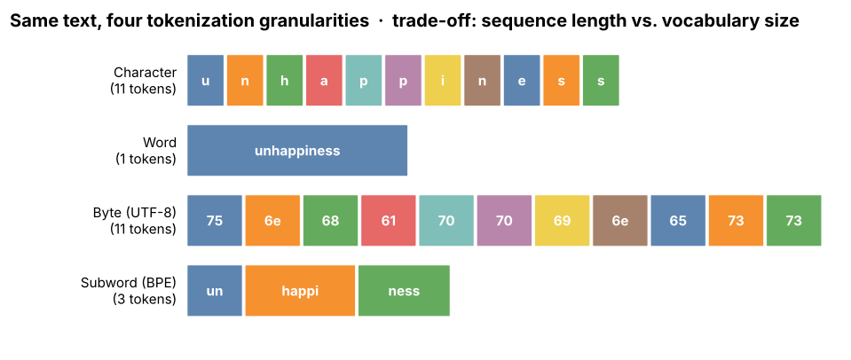

## 6.5 Subword tokenization

Metadata:

- Tier: 6 — Tokenization & Embeddings
- Phase: 2 — Transformers & Foundation Models
- Priority: Critical
- Difficulty: Intermediate
- Interview Importance: Very high
- Hands-on Importance: High
- Prerequisites: [6.2 Character tokenization](06.02-character-tokenization.md), [6.3 Word tokenization](06.03-word-tokenization.md), [6.4 Byte tokenization](06.04-byte-tokenization.md)
- Leads To: [6.12 BPE](06.12-bpe.md), [6.13 WordPiece](06.13-wordpiece.md), [6.14 SentencePiece](06.14-sentencepiece.md), [6.15 Unigram LM tokenizer](06.15-unigram-lm-tokenizer.md), [6.6 Vocabulary](06.06-vocabulary.md)

---

### 1. WHAT IS IT?

Subword tokenization represents text as a sequence of pieces between characters and words: frequent words stay whole; rare words are split into reusable fragments (`unhappiness -> un | happi | ness`).

### 2. WHY DOES IT EXIST?

It resolves the word-vs-character dilemma: a bounded vocabulary (about 10^4-2x10^5 entries), reasonably short sequences, and graceful handling of unseen words by composing known pieces.

### 3. DETAILED EXPLANATION

All major LLM tokenizers are subword-based. The algorithms differ in how they build the vocabulary:

| | [6.12 BPE](06.12-bpe.md) | [6.13 WordPiece](06.13-wordpiece.md) | [6.15 Unigram LM tokenizer](06.15-unigram-lm-tokenizer.md) |
|---|---|---|---|
| Direction | bottom-up merges | bottom-up (likelihood score) | top-down pruning |
| Encoding | apply merges in learned order | greedy longest match | Viterbi best segmentation |
| Multiple segmentations | no | no | yes (sampling) |
| Typical users | GPT-style, many open LLMs | BERT-family | T5-style via [6.14 SentencePiece](06.14-sentencepiece.md) |

Common design choices that matter as much as the algorithm: byte base alphabet or not ([6.4 Byte tokenization](06.04-byte-tokenization.md)), pre-tokenization rules, how digits and whitespace are treated, vocabulary size ([6.28 Vocabulary-size trade-offs](06.28-vocabulary-size-trade-offs.md)) and reserved special tokens ([6.8 UNK](06.08-unk.md)-[6.11 EOS](06.11-eos.md)).

### 4. HOW DOES IT WORK?

1. Choose base symbols and a target vocabulary size.
2. Learn pieces from a corpus (merge or prune).
3. Freeze the table; encode new text by greedy/ordered/optimal segmentation; decode by concatenation.



*Figure 1 - Subword (bottom row) sits between characters and whole words in token count.*

See the animation in [6.12 BPE](06.12-bpe.md).

### 5. SIMPLE EXAMPLE

LEGO bricks: common shapes are single big bricks, unusual shapes are built from small ones.

### 6. TECHNICAL EXAMPLE

`tokenization` may be one token; `tokenizationally` may be `token|ization|ally`. A rare drug name becomes several pieces; arithmetic digits may be grouped unevenly (`1234` could be `123|4`, which can hurt arithmetic).

### 7. CODE

```python
# run inside lab/
from mini_bpe import ByteBPE
corpus = "low lower lowest newer newest wider widest " * 30
tok = ByteBPE.train(corpus, num_merges=25)
print(tok.tokens("lowest widest unseenword"))   # familiar parts merge, unseen word falls back to small pieces
```
[explore: `bpe_trainer.html`](interactive/bpe_trainer.html)

### 8. INPUT → PROCESS → OUTPUT

```
rare word ──► [known piece][known piece][known piece] ──► IDs ──► embeddings
```

### 9. ENTERPRISE USE CASE

Every hosted LLM API bills in subword tokens; engineering teams budget prompts, chunk sizes and rate limits in them.

### 10. AI ENGINEERING CONNECTION

Defines the units of context windows, cost, logprobs and the embedding table rows ([6.18 Embedding matrix](06.18-embedding-matrix.md)).

### 11. ADVANTAGES

Bounded vocabulary; no OOV (with byte base); parameter sharing across morphology; tunable compression.

### 12. LIMITATIONS

Frequency-driven rather than linguistic; fragmentation of numbers, rare scripts and code; frozen after training.

### 13. TRADE-OFFS

Larger vocabulary = shorter sequences but a bigger embedding/softmax table and undertrained rare tokens ([6.28 Vocabulary-size trade-offs](06.28-vocabulary-size-trade-offs.md)).

### 14. COMMON MISTAKES

- Comparing token counts across different tokenizers as if equal.
- Changing tokenizer without retraining.
- Training the tokenizer on data unlike production data.

### 15. PERFORMANCE / COST CONSIDERATIONS

Tokenization speed is not usually the bottleneck; tokens per document is (cost, latency, context fit).

### 16. SECURITY CONSIDERATIONS

Rarely trained tokens (glitch tokens) can cause unstable behaviour; user-supplied special-token strings must be escaped ([6.10 BOS](06.10-bos.md)).

### 17. INTERVIEW EXPLANATION

*"Subword tokenization keeps common words as single tokens and breaks rare words into frequent pieces. That bounds the vocabulary, keeps sequences short, and avoids unknown tokens. BPE, WordPiece and Unigram are three ways to build the vocabulary."*

### 18. RAPID-FIRE ANSWER

Frequent words whole, rare words in reusable pieces.

### 19. INTERVIEW QUESTIONS

- **Basic:** Why is subword better than word-level?
- **Intermediate:** How do BPE and Unigram differ in how they build a vocabulary?
- **Advanced:** Why do numbers tokenize badly in many subword vocabularies?
- **Scenario:** A user pastes a long DNA string and cost spikes; why?

### 20. HANDS-ON EXERCISE

Train the lab BPE on two different corpora; print how the same sentence is split by each.

### 21. REVISION QUESTIONS

1. Name the three main subword algorithms.
2. What does a subword vocabulary guarantee about unseen words?

### 22. RELATED CONCEPTS

[6.12 BPE](06.12-bpe.md), [6.13 WordPiece](06.13-wordpiece.md), [6.14 SentencePiece](06.14-sentencepiece.md), [6.15 Unigram LM tokenizer](06.15-unigram-lm-tokenizer.md), [6.28 Vocabulary-size trade-offs](06.28-vocabulary-size-trade-offs.md)

### 23. ONE-LINE MEMORY HOOK

*Common words whole, rare words in pieces.*
