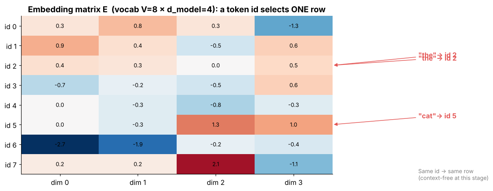

## 6.18 Embedding matrix

Metadata:

- Tier: 6 — Tokenization & Embeddings
- Phase: 2 — Transformers & Foundation Models
- Priority: Critical
- Difficulty: Beginner
- Interview Importance: Very high
- Hands-on Importance: High
- Prerequisites: [6.17 Token embedding](06.17-token-embedding.md), [6.6 Vocabulary](06.06-vocabulary.md)
- Leads To: [6.19 Embedding dimensions](06.19-embedding-dimensions.md), [6.28 Vocabulary-size trade-offs](06.28-vocabulary-size-trade-offs.md), [Tier 8](../tier-08-transformer-architecture/README.md)

---

### 1. WHAT IS IT?

The embedding matrix `E in R^(V x d)` stores one learnable `d`-dimensional vector per vocabulary entry; looking up token ID *i* returns row *i*.

### 2. WHY DOES IT EXIST?

It is the interface between discrete IDs and continuous math.

### 3. DETAILED EXPLANATION

Mathematically, lookup equals `one_hot(i) @ E`; it is implemented as indexing because the matrix product wastes `O(V d)` work. **Parameters:** `V*d`. **Weight tying:** many models share the input matrix with the output (unembedding) projection, halving this parameter block (full treatment in [Tier 8](../tier-08-transformer-architecture/README.md)). **Gradients** are sparse: only rows used in the batch update (with optimizer momentum, others may still move).

Example sizes (arithmetic, not model claims): `V=50,257, d=768` -> 38.6 M parameters; `V=128,000, d=4,096` -> 524 M; `V=32,000, d=4,096` -> 131 M.

### 4. HOW DOES IT WORK?

`E[ids]` for ids of shape `(batch, seq)` returns `(batch, seq, d)`. Output side: `logits = h @ E.T` when tied.



*Figure 4 - Embedding lookup as row selection.*

### 5. SIMPLE EXAMPLE

A big spreadsheet with one row per token; you read the row whose number is the token ID.

### 6. TECHNICAL EXAMPLE

Tied embeddings: the same rows are used to read tokens in and to score tokens out.

### 7. CODE

```python
import numpy as np
V, d = 6, 3
E = np.arange(V * d, dtype=float).reshape(V, d)
i = 4
one_hot = np.eye(V)[i]
assert np.array_equal(one_hot @ E, E[i])            # lookup == one-hot matmul
print("params:", E.size, "= V*d")
print("example sizes (M):", [round(v * dd / 1e6, 1) for v, dd in [(50257, 768), (128000, 4096), (32000, 4096)]])
```
Code: [`lab/positional.py`](lab/positional.py) (`embedding_lookup`) | [explore: `vocab_tradeoff.html`](interactive/vocab_tradeoff.html)

### 8. INPUT → PROCESS → OUTPUT

```
ids (B,T) ──index E (V×d)──► (B,T,d)         tied output: h (B,T,d) ──@ Eᵀ──► logits (B,T,V)
```

### 9. ENTERPRISE USE CASE

Capacity planning: embedding + head memory is a deployment line item, especially for small, huge-vocabulary models.

### 10. AI ENGINEERING CONNECTION

Together with the head it determines the vocabulary-dependent share of parameters ([6.28 Vocabulary-size trade-offs](06.28-vocabulary-size-trade-offs.md)).

### 11. ADVANTAGES

Cheap lookup; learnable; tie-able.

### 12. LIMITATIONS

Memory grows linearly in V and d; rare rows undertrained.

### 13. TRADE-OFFS

Tied versus untied output (saves parameters; couples input/output geometry).

### 14. COMMON MISTAKES

- Resizing V without resizing the output layer.
- Using one-hot matmul in code.
- Counting only the input table and forgetting the untied head.

### 15. PERFORMANCE / COST CONSIDERATIONS

`V*d*bytes` memory: V=128k, d=4096 in fp16 is about 1.05 GB (`128000*4096*2`).

### 16. SECURITY CONSIDERATIONS

Embedding matrices can be inverted partially to reveal training data tendencies; treat checkpoints as sensitive artifacts.

### 17. INTERVIEW EXPLANATION

*"The embedding matrix is V by d: one trainable vector per token. Lookup is row indexing, mathematically a one-hot matmul. Tying it with the output head saves V times d parameters."*

### 18. RAPID-FIRE ANSWER

V x d table; lookup = row index = one-hot @ E.

### 19. INTERVIEW QUESTIONS

- **Basic:** What are the dimensions of the embedding matrix?
- **Intermediate:** Why index instead of one-hot matmul?
- **Advanced:** What does weight tying do?
- **Scenario:** The model OOMs after you switch to a 256k-vocab tokenizer; why?

### 20. HANDS-ON EXERCISE

Compute the fp16 memory of the embedding table for V in {32k, 128k, 256k} at d=4096.

### 21. REVISION QUESTIONS

1. Show `one_hot(i) @ E == E[i]`.
2. How many parameters in the table?

### 22. RELATED CONCEPTS

[6.17 Token embedding](06.17-token-embedding.md), [6.19 Embedding dimensions](06.19-embedding-dimensions.md), [6.28 Vocabulary-size trade-offs](06.28-vocabulary-size-trade-offs.md)

### 23. ONE-LINE MEMORY HOOK

*One row per token, V rows tall.*
