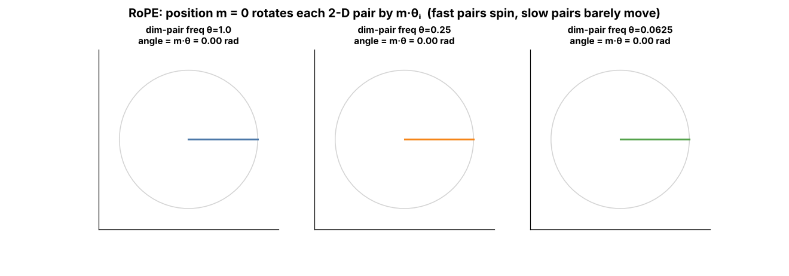

## 6.24 RoPE

Metadata:

- Tier: 6 — Tokenization & Embeddings
- Phase: 2 — Transformers & Foundation Models
- Priority: Critical
- Difficulty: Advanced
- Interview Importance: Very high
- Hands-on Importance: High
- Prerequisites: [6.22 Sinusoidal positional encoding](06.22-sinusoidal-positional-encoding.md), [6.23 Relative positional encoding](06.23-relative-positional-encoding.md), [Tier 7](../tier-07-attention/README.md)
- Leads To: [Tier 12](../tier-12-modern-architectures/README.md) (long-context scaling)

---

### 1. WHAT IS IT?

Rotary Position Embedding (RoPE) encodes position by *rotating* query and key vectors in 2-D subspaces by an angle proportional to the token's position.

### 2. WHY DOES IT EXIST?

It gives attention scores that depend on content and the **relative** offset only, with no extra parameters, and it is widely adopted in open LLM families (`REVIEW_REQUIRED` for specific models).

### 3. DETAILED EXPLANATION

Split a head's vector (dimension `d_head`, even) into `d_head/2` pairs. Pair *i* at position *m* is rotated by angle `m*theta_i`, with `theta_i = base^(-2i/d_head)` (base 10000 in the original paper; some newer models use larger bases for long context, `REVIEW_REQUIRED` per model).

**Key property.** With rotation matrices `R`, `(R_m q) . (R_n k) = q^T R_(n-m) k`: the score depends on the content of q and k and only on the **offset** `m - n`. Rotations preserve vector norms. RoPE is applied to **Q and K** (not V, not the residual stream).

**Frequency spread.** Low pair indices have large `theta` and rotate fast (fine position resolution); high indices barely rotate (long-range). Lowering the base makes more pairs rotate; raising it stretches the slow ones. **Context extension** (position interpolation, base change, YaRN-style methods) rescales these frequencies; [Tier 12](../tier-12-modern-architectures/README.md) is authoritative for variants.

**Implementation conventions** differ: *interleaved* pairs `(x0,x1),(x2,x3)...` (the lab) vs *half-split* pairs `(x_i, x_(i+d/2))` used by some libraries; loading a checkpoint with the wrong convention gives silently wrong results (`REVIEW_REQUIRED` for specific libraries).

### 4. HOW DOES IT WORK?



*Figure 6 - Position m rotates each 2-D pair by m*theta. The left pair has a large theta and spins fast; the right pairs barely move.*

Verify relative-position invariance interactively in [explore: `rope_explorer.html`](interactive/rope_explorer.html): slide 'shift both by' and the score stays fixed.

### 5. SIMPLE EXAMPLE

Two compass needles: if you rotate both by the same amount, the angle between them (and thus how they relate) is unchanged; only the gap matters.

### 6. TECHNICAL EXAMPLE

Rotating q at position 5 and k at position 2 gives the same dot product as q at 12 and k at 9.

### 7. CODE

```python
# run inside lab/
import numpy as np
from positional import apply_rope
rng = np.random.default_rng(0)
q, k = rng.normal(size=(1, 8)), rng.normal(size=(1, 8))
Q = apply_rope(np.repeat(q, 20, 0))      # q placed at every position 0..19
K = apply_rope(np.repeat(k, 20, 0))
print(np.isclose(Q[5] @ K[2], Q[12] @ K[9]))     # True : same offset (3) -> same score
print(np.isclose(Q[5] @ K[2], Q[5] @ K[3]))      # False: different offset
x = rng.normal(size=(6, 8))
print(np.allclose(np.linalg.norm(apply_rope(x), axis=1), np.linalg.norm(x, axis=1)))   # True: norm preserved
# in an attention layer: scores = apply_rope(Q_matrix) @ apply_rope(K_matrix).T
```
Code: [`lab/positional.py`](lab/positional.py) (`apply_rope`) | `test_rope_preserves_norm_and_is_relative` in [`lab/test_tier06.py`](lab/test_tier06.py)

### 8. INPUT → PROCESS → OUTPUT

```
q_m, k_n ──rotate by m·θ, n·θ──► (R_m q)·(R_n k) = qᵀ R_(n−m) k ──► score depends on n−m
```

### 9. ENTERPRISE USE CASE

Teams extending context windows of open models do so by changing RoPE scaling/base plus fine-tuning; evaluation on long documents is required (`REVIEW_REQUIRED` for methods' quality claims).

### 10. AI ENGINEERING CONNECTION

Position scheme of Llama-style and many other open LLMs; central to long-context engineering ([Tier 12](../tier-12-modern-architectures/README.md)).

### 11. ADVANTAGES

Relative information with no learned table; norm-preserving; no change to V; efficient.

### 12. LIMITATIONS

Quality can degrade beyond trained length; extension needs frequency scaling; convention mismatches between libraries.

### 13. TRADE-OFFS

Elegant and parameter-free versus the need for scaling tricks and careful implementation.

### 14. COMMON MISTAKES

- Odd head dimension.
- Applying RoPE to V.
- Interleaved vs half-split mismatch with a checkpoint.
- Using an RoPE base different from the checkpoint's.

### 15. PERFORMANCE / COST CONSIDERATIONS

Cheap elementwise rotations on Q and K (fused in modern kernels); cos/sin tables can be cached.

### 16. SECURITY CONSIDERATIONS

Very long contexts enabled by RoPE scaling enlarge the prompt-injection surface and cost; enforce token budgets.

### 17. INTERVIEW EXPLANATION

*"RoPE encodes position by rotating query and key vectors in 2-D subspaces by an angle proportional to position. Because dot products of rotations depend only on the angle difference, attention automatically sees relative distance. It has no parameters and works well, but extending beyond the trained context needs rescaling the frequencies."*

### 18. RAPID-FIRE ANSWER

Rotate Q and K by position-dependent angles so scores depend on relative offset.

### 19. INTERVIEW QUESTIONS

- **Basic:** What does RoPE rotate, and which tensors?
- **Intermediate:** Why does the score depend only on m-n?
- **Advanced:** Why does changing the base affect long-range behaviour?
- **Scenario:** Your long-context fine-tune produces garbage when loaded in another library; what do you check first?

### 20. HANDS-ON EXERCISE

In `rope_explorer.html` set base to 100 vs 100000; which pairs stop rotating? Predict the effect on long-range resolution.

### 21. REVISION QUESTIONS

1. State RoPE's key property in one sentence and test it numerically.
2. Why is V not rotated?
3. What is the angle of pair i at position m?

### 22. RELATED CONCEPTS

[6.22 Sinusoidal positional encoding](06.22-sinusoidal-positional-encoding.md), [6.23 Relative positional encoding](06.23-relative-positional-encoding.md), [6.25 ALiBi](06.25-alibi.md), [Tier 12](../tier-12-modern-architectures/README.md)

### 23. ONE-LINE MEMORY HOOK

*Position is an angle; distance is the angle between.*
