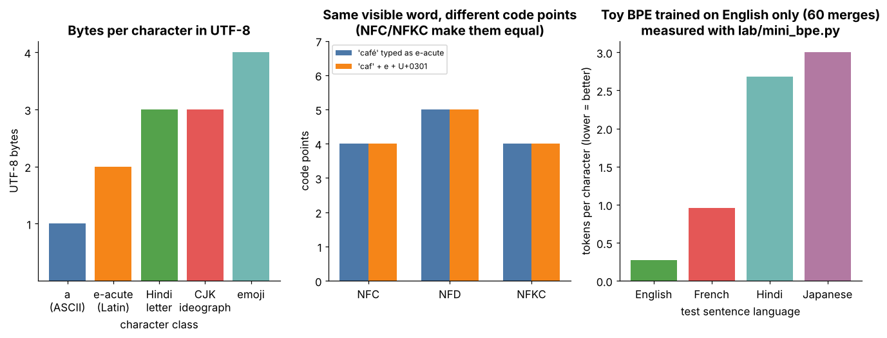

> Tier 6 · Tokenization & Embeddings · **Level: intermediate** · Reading time: about 6 minutes

# 6.31 Tokenization efficiency

**Metadata** — Tier: 6 · Phase: 2 · Priority: Critical · Difficulty: Intermediate · Interview: Very high · Hands-on: High
Prerequisites: [6.5 Subword tokenization](06.05-subword-tokenization.md), [6.28 Vocabulary-size trade-offs](06.28-vocabulary-size-trade-offs.md), [6.4 Byte tokenization](06.04-byte-tokenization.md) · Leads to: [6.32 Tokens-per-character / compression intuition](06.32-tokens-per-character-compression-intuition.md), cost/latency tiers

> **In plain words**
> **Tokenization efficiency** is how few tokens a tokenizer needs for a given text. It is measured as bytes per token (higher is better), tokens per character (lower is better) or fertility (tokens per word). Measured per language and domain, it is a **cost and fairness** number: the same message can cost several times more tokens in Hindi or Japanese than in English, and fits less into the context window.

**You need first:** [6.5 Subword tokenization](06.05-subword-tokenization.md), [6.28 Vocabulary-size trade-offs](06.28-vocabulary-size-trade-offs.md), [6.4 Byte tokenization](06.04-byte-tokenization.md).

> **Figure 6.31-1 — Tokens per character differ by script**
>
> 
>
> *How to read it:* the same English-trained tokenizer needs about one token per character for English-like text but several tokens per character for scripts it saw rarely. Efficiency must always be reported per language and with the target model's own tokenizer.

**Words you'll meet on this page**

| Word | What it means here |
|---|---|
| bytes per token | UTF-8 bytes of text divided by number of tokens |
| tokens per character | number of tokens divided by number of characters |
| fertility | tokens per whitespace-separated word (not meaningful without spaces) |
| context window | the maximum number of tokens a model can read |
| domain tokenizer | one trained on your own kind of text (6.27) |
| fairness | users of some languages pay more for the same content |

### 1. What is it?

Tokenization efficiency is how few tokens a tokenizer needs to represent a given text; it is measured in bytes per token, tokens per character, or fertility (tokens per word), per language and domain.

### 2. Why does it exist?

Everything operational is priced and bounded in tokens: API cost, latency, context window and rate limits. A tokenizer that is 2x less efficient on your language doubles cost and halves effective context.

### 3. Detailed explanation

**Metrics:** bytes/token (higher is better), tokens/character (lower is better), **fertility** = tokens per whitespace word (meaningless for languages without spaces). Always report **per language and domain** and with the *target model's* tokenizer.

English prose is often around 3.5-4.5 characters/token on modern tokenizers (`REVIEW_REQUIRED` - varies by tokenizer); many non-Latin scripts and code with unusual formatting can be several times worse. That is a **fairness and cost issue**: the same message costs more and fits less in the context window.

**Levers:** switch to a more suitable model/tokenizer; train a domain tokenizer ([6.27 Tokenizer training](06.27-tokenizer-training.md)); pre-process (strip boilerplate, normalize whitespace where safe); compress prompts; restructure data (e.g. avoid verbose JSON keys, long UUIDs).

### 4. How does it work?


### 5. Simple example

Shipping the same goods in boxes of different sizes: the smaller the box count, the cheaper the freight.

**By hand.** Suppose a tokenizer turns the 22-character English sentence "the dog sat on the mat" into 7 tokens: 3.1 characters per token, fertility 7 / 6 words = 1.17. The same tokenizer turns a 6-character Hindi phrase into 17 tokens (the library example below): 2.8 tokens per character, almost 9 times the tokens per character of the English sentence. At the same price per token the Hindi text costs almost 9 times as much per character and uses up the context window almost 9 times faster.

### 6. Technical example

A support product measures fertility on 1,000 real tickets per language before choosing a model; a Thai/Hindi cost gap becomes a pricing and context-budget decision.

### 7. Code

**① By hand (plain Python).** The three metrics for one sentence.

```python
text = "the dog sat on the mat"
n_tokens = 8                                                    # pretend the tokenizer produced 8 tokens
print("characters:", len(text), "  bytes:", len(text.encode()), "  words:", len(text.split()))
print("tokens/char:", round(n_tokens / len(text), 2), "  bytes/token:", round(len(text.encode()) / n_tokens, 2), "  fertility:", round(n_tokens / len(text.split()), 2))
```

```text
characters: 22   bytes: 22   words: 6
tokens/char: 0.36   bytes/token: 2.75   fertility: 1.33
```

**② With NumPy.** What fragmentation costs in money and context.

```python
price_per_million = 3.0                                          # dollars per million tokens, an assumed price
messages = 1_000_000
for name, tokens_per_message in (("English (efficient)", 25), ("Hindi (fragmented)", 75), ("Japanese (fragmented)", 60)):
    cost = messages * tokens_per_message * price_per_million / 1e6
    print(f"{name:<22}: {tokens_per_message:>3} tokens/message -> ${cost:>7,.0f} per million messages; fits {8192 // tokens_per_message:>3} messages in 8k context")
```

```text
English (efficient)   :  25 tokens/message -> $     75 per million messages; fits 327 messages in 8k context
Hindi (fragmented)    :  75 tokens/message -> $    225 per million messages; fits 109 messages in 8k context
Japanese (fragmented) :  60 tokens/message -> $    180 per million messages; fits 136 messages in 8k context
```

**③ With the tier library.** Measuring a real (tiny) tokenizer on two scripts.

```python
import sys
sys.path.insert(0, "lab")
from mini_bpe import ByteBPE
from tokenizer_extras import fertility, tokens_per_char

tok = ByteBPE.train("the cat sat on the mat and the dog ran to the park " * 40, 60)
samples = {"English": "the dog sat on the mat", "Hindi": "\u0915\u0941\u0924\u094d\u0924\u093e \u092c\u0948\u0920\u093e"}
for lang, s in samples.items():
    n = len(tok.encode(s))
    print(f"{lang:<8} tokens/char {tokens_per_char(n, s):.2f} | fertility {fertility(n, s):.2f} | bytes/token {len(s.encode()) / n:.2f}")
```

```text
English  tokens/char 0.32 | fertility 1.17 | bytes/token 3.14
Hindi    tokens/char 2.82 | fertility 15.50 | bytes/token 1.00
```

**Lab excerpt** (from the tier's `lab/`, as originally authored; run inside the `lab/` folder):

```python
# run inside lab/
from mini_bpe import ByteBPE
from tokenizer_extras import fertility, tokens_per_char
tok = ByteBPE.train("the cat sat on the mat and the dog ran to the park " * 40, 60)
samples = {"English": "the dog sat on the mat", "Hindi": "\u0915\u0941\u0924\u094d\u0924\u093e \u092c\u0948\u0920\u093e"}
for lang, s in samples.items():
    n = len(tok.encode(s))
    print(lang, "tokens/char:", round(tokens_per_char(n, s), 2), "| fertility:", round(fertility(n, s), 2), "| bytes/token:", round(len(s.encode()) / n, 2))
```
Code: [`lab/tokenizer_extras.py`](lab/tokenizer_extras.py) (`tokens_per_char`, `fertility`), [`lab/mini_bpe.py`](lab/mini_bpe.py) (`compression_ratio`) | [explore: `bpe_trainer.html`](interactive/bpe_trainer.html)

### 8. Input → Process → Output

```
text ─► tokenizer ─► n_tokens ─► (bytes/token, tokens/char, fertility) ─► cost, latency, context fit
```

<details>
<summary><b>Beyond the basics (sections 9–16)</b> — real-world use, limits, mistakes. Skip on a first read.</summary>

### 9. Enterprise use case

Cost dashboards track tokens per request per language; procurement compares providers on a representative sample, not on English benchmarks.

### 10. AI engineering connection

Context windows, rate limits, RAG chunk sizes, prompt budgets and cost dashboards are all in *tokens*: always count with the target model's tokenizer.

### 11. Advantages

Directly reduces cost and latency; improves fairness.

### 12. Limitations

Metrics depend on sample choice; not comparable across tokenizers without a common reference (bytes).

### 13. Trade-offs

Efficiency versus vocabulary size and training cost ([6.28 Vocabulary-size trade-offs](06.28-vocabulary-size-trade-offs.md)).

### 14. Common mistakes

- Counting characters instead of tokens.
- Using one tokenizer to budget for another model.
- Reporting only English numbers.

### 15. Performance / cost

Linear effect on cost; attention cost is quadratic in tokens so efficiency compounds.

### 16. Security

Untrusted inputs can be crafted to be token-expensive (cost-DoS); cap *tokens* and rate-limit.

</details>

### 17. Interview explanation

*"Tokenization efficiency is tokens per unit of text, measured per language and domain. It sets cost, latency and effective context, and a weak tokenizer for a language is both an expense and a fairness problem."*

### 18. Rapid-fire answer

Fewer tokens per text = cheaper, faster, more context; measure per language.

### 19. Interview questions

- **Basic:** What is fertility?
- **Intermediate:** Why measure per language?
- **Advanced:** Why is bytes/token the safest cross-tokenizer comparison?
- **Scenario:** RAG chunks of 500 characters sometimes exceed the LLM limit; why and how to fix?

### 20. Hands-on exercise

Run the snippet, then add a code sample and a URL-heavy sample; rank their efficiency.

<details>
<summary>Show a solution</summary>

```python
import sys
sys.path.insert(0, "lab")
from mini_bpe import ByteBPE

tok = ByteBPE.train("the cat sat on the mat and the dog ran to the park " * 40, 60)
for name, s in (("plain English", "the dog sat on the mat"), ("UUID", "3f2b8c1e-9a4d-4e7b-8c2f-1d5e6a7b8c9d"), ("JSON keys", '{"customer_identifier": 1, "customer_name": "x"}')):
    print(f"{name:<14}: {len(s):>3} characters -> {len(tok.encode(s)):>3} tokens ({len(s.encode()) / len(tok.encode(s)):.2f} bytes/token)")
```

```text
plain English :  22 characters ->   7 tokens (3.14 bytes/token)
UUID          :  36 characters ->  36 tokens (1.00 bytes/token)
JSON keys     :  48 characters ->  48 tokens (1.00 bytes/token)
```

</details>

### 21. Revision questions

1. Three efficiency metrics?
2. Why does inefficiency hurt both cost and context?

### 22. Related concepts

[6.28 Vocabulary-size trade-offs](06.28-vocabulary-size-trade-offs.md), [6.32 Tokens-per-character / compression intuition](06.32-tokens-per-character-compression-intuition.md), [6.27 Tokenizer training](06.27-tokenizer-training.md)

### 23. One-line memory hook

*Count in tokens, with the model's own tokenizer, per language.*

<details>
<summary><b>For reviewers</b> (not part of the lesson)</summary>

- Status: DRAFT; original text by ChatGPT, learner-first layer (plain-words box, glossary, executed code ladder) added by Claude. Code blocks with an output block are executed by `tests/test_md_snippets.py`; the *Lab excerpt* is not.
- Original `REVIEW_REQUIRED` markers in the text are unchanged.
</details>
