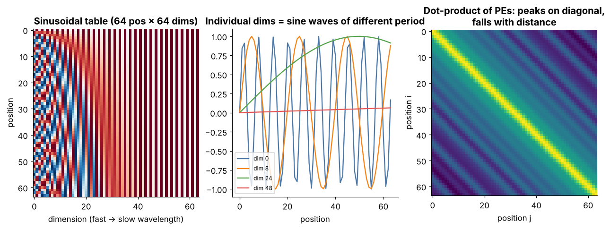

# Tier 6 — Tokenization & Embeddings

> **Phase 2 · Transformers & Foundation Models** · Author: ChatGPT/Claude draft (see `CHAPTER_STATUS.md`) · Status: `AUTHOR_DRAFT` (Critic / Code-review / Final-review pending)
> This file is the **tier overview and index**. Each of the 32 roadmap concepts has its own file (`NN.CC-*.md`) in this folder following the 23-section Standard Concept Format.

**Prerequisites:** Tier 1 (vectors, matrices, dot product), Tier 3 (embeddings as learned layers).
**Leads to:** [Tier 7 Attention](../tier-07-attention/README.md), [Tier 8 Transformer Architecture](../tier-08-transformer-architecture/README.md), [Tier 12 Modern Architectures](../tier-12-modern-architectures/README.md) (RoPE scaling / long context).

**Tier goal.** After this tier you can turn raw text into integer IDs, explain *why* subword tokenization won, train a byte-level BPE from scratch, explain what the embedding matrix is, and explain *three* different ways a Transformer is told about word order (learned, sinusoidal, RoPE/ALiBi).

---

## 1 · The big picture

```
 raw text ──► normalize ──► pre-tokenize ──► tokenizer ──► token IDs ──► embedding lookup ──► + position info ──► Transformer
 "Héllo!"      NFC          words/bytes      BPE/WP/SP     [812, 90, 3]    E[ids]  (V×d)         PE / RoPE / ALiBi       (Tier 7-8)
```

A neural network only multiplies numbers. Tokenization is the **bridge from text to integers**; embeddings are the bridge from integers to vectors; position information repairs the fact that attention by itself is order-blind. The tokenizer is frozen with the model, so choices made here (vocabulary, normalization, special tokens) become permanent properties of cost, context and fairness.

---

## 2 · How to use this tier (read → see → play → build)

| Step | What | Where |
|---|---|---|
| 1. Read | One file per concept (start with 6.5, 6.12, 6.18, 6.24) | the files `NN.CC-*.md` in this folder — see index below |
| 2. **See** | Labelled static figures and animated GIFs | [`figures/`](figures) — gallery below |
| 3. **Play** | Interactive pages with sliders (open in a browser) | [`interactive/`](interactive) |
| 4. **Build** | Mini byte-level BPE + positional library + tokenizer extras, with tests | [`lab/`](lab) |
| 5. **Regenerate** | All figures come from one script | `python figures/src/make_figures.py` |

> **Note on animation tooling.** The GIFs are rendered with Matplotlib (`PillowWriter`) so they regenerate with `pip install matplotlib pillow`. Manim could not be installed in the authoring sandbox; figure scripts are written so a Manim scene can replace any GIF later.

---

## 3 · Visual gallery


*Figure 1 — The same word at four granularities. Fewer tokens ⇒ shorter sequences (cheaper attention) but a larger vocabulary. Concepts: [6.2](06.02-character-tokenization.md), [6.3](06.03-word-tokenization.md), [6.4](06.04-byte-tokenization.md), [6.5](06.05-subword-tokenization.md).*


*Figure 2 — BPE training. Left: each row is a word (×frequency); red = the symbol just created. Right: pair counts; the top bar is merged next. Concepts: [6.12](06.12-bpe.md), [6.27](06.27-tokenizer-training.md).*


*Figure 4 — A token ID selects one row of the embedding matrix. Concepts: [6.7](06.07-token-ids.md), [6.17](06.17-token-embedding.md), [6.18](06.18-embedding-matrix.md).*



*Figure 5 — Left: heatmap (position × dimension). Middle: single dimensions are sine waves of different periods. Right: similarity between positions vs distance. Concept: [6.22](06.22-sinusoidal-positional-encoding.md).*


*Figure 6 — RoPE: position m rotates each 2-D pair by m·θ; fast pairs on the left, slow on the right. Concept: [6.24](06.24-rope.md).*


*Figure 3 — Left: ALiBi bias. Middle: causal mask. Right: padding mask for a batch of two. Concepts: [6.16](06.16-attention-masks.md), [6.25](06.25-alibi.md).*


*Figure 7 — Illustrative curve (assumed compression law, not measured): tokens fall, embedding parameters grow with V. Concept: [6.28](06.28-vocabulary-size-trade-offs.md).*


*Figure 8 — Left: UTF-8 bytes per character. Middle: normalization forms make two spellings of "café" equal. Right: tokens per character for a toy English-trained BPE (measured with the lab code). Concepts: [6.4](06.04-byte-tokenization.md), [6.30](06.30-unicode-normalization.md), [6.31](06.31-tokenization-efficiency.md), [6.32](06.32-tokens-per-character-compression-intuition.md).*


*Figure 9 — A padded batch with BOS/EOS/PAD and its attention mask. Concepts: [6.9](06.09-pad.md), [6.10](06.10-bos.md), [6.11](06.11-eos.md).*

---

## 4 · Interactive explorers

Download the repo and double-click the HTML file; they are self-contained (no internet, no install).

| Explorer | Adjustable controls | Teaches |
|---|---|---|
| [`bpe_trainer.html`](interactive/bpe_trainer.html) | training text, #merges, probe text | 6.5, 6.12, 6.27, 6.31 |
| [`positional_encoding.html`](interactive/positional_encoding.html) | d_model, #positions, base, query position | 6.20, 6.22 |
| [`rope_explorer.html`](interactive/rope_explorer.html) | m, n, base θ, head dim, shift | 6.24, 6.23 |
| [`vocab_tradeoff.html`](interactive/vocab_tradeoff.html) | V, d_model, doc length, tied embeddings | 6.19, 6.28, 6.32 |
| [`unicode_normalization.html`](interactive/unicode_normalization.html) | text, normalization form (none/NFC/NFD/NFKC) | 6.4, 6.29, 6.30 |
| [`special_tokens_batching.html`](interactive/special_tokens_batching.html) | sentences, BOS/EOS, padding side, length cap | 6.9, 6.10, 6.11, 6.16 |

---

## 5 · Concept index (32 concepts, one file each)

| # | Concept (link) | Priority | Difficulty |
|---|---|---|---|
| 6.1 | [Text preprocessing](06.01-text-preprocessing.md) | High | Beginner |
| 6.2 | [Character tokenization](06.02-character-tokenization.md) | Medium | Beginner |
| 6.3 | [Word tokenization](06.03-word-tokenization.md) | Medium | Beginner |
| 6.4 | [Byte tokenization](06.04-byte-tokenization.md) | High | Intermediate |
| 6.5 | [Subword tokenization](06.05-subword-tokenization.md) | Critical | Intermediate |
| 6.6 | [Vocabulary](06.06-vocabulary.md) | High | Beginner |
| 6.7 | [Token IDs](06.07-token-ids.md) | High | Beginner |
| 6.8 | [UNK](06.08-unk.md) | Medium | Beginner |
| 6.9 | [PAD](06.09-pad.md) | High | Beginner |
| 6.10 | [BOS](06.10-bos.md) | Medium | Beginner |
| 6.11 | [EOS](06.11-eos.md) | High | Beginner |
| 6.12 | [BPE](06.12-bpe.md) | Critical | Intermediate |
| 6.13 | [WordPiece](06.13-wordpiece.md) | High | Intermediate |
| 6.14 | [SentencePiece](06.14-sentencepiece.md) | High | Intermediate |
| 6.15 | [Unigram LM tokenizer](06.15-unigram-lm-tokenizer.md) | Medium | Advanced |
| 6.16 | [Attention masks](06.16-attention-masks.md) | Critical | Intermediate |
| 6.17 | [Token embedding](06.17-token-embedding.md) | Critical | Beginner |
| 6.18 | [Embedding matrix](06.18-embedding-matrix.md) | Critical | Beginner |
| 6.19 | [Embedding dimensions](06.19-embedding-dimensions.md) | High | Beginner |
| 6.20 | [Positional information](06.20-positional-information.md) | Critical | Intermediate |
| 6.21 | [Learned positional embeddings](06.21-learned-positional-embeddings.md) | Medium | Beginner |
| 6.22 | [Sinusoidal positional encoding](06.22-sinusoidal-positional-encoding.md) | High | Intermediate |
| 6.23 | [Relative positional encoding](06.23-relative-positional-encoding.md) | High | Intermediate |
| 6.24 | [RoPE](06.24-rope.md) | Critical | Advanced |
| 6.25 | [ALiBi](06.25-alibi.md) | High | Intermediate |
| 6.26 | [Token vs semantic embeddings](06.26-token-vs-semantic-embeddings.md) | Critical | Beginner |
| 6.27 | [Tokenizer training](06.27-tokenizer-training.md) | Critical | Advanced |
| 6.28 | [Vocabulary-size trade-offs](06.28-vocabulary-size-trade-offs.md) | Critical | Intermediate |
| 6.29 | [Byte fallback](06.29-byte-fallback.md) | High | Intermediate |
| 6.30 | [Unicode normalization](06.30-unicode-normalization.md) | High | Beginner |
| 6.31 | [Tokenization efficiency](06.31-tokenization-efficiency.md) | Critical | Intermediate |
| 6.32 | [Tokens-per-character / compression intuition](06.32-tokens-per-character-compression-intuition.md) | High | Beginner |

Suggested reading order: 6.1 → 6.5 → 6.12 → 6.6/6.7 → special tokens 6.8–6.11 → 6.17/6.18 → 6.20 → 6.22 → 6.24/6.25 → 6.27/6.28/6.31 → the rest.

---

## 6 · Build: miniature BPE tokenizer + positional lab

| File | What it is |
|---|---|
| [`lab/mini_bpe.py`](lab/mini_bpe.py) | byte-level BPE: `train`, `encode`, `decode`, `tokens`, `compression_ratio` |
| [`lab/positional.py`](lab/positional.py) | sinusoidal table, RoPE, ALiBi, embedding lookup, padding mask |
| [`lab/tokenizer_extras.py`](lab/tokenizer_extras.py) | WordPiece greedy encoder, Unigram Viterbi, digit splitter, normalization wrapper, fertility/tokens-per-char, BOS/EOS/PAD batching |
| [`lab/test_tier06.py`](lab/test_tier06.py) | pytest suite: round-trip on Unicode/emoji, determinism, RoPE relative property, ALiBi values, masks, WordPiece/Unigram/normalization/batching |
| [`figures/src/make_figures.py`](figures/src/make_figures.py) | regenerates every figure/GIF |

```bash
cd lab && python -m pytest -q      # 14 passed
python mini_bpe.py                 # demo
python ../figures/src/make_figures.py  # regenerate figures
```

**Results.** `pytest`: 14 passed. Code snippets in the concept files marked "run inside lab/" were executed against the lab modules; snippets that need third-party libraries (`sentencepiece`, `tokenizers`, `tiktoken`) are labelled *not run* and `REVIEW_REQUIRED`.

**Exercises**

1. Train on 3 different corpora (English prose, Python code, a non-English text). Plot bytes/token vs #merges for each. *Which corpus compresses best and why?* ([6.27](06.27-tokenizer-training.md), [6.28](06.28-vocabulary-size-trade-offs.md))
2. Add a pre-tokenizer that isolates digits (`split_digits`). Compare tokenization of `"1234567"`. *What changes for arithmetic?* ([6.5](06.05-subword-tokenization.md))
3. Break it: encode a string containing `"<EOS>"`. Is it one control token or 5 ordinary tokens? Which is safe for user input? ([6.10](06.10-bos.md), [6.11](06.11-eos.md))
4. In `rope_explorer.html` set base θ to 100 vs 100000. Which pairs stop rotating? ([6.24](06.24-rope.md))
5. Extend `lab/positional.py` with learned-absolute positions in PyTorch and compare to sinusoidal on a toy "reverse the sequence" task. *(stretch)*

---

## 7 · Tier interview kit

**Basic.** What is a token? What is `<PAD>` for? What does an embedding matrix look like?
**Intermediate.** Compare BPE, WordPiece and Unigram. Why add position information? Learned vs sinusoidal?
**Advanced.** Derive why RoPE gives relative-position attention. Why does ALiBi extrapolate? How does byte fallback differ from byte-level BPE?
**Scenario.** *Your RAG chunker splits by 500 characters but the LLM rejects some chunks as too long.* (Tokens ≠ characters; count with the model's tokenizer, set budgets in tokens — [6.31](06.31-tokenization-efficiency.md), [6.32](06.32-tokens-per-character-compression-intuition.md).)

**60-second tier summary.** *"Models don't read text; they read integer IDs from a frozen tokenizer — usually byte-level BPE or Unigram — then look each ID up in an embedding matrix. Attention is order-blind, so we add position: learned vectors, sinusoids, or — in modern models — rotations (RoPE) or distance biases (ALiBi). Vocabulary size trades sequence length against embedding size, and tokenizer efficiency per language is a real cost and fairness lever."*

## 8 · Tier revision questions

1. Why is `unhappiness → un|happi|ness` better than word-level? Than character-level?
2. Why must a tokenizer be shipped with the model weights?
3. What breaks if you apply merges in a different order than they were learned?
4. Show `one_hot(i) @ E == E[i]`. Why do we index instead?
5. Why can ID 500 and 501 be unrelated words?
6. State RoPE's key property in one sentence, and test it numerically.
7. Give two reasons a bigger vocabulary can hurt.

## 9 · Forward references

Attention masks in full → Tier 7. Weight tying, parameter counting → Tier 8. RoPE extensions, long-context → Tier 12. Semantic embeddings for retrieval → Tier 20. Chat-template special tokens → Tier 10. Token-based cost control → Tier 36.

## 10 · Review status

| Item | State |
|---|---|
| Concept files (32) | `AUTHOR_DRAFT`; structure validated by `tools/check_concepts.py` |
| Code (`lab/`) | **TESTED** — `pytest`: 14 passed (Python 3.13, NumPy) |
| Concept-file snippets | **TESTED** where marked "run inside lab/"; third-party-library snippets *not run* |
| Interactive pages (6) | **TESTED** in headless Chromium via `tools/check_interactive.py`: no JS errors, sliders/checkboxes exercised |
| Figures (9) | regenerated by script; visually spot-checked |
| Numeric claims about specific model vocab sizes / chars-per-token / library APIs | `REVIEW_REQUIRED` (marked inline) |
| Critic / Code-review / Final-review | pending per `CHAPTER_STATUS.md` |
