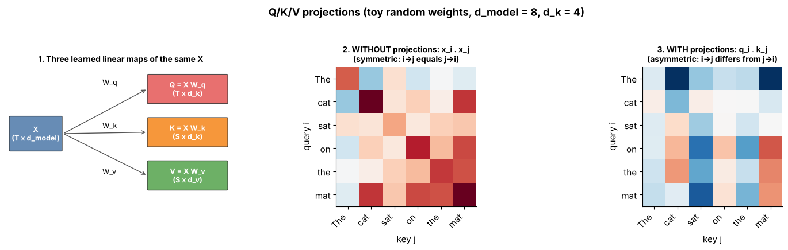

## 7.3 Key

Metadata:

- Tier: 7 — Attention
- Phase: 2 — Transformers & Foundation Models
- Priority: Critical
- Difficulty: Beginner
- Interview Importance: Very High
- Hands-on Importance: Medium
- Prerequisites: [7.2 Query](07.02-query.md)
- Leads To: [7.4 Value](07.04-value.md); [7.6 Dot-product similarity](07.06-dot-product-similarity.md); [7.21 MQA](07.21-mqa.md)

---

### 1. WHAT IS IT?

A **key** `k_j` is the vector token *j* uses to *advertise* what it contains, so that queries can match against it.

### 2. WHY DOES IT EXIST?

Separating "how to be found" (key) from "what to contribute" (value, [7.4 Value](07.04-value.md)) means a token can be easy to find for one reason and hand over different information.

### 3. DETAILED EXPLANATION

Shape `K ∈ ℝ^{S×d_k}` (S = number of keys; S = T in self-attention). `k_j = x_j W_k`. Scores are `q_i · k_j` ([7.6 Dot-product similarity](07.06-dot-product-similarity.md)). The keys (and values) of past tokens never change under causal attention, so they can be cached during generation, which is exactly why the **KV cache** exists ([7.24 Attention memory requirements](07.24-attention-memory-requirements.md); Tier 11). Sharing keys across query heads is the idea behind MQA/GQA ([7.21 MQA](07.21-mqa.md), [7.22 GQA](07.22-gqa.md)).



*Figure — one X, three projections; right panels show scores without projections (symmetric) versus with separate query and key projections (asymmetric).*

### 4. HOW DOES IT WORK?

1. `k_j = x_j W_k` for every token.
2. Stack into `K` (S × d_k).
3. Compute `Q Kᵀ` ([7.7 Attention scores](07.07-attention-scores.md)).

### 5. SIMPLE EXAMPLE

The spine label on a book: it summarises the book for matching purposes without being the book.

### 6. TECHNICAL EXAMPLE

A Llama-style decoder with 32 layers keeps K and V for every past token in every layer; for long prompts this cache dominates GPU memory ([7.24 Attention memory requirements](07.24-attention-memory-requirements.md)).

### 7. CODE

```python
import numpy as np
rng = np.random.default_rng(0)
X = rng.normal(size=(6, 8)); Wk = rng.normal(size=(8, 4))
K = X @ Wk                      # (6, 4)
q = rng.normal(size=4)
scores = K @ q                  # (6,) one score per key
```

### 8. INPUT → PROCESS → OUTPUT

```
x_j ──·W_k──► k_j ──(dot with q_i)──► score s_ij
```

### 9. ENTERPRISE USE CASE

Key storage is the main serving-memory cost of attention ([7.24 Attention memory requirements](07.24-attention-memory-requirements.md)).

### 10. AI ENGINEERING CONNECTION

Keys are what retrieval-style read-outs match against; in-context retrieval and induction behaviour (see [7.27 Attention patterns](07.27-attention-patterns.md)) rely on key matching.

### 11. ADVANTAGES

Decouples findability from payload; cacheable under causal masking.

### 12. LIMITATIONS

One key vector per head per token limits what can be advertised; cache grows linearly in sequence length.

### 13. TRADE-OFFS

More K heads = better matching diversity versus larger cache ([7.21 MQA](07.21-mqa.md), [7.22 GQA](07.22-gqa.md)).

### 14. COMMON MISTAKES

Using the value matrix as the key (collapsing roles); forgetting that keys come from the *context* tensor in cross-attention.

### 15. PERFORMANCE / COST CONSIDERATIONS

Projection O(S·d_model·d_k); cache bytes per token per layer = 2·H_kv·d_h·bytes (K and V).

### 16. SECURITY CONSIDERATIONS

Cached keys/values of one request must never be visible to another (a batching/isolation bug is a data leak).

### 17. INTERVIEW EXPLANATION

*"Keys are learned projections that tell queries what each token offers; query·key gives relevance, and keys are cacheable at inference."*

### 18. RAPID-FIRE ANSWER

Key = X·W_k: how a token advertises itself for matching.

### 19. INTERVIEW QUESTIONS

**Basic.** What does the key do in attention?

**Intermediate.** Why can keys be cached but not softmax weights?

**Advanced.** Why are K and V separate projections instead of one?

**Scenario.** You must cut serving memory 4×: which K/V design knobs exist?

### 20. HANDS-ON EXERCISE

In the snippet make `X` the *same* matrix as `Wk` input but use `Wk = Wq`; observe the score matrix `X Wq (X Wq)ᵀ` is symmetric. Compare with figure 11.

### 21. REVISION QUESTIONS

1. Shape of K?
2. Why does the KV cache hold K but not Q?
3. Which dimension must match between K and Q?

### 22. RELATED CONCEPTS

[7.2 Query](07.02-query.md), [7.4 Value](07.04-value.md), [7.5 Q/K/V projections](07.05-q-k-v-projections.md), [7.21 MQA](07.21-mqa.md), [7.24 Attention memory requirements](07.24-attention-memory-requirements.md).

### 23. ONE-LINE MEMORY HOOK

*The key is the label that gets you found.*
