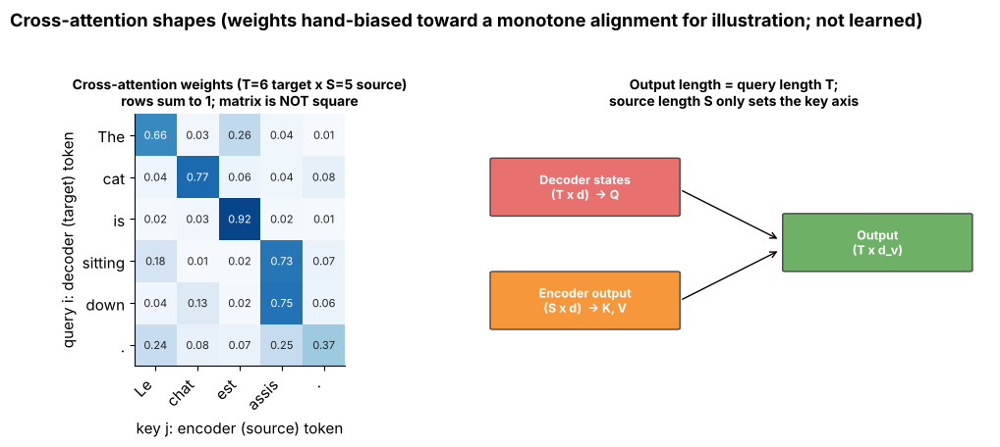

## 7.13 Cross-attention

Metadata:

- Tier: 7 — Attention
- Phase: 2 — Transformers & Foundation Models
- Priority: High
- Difficulty: Intermediate
- Interview Importance: High
- Hands-on Importance: Medium
- Prerequisites: [7.12 Self-attention](07.12-self-attention.md)
- Leads To: [Tier 8 Transformer Architecture](../tier-08-transformer-architecture/); [Tier 12 Modern Architectures](../tier-12-modern-architectures/)

---

### 1. WHAT IS IT?

Cross-attention: **queries** come from one sequence (e.g. decoder states), **keys and values** from **another** (e.g. encoder output, image features, memory).

### 2. WHY DOES IT EXIST?

Encoder–decoder tasks (translation, speech recognition, captioning, conditional image generation) need the output sequence to read from a *different* input sequence.

### 3. DETAILED EXPLANATION

The score matrix is `T×S` and need not be square; output length equals the **query** length `T`. Used in the original encoder–decoder Transformer, many speech/translation models and text-to-image conditioning. **Decoder-only LLMs use self-attention only**; "RAG" with decoder-only LLMs works by putting retrieved text into the prompt, not via cross-attention (Tier 20).

| | Q from | K, V from | Score shape | Typical use |
|---|---|---|---|---|
| Self | X | X | T × T | all Transformer blocks |
| Cross | decoder X | encoder/other C | T × S | enc–dec translation, conditioning |



*Figure — a non-square weight matrix; rows are decoder tokens, columns are source tokens. Weights are hand-biased for illustration, not learned. Explore T≠S in [the mask explorer](interactive/mask_explorer.html).*

### 4. HOW DOES IT WORK?

1. `Q = decoder_states · W_q`.
2. `K = context · W_k`, `V = context · W_v`.
3. Scores `T×S`, softmax over S, output `T×d_v`.
4. Padding mask has length **S** (key side).

### 5. SIMPLE EXAMPLE

A translator (decoder) glancing back at the source sentence (encoder) while writing each target word.

### 6. TECHNICAL EXAMPLE

Encoder–decoder models such as T5/BART-style architectures use cross-attention in every decoder block (Tier 12 architecture families).

### 7. CODE

```python
import numpy as np
from attention_np import MultiHeadAttention
rng = np.random.default_rng(0)
mha = MultiHeadAttention(d_model=16, n_heads=2)
dec, enc = rng.normal(size=(1, 3, 16)), rng.normal(size=(1, 7, 16))
y = mha(dec, context=enc)            # K,V built from enc
print(y.shape, mha.last_weights.shape)   # (1, 3, 16) (1, 2, 3, 7)
```
Test: `test_cross_attention_shapes_and_independence_of_decoder_length` in [`lab/test_tier07.py`](lab/test_tier07.py).

### 8. INPUT → PROCESS → OUTPUT

```
decoder states (T×d) ─► Q ┐
encoder output (S×d) ─► K,V ┴► attention ─► (T×d_v)
```

### 9. ENTERPRISE USE CASE

Speech-to-text and translation services; image generation with text conditioning (`REVIEW_REQUIRED` for specific products).

### 10. AI ENGINEERING CONNECTION

Multimodal models inject vision/audio features through cross-attention in some designs (Tier 12/13).

### 11. ADVANTAGES

Lets one sequence condition on another of a different length.

### 12. LIMITATIONS

Extra parameters and compute; needs an encoder.

### 13. TRADE-OFFS

Cross-attention (separate encoder, strong conditioning) versus decoder-only prompting (simpler, one stack).

### 14. COMMON MISTAKES

Using the decoder length for the encoder padding mask; computing K/V from the decoder state.

### 15. PERFORMANCE / COST CONSIDERATIONS

O(T·S·d); the encoder K/V can be computed once and reused for all decoder steps.

### 16. SECURITY CONSIDERATIONS

Conditioning content can steer outputs; sanitise untrusted conditioning inputs.

### 17. INTERVIEW EXPLANATION

*"Cross-attention takes queries from the decoder and keys/values from the encoder, so the output length follows the decoder while it reads the whole source."*

### 18. RAPID-FIRE ANSWER

Q from one sequence, K and V from another.

### 19. INTERVIEW QUESTIONS

**Basic.** How does cross-attention differ from self-attention?

**Intermediate.** What shape is the score matrix and what mask length is needed?

**Advanced.** Why can encoder K/V be cached once for all decoding steps?

**Scenario.** Translation outputs ignore the end of long sources. Where do you look?

### 20. HANDS-ON EXERCISE

Run the snippet with S = 20 and check `last_weights` shape.

### 21. REVISION QUESTIONS

1. Score shape for T=3, S=7?
2. Who supplies K and V?
3. Do decoder-only LLMs use it?

### 22. RELATED CONCEPTS

[7.12 Self-attention](07.12-self-attention.md), [7.16 Attention masks](07.16-attention-masks.md), [7.17 Padding masks](07.17-padding-masks.md); [Tier 8 Transformer Architecture](../tier-08-transformer-architecture/).

### 23. ONE-LINE MEMORY HOOK

*Cross: ask someone else.*
