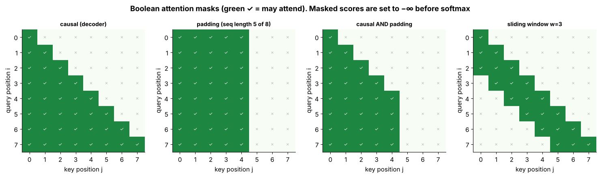
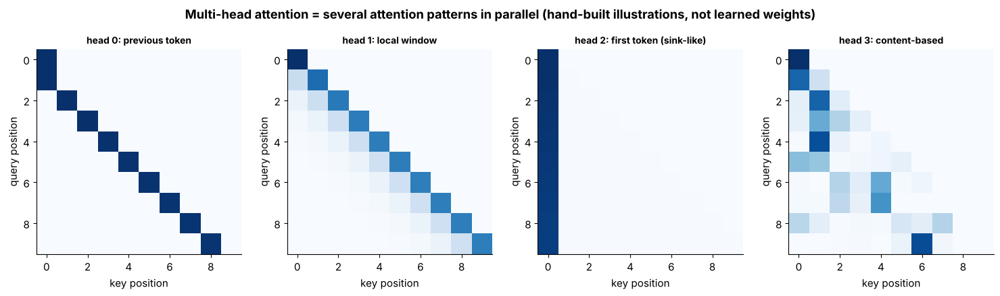
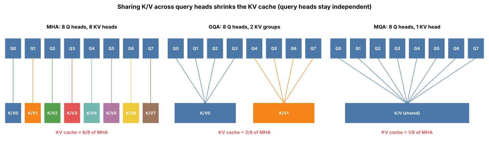
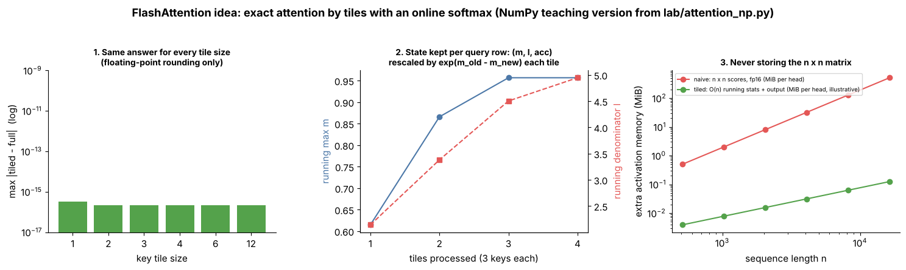

# Tier 7 — Attention

> **Phase 2 · Transformers & Foundation Models** · Author: ChatGPT/Claude draft (see `CHAPTER_STATUS.md`) · Status: `AUTHOR_DRAFT` (Critic / Code-review / Final-review pending)
> This file is the **tier overview and index only**. Each of the 30 roadmap concepts has its own file (`NN.CC-*.md`) in this folder following the 23-section Standard Concept Format.

## 1 · Goal

After this tier you can write scaled dot-product attention from four matrix operations, explain every factor in `softmax(QKᵀ/√d_k + mask)V`, extend it to multi-head, MQA and GQA, compute its time and memory cost, explain what FlashAttention changes (and what it does not), and verify your own implementation against `torch.nn.functional.scaled_dot_product_attention`.

**Scope.** Tier 7 owns the **attention math**. Tier 8 owns how attention sits inside encoder/decoder blocks (residuals, LayerNorm/RMSNorm, FFN). Positional methods (RoPE, ALiBi) are taught in Tier 6. KV-cache *serving* engineering belongs to Tier 11 (we teach only the size formula, 7.24); MQA/GQA in model families, long-context architectures and full sliding-window architectures belong to Tier 12.

## 2 · Prerequisites and leads-to

* **Prerequisites:** Tier 1 Mathematics for AI (matrix multiply, dot product, softmax), Tier 3 Neural Networks (linear layers), [Tier 6 Tokenization & Embeddings](../tier-06-tokenization-embeddings/) (embeddings, positional information, mask basics).
* **Leads to:** [Tier 8 Transformer Architecture](../tier-08-transformer-architecture/) (blocks, residuals, norms), [Tier 11 LLM Inference & Optimization](../tier-11-llm-inference-optimization/) (KV cache, serving), [Tier 12 Modern Architectures](../tier-12-modern-architectures/) (MQA/GQA families, long context, sliding window, sparse attention).

## 3 · The big picture

```
 token IDs ─► embeddings (+ position info, Tier 6) ─► X  (T × d_model)
                                                      │
              ┌───────────────────────────────────────┤  three learned projections
              ▼                  ▼                    ▼
        Q = X·W_q          K = X·W_k            V = X·W_v
              └────── scores = Q·Kᵀ / √d_k  (+ mask) ─┐
                                     softmax per row ─┤  weights  (T × S, rows sum to 1)
                                     output = weights·V ┘  (T × d_v)  →  W_o  →  next layer (Tier 8)
```

An RNN (Tier 5) passes information through a fixed-size state one step at a time, so distant tokens interact only through a long chain. Attention lets **every position read every other position directly in one step**, with data-dependent weights. The price is that the number of query–key pairs is n², which drives almost every engineering topic in 7.23–7.30.

## 4 · How to use this tier (read → see → play → build)

| Step | What | Where |
|---|---|---|
| 1. Read | One file per concept (intuition, mechanics, code, interview prep) | the files `NN.CC-*.md` in this folder — start at [7.1](07.01-why-attention.md) |
| 2. **See** | 10 labelled figures + 3 animated GIFs | gallery below, files in [`figures/`](figures) |
| 3. **Play** | 5 self-contained interactive pages (open in a browser, no internet) | [`interactive/`](interactive) |
| 4. **Build** | NumPy attention → MHA/GQA → tiled (flash-style) attention; PyTorch MHA; tests vs PyTorch SDPA | [`lab/`](lab) |
| 5. **Regenerate** | `python figures/src/make_figures.py` | [`figures/src/`](figures/src) |

## 5 · Visual gallery


*Figure 1 — Scaled dot-product attention as four matrix operations on 6 tokens (random toy Q, K, V). Look at panel 3: every row sums to 1; panel 4 rows are weighted mixtures of V.*


*Figure 2 — Why √d_k: unscaled score variance equals d_k; unscaled softmax approaches one-hot as d_k grows; saturated softmax has vanishing gradient.*



*Figure 3 — Causal, padding (5 real tokens of 8), their AND, and sliding window. Green = allowed.*



*Figure 4 — Hand-built head patterns (not learned): previous-token, local, first-token, uniform.*



*Figure 5 — MHA, GQA, MQA differ only in how many K/V heads are shared by query heads.*


*Figure 6 — Log–log growth of naive score matrix (slope 2) versus KV cache (slope 1); KV cache at n = 8192 for several H_kv.*


*Figure 7 — Which (query, key) pairs are computed under full-causal, sliding-window, window + sinks and bidirectional patterns.*


*Animation 8 — One query at a time: masked scores, softmax weights, accumulated outputs.*


*Animation 9 — Score multiplier sweeps from uniform (high entropy) to one-hot (entropy near 0).*


*Animation 10 — Autoregressive decoding: one new query row (red) against cached K/V (green).*


*Figure 11 — Q/K/V projections; scores without projections are symmetric, with projections asymmetric (toy random weights).*



*Figure 12 — Tiled attention with online softmax equals full attention; running max/denominator; naive versus O(n) memory (illustrative).*


*Figure 13 — Cross-attention: non-square T×S weights (hand-biased for illustration, not learned).*

## 6 · Interactive explorers

| Explorer | Adjustable controls | Teaches |
|---|---|---|
| [`attention_heatmap.html`](interactive/attention_heatmap.html) | sentence, d_k, scaling mode (1/√d_k, none, custom), temperature, causal mask, query row, seed | 7.6–7.11, 7.14, 7.26 |
| [`mask_explorer.html`](interactive/mask_explorer.html) | T, S (cross-attention), #real keys, causal, padding, window w, sink tokens | 7.12–7.17, 7.28, 7.30 |
| [`multihead_gqa.html`](interactive/multihead_gqa.html) | d_model, H, H_kv, layers, context, dtype | 7.18–7.22, 7.24 |
| [`memory_calculator.html`](interactive/memory_calculator.html) | n, H, H_kv, d_h, layers, batch, dtype, window, device memory | 7.23–7.25, 7.29, 7.30 |
| [`online_softmax_tiling.html`](interactive/online_softmax_tiling.html) | number of keys, tile size, score spread, seed, tiles processed | 7.9, 7.25 |

## 7 · Concept index (30 concepts, one file each)

| # | Concept file | Visuals |
|---|---|---|
| 7.1 | [Why attention](07.01-why-attention.md) | Fig 1 |
| 7.2 | [Query](07.02-query.md) | Fig 11 |
| 7.3 | [Key](07.03-key.md) | Fig 11 |
| 7.4 | [Value](07.04-value.md) | Fig 11 |
| 7.5 | [Q/K/V projections](07.05-q-k-v-projections.md) | Fig 11 |
| 7.6 | [Dot-product similarity](07.06-dot-product-similarity.md) | Fig 1; heatmap |
| 7.7 | [Attention scores](07.07-attention-scores.md) | Fig 1 |
| 7.8 | [Scaling by √dk](07.08-scaling-by-dk.md) | Fig 2; heatmap |
| 7.9 | [Softmax](07.09-softmax.md) | GIF 9; heatmap |
| 7.10 | [Weighted values](07.10-weighted-values.md) | Fig 1 |
| 7.11 | [Scaled dot-product attention](07.11-scaled-dot-product-attention.md) | GIF 8; heatmap |
| 7.12 | [Self-attention](07.12-self-attention.md) | lab test |
| 7.13 | [Cross-attention](07.13-cross-attention.md) | Fig 13; mask explorer |
| 7.14 | [Causal attention](07.14-causal-attention.md) | GIF 10; mask explorer |
| 7.15 | [Bidirectional attention](07.15-bidirectional-attention.md) | Fig 3; mask explorer |
| 7.16 | [Attention masks](07.16-attention-masks.md) | Fig 3; mask explorer |
| 7.17 | [Padding masks](07.17-padding-masks.md) | Fig 3; mask explorer |
| 7.18 | [Multi-head attention](07.18-multi-head-attention.md) | Fig 4; MHA/GQA page |
| 7.19 | [Head dimensions](07.19-head-dimensions.md) | MHA/GQA page |
| 7.20 | [Projection matrices](07.20-projection-matrices.md) | MHA/GQA page |
| 7.21 | [MQA](07.21-mqa.md) | Fig 5; MHA/GQA page |
| 7.22 | [GQA](07.22-gqa.md) | Fig 5; MHA/GQA page |
| 7.23 | [Attention complexity](07.23-attention-complexity.md) | Fig 6; memory calc |
| 7.24 | [Attention memory requirements](07.24-attention-memory-requirements.md) | Fig 6; memory calc |
| 7.25 | [FlashAttention](07.25-flashattention.md) | Fig 12; online-softmax page |
| 7.26 | [Attention visualization](07.26-attention-visualization.md) | heatmap |
| 7.27 | [Attention patterns](07.27-attention-patterns.md) | Fig 4, 7 |
| 7.28 | [Attention sinks](07.28-attention-sinks.md) | Fig 7; mask explorer |
| 7.29 | [Long-context attention limitations](07.29-long-context-attention-limitations.md) | Fig 6; memory calc |
| 7.30 | [Sliding-window attention (introduction only)](07.30-sliding-window-attention-introduction-only-full-architecture.md) | Fig 7; mask explorer |

## 8 · Build: attention from matrix operations → MHA → tiled attention (tier build item)

| File | What it is |
|---|---|
| [`lab/attention_np.py`](lab/attention_np.py) | NumPy: stable `softmax`, `causal_mask`, `padding_mask`, `sliding_window_mask`, `scaled_dot_product_attention`, `split_heads`/`merge_heads`, `MultiHeadAttention` (MHA/GQA/MQA, self- and cross-attention), `tiled_attention` (online-softmax, flash-style math), `kv_cache_bytes`, `score_matrix_bytes` |
| [`lab/attention_torch.py`](lab/attention_torch.py) | PyTorch: `sdpa_manual` (raw math) and `MultiHeadAttention` nn.Module (`use_sdpa` switch to the framework kernel) |
| [`lab/test_tier07.py`](lab/test_tier07.py) | 23 pytest cases |
| [`figures/src/make_figures.py`](figures/src/make_figures.py) | regenerates all figures/GIFs |

```bash
cd lab && python -m pytest -q          # 23 passed
python attention_np.py                 # tiny demo: causal MHA weights
```

**Results.** `pytest`: 23 passed (Python 3.13, NumPy, PyTorch CPU). The tests compare against PyTorch `F.scaled_dot_product_attention` where relevant: softmax stability; Var(q·k) ≈ d_k and ≈ 1 after scaling; unscaled softmax is more peaked; NumPy SDPA == PyTorch SDPA (no mask, causal, padding mask, additive float mask, custom scale); no future leakage; PAD values do not influence output; fully-masked rows stay finite; split/merge roundtrip; sliding-window/sink masks; NumPy MHA == PyTorch module for MHA, GQA and MQA with copied weights; hand-written core == framework SDPA backend inside the module; cross-attention shapes; permutation equivariance; KV-cache and parameter savings arithmetic; tiled online-softmax attention == full attention for several tile sizes, with and without a causal mask.

**Progression** (the book's code rule): *manual math* (`attention_np.scaled_dot_product_attention`) → *minimal Python module* (`attention_np.MultiHeadAttention`) → *PyTorch from scratch* (`attention_torch.MultiHeadAttention`, `use_sdpa=False`) → *framework equivalent* (`use_sdpa=True`).

**Not production-ready — and why.** No KV cache, no positional encoding (RoPE/ALiBi — Tier 6), no dropout, no fused QKV projection, no flash/paged kernels (`tiled_attention` teaches the algebra only), no mixed-precision handling, no input validation beyond asserts, no batched-inference isolation checks. Tier 8 composes this into a full block; Tier 11 covers serving.

**Exercises**

1. Add RoPE (Tier 6) to Q and K before the score computation; test that shifting all positions by *k* leaves the weights unchanged.
2. Add an incremental decode path with a KV cache; test that token-by-token outputs equal the full causal forward pass.
3. Extend `tiled_attention` to also tile the queries and handle fully masked tiles.
4. Add an ALiBi additive bias via the `attn_mask` float path in `sdpa_manual` and compare with `F.scaled_dot_product_attention(attn_mask=bias)`.
5. Time naive vs `F.scaled_dot_product_attention` for n = 256…4096 on your machine; your numbers are yours — do not generalise across hardware.
6. *Break it:* remove the `√d_k` and train a tiny model on a copy task with d_k = 256. What happens to the loss and why?

## 9 · Whole-tier interview kit

**Basic.** What are Q, K and V? What does softmax do here? Why is attention order-blind?
**Intermediate.** Why divide by √d_k? Compare self-, cross-, causal and bidirectional attention. Why multiple heads? What does `W_o` do?
**Advanced.** Derive `Var(q·k) = d_k`. Count parameters and KV-cache bytes for MHA vs GQA. Explain FlashAttention's online softmax and why it is exact. Why does GQA help decoding more than prefill? Explain attention sinks.
**Scenario.** *GPU OOM only on long prompts and only inside attention.* (Score matrix n² → fused/flash kernel, cap prompt tokens, check KV cache vs batch, consider GQA/window — and verify by profiling which term is the culprit.)
**Scenario.** *A new checkpoint produces fluent text for single requests but wrong answers when batched.* (Padding mask / position IDs / left-vs-right padding; a leak across the batch dimension.)
**Scenario.** *Product wants a 1M-token context "because it's available".* (Cost/latency scale with tokens; usage quality; injection surface; compare with retrieval.)

## 10 · Tier summary (60 seconds)

*"Attention computes, for each token, a weighted average of value vectors, with weights from softmax of query–key dot products scaled by √d_k so softmax doesn't saturate. Masks set forbidden pairs to −∞ before the softmax: causal for generation, padding for batches. Multi-head splits the width into parallel attentions; MQA/GQA share K/V heads to shrink the KV cache. Cost is quadratic in sequence length, FlashAttention keeps it exact but avoids storing the n×n matrix, and sliding windows with sinks trade global reach for bounded cost."*

Related tiers: positions/masks basics → Tier 6; blocks, residuals, norms → Tier 8; decoding, KV cache, serving → Tier 11; MQA/GQA families, long-context and sliding-window architectures → Tier 12; context budgeting → Tier 17; retrieval → Tier 20; gradient flow through softmax → Tier 4.

## 11 · Review status

| Item | State |
|---|---|
| Code (`lab/`) | **TESTED** — `pytest`: 23 passed (Python 3.13, NumPy, PyTorch CPU) |
| Code snippets in concept files | **TESTED** — every self-contained snippet was executed against `lab/`; excerpts of module code are marked as such |
| Interactive pages | **TESTED** with `tools/check_interactive.py` (headless Chromium: no JS errors with controls exercised); screenshots checked |
| Figures / GIFs | regenerated by `figures/src/make_figures.py`; visually spot-checked; Figures 4 and 13 are hand-built illustrations, not learned weights |
| Concept files format | validated by `tools/check_concepts.py` (30 files, 23 headings, links) |
| Citations (Bahdanau 2014, Vaswani 2017, Shazeer 2019, Ainslie 2023, Dao 2022, Xiao 2023, Liu 2023) | `REVIEW_REQUIRED` (names/years from memory; verify before FINAL) |
| Which models use GQA / sliding window; flash kernel dispatch in PyTorch; hardware sizes; head-size conventions | `REVIEW_REQUIRED` (fast-moving; marked inline) |
| FlashAttention performance claims | `NOT_TESTED` (CPU-only lab; no GPU benchmarks run) |
| Critic / Code-review / Final-review | pending per `CHAPTER_STATUS.md` |
