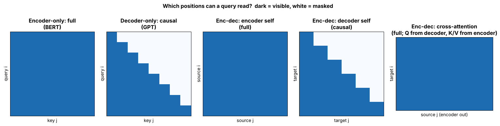

## 8.2 Transformer encoder

Metadata:

- Tier: 8 — Transformer Architecture
- Phase: 2 — Transformers & Foundation Models
- Priority: Critical
- Difficulty: Intermediate
- Interview Importance: High
- Hands-on Importance: Medium
- Prerequisites: [8.1 Original Transformer](08.01-original-transformer.md), [8.5 Transformer block](08.05-transformer-block.md), [Tier 7 — Attention](../tier-07-attention/README.md)
- Leads To: [8.4 Encoder-decoder architecture](08.04-encoder-decoder-architecture.md), [8.23 Encoder-only architecture](08.23-encoder-only-architecture.md), [8.24 BERT](08.24-bert.md)

---

### 1. WHAT IS IT?

A **Transformer encoder** is a stack of blocks whose self-attention is **bidirectional**: every token can attend to every other token (padding excluded). The output is one contextual vector per input token.

### 2. WHY DOES IT EXIST?

Many tasks need understanding, not generation: classification, tagging, retrieval embeddings, extraction. Reading the whole input in both directions gives each token a representation that depends on its full left and right context.

### 3. DETAILED EXPLANATION

One encoder layer = `Norm -> self-attention (no causal mask) -> add -> Norm -> FFN -> add` (Pre-LN form; the 2017 layer used Post-LN, [8.13 Post-LN](08.13-post-ln.md)). Stacking `L` of them gives `L` rounds of all-to-all mixing. The attention mask is only a **padding mask** so short sequences in a batch ignore pad tokens. An encoder has no cross-attention and cannot generate text token by token on its own because it has no notion of "next token".

As a standalone model ([8.23 Encoder-only architecture](08.23-encoder-only-architecture.md)) it is trained with the masked objective ([8.30 Masked objective](08.30-masked-objective.md)); as the first half of an encoder-decoder model ([8.4 Encoder-decoder architecture](08.04-encoder-decoder-architecture.md)) its output `memory` is read by the decoder through cross-attention ([8.7 Cross-attention layer](08.07-cross-attention-layer.md)).



*Figure 2 (left panel) - encoder self-attention is a full square: every position sees every other. Compare with the triangular decoder mask in the middle panel.*

[explore: switch the family and move the query position](interactive/attention_masks.html)

### 4. HOW DOES IT WORK?

1. Embed tokens and add positions: `x0 (B,T,d)`.
2. For each layer: normalise, project to Q/K/V, compute `softmax(QK^T/sqrt(d_k) + padding_mask) V`, output projection, add residual.
3. Normalise, apply the FFN, add residual.
4. (Optionally) apply a final norm. Result: `H (B,T,d)`, one vector per token, where `H[:, i]` depends on all non-pad tokens.

### 5. SIMPLE EXAMPLE

Reading a whole sentence before answering a question about any one word: to decide that "bank" means a riverbank you need the words both before and after it.

### 6. TECHNICAL EXAMPLE

A support-ticket classifier: tokenise the ticket, run it through a 6-12 layer encoder, take the first token's vector or the mean of all vectors, and pass it to a linear classification head. Embedding and reranking models for retrieval work the same way (Tier 20).

### 7. CODE

```python
import torch, torch.nn as nn

d, h, ff, L = 64, 4, 256, 2
layer = nn.TransformerEncoderLayer(d_model=d, nhead=h, dim_feedforward=ff, dropout=0.0,
                                   batch_first=True, norm_first=True)   # norm_first=True -> Pre-LN
enc = nn.TransformerEncoder(layer, num_layers=L)
x = torch.randn(2, 5, d)
pad = torch.tensor([[0, 0, 0, 0, 0], [0, 0, 0, 1, 1]], dtype=torch.bool)   # True = padding
enc.eval()
y = enc(x, src_key_padding_mask=pad)
print(y.shape)                      # torch.Size([2, 5, 64]): one vector per token, no mask on the future

# Bidirectional: changing the LAST real token changes the FIRST output
x2 = x.clone(); x2[0, 4] = torch.randn(d)      # a random change (a constant shift would be removed by LayerNorm)
assert not torch.allclose(enc(x2, src_key_padding_mask=pad)[0, 0], y[0, 0])
```

Framework equivalent shown above (`torch.nn.TransformerEncoder`); the from-scratch block is `Block` in [`lab/mini_gpt.py`](lab/mini_gpt.py) with the causal mask removed.

### 8. INPUT → PROCESS → OUTPUT

```
token ids (B,T) -> embed+pos (B,T,d) -> [self-attn(full) -> FFN] x L -> H (B,T,d) -> task head / pooling
```

### 9. ENTERPRISE USE CASE

Email triage, intent classification, entity extraction and semantic search embeddings at high volume where a small encoder is far cheaper and more deterministic than calling a general LLM.

### 10. AI ENGINEERING CONNECTION

Encoders power RAG retrieval (bi-encoders, rerankers: Tier 20) and classification guards around LLMs. They are the [8.24 BERT](08.24-bert.md) lineage. Their outputs are vectors, which connects to [Tier 6 — Tokenization & Embeddings](../tier-06-tokenization-embeddings/README.md) embeddings.

### 11. ADVANTAGES

Rich bidirectional context; cheap and fast for classification/embedding; fully parallel at inference (no autoregressive loop).

### 12. LIMITATIONS

Cannot generate text natively; fixed maximum length; quadratic attention in `T`; masked pre-training sees only ~15 % of positions as targets.

### 13. TRADE-OFFS

Understanding quality and efficiency versus no generation. A bigger decoder LLM can often do the same job, at much higher cost.

### 14. COMMON MISTAKES

Applying a causal mask in an encoder (throws away the right context); forgetting the padding mask (pad tokens leak into attention); using an encoder for open-ended generation.

### 15. PERFORMANCE / COST CONSIDERATIONS

Cost per sequence is one forward pass: `~2N` FLOPs per token plus the `T^2` attention term. No KV cache is needed. Batching by similar length reduces padding waste.

### 16. SECURITY CONSIDERATIONS

Pad-mask bugs let padding content (or other batch items if mis-batched) influence outputs; truncation silently drops text, which matters for compliance classifiers. Inputs are untrusted text: validate length and encoding.

### 17. INTERVIEW EXPLANATION

*"An encoder is a stack of Transformer blocks with full bidirectional self-attention, so every token's output vector depends on the whole input. It is trained with a masked objective and used for classification, tagging and embeddings. It cannot generate text on its own, but it is far cheaper than an LLM for those tasks."*

### 18. RAPID-FIRE ANSWER

A stack of blocks with unmasked (padding-only) self-attention that turns a sequence into contextual vectors.

### 19. INTERVIEW QUESTIONS

**Basic.** What is different between an encoder block and a decoder block's self-attention?
**Intermediate.** Why can an encoder not be used directly for left-to-right generation?
**Advanced.** How does the padding mask differ from the causal mask, and what happens if you forget it?
**Scenario.** Classify 10 M tickets per day cheaply: why an encoder?

### 20. HANDS-ON EXERCISE

Run the snippet, then pass `src_key_padding_mask=None` for the padded example and show that the first sequence's outputs are unchanged but the second's change.

### 21. REVISION QUESTIONS

1. What shape goes in and out? 2. What does an encoder mask contain? 3. How do you get one vector per sentence from per-token vectors?

### 22. RELATED CONCEPTS

[8.23 Encoder-only architecture](08.23-encoder-only-architecture.md), [8.24 BERT](08.24-bert.md), [8.4 Encoder-decoder architecture](08.04-encoder-decoder-architecture.md), [8.6 Self-attention layer](08.06-self-attention-layer.md), [8.30 Masked objective](08.30-masked-objective.md)

### 23. ONE-LINE MEMORY HOOK

Encoder: everyone sees everyone.
