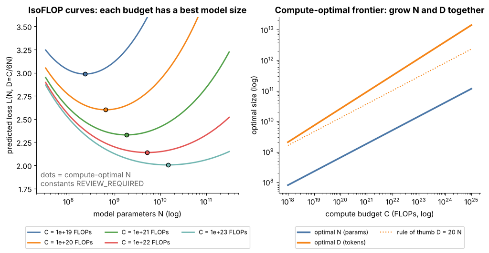

## 9.21 Compute/data/model scaling trade-offs

Metadata:

- Tier: 9 — Foundation Model Pretraining
- Phase: 2 — Transformers & Foundation Models
- Priority: Core
- Difficulty: Advanced
- Interview Importance: High
- Hands-on Importance: Medium
- Prerequisites: [9.20 Scaling laws](09.20-scaling-laws.md), [9.15 Compute budgets](09.15-compute-budgets.md)
- Leads To: [9.24 Dense-model pretraining](09.24-dense-model-pretraining.md), [9.25 Mixture-of-Experts pretraining](09.25-mixture-of-experts-pretraining.md), [Tier 11 inference cost](../tier-11-llm-inference-optimization/README.md)

---

### 1. WHAT IS IT?

The decision framework for splitting a fixed budget between model size N, training tokens D and data quality, and for deciding whether to optimise *training* cost or *lifetime* (training + inference) cost.

### 2. WHY DOES IT EXIST?

Scaling laws tell you the loss-optimal split for training compute, but real systems also pay to serve the model, are limited by unique data, and may be limited by memory. The best practical choice differs from the compute-optimal point.

### 3. DETAILED EXPLANATION

| Choice | Effect | When |
|---|---|---|
| Bigger N, fewer tokens (under-trained) | best loss *per training FLOP* is **not** achieved; expensive to serve | rarely right |
| Compute-optimal N, D | lowest loss for a given *training* budget | research budgets, one-off models |
| Smaller N, many more tokens ("over-trained") | higher training cost for the same loss, but **cheaper inference and fine-tuning** | models served at scale |
| More epochs on the same data | diminishing/negative returns past a few epochs | data-limited regimes |
| Better data (quality, dedup) | shifts the whole curve down | almost always the first lever |

Lifetime cost = training + (inference cost per token x tokens served). For popular models inference can dominate, which is why deliberately over-training smaller models is common practice (`REVIEW_REQUIRED` for specific model examples). The **data wall** (running out of unique high-quality tokens) pushes toward synthetic data, repetition and multimodal data.


*Figure 9 — Moving along one coloured line trades parameters for tokens at constant training compute; the dashed compute-optimal frontier and the dotted 20-tokens-per-parameter rule differ.*



*Figure 4, left — the IsoFLOP bowls: the minimum is fairly flat, so choosing a somewhat smaller model than the optimum costs little training loss but saves serving cost.*

### 4. HOW DOES IT WORK?

1. Compute the compute-optimal (N*, D*) for budget C. 2. Estimate expected served tokens `T_serve` and cost per token (proportional to `2N` FLOPs). 3. Compare lifetime cost for candidates (smaller N with larger D at the same loss). 4. Check unique-token availability and epochs ([9.14](09.14-token-budgets.md)). 5. Pick; keep the quality lever (data) at the top of the list.

### 5. SIMPLE EXAMPLE

Training a taxi driver: a very long, thorough training programme (more tokens) costs more up front but a lean car (smaller model) is cheaper to run every day.

### 6. TECHNICAL EXAMPLE

Suppose two designs are *assumed* to reach similar loss: A = 70B parameters on 1.4T tokens (`6ND` ≈ 5.9e23 FLOPs) and B = 8B parameters on 15T tokens (≈ 7.2e23 FLOPs, about 1.2x the training compute). Serving B costs about 1/9 as much per token (forward FLOPs ∝ 2N), so if the model serves tens of trillions of tokens, B wins on lifetime cost. (Illustrative numbers, `REVIEW_REQUIRED`; whether such a pair really reaches equal loss depends on the fitted law and on having 15T unique tokens.)

### 7. CODE

```python
# Run from lab/: lifetime-cost comparison of two designs (illustrative inputs).
from pretrain import flops_6nd

def lifetime_flops(n_params: float, train_tokens: float, served_tokens: float) -> float:
    return flops_6nd(n_params, train_tokens) + 2.0 * n_params * served_tokens   # forward-only FLOPs per served token ~ 2N

for name, n, d in [("A: big, compute-optimal", 70e9, 1.4e12), ("B: small, over-trained", 8e9, 15e12)]:
    for served in (1e12, 1e14):
        print(name, f"served={served:.0e}", f"{lifetime_flops(n, d, served):.2e}")
```

### 8. INPUT → PROCESS → OUTPUT

```
budget C, unique data U, expected traffic -> candidate (N, D) pairs -> lifetime cost + loss prediction -> chosen design
```

### 9. ENTERPRISE USE CASE

For a customer-facing assistant with heavy traffic, teams prefer a smaller, well-trained model whose serving cost fits the unit economics, rather than the largest model the training budget allows.

### 10. AI ENGINEERING CONNECTION

Explains why open model families come in sizes and why distilled or over-trained small models are popular for on-device and cost-sensitive serving ([Tier 11](../tier-11-llm-inference-optimization/README.md)).

### 11. ADVANTAGES

- Aligns training decisions with business economics.
- Highlights data quality as the cheapest lever.

### 12. LIMITATIONS

- Requires traffic forecasts that are uncertain.
- Scaling-law constants (`REVIEW_REQUIRED`) shift the break-even points.

### 13. TRADE-OFFS

Training cost vs inference cost; model size vs tokens; breadth of capability (larger N) vs deployability (smaller N); repetition vs new data.

### 14. COMMON MISTAKES

- Optimising training compute only.
- Using total parameters for MoE comparisons.
- Ignoring unique-token limits when planning "more tokens".

### 15. PERFORMANCE / COST CONSIDERATIONS

Include fine-tuning, evaluation, and hardware memory fit in the comparison: a model that does not fit on available serving GPUs forces expensive parallelism.

### 16. SECURITY CONSIDERATIONS

Smaller over-trained models may memorise less per token but see each example more; check regurgitation rates rather than assuming either way (`REVIEW_REQUIRED`).

### 17. INTERVIEW EXPLANATION

"For a fixed training budget the scaling laws give the loss-optimal split, but I'd also look at lifetime cost. If the model will be served at large scale, a smaller model trained on more tokens than compute-optimal costs more to train but much less to serve, so it can win overall. And before any of that, data quality is usually the cheapest improvement."

### 18. RAPID-FIRE ANSWER

Training-optimal differs from lifetime-optimal: serve-heavy models should be smaller and over-trained.

### 19. INTERVIEW QUESTIONS

- **Basic:** Why not always train the biggest model?
- **Intermediate:** What does "over-trained" mean and why do it?
- **Advanced:** How does inference traffic change the optimal N?
- **Scenario:** You have 2T unique tokens and a fixed budget. How do you choose N?

### 20. HANDS-ON EXERCISE

Use the snippet to find the traffic level (served tokens) at which design B overtakes design A in lifetime FLOPs.

### 21. REVISION QUESTIONS

1. What is lifetime cost? 2. What is the data wall? 3. Why is data quality the first lever?

### 22. RELATED CONCEPTS

[9.20 Scaling laws](09.20-scaling-laws.md) · [9.15 Compute budgets](09.15-compute-budgets.md) · [9.14 Token budgets](09.14-token-budgets.md) · [Tier 11](../tier-11-llm-inference-optimization/README.md)

### 23. ONE-LINE MEMORY HOOK

*"Bigger brain or longer school? Both, in proportion, then check who pays for inference."*
