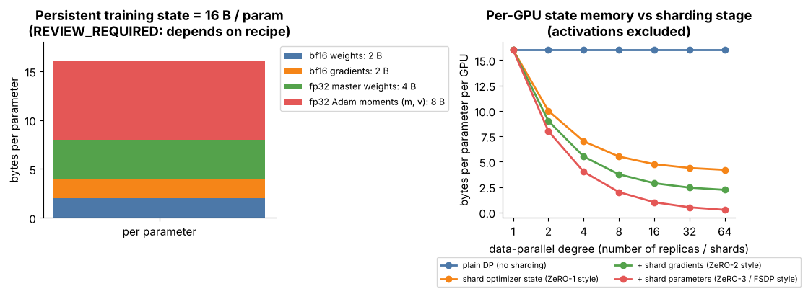

## 9.23 Distributed pretraining

Metadata:

- Tier: 9 — Foundation Model Pretraining
- Phase: 2 — Transformers & Foundation Models
- Priority: Core
- Difficulty: Advanced
- Interview Importance: High
- Hands-on Importance: Low–Medium (the lab is single-process; the memory arithmetic is hands-on)
- Prerequisites: [9.15 Compute budgets](09.15-compute-budgets.md), [9.22 Training checkpoints](09.22-training-checkpoints.md)
- Leads To: [9.24 Dense-model pretraining](09.24-dense-model-pretraining.md), [9.25 Mixture-of-Experts pretraining](09.25-mixture-of-experts-pretraining.md), [Tier 11 tensor/pipeline-parallel inference](../tier-11-llm-inference-optimization/README.md)

---

### 1. WHAT IS IT?

Training one model across many accelerators by splitting the batch, the optimizer state, the parameters, the layers or the experts, and communicating between them.

### 2. WHY DOES IT EXIST?

A frontier-scale model cannot fit in one accelerator's memory and one accelerator would take decades. Mixed-precision AdamW needs about **16 bytes per parameter** of persistent state *before* activations (bf16 weights 2 + bf16 grads 2 + fp32 master weights 4 + two fp32 Adam moments 8; the accounting popularised by the ZeRO paper, `REVIEW_REQUIRED` for your exact precision recipe): a 7B-parameter model needs about 112 GB of state alone.

### 3. DETAILED EXPLANATION

| Parallelism | Splits | Communication | Note |
|---|---|---|---|
| Data parallel (DP) | batch across replicas | all-reduce gradients each step | simplest; each replica holds a full copy |
| Sharded DP (ZeRO / FSDP) | optimizer state, gradients, then parameters across DP ranks | all-gather / reduce-scatter | trades communication for memory |
| Tensor parallel (TP) | each weight matrix across GPUs | all-reduce inside every layer | needs fast links (same node) |
| Pipeline parallel (PP) | layers across stages, micro-batches | point-to-point activations | "bubble" idle time |
| Sequence/context parallel | tokens of one sequence | attention-related collectives | long contexts |
| Expert parallel (EP) | MoE experts across GPUs | all-to-all token dispatch | [9.25](09.25-mixture-of-experts-pretraining.md) |

Real systems combine them ("3D/4D parallelism") and overlap communication with compute. Efficiency is reported as MFU ([9.15](09.15-compute-budgets.md)). Interconnect (intra-node vs inter-node bandwidth) and failures dominate engineering effort: at thousands of GPUs *something fails every few hours* (`REVIEW_REQUIRED` for specific rates), so **automatic restart from checkpoint** is a requirement.



*Figure 11 — Left: the 16-bytes-per-parameter accounting. Right: per-GPU state bytes as the data-parallel degree grows, under plain DP (no savings) and under progressively more sharding (optimizer state, then gradients, then parameters). Activations are excluded. (Illustrative accounting, `REVIEW_REQUIRED`.)*

**Scope note.** The lab is a single-process CPU run; it does not implement distributed training. It implements the *properties* (determinism, resumability, metrics) a distributed run needs.

### 4. HOW DOES IT WORK?

Data parallel step: (1) each replica computes gradients on its micro-batch; (2) all-reduce averages gradients; (3) every replica applies the same optimizer step. Sharded DP: each rank owns `1/DP` of the optimizer state (and later gradients/parameters); parameters are all-gathered just in time; gradients are reduce-scattered. TP/PP/EP partition the model itself and add their own collectives.

### 5. SIMPLE EXAMPLE

A huge jigsaw puzzle: everyone works on separate sections of the table (data parallel) and swaps edge pieces regularly (communication); a bigger table (sharding) means each person stores fewer pieces.

### 6. TECHNICAL EXAMPLE

7B parameters: plain DP needs about 112 GB of state per GPU, which does not fit an 80 GB accelerator. Sharding everything over 64 GPUs gives `16/64 = 0.25` bytes per parameter ≈ 1.75 GB per GPU for state, leaving room for activations (at the cost of all-gather/reduce-scatter traffic).

### 7. CODE

```python
# Memory arithmetic per GPU (standalone; REVIEW_REQUIRED for your precision recipe).
def state_gb(n_params: float, dp: int, shard: str) -> float:
    b = {"none": 16.0,
         "opt": 4.0 + 12.0 / dp,          # shard optimizer state (fp32 master + Adam m, v = 12 B)
         "opt+grad": 2.0 + 14.0 / dp,
         "all": 16.0 / dp}[shard]
    return n_params * b / 1e9

for shard in ("none", "opt", "opt+grad", "all"):
    print(shard, [round(state_gb(7e9, dp, shard), 1) for dp in (1, 8, 64)])
```

Concept check in the lab: `tokens_per_sec_this_session` in `metrics.json` is the single-process analogue of a throughput metric ([`lab/pretrain.py`](lab/pretrain.py)).

### 8. INPUT → PROCESS → OUTPUT

```
model + optimizer + global batch -> split (DP/FSDP/TP/PP/EP) -> local compute + collectives -> synchronised update -> sharded checkpoint
```

### 9. ENTERPRISE USE CASE

If you rent a cluster: reserved vs on-demand capacity, topology-aware placement, scheduler preemption policy, per-rank throughput observability and cost per trained token.

### 10. AI ENGINEERING CONNECTION

The same parallelism vocabulary (tensor, pipeline, expert) reappears in inference serving ([Tier 11](../tier-11-llm-inference-optimization/README.md)), and in the memory limits that decide which models you can fine-tune on your hardware ([Tier 10](../tier-10-fine-tuning-alignment/README.md)).

### 11. ADVANTAGES

- Makes otherwise impossible model sizes and training times feasible.
- Sharding trades communication for memory in a controllable way.

### 12. LIMITATIONS

- Communication overhead lowers MFU; stragglers and failures scale with cluster size.
- Complex to debug; bit-exact reproducibility across layouts is generally not achievable.

### 13. TRADE-OFFS

Memory vs communication (sharding); latency vs throughput (pipeline bubbles, micro-batch size); simplicity (DP) vs capacity (3D parallelism).

### 14. COMMON MISTAKES

- Ignoring optimizer state when sizing memory (counting only weights).
- Using tensor parallelism across slow inter-node links.
- No automatic restart or checkpoint validation.

### 15. PERFORMANCE / COST CONSIDERATIONS

Track MFU, step time per rank, communication share of step time, and data-loader stalls. Overlap communication and compute; size micro-batches to shrink pipeline bubbles.

### 16. SECURITY CONSIDERATIONS

Multi-tenant clusters need isolation, least-privilege credentials and encrypted checkpoint storage. Training traffic can include gradients that leak data in federated settings; in a single-org cluster the larger risks are stolen credentials and tampered images.

### 17. INTERVIEW EXPLANATION

"A big model doesn't fit on one GPU, mostly because of optimizer state — about 16 bytes per parameter with mixed-precision Adam. Data parallel replicates the model and all-reduces gradients; ZeRO/FSDP shards optimizer state, gradients and parameters across the data-parallel ranks, trading communication for memory; tensor, pipeline and expert parallelism split the model itself. At scale you combine them and treat failures and restart-from-checkpoint as normal."

### 18. RAPID-FIRE ANSWER

Split batch, state, layers or experts across GPUs; sharding optimizer state cuts per-GPU memory roughly by the DP degree.

### 19. INTERVIEW QUESTIONS

- **Basic:** What is data parallelism?
- **Intermediate:** Why shard optimizer state?
- **Advanced:** When would you choose tensor over pipeline parallelism?
- **Scenario:** Your 70B fine-tune doesn't fit on 8 x 80 GB. What do you change?

### 20. HANDS-ON EXERCISE

Run the snippet for 70B parameters at DP = 8, 64 and 512 for each sharding mode; find the smallest configuration that leaves at least 20 GB per 80 GB GPU for activations.

### 21. REVISION QUESTIONS

1. What are the 16 bytes per parameter? 2. What does all-reduce do? 3. Why is the lab not distributed?

### 22. RELATED CONCEPTS

[9.15 Compute budgets](09.15-compute-budgets.md) · [9.22 Checkpoints](09.22-training-checkpoints.md) · [9.25 MoE pretraining](09.25-mixture-of-experts-pretraining.md) · [Tier 11](../tier-11-llm-inference-optimization/README.md)

### 23. ONE-LINE MEMORY HOOK

*"Adam's moments are the memory hogs; shard them, and treat failure as routine."*
