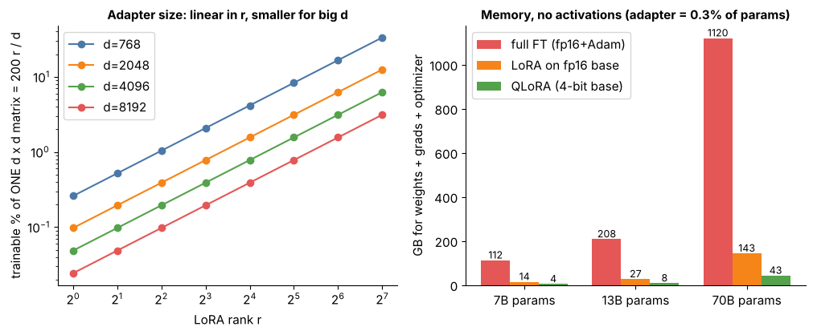

## 10.12 LoRA rank

Metadata:

- Tier: 10 — Fine-Tuning & Alignment
- Phase: 2 — Transformers & Foundation Models
- Priority: High
- Difficulty: Intermediate
- Interview Importance: High
- Hands-on Importance: High
- Prerequisites: [10.11 LoRA](10.11-lora.md)
- Leads To: [10.13 LoRA alpha](10.13-lora-alpha.md), [10.35 Fine-tuning cost and deployment trade-offs](10.35-fine-tuning-cost-and-deployment-trade-offs.md)

---

### 1. WHAT IS IT?

**LoRA rank `r`** is the inner dimension of the factorisation: it caps the rank of `delta W` and sets adapter size linearly.

### 2. WHY DOES IT EXIST?

It controls the capacity/cost trade-off of the adapter.

### 3. DETAILED EXPLANATION

Small `r` (4-16) is a common starting range (`REVIEW_REQUIRED` as a rule of thumb); larger `r` for big domain shifts or reasoning-style tasks; diminishing returns beyond the task's intrinsic rank.



*Figure: left, the trainable share of one d x d matrix is 200 r/d percent (straight on log-log). Right, memory for full FT vs LoRA vs QLoRA (analytic, adapter assumed 0.3 % of params).*

[Explore rank](interactive/lora_explorer.html).

### 4. HOW DOES IT WORK?

Params per layer = `r (d_in + d_out)`; the rank of `delta W` is at most `r`. Doubling `r` doubles adapter parameters and optimizer state.

### 5. SIMPLE EXAMPLE

A thicker bundle of correction notes can express more changes.

### 6. TECHNICAL EXAMPLE

Lab: r=4 on q,v = 1,536 params; r=8 on six matrices = 13,824. The rank-approximation animation shows error plateau as r rises (illustrative SVD, not a trained result).

### 7. CODE

```python
from lora import lora_param_count
shapes = [(48, 48)] * 4            # (out, in) of four attention matrices
print(lora_param_count(shapes, r=8))   # 8 * (48+48) * 4 = 3072
```

### 8. INPUT → PROCESS → OUTPUT

```
choose r --> params = r(d_in+d_out) per layer --> capacity vs memory
```

### 9. ENTERPRISE USE CASE

Platform teams sweep r in {8,16,64} per task and pick the smallest that meets the eval bar.

### 10. AI ENGINEERING CONNECTION

Rank trades adapter capacity for memory; larger ranks approach full FT behaviour.

### 11. ADVANTAGES

Linear control of size; small ranks often suffice.

### 12. LIMITATIONS

Too low underfits large shifts; too high wastes memory and may overfit.

### 13. TRADE-OFFS

r versus alpha scaling ([10.13](10.13-lora-alpha.md)) and number of targeted layers ([10.14](10.14-lora-target-modules.md)).

### 14. COMMON MISTAKES

Sweeping r without adjusting alpha/LR; reading a single seed as a trend.

### 15. PERFORMANCE / COST CONSIDERATIONS

Adapter and optimizer memory scale linearly with r.

### 16. SECURITY CONSIDERATIONS

Higher-rank adapters memorise more training data; consider for sensitive data.

### 17. INTERVIEW EXPLANATION

Rank r caps how expressive the LoRA update is and sets adapter size linearly. I start around 8 to 16, go higher for big domain shifts, and stop when evaluation stops improving, because gains diminish past the task's intrinsic rank.

### 18. RAPID-FIRE ANSWER

Rank = adapter capacity knob.

### 19. INTERVIEW QUESTIONS

**Basic:** What does rank control?

**Intermediate:** How does adapter size scale with r?

**Advanced:** How do you pick r?

**Scenario:** r=64 barely beats r=8 but costs more. What do you do?

### 20. HANDS-ON EXERCISE

Exercise 1 in the tier README: ranks 1,2,4,8,16 with 3 seeds.

### 21. REVISION QUESTIONS

1. Trainable % for d=4096, r=16? 2. Why diminishing returns?

### 22. RELATED CONCEPTS

[10.11 LoRA](10.11-lora.md), [10.13 LoRA alpha](10.13-lora-alpha.md), [10.14 LoRA target modules](10.14-lora-target-modules.md).

### 23. ONE-LINE MEMORY HOOK

Rank: how thick the correction is.
