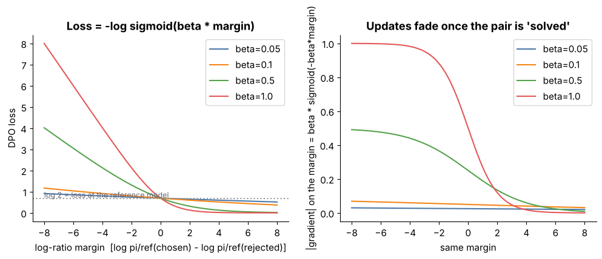
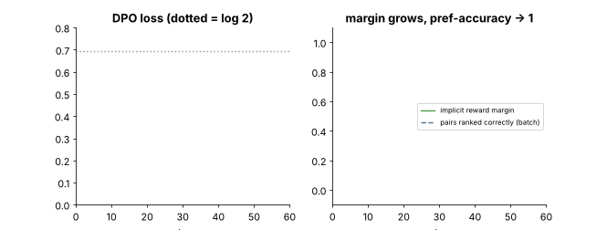

## 10.25 Direct Preference Optimization (DPO)

Metadata:

- Tier: 10 — Fine-Tuning & Alignment
- Phase: 2 — Transformers & Foundation Models
- Priority: Critical
- Difficulty: Advanced
- Interview Importance: Very high
- Hands-on Importance: High
- Prerequisites: [10.21 Reward models](10.21-reward-models.md), [10.22 RLHF](10.22-rlhf.md), [10.20 Preference optimization](10.20-preference-optimization.md)
- Leads To: [10.24 On-policy vs off-policy alignment intuition](10.24-on-policy-vs-off-policy-alignment-intuition.md), [10.33 Fine-tuning evaluation](10.33-fine-tuning-evaluation.md)

---

### 1. WHAT IS IT?

**Direct Preference Optimization (DPO)** trains the policy directly on preference pairs with a classification-style loss, with no separate reward model and no RL loop.

### 2. WHY DOES IT EXIST?

RLHF is heavy and unstable. DPO exploits the closed-form optimum of the KL-regularised objective to get a simple supervised loss.

### 3. DETAILED EXPLANATION

The KL-regularised RLHF objective has a closed-form optimum, so the reward can be written as a **log-ratio between policy and reference**. Plugging that into Bradley-Terry removes the explicit RM and the RL loop:

```
margin = beta * [ (log pi(y_c|x) - log pi_ref(y_c|x))  -  (log pi(y_r|x) - log pi_ref(y_r|x)) ]
loss   = -log sigmoid(margin)                 beta ~ 0.1 typical (REVIEW_REQUIRED)
```
Log-probs are **sequence sums over response tokens**; `pi_ref` is a *frozen copy of the SFT model*.



*Figure: left, loss vs margin for several beta; every curve passes through log 2 at margin 0 (policy = reference). Right, gradient weight beta*sigmoid(-beta*margin): large when the pair is wrong or undecided, vanishing when solved.*

**Properties tested** (`lab/test_tier10.py`): loss = log 2 at pi = pi_ref; `L(-m) - L(m) = m`; loss falls as chosen log-prob rises; gradient pushes chosen up and rejected down; beta = 0 gives no signal.

**Lab workflow (measured, fixed seed).** First SFT on deliberately noisy data (half the answers sloppy lower-case echoes), then DPO with `pi_ref` = that SFT model; held-out prompts; greedy decoding.


*Figure: after noisy SFT only 42 % of answers are correct and 45 % sloppy. DPO (60 steps, lr 5e-5, beta 0.1) eliminates the sloppy behaviour (0 %) and raises correctness to 70 %; adding a small NLL anchor on the chosen answer gives 76 %. Note the brown "other/garbled" share grows from 12 % to 30 % with plain DPO: probability mass flowed to outputs that were neither chosen nor rejected.*



*Animation: a real DPO run. Left, loss falls from log 2 (dotted). Right, the implicit-reward margin grows while the fraction of correctly ranked pairs jumps to 1 within ~20 steps.*

**Likelihood displacement.** DPO constrains only the *difference* of log-ratios. Both chosen and rejected likelihoods can fall as long as rejected falls faster, and the freed mass may land on outputs nobody wanted. Mitigations: a small SFT/NLL term on the chosen answer (what `dpo_run(nll_weight=1.0)` does; RPO-style, names differ across papers, `REVIEW_REQUIRED`), lower LR, fewer steps, careful beta, on-policy data.

[Explore DPO](interactive/dpo_bt.html): part B warns when you drag both log-ratios negative with a positive margin.

### 4. HOW DOES IT WORK?

1. Compute sequence log-probs of chosen and rejected under the policy (with grad) and the frozen reference (no grad). 2. Implicit rewards `beta*(logpi - logref)`. 3. Margin = difference. 4. Loss `-log sigmoid(margin)`. 5. Backprop to the policy only.

### 5. SIMPLE EXAMPLE

Pick the policy's preferences by comparing "how much more do I now like the good answer than I did at the start" against the same for the bad one.

### 6. TECHNICAL EXAMPLE

Lab summary (greedy, correct / sloppy / other): noisy SFT 0.42 / 0.45 / 0.12; + DPO 0.70 / 0.00 / 0.30; + DPO + NLL anchor 0.76 / 0.00 / 0.24. Pairwise preference accuracy hit 1.00 even while quality was imperfect. Numbers here come from the seeded lab run (`lab/run_lab.py`, 64,512-parameter char model, one seed, CPU); they teach mechanics, not large-model behaviour.

### 7. CODE

```python
# lab/alignment.py
def dpo_loss(pol_c, pol_r, ref_c, ref_r, beta=0.1):
    rc, rr = beta * (pol_c - ref_c), beta * (pol_r - ref_r)     # implicit rewards
    margin = rc - rr
    loss = -F.logsigmoid(margin).mean()
    return loss, {"margin": margin.mean().item(), "acc": (margin > 0).float().mean().item()}
```
Sequence log-probs come from `seq_logprob` in [`lab/tiny_lm.py`](lab/tiny_lm.py); the loss is in [`lab/alignment.py`](lab/alignment.py); the experiment is in [`lab/run_lab.py`](lab/run_lab.py). Library equivalent: Hugging Face TRL `DPOTrainer` (verify current API, `REVIEW_REQUIRED`).

### 8. INPUT → PROCESS → OUTPUT

```
(x, y_c, y_r) --> logp under policy and frozen ref --> beta*(Delta_c - Delta_r) = margin --> -log sigmoid --> update policy
```

### 9. ENTERPRISE USE CASE

Preference tuning for tone, safety and format with a few thousand pairs on the same base+adapter infrastructure as SFT.

### 10. AI ENGINEERING CONNECTION

The default preference method for open-weight assistants; works with LoRA/QLoRA.

### 11. ADVANTAGES

No RM and no sampling loop; stable; about 2x SFT cost per pair.

### 12. LIMITATIONS

Offline; beta-sensitive; can over-fit pairs and favour length; likelihood displacement; less exploration than online RL.

### 13. TRADE-OFFS

Simplicity versus exploration; beta (stay near reference) versus movement.

### 14. COMMON MISTAKES

Using a `pi_ref` other than the SFT model the policy starts from; wrong sign; forgetting to detach the reference; averaging log-probs instead of summing; judging only by preference accuracy (1.00 here despite imperfect quality).

### 15. PERFORMANCE / COST CONSIDERATIONS

Two forward passes per pair per model (policy and reference): about 2x SFT compute per example, plus holding `pi_ref` (or precomputing its log-probs once offline).

### 16. SECURITY CONSIDERATIONS

Preference data can embed unsafe preferences; evaluate safety before and after.

### 17. INTERVIEW EXPLANATION

DPO rewrites RLHF's KL-regularised objective so the reward is beta times the log-ratio of policy to reference. Plug that into the Bradley-Terry preference likelihood and you get a simple classification loss on chosen and rejected pairs, with no reward model or RL loop. It's offline and cheap, but sensitive to beta and can lower the likelihood of both answers.

### 18. RAPID-FIRE ANSWER

The policy is its own reward model.

### 19. INTERVIEW QUESTIONS

**Basic:** What is the DPO loss and its value at pi = pi_ref?

**Intermediate:** What does beta control?

**Advanced:** Derive DPO from the KL-regularised objective. What is likelihood displacement and how do you mitigate it?

**Scenario:** After DPO your model outputs garbled text more often even though preference accuracy is 100 %. Diagnose. (Displacement; add NLL anchor, lower LR/steps, check beta, on-policy pairs.)

### 20. HANDS-ON EXERCISE

Exercise 3: sweep beta in {0.01, 0.1, 1} and LR; track the garbled share and chosen log-prob.

### 21. REVISION QUESTIONS

1. Why log 2 at the start? 2. Why can the chosen likelihood fall?

### 22. RELATED CONCEPTS

[10.19 Preference data](10.19-preference-data.md), [10.21 Reward models](10.21-reward-models.md), [10.22 RLHF](10.22-rlhf.md), [10.24 On-policy vs off-policy alignment intuition](10.24-on-policy-vs-off-policy-alignment-intuition.md), [10.33 Fine-tuning evaluation](10.33-fine-tuning-evaluation.md).

### 23. ONE-LINE MEMORY HOOK

The policy is its own reward model.
