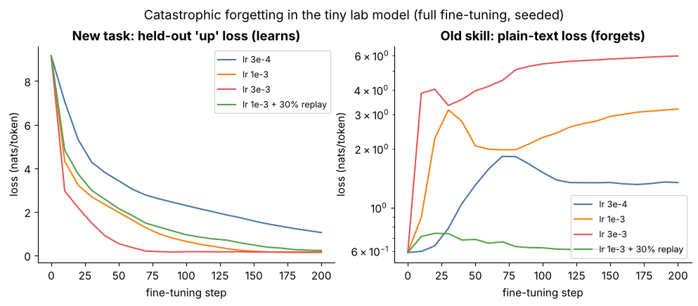

## 10.28 Catastrophic forgetting

Metadata:

- Tier: 10 — Fine-Tuning & Alignment
- Phase: 2 — Transformers & Foundation Models
- Priority: Critical
- Difficulty: Intermediate
- Interview Importance: Very high
- Hands-on Importance: High
- Prerequisites: [10.27 Continued fine-tuning](10.27-continued-fine-tuning.md), [10.9 Full fine-tuning](10.09-full-fine-tuning.md)
- Leads To: [10.29 Catastrophic-forgetting evaluation](10.29-catastrophic-forgetting-evaluation.md), [10.31 Model merging](10.31-model-merging.md)

---

### 1. WHAT IS IT?

**Catastrophic forgetting** is the sharp loss of previously learned abilities when a model is trained on a new task.

### 2. WHY DOES IT EXIST?

Understanding it is how you decide learning rate, steps, replay and adapter use for any fine-tune.

### 3. DETAILED EXPLANATION

Learning the new task moves weights away from regions that supported old abilities. Strength grows with **learning rate, number of steps and distance from the base**.



*Figure (measured, full FT): left, all runs learn the new task (higher LR faster). Right (log scale): plain-text loss, the "old skill", rises from 0.59 to 1.35 (lr 3e-4), 3.2 (1e-3) and 6.0 (3e-3), whereas mixing 30 % plain-text batches (replay) keeps it at 0.61 while still learning the task.*


*Animation: the same four runs step by step. Watch the red/orange curves on the right take off almost immediately, long before the new-task loss has finished falling.*

Mitigations: lower LR / fewer steps / early stopping; **replay**; **adapters** with limited capacity; **regularising toward the base** (L2-SP, KL to the base); **model merging** ([10.31](10.31-model-merging.md)). **Honest toy result:** LoRA did *not* forget less in our run (plain-text loss 5.04 for LoRA-all-r8 vs 2.96 for full FT), because we used a high LR (1e-2) and the toy's behaviour was fully rewritten; with replay both stay near 0.6. The folklore "LoRA forgets less" is more nuanced in the literature (`REVIEW_REQUIRED`): it depends on rank, LR and data.

[Explore forgetting](interactive/forgetting_merge.html).

### 4. HOW DOES IT WORK?

Gradient steps on the new loss change shared weights; nothing protects directions old tasks used. Replay adds old-task gradients that cancel the harmful drift.

### 5. SIMPLE EXAMPLE

Practising only tennis for a year and losing your badminton form.

### 6. TECHNICAL EXAMPLE

Plain-text loss after full FT at lr 3e-4/1e-3/3e-3: 1.35 / 3.2 / 6.0 (base 0.59); with replay 0.61. Numbers here come from the seeded lab run (`lab/run_lab.py`, 64,512-parameter char model, one seed, CPU); they teach mechanics, not large-model behaviour.

### 7. CODE

```python
# plain-text loss as the 'old skill' probe (lab/run_lab.py uses this idea)
x, y = base_batch(random.Random(0))
old_skill_loss = lm_loss(model, x, y).item()
```

### 8. INPUT → PROCESS → OUTPUT

```
new-task gradient --> weights drift from base --> old-skill loss rises   (replay / small LR / adapters / merging reduce it)
```

### 9. ENTERPRISE USE CASE

Support bots that lose general ability or safety after domain tuning; the standard release gate is a regression suite.

### 10. AI ENGINEERING CONNECTION

Why fine-tuned assistants can become unsafe or lose formatting; central to safe continual updates.

### 11. ADVANTAGES

Knowing the levers (LR, steps, replay) gives control.

### 12. LIMITATIONS

Hard to eliminate; trade-off with learning the new task.

### 13. TRADE-OFFS

Plasticity versus stability.

### 14. COMMON MISTAKES

Assuming PEFT guarantees no forgetting; no replay; evaluating only the new task.

### 15. PERFORMANCE / COST CONSIDERATIONS

Replay adds tokens (cost) but little complexity.

### 16. SECURITY CONSIDERATIONS

Safety behaviours are among the skills that can be forgotten.

### 17. INTERVIEW EXPLANATION

When you train on a new task, the weights drift away from the regions supporting old skills, and old performance can collapse; it grows with learning rate, steps and distance from the base. I mitigate with small LR, early stopping, replay, adapters and merging, and I measure it with a regression suite. LoRA doesn't automatically avoid it.

### 18. RAPID-FIRE ANSWER

New task in, old skill out, unless you replay.

### 19. INTERVIEW QUESTIONS

**Basic:** What is catastrophic forgetting?

**Intermediate:** What determines its strength?

**Advanced:** Name three mitigations. Does LoRA prevent it?

**Scenario:** A domain-tuned model refuses less often. What happened and what do you do?

### 20. HANDS-ON EXERCISE

Rerun Figure 8's idea at your own LR; add replay.

### 21. REVISION QUESTIONS

1. Three mitigations? 2. What did the toy show about LoRA?

### 22. RELATED CONCEPTS

[10.27 Continued fine-tuning](10.27-continued-fine-tuning.md), [10.29 Catastrophic-forgetting evaluation](10.29-catastrophic-forgetting-evaluation.md), [10.31 Model merging](10.31-model-merging.md).

### 23. ONE-LINE MEMORY HOOK

New task in, old skill out, unless you replay.
