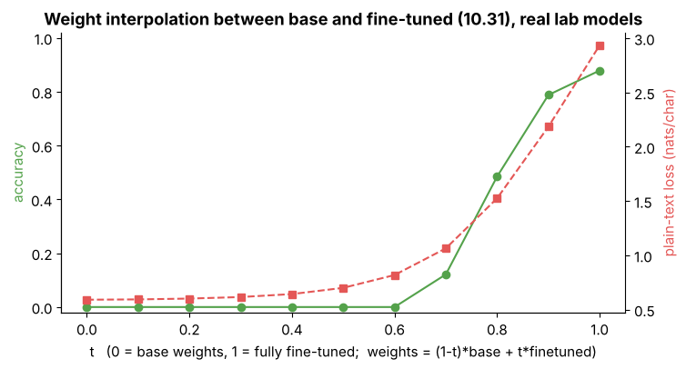

## 10.31 Model merging

Metadata:

- Tier: 10 — Fine-Tuning & Alignment
- Phase: 2 — Transformers & Foundation Models
- Priority: High
- Difficulty: Advanced
- Interview Importance: High
- Hands-on Importance: Medium
- Prerequisites: [10.30 Adapter merging](10.30-adapter-merging.md), [10.28 Catastrophic forgetting](10.28-catastrophic-forgetting.md)
- Leads To: [10.32 Checkpoint merging](10.32-checkpoint-merging.md)

---

### 1. WHAT IS IT?

**Model merging** combines the *weights* of models fine-tuned from the same base: linear interpolation, task arithmetic, SLERP, averaging ("model soups").

### 2. WHY DOES IT EXIST?

To combine skills or trade off behaviours without training or extra inference cost.

### 3. DETAILED EXPLANATION

Linear interpolation `(1-t) theta_a + t theta_b`; **task arithmetic** `theta = theta_base + sum_i lambda_i tau_i` with task vectors `tau_i = theta_i - theta_base`; spherical interpolation (SLERP); averaging. Works best when models share a base, were trained with a small LR, and lie in one loss basin; it fails across different bases or architectures. The lab's `merge.py` is plain arithmetic on state dicts (torch tensors), tested for endpoints and reconstruction.



*Figure (measured): interpolating from the base (t=0) to the fully fine-tuned lab model (t=1). Plain-text loss rises smoothly, but task accuracy stays 0 until t ~ 0.7 and reaches only 0.88 at t=1: behaviour changes in a threshold-like way. There is no free-lunch midpoint in this model.*

[Explore merge weights](interactive/forgetting_merge.html) (illustrative quadratic landscape).

### 4. HOW DOES IT WORK?

Compute task vectors, scale, add to base (or interpolate), evaluate.

### 5. SIMPLE EXAMPLE

Mixing two paint colours: works for same-base paints, fails for oil and water.

### 6. TECHNICAL EXAMPLE

Interpolation sweep t in [0,1] on the lab model (figure above). Numbers here come from the seeded lab run (`lab/run_lab.py` / `figures/src/make_figures.py`, 64,512-parameter char model, one seed, CPU); they teach mechanics, not large-model behaviour.

### 7. CODE

```python
# lab/merge.py
tv = task_vector(finetuned_state, base_state)
merged = add_task_vectors(base_state, [tv], [0.7])
mid = lerp_state(base_state, finetuned_state, 0.5)
```
Test: `test_lerp_and_task_arithmetic` in [`lab/test_tier10.py`](lab/test_tier10.py). Library route: mergekit-style tools (verify, `REVIEW_REQUIRED`).

### 8. INPUT → PROCESS → OUTPUT

```
theta_base, theta_1..n --> task vectors --> weighted sum / interpolation --> merged model
```

### 9. ENTERPRISE USE CASE

Community and vendor "merged" checkpoints combine instruct, code and domain tunes.

### 10. AI ENGINEERING CONNECTION

Cheap composition of open-weight fine-tunes.

### 11. ADVANTAGES

No training; no inference cost.

### 12. LIMITATIONS

Fails across bases; unpredictable interference; needs eval per recipe.

### 13. TRADE-OFFS

Convenience versus reliability.

### 14. COMMON MISTAKES

Merging different bases; skipping evaluation; assuming a midpoint is "average skill".

### 15. PERFORMANCE / COST CONSIDERATIONS

Cheap (arithmetic on weights); evaluation dominates.

### 16. SECURITY CONSIDERATIONS

Merged models inherit all parents' licences and any backdoors.

### 17. INTERVIEW EXPLANATION

Model merging combines weights of models fine-tuned from the same base, by interpolation or by adding task vectors. It needs a shared base and a shared basin, and the result has to be evaluated, because behaviour can change abruptly, as my interpolation sweep showed.

### 18. RAPID-FIRE ANSWER

Merge weights, then verify behaviour.

### 19. INTERVIEW QUESTIONS

**Basic:** What is a task vector?

**Intermediate:** When does merging work?

**Advanced:** Why might interpolation give threshold-like behaviour?

**Scenario:** Two community fine-tunes merge into gibberish. Why?

### 20. HANDS-ON EXERCISE

Sweep t in the lab and plot accuracy vs t.

### 21. REVISION QUESTIONS

1. Define task arithmetic. 2. Why same base?

### 22. RELATED CONCEPTS

[10.30 Adapter merging](10.30-adapter-merging.md), [10.32 Checkpoint merging](10.32-checkpoint-merging.md).

### 23. ONE-LINE MEMORY HOOK

Same base, add the deltas, then test.
