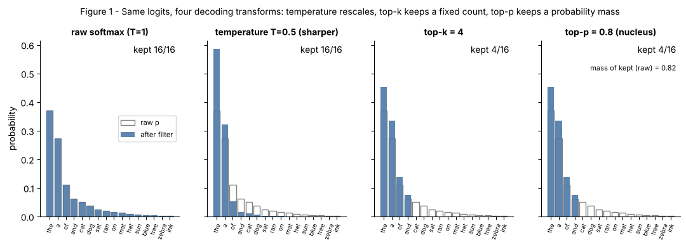

## 11.6 Top-k sampling

Metadata:

- Tier: 11 — LLM Inference & Optimization
- Phase: 2 — Transformers & Foundation Models
- Priority: P1
- Difficulty: Beginner
- Interview Importance: High
- Hands-on Importance: High
- Prerequisites: [11.5 Temperature](11.05-temperature.md)
- Leads To: [11.7 Top-p sampling](11.07-top-p-sampling.md)

---

### 1. WHAT IS IT?

**Top-k sampling** keeps only the `k` highest-logit tokens, sets all others to `-inf`, renormalises and samples from the survivors.

### 2. WHY DOES IT EXIST?

Pure sampling can pick a very unlikely token from the long tail and derail a sentence. Truncating the tail removes those low-quality choices.

### 3. DETAILED EXPLANATION

The kept set has a **fixed size** regardless of how confident the model is. `k = 40` is too loose when the model is sure (it admits junk) and too tight when many continuations are valid. `k = 1` is greedy ([11.4 Greedy decoding](11.04-greedy-decoding.md)); `k >= V` disables the filter. In `lab/decoding.py`, ties at the threshold are kept.



*Figure 1 — Look at the top-k panel: the same number of bars survive whether or not the distribution is peaked.*

[Explore in the decoding explorer](interactive/decoding_explorer.html) (top-k slider).

### 4. HOW DOES IT WORK?

1. Find the `k`-th largest logit (`topk`).
2. Mask every logit below it with `-inf`.
3. Softmax over the survivors (renormalise).
4. Sample.

### 5. SIMPLE EXAMPLE

Interviewing only the top 5 applicants, however many strong or weak candidates applied.

### 6. TECHNICAL EXAMPLE

A code-completion service sets `top_k = 50` as a safety net against absurd tokens while using temperature for style (illustrative; REVIEW_REQUIRED per product).

### 7. CODE

```python
import torch
from decoding import top_k_filter

z = torch.tensor([3.0, 2.0, 1.0, 0.0, -1.0])
print(top_k_filter(z, 2).softmax(-1))     # only 2 tokens have mass
```

See [`lab/decoding.py`](lab/decoding.py) (`top_k_filter`).

### 8. INPUT → PROCESS → OUTPUT

```
logits --[keep k largest]--> masked logits --softmax--> renormalised probs --sample--> token
```

### 9. ENTERPRISE USE CASE

Used as a coarse guard in APIs that expose `top_k`; many providers expose only top-p (REVIEW_REQUIRED).

### 10. AI ENGINEERING CONNECTION

Combined with temperature and top-p in sampling presets for chat and code models.

### 11. ADVANTAGES

Trivial to implement and very cheap; bounds the worst-case token quality.

### 12. LIMITATIONS

Fixed size ignores confidence; if the model is certain, k > 1 still allows alternatives; if uncertain, k may cut valid options.

### 13. TRADE-OFFS

Simplicity vs adaptivity (top-p adapts, [11.7 Top-p sampling](11.07-top-p-sampling.md)).

### 14. COMMON MISTAKES

Setting both top-k and top-p without knowing the order; using a large k and assuming it filters.

### 15. PERFORMANCE / COST CONSIDERATIONS

Negligible cost: one partial sort of `V` logits per step.

### 16. SECURITY CONSIDERATIONS

No security role; validate user-supplied values.

### 17. INTERVIEW EXPLANATION

"Top-k keeps the k most likely tokens and samples among them. It cuts the tail but the cut is a fixed count, so it doesn't adapt: it can be too loose when the model is sure and too tight when it's unsure. Top-p fixes that by using probability mass instead of a count."

### 18. RAPID-FIRE ANSWER

Keep the k highest logits, mask the rest, renormalise, sample.

### 19. INTERVIEW QUESTIONS

**Basic.** What does k=1 equal? (Greedy.) **Intermediate.** Why is a fixed k a weakness? **Advanced.** What happens to ties at the threshold? (Lab keeps them.) **Scenario.** Output contains odd rare words at T=1; what filter do you add?

### 20. HANDS-ON EXERCISE

In the explorer set top-k = 3 on "flat" and "peaked" shapes and compare how much probability mass is lost.

### 21. REVISION QUESTIONS

1. What does top-k do to the logits?
2. Why does it not adapt to confidence?
3. How do you disable it?

### 22. RELATED CONCEPTS

[11.5 Temperature](11.05-temperature.md), [11.7 Top-p sampling](11.07-top-p-sampling.md), [11.4 Greedy decoding](11.04-greedy-decoding.md), [11.3 Decoding overview](11.03-decoding-overview.md).

### 23. ONE-LINE MEMORY HOOK

*Top-k counts.*
