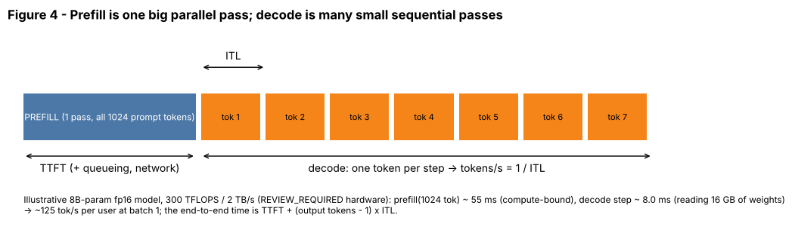

## 11.12 Decode phase

Metadata:

- Tier: 11 — LLM Inference & Optimization
- Phase: 2 — Transformers & Foundation Models
- Priority: P0
- Difficulty: Intermediate
- Interview Importance: Very high
- Hands-on Importance: Medium
- Prerequisites: [11.1 Autoregressive inference](11.01-autoregressive-inference.md), [11.11 Prefill phase](11.11-prefill-phase.md), [11.16 KV cache](11.16-kv-cache.md)
- Leads To: [11.14 Inter-token latency](11.14-inter-token-latency.md), [11.19 Batching](11.19-batching.md), [11.39 Memory bandwidth](11.39-memory-bandwidth.md), [11.40 Compute-bound vs memory-bound inference](11.40-compute-bound-vs-memory-bound-inference.md)

---

### 1. WHAT IS IT?

**Decode** is the generation phase after prefill: each iteration feeds one new token per sequence (plus the KV cache), produces the next logits and appends the new token's K/V to the cache.

### 2. WHY DOES IT EXIST?

Tokens depend on each other, so after the prompt is processed the model can only advance one step at a time. The KV cache ([11.16 KV cache](11.16-kv-cache.md)) lets each step process a single token instead of the whole prefix.

### 3. DETAILED EXPLANATION

- Each step streams **all model weights** (and that sequence's KV cache) from GPU memory to compute only about 2 FLOPs per weight per token. Arithmetic intensity is low, so decode is **memory-bandwidth-bound** at small batch ([11.40 Compute-bound vs memory-bound inference](11.40-compute-bound-vs-memory-bound-inference.md)).
- A lower bound on inter-token latency is `weight bytes / memory bandwidth` (illustrative: 16 GB / 2 TB/s = 8 ms, i.e. at most about 125 tok/s per user; REVIEW_REQUIRED hardware).
- Batching more sequences into one step reuses the same weight reads, so system throughput rises almost for free until compute, KV memory or latency limits bite ([11.19 Batching](11.19-batching.md)).
- At long context and large batch, reading the KV cache becomes a second major cost.



*Figure 4 — Many narrow decode blocks follow the wide prefill block. Each narrow block is one ITL.*


*Figure 10 — Orange squares: decode at batch 1, 8 and 64 all sit far left of the ridge point (memory-bound), so adding users is nearly free until the ridge is approached.*

[Explore in the roofline latency page](interactive/roofline_latency.html) (batch size and bytes per parameter).

### 4. HOW DOES IT WORK?

1. Input: the last token id, its position, the per-layer cache of length `S`.
2. Compute Q/K/V for that one token; append K/V to the cache; attend over `S+1` keys.
3. MLP, final norm, logits.
4. Apply the decoding rule ([11.3 Decoding overview](11.03-decoding-overview.md)); repeat.

### 5. SIMPLE EXAMPLE

Answering follow-up questions one at a time from the same brief: each answer is short, but you must walk to the shelf for the book every time (weights streaming).

### 6. TECHNICAL EXAMPLE

Decoding 256 tokens on an 8B-class fp16 model reads about 16 GB of weights per step; speeding it up means more bandwidth, fewer bytes (quantization, [11.26 Quantization](11.26-quantization.md)), more tokens per weight read (batching, [11.19 Batching](11.19-batching.md)) or more tokens per step (speculative decoding, [11.25 Speculative decoding](11.25-speculative-decoding.md)).

### 7. CODE

```python
import torch
from tiny_gpt import TinyGPT

torch.manual_seed(0)
m = TinyGPT().eval()
with torch.no_grad():
    logits, caches = m(torch.arange(1, 17).unsqueeze(0))        # prefill
    for _ in range(3):                                          # decode: ONE token per call
        nxt = logits[0, -1].argmax().view(1, 1)
        logits, caches = m(nxt, caches)
        print("cache length:", caches[0][0].shape[2])          # grows by 1 each step
```

### 8. INPUT → PROCESS → OUTPUT

```
(last token, cache S) -> Q,K,V for 1 token -> attend over S+1 -> logits -> token -> cache S+1
```

### 9. ENTERPRISE USE CASE

GPU fleet sizing for chat products is dominated by decode throughput and KV memory.

### 10. AI ENGINEERING CONNECTION

Reasoning models and agents produce long outputs, so decode dominates their latency and cost.

### 11. ADVANTAGES

Simple loop; memory use grows linearly; supports streaming.

### 12. LIMITATIONS

Sequential; bandwidth-bound; GPU FLOPs mostly idle at small batch.

### 13. TRADE-OFFS

Larger batches raise throughput but also per-step latency and KV memory.

### 14. COMMON MISTAKES

Buying more FLOPs for a decode-bound workload; reading "GPU utilization" as efficiency (it reports kernel activity, not whether FLOPs or bandwidth are saturated).

### 15. PERFORMANCE / COST CONSIDERATIONS

Cost per token is roughly `GPU $/h / system tokens/s`; raising effective batch size is the largest lever ([11.45 Inference cost](11.45-inference-cost.md)).

### 16. SECURITY CONSIDERATIONS

Per-sequence cache isolation is mandatory; never reuse a cache slot across tenants without clearing.

### 17. INTERVIEW EXPLANATION

"Decode is the one-token-at-a-time phase. Each step has to read every weight and the sequence's KV cache but only does a couple of FLOPs per weight, so it's memory-bandwidth-bound. That's why quantization, GQA, bigger batches and speculative decoding help: they cut bytes per token or give each weight read more work."

### 18. RAPID-FIRE ANSWER

Decode = one token per step per sequence; memory-bandwidth-bound; sets ITL and tokens/s.

### 19. INTERVIEW QUESTIONS

**Basic.** What does decode produce per step? **Intermediate.** Why is decode memory-bound? **Advanced.** Give a lower bound for ITL. **Scenario.** ITL is 2x the weights/bandwidth bound at batch 1; what do you check?

### 20. HANDS-ON EXERCISE

In the roofline page set batch to 1, then 8, then 64 and note ITL and system tokens/s.

### 21. REVISION QUESTIONS

1. What is appended to the cache each step?
2. Why does batching help decode?
3. Why is utilization a poor efficiency metric?

### 22. RELATED CONCEPTS

[11.11 Prefill phase](11.11-prefill-phase.md), [11.14 Inter-token latency](11.14-inter-token-latency.md), [11.16 KV cache](11.16-kv-cache.md), [11.19 Batching](11.19-batching.md), [11.40 Compute-bound vs memory-bound inference](11.40-compute-bound-vs-memory-bound-inference.md), [11.41 Prefill vs decode bottlenecks](11.41-prefill-vs-decode-bottlenecks.md).

### 23. ONE-LINE MEMORY HOOK

*Decode pays per token.*
