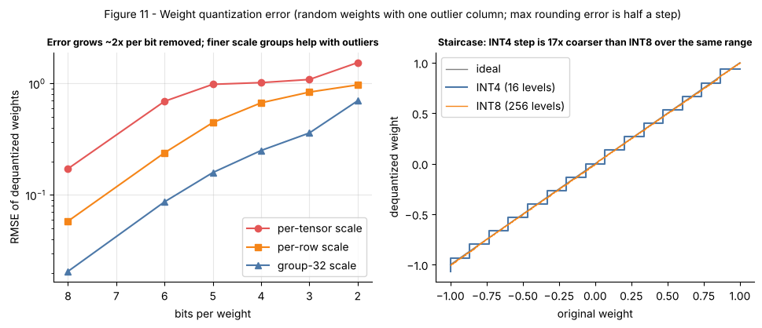

## 11.27 INT8 inference

Metadata:

- Tier: 11 — LLM Inference & Optimization
- Phase: 2 — Transformers & Foundation Models
- Priority: High
- Difficulty: Intermediate
- Interview Importance: Medium
- Hands-on Importance: High
- Prerequisites: [11.26 Quantization](11.26-quantization.md)
- Leads To: [11.28 INT4 inference](11.28-int4-inference.md), [11.44 GPU-memory budgeting](11.44-gpu-memory-budgeting.md)

### 1. WHAT IS IT?

**INT8 inference** runs a model with 8-bit integer weights (and optionally 8-bit activations, "W8A8"). It has 256 levels, so with per-channel or group scales it is usually close to lossless for weights.

### 2. WHY DOES IT EXIST?

Halves memory and weight traffic relative to FP16 with small quality risk — the conservative first step before going to 4 bits.

### 3. DETAILED EXPLANATION

- Symmetric range [−128, 127] (lab clamps to −qmax−1..qmax with qmax = 127).
- **Weight-only INT8** (W8A16): dequantize in the kernel; **W8A8**: activations also int8, needs calibration and outlier handling (techniques such as SmoothQuant, LLM.int8() mixed precision — `REVIEW_REQUIRED`).
- Tensor cores on recent GPUs have INT8 paths; FP8 is a related alternative on newest hardware (`REVIEW_REQUIRED`).
Lab toy result: INT8 per-channel on a random tiny model gives max logit change 0.009 and top-1 agreement 0.97 on 32 positions — a toy, not evidence about real LLMs.

### 4. HOW DOES IT WORK?

Same pipeline as [11.26 Quantization](11.26-quantization.md) with `bits=8`; per-output-channel scales are the common default for weights.



*Figure 11 (right panel) — the INT8 staircase is so fine it is nearly the diagonal.*

### 5. SIMPLE EXAMPLE

Measuring with a ruler marked in millimetres instead of micrometres: for almost every purpose the answer is the same.

### 6. TECHNICAL EXAMPLE

An 8B model: FP16 ≈ 16 GB, INT8 ≈ 8 GB (+ scales), so one 24 GB GPU can hold weights plus a useful KV cache (`REVIEW_REQUIRED`: hardware sizes vary).

### 7. CODE

```python
# run from lab/
import copy, torch
from tiny_gpt import TinyGPT
from quant import quantize_model

torch.manual_seed(0)
m = TinyGPT(vocab=64, d=128, n_layer=4, n_head=8, n_kv_head=2, max_len=256).eval()
x = torch.tensor([list(range(1, 33))])
with torch.no_grad():
    ref = m(x)[0]
    q8 = quantize_model(copy.deepcopy(m), bits=8)(x)[0]
print("max |dlogit|:", float((q8 - ref).abs().max()))
print("top-1 agree:", (q8.argmax(-1) == ref.argmax(-1)).float().mean().item())
```
Note: the lab `QLinear` dequantizes on the fly, so it shows accuracy effects, **not speedups**.

### 8. INPUT → PROCESS → OUTPUT

```
FP16 W ─► per-channel scale ─► int8 W ─► (fused dequant/int8 GEMM) ─► ~same logits
```

### 9. ENTERPRISE USE CASE

Default production precision for memory-constrained deployments where accuracy risk must stay minimal.

### 10. AI ENGINEERING CONNECTION

Common serving option in GPU engines ([11.32 vLLM](11.32-vllm.md)) and an easy cost win ([11.45 Inference cost](11.45-inference-cost.md)).

### 11. ADVANTAGES

- Near-lossless for most weight-only cases; 2x smaller; broadly supported.

### 12. LIMITATIONS

- Only 2x compression; activations/outliers are hard for W8A8.

### 13. TRADE-OFFS

Safety margin of accuracy vs the extra 2x that INT4 buys.

### 14. COMMON MISTAKES

- Assuming W8A8 is as easy as weight-only. - Skipping eval. - Measuring speed with a dequantizing reference implementation.

### 15. PERFORMANCE / COST CONSIDERATIONS

Weight traffic halves, so decode ITL can improve up to ~2x if kernels are fused; prefill (compute-bound) gains depend on int8 tensor-core use.

### 16. SECURITY CONSIDERATIONS

Same as [11.26 Quantization](11.26-quantization.md): verify provenance and checksums; re-run safety evals.

### 17. INTERVIEW EXPLANATION

"INT8 gives 256 levels per scale. With per-channel scales weights quantize almost losslessly, halving memory and weight traffic versus FP16. Activations are harder because of outliers, so people either keep activations in higher precision or use smoothing techniques."

### 18. RAPID-FIRE ANSWER

INT8 halves weight memory/traffic vs FP16 with minimal loss; activation outliers are the hard part.

### 19. INTERVIEW QUESTIONS

**Basic:** How many levels in INT8? **Intermediate:** Why is per-channel better than per-tensor? **Advanced:** What is SmoothQuant trying to fix? **Scenario:** INT8 gave no speedup on your GPU — why? (Unfused dequant, no int8 kernel path, compute-bound regime.)

### 20. HANDS-ON EXERCISE

Run the section 7 snippet with `bits=8` and `bits=4, group=32` and compare agreement.

### 21. REVISION QUESTIONS

1. qmax for INT8? 2. Expected memory for a 13B model in INT8? 3. W8A16 vs W8A8?

### 22. RELATED CONCEPTS

[11.26 Quantization](11.26-quantization.md), [11.28 INT4 inference](11.28-int4-inference.md), [11.40 Compute-bound vs memory-bound inference](11.40-compute-bound-vs-memory-bound-inference.md).

### 23. ONE-LINE MEMORY HOOK

"INT8: half the bytes, almost the same model."
