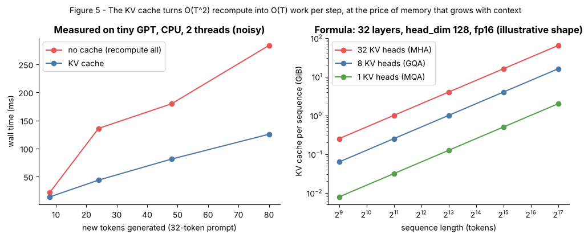

## 11.44 GPU-memory budgeting

Metadata:

- Tier: 11 — LLM Inference & Optimization
- Phase: 2 — Transformers & Foundation Models
- Priority: High
- Difficulty: Intermediate
- Interview Importance: High
- Hands-on Importance: High
- Prerequisites: [11.17 KV-cache memory calculation](11.17-kv-cache-memory-calculation.md), [11.26 Quantization](11.26-quantization.md)
- Leads To: [11.42 Concurrency](11.42-concurrency.md), [11.45 Inference cost](11.45-inference-cost.md)

### 1. WHAT IS IT?

**GPU-memory budgeting** is the arithmetic of how much GPU memory goes to weights, activations/workspace and the KV cache, and therefore how many tokens and sequences fit.

### 2. WHY DOES IT EXIST?

Out-of-memory crashes and low concurrency come from not planning this.

### 3. DETAILED EXPLANATION

```
free for KV = GPU_memory × usable_fraction − weights − activations/workspace
max concurrent tokens ≈ free_for_KV / kv_bytes_per_token ;   max sequences = that / avg context
```
Example (illustrative): 80 GB GPU, 90% usable = 72 GB; 8B-class FP16 weights ≈ 16 GB → ≈ 56 GB for KV; at 128 KiB/token → ≈ 430k cached tokens → ~104 sequences of 4k tokens. INT4 weights (~4.5 GB) free ~11 GB more; KV quantization or GQA multiplies capacity. Reserve headroom for activations and fragmentation (paging reduces the latter).



*Figure 5 — Look at KV memory growing linearly with context length and batch; this is the budget line you are spending.*
[KV calculator](interactive/kv_cache_calculator.html) does this arithmetic with presets.

### 4. HOW DOES IT WORK?

1. Weights = params × bytes. 2. Subtract from usable memory. 3. Reserve workspace. 4. Divide by KV bytes/token ([11.17 KV-cache memory calculation](11.17-kv-cache-memory-calculation.md)). 5. Divide by context for concurrency.

### 5. SIMPLE EXAMPLE

A suitcase: after clothes (weights), what's left holds souvenirs (KV).

### 6. TECHNICAL EXAMPLE

A 70B-class model at INT4 is ≈ 35-40 GB of weights (`REVIEW_REQUIRED`), so on two 80 GB GPUs (TP=2) about 2 × 72 − 40 ≈ 104 GB remain for KV. At the 70B-class GQA shape (80 layers, 8 KV heads, head_dim 128 — `REVIEW_REQUIRED`) FP16 KV is ≈ 320 KiB/token, i.e. ≈ 317k tokens, or ≈ 77 sequences of 4k tokens.

### 7. CODE

```python
# run from lab/
from kv_memory import kv_bytes_per_token, max_concurrent, kv_bytes

per_tok = kv_bytes_per_token(layers=32, kv_heads=8, head_dim=128, dtype="fp16")   # 131072 B = 128 KiB
per_seq_4k = kv_bytes(32, 8, 128, seq_len=4096, batch=1, dtype="fp16")
print(per_tok, max_concurrent(gpu_gb=80, weights_gb=16, per_seq_bytes=per_seq_4k))   # ~104 sequences
```

### 8. INPUT → PROCESS → OUTPUT

```
GPU memory ─ weights ─ workspace ─► KV pool ─► ÷ bytes/token ─► tokens ─► ÷ context ─► sequences
```

### 9. ENTERPRISE USE CASE

Capacity planning documents with explicit KV budgets per model per GPU type.

### 10. AI ENGINEERING CONNECTION

Connects quantization, GQA ([Tier 8](../tier-08-transformer-architecture/README.md)), context length and concurrency ([11.42 Concurrency](11.42-concurrency.md)).

### 11. ADVANTAGES

- Predicts capacity; prevents OOM.

### 12. LIMITATIONS

- Approximate; engines reserve extra memory.

### 13. TRADE-OFFS

Context length vs concurrency; precision vs quality.

### 14. COMMON MISTAKES

- Forgetting KV. - Using max context for all sequences. - No headroom.

### 15. PERFORMANCE / COST CONSIDERATIONS

Memory is the cost lever for concurrency.

### 16. SECURITY CONSIDERATIONS

Limit max context per tenant to avoid memory DoS.

### 17. INTERVIEW EXPLANATION

"I subtract weights and workspace from usable GPU memory, divide the remainder by KV bytes per token, then by average context to get concurrent sequences. Quantization, GQA and paging increase that number."

### 18. RAPID-FIRE ANSWER

Free-for-KV = usable − weights − workspace; divide by bytes/token.

### 19. INTERVIEW QUESTIONS

**Basic:** What fills GPU memory? **Intermediate:** Compute KV bytes/token for a given config. **Advanced:** Effect of GQA ratio 4:1. **Scenario:** OOM at 3 AM after a long-context request — fix?

### 20. HANDS-ON EXERCISE

Find context length at which an 80 GB GPU hosts exactly 8 sequences for a 70B-class preset.

### 21. REVISION QUESTIONS

1. Formula? 2. Which lever frees most? 3. Why headroom?

### 22. RELATED CONCEPTS

[11.17 KV-cache memory calculation](11.17-kv-cache-memory-calculation.md), [11.26 Quantization](11.26-quantization.md), [11.21 PagedAttention](11.21-pagedattention.md), [11.42 Concurrency](11.42-concurrency.md).

### 23. ONE-LINE MEMORY HOOK

"Weights first, KV gets the rest."
