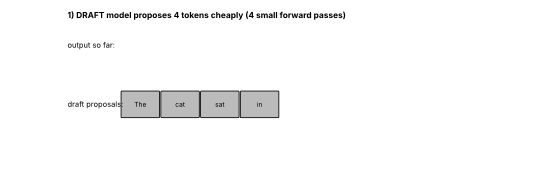

# Tier 11 — LLM Inference & Optimization

> **Phase 2 · Transformers & Foundation Models** · Author: ChatGPT/Claude draft (see `CHAPTER_STATUS.md`) · Status: `AUTHOR_DRAFT` (Critic / Code-review / Final-review pending)
> This file is the **tier overview**. Each of the 47 roadmap concepts is taught in its own file under the files `NN.CC-*.md` in this folder (see the [concept index](#4--concept-index)).

## 1 · Goal, prerequisites and what comes next

**Tier goal.** After this tier you can explain, with numbers, what happens between "user presses enter" and "last token streams back": how logits become a token (decoding), why the first token and later tokens have different costs (prefill vs decode), why the KV cache exists and how big it is, how serving engines keep a GPU busy (continuous batching, PagedAttention, speculative decoding), how quantization trades accuracy for bandwidth, and how to budget GPUs, latency and cost. You also build a tiny GPT and a benchmark that measures these effects yourself.

- **Prerequisites:** [Tier 7 — Attention](../tier-07-attention/) (owns the attention math and causal masks), [Tier 8 — Transformer architecture](../tier-08-transformer-architecture/) (owns GQA/MQA mechanics and the block diagram), [Tier 9 — Pretraining](../tier-09-foundation-model-pretraining/) (how the model was trained), [Tier 10 — Fine-tuning & alignment](../tier-10-fine-tuning-alignment/) (chat templates).
- **Leads to:** [Tier 12 — Modern architectures](../tier-12-modern-architectures/) (long-context, MoE and SSM inference), later RAG/agent tiers (prompt length, request multiplication), and Tier 36 (cost & observability platforms).
- **Not re-taught here (one authoritative location):** attention math and masks (Tier 7), GQA/MQA mechanics and transformer blocks (Tier 8), RoPE and long-context architecture changes (Tier 12), chat templates (Tier 10).

## 2 · The big picture

```
 prompt tokens ──► PREFILL (one parallel pass, builds KV cache) ──► first token  ◄── TTFT
                                   │
                                   ▼
                 DECODE loop:  [last token] ─► forward (reads weights + KV cache) ─► logits ─► decoding rule ─► next token
                                   ▲                                                                              │
                                   └────────────────────── append K,V of the new token to the cache ◄────────────┘   ◄── ITL per iteration
 Serving layer: queue ─► admission control ─► scheduler (continuous batching) ─► KV allocator (paged) ─► GPU(s) ─► stream tokens
```

Training is compute-hungry and parallel across the whole sequence. **Inference is sequential**: token *t+1* needs token *t*. That single fact drives everything in this tier: memory bandwidth (not FLOPs) is the usual bottleneck during decode, the KV cache is needed to avoid redoing work, and serving systems exist to batch many users' sequential loops onto one GPU.

Reading order that follows the story: decoding ([11.2](11.02-logits.md)-[11.10](11.10-stop-sequences.md)) -> prefill/decode and latency metrics ([11.11](11.11-prefill-phase.md)-[11.15](11.15-tokens-per-second.md)) -> KV cache ([11.16](11.16-kv-cache.md)-[11.18](11.18-prefix-caching.md)) -> batching and scheduling ([11.19](11.19-batching.md)-[11.24](11.24-admission-control.md)) -> speculative decoding and quantization ([11.25](11.25-speculative-decoding.md)-[11.28](11.28-int4-inference.md)) -> engines and topologies ([11.29](11.29-gguf.md)-[11.38](11.38-cold-starts.md)) -> bottlenecks, cost, reliability and observability ([11.39](11.39-memory-bandwidth.md)-[11.47](11.47-inference-observability.md)).

## 3 · How to use this tier (theory → see → play → code)

| Step | What | Where |
|---|---|---|
| 1. Read | One file per concept: intuition, mechanics, code, enterprise use, interview prep | the files `NN.CC-*.md` in this folder (index in section 4) |
| 2. **See** | 7 labelled static figures + 4 animated GIFs (all regenerated by one script) | [`figures/`](figures) — embedded in section 5 |
| 3. **Play** | Five interactive pages with sliders (open in a browser, no network) | [`interactive/`](interactive) — table in section 6 |
| 4. **Build** | Tiny GPT with KV cache + decoding + quantization + scheduler simulator + benchmark + 43 tests | [`lab/`](lab) — section 7 |
| 5. **Regenerate** | `python figures/src/make_figures.py` | [`figures/src/make_figures.py`](figures/src/make_figures.py) |

> **Note on animation tooling.** GIFs are rendered with Matplotlib (`FuncAnimation` + `PillowWriter`); no Manim. All hardware numbers shown in figures/pages are **illustrative round numbers marked `REVIEW_REQUIRED`**, not vendor specifications.

## 4 · Concept index

Every roadmap concept has its own file following the 23-section Standard Concept Format. The last column shows which figures the concept file embeds.

| # | Concept (link to file) | Figures |
|---|---|---|
| **Autoregressive inference and logits** | | |
| 11.1 | [Autoregressive inference](11.01-autoregressive-inference.md) | Fig 4 |
| 11.2 | [Logits](11.02-logits.md) | Fig 1 |
| **Decoding strategies** | | |
| 11.3 | [Decoding overview](11.03-decoding-overview.md) | Fig 2 |
| 11.4 | [Greedy decoding](11.04-greedy-decoding.md) |  |
| 11.5 | [Temperature](11.05-temperature.md) | Fig 2 |
| 11.6 | [Top-k sampling](11.06-top-k-sampling.md) | Fig 1 |
| 11.7 | [Top-p sampling](11.07-top-p-sampling.md) | Fig 1, Fig 2 |
| 11.8 | [Repetition/frequency penalties](11.08-repetition-frequency-penalties.md) |  |
| 11.9 | [Beam search](11.09-beam-search.md) | Fig 3 |
| 11.10 | [Stop sequences](11.10-stop-sequences.md) |  |
| **Prefill, decode and latency metrics** | | |
| 11.11 | [Prefill phase](11.11-prefill-phase.md) | Fig 4, Fig 10 |
| 11.12 | [Decode phase](11.12-decode-phase.md) | Fig 4, Fig 10 |
| 11.13 | [Time to first token (TTFT)](11.13-time-to-first-token-ttft.md) | Fig 4 |
| 11.14 | [Inter-token latency](11.14-inter-token-latency.md) | Fig 4 |
| 11.15 | [Tokens per second](11.15-tokens-per-second.md) | Fig 10 |
| **KV cache, memory, prefix caching and PagedAttention** | | |
| 11.16 | [KV cache](11.16-kv-cache.md) | Fig 5 |
| 11.17 | [KV-cache memory calculation](11.17-kv-cache-memory-calculation.md) | Fig 5 |
| 11.18 | [Prefix caching](11.18-prefix-caching.md) |  |
| **Batching, scheduling, backpressure, admission control** | | |
| 11.19 | [Batching](11.19-batching.md) | Fig 7 |
| 11.20 | [Continuous batching](11.20-continuous-batching.md) | Fig 7 |
| 11.21 | [PagedAttention](11.21-pagedattention.md) | Fig 6 |
| 11.22 | [Request scheduling](11.22-request-scheduling.md) |  |
| 11.23 | [Backpressure](11.23-backpressure.md) |  |
| 11.24 | [Admission control](11.24-admission-control.md) |  |
| **Speculative decoding** | | |
| 11.25 | [Speculative decoding](11.25-speculative-decoding.md) | Fig 8, Fig 9 |
| **Quantization** | | |
| 11.26 | [Quantization](11.26-quantization.md) | Fig 11 |
| 11.27 | [INT8 inference](11.27-int8-inference.md) | Fig 11 |
| 11.28 | [INT4 inference](11.28-int4-inference.md) | Fig 11 |
| **Local-inference and serving ecosystem** | | |
| 11.29 | [GGUF](11.29-gguf.md) |  |
| 11.30 | [llama.cpp](11.30-llama-cpp.md) |  |
| 11.31 | [Ollama](11.31-ollama.md) |  |
| 11.32 | [vLLM](11.32-vllm.md) | Fig 6 |
| **Deployment topologies and scaling** | | |
| 11.33 | [Local vs hosted inference](11.33-local-vs-hosted-inference.md) |  |
| 11.34 | [Model replicas](11.34-model-replicas.md) |  |
| 11.35 | [Tensor-parallel inference](11.35-tensor-parallel-inference.md) |  |
| 11.36 | [Pipeline-parallel inference](11.36-pipeline-parallel-inference.md) |  |
| 11.37 | [Serving autoscaling](11.37-serving-autoscaling.md) |  |
| 11.38 | [Cold starts](11.38-cold-starts.md) |  |
| **Bandwidth, roofline, bottlenecks** | | |
| 11.39 | [Memory bandwidth](11.39-memory-bandwidth.md) | Fig 10 |
| 11.40 | [Compute-bound vs memory-bound inference](11.40-compute-bound-vs-memory-bound-inference.md) | Fig 10 |
| 11.41 | [Prefill vs decode bottlenecks](11.41-prefill-vs-decode-bottlenecks.md) | Fig 4 |
| **Concurrency, throughput, memory budget, cost** | | |
| 11.42 | [Concurrency](11.42-concurrency.md) |  |
| 11.43 | [Throughput](11.43-throughput.md) | Fig 7 |
| 11.44 | [GPU-memory budgeting](11.44-gpu-memory-budgeting.md) | Fig 5 |
| 11.45 | [Inference cost](11.45-inference-cost.md) |  |
| **Reliability and observability** | | |
| 11.46 | [Serving reliability](11.46-serving-reliability.md) |  |
| 11.47 | [Inference observability](11.47-inference-observability.md) |  |

## 5 · Visual gallery


*Figure 1 — Same 16 logits through four transforms. Look at the hollow outlines (the raw softmax) versus the blue bars (what survives and is renormalised): temperature changes shape, top-k keeps a fixed count, top-p keeps a probability mass. Concepts: [11.2](11.02-logits.md), [11.6](11.06-top-k-sampling.md), [11.7](11.07-top-p-sampling.md).*


*Figure 2 — As temperature rises the distribution flattens (entropy up) and the top-p(0.9) nucleus (blue) grows from one token to many. Watch the title: nucleus size and entropy move together. Concepts: [11.3](11.03-decoding-overview.md), [11.5](11.05-temperature.md), [11.7](11.07-top-p-sampling.md).*


*Figure 3 — Illustrative probabilities. Greedy picks A (0.5) then x for joint 0.175; beam width 2 keeps B too and finds Bx at 0.36. Beam search favours short, generic, high-probability text, so open-ended chat generally uses sampling; it remains common in translation/summarisation-style tasks. Cost: B times the compute and KV memory. Concept: [11.9](11.09-beam-search.md).*


*Figure 4 — Look at how one wide prefill block (all prompt tokens at once) precedes many narrow decode steps (one token each). The width of one orange block is one ITL; TTFT ends where the first orange block starts. Numbers come from the illustrative roofline model (REVIEW_REQUIRED hardware). Concepts: [11.11](11.11-prefill-phase.md)-[11.14](11.14-inter-token-latency.md).*


*Figure 5 — Left: measured on the lab's tiny GPT (CPU, 2 threads, noisy, relative only): the gap between recompute and cache widens as more tokens are generated. Right: the KV cache is the other side of the bargain; it grows linearly with context and shrinks with fewer KV heads (GQA/MQA, Tier 8). Shape numbers are illustrative. Concepts: [11.16](11.16-kv-cache.md), [11.17](11.17-kv-cache-memory-calculation.md).*


*Figure 6 — Left: physical blocks (4 tokens each) filling from the bottom; the colour is the owning request. Right: the block tables and free pool. Watch (a) a new block allocated only when the last one is full, (b) request B finishing and its blocks returning to the pool, (c) request D reusing them in non-contiguous order. Concept: [11.21](11.21-pagedattention.md).*


*Figure 7 — Same ten requests, four slots (from the lab scheduler). Top: static; bottom: continuous. Watch the empty gaps at the right of the static batches (waiting for the longest request) versus slots being refilled at once in the continuous plot; compare the makespan in each title. Concepts: [11.19](11.19-batching.md), [11.20](11.20-continuous-batching.md).*



*Figure 8 — Round 1: the draft proposes 4 tokens, the target accepts three and replaces the fourth with its own token ("on"); Round 2: all 4 accepted plus a bonus token. Nine tokens in two target passes. Green = accepted, red = rejected; everything after the first rejection is discarded. Concept: [11.25](11.25-speculative-decoding.md).*


*Figure 9 — Expected tokens per target pass `(1 - alpha^(k+1)) / (1 - alpha)` assuming each draft token is accepted independently with probability alpha. Real speedup is lower because the draft model also costs time; the curve flattens, so large k pays off only at high alpha. Concept: [11.25](11.25-speculative-decoding.md).*


*Figure 10 — Illustrative accelerator (300 TFLOPS, 2 TB/s; REVIEW_REQUIRED). Orange squares: decode at batch 1, 8, 64 — all far left of the dashed ridge, so adding users is nearly free until the ridge is approached. Blue: prefill of 128 vs 2048 tokens climbs the slope and, once long enough, reaches the compute roof. Concepts: [11.39](11.39-memory-bandwidth.md)-[11.41](11.41-prefill-vs-decode-bottlenecks.md).*


*Figure 11 — Left: RMSE vs bits for per-tensor, per-row and group-32 scales on random weights with one outlier column — finer scales help; each removed bit roughly doubles the error. Right: the staircase map from original to dequantized values; INT4's steps are visibly coarser. Concepts: [11.26](11.26-quantization.md)-[11.28](11.28-int4-inference.md).*

## 6 · Interactive explorers

Double-click the HTML file; self-contained, light/dark aware, phone-friendly, no network.

| Explorer | Adjustable controls | Concepts |
|---|---|---|
| [`decoding_explorer.html`](interactive/decoding_explorer.html) | logit shape, temperature, top-k, top-p, min-p, repetition penalty, "draw 1000 samples" | [11.2](11.02-logits.md)-[11.8](11.08-repetition-frequency-penalties.md) |
| [`kv_cache_calculator.html`](interactive/kv_cache_calculator.html) | layers, query/KV heads, head_dim, context, batch, dtype, GPU & weight GB; PagedAttention block size / max context / #sequences | [11.16](11.16-kv-cache.md), [11.17](11.17-kv-cache-memory-calculation.md), [11.21](11.21-pagedattention.md), [11.44](11.44-gpu-memory-budgeting.md) |
| [`batching_gantt.html`](interactive/batching_gantt.html) | batch slots, #requests, length spread, arrival gap, seed, time scrubber + play | [11.19](11.19-batching.md), [11.20](11.20-continuous-batching.md), [11.22](11.22-request-scheduling.md) |
| [`quantization_explorer.html`](interactive/quantization_explorer.html) | bits, group size, outlier magnitude, #weights, seed | [11.26](11.26-quantization.md)-[11.28](11.28-int4-inference.md) |
| [`roofline_latency.html`](interactive/roofline_latency.html) | hardware preset, peak TFLOPS, bandwidth, params, bytes/param, batch, prompt & output length | [11.11](11.11-prefill-phase.md)-[11.15](11.15-tokens-per-second.md), [11.39](11.39-memory-bandwidth.md)-[11.41](11.41-prefill-vs-decode-bottlenecks.md), [11.43](11.43-throughput.md) |

## 7 · Build: inference benchmark (tiny GPT, decoding, KV cache, quantization, scheduler)

| File | What it is |
|---|---|
| [`lab/tiny_gpt.py`](lab/tiny_gpt.py) | ~90-line GPT (pre-LN, learned positions, **GQA**) with an optional per-layer KV cache; self-contained (no cross-tier imports) |
| [`lab/decoding.py`](lab/decoding.py) | temperature, top-k, top-p, min-p, repetition/frequency/presence penalties, stop sequences, greedy/sampling `generate` (cache on/off), beam search |
| [`lab/quant.py`](lab/quant.py) | symmetric INT8/INT4 (per-tensor, per-row, group-wise), error metrics, `QLinear`, `quantize_model` |
| [`lab/scheduler.py`](lab/scheduler.py) | toy static vs continuous batching simulator with KV-token capacity, max batch, reservation policy, bounded queue (admission control) |
| [`lab/kv_memory.py`](lab/kv_memory.py) | KV-cache bytes formula and max-concurrency calculator |
| [`lab/benchmark.py`](lab/benchmark.py) | prints all the comparisons below (about 8 s on 2 CPU threads) |
| [`lab/test_tier11.py`](lab/test_tier11.py) | 43 tests |

```bash
cd lab && python -m pytest -q      # 43 passed
python benchmark.py                # the measurements below
python ../figures/src/make_figures.py  # regenerates figures/
```

**What the tests prove.** KV-cache incremental logits equal full-recompute logits (atol 1e-5) and cached/uncached greedy generation is identical; the cache tensors use `n_kv_head` (GQA) not `n_head`; top-k keeps exactly the k largest; top-p: kept mass >= p, minimal, always >= 1 token, kept tokens are the most probable; sampled tokens always lie inside the nucleus; temperature limits; repetition penalty direction; beam score >= greedy score and equals the recomputed log-prob; INT8 rounding error <= s/2 and values in int8 range; per-channel beats per-tensor with an outlier row; INT4 worse than INT8 and group scales help; quantized model logits close to float; the KV formula (incl. 4x GQA saving); scheduler never exceeds capacity or batch slots, finishes or rejects every request (static & continuous, both reservation modes, 5 seeds); continuous beats static; admission control sheds load.

**Example benchmark output** (this sandbox, CPU with 2 threads while other jobs ran; **relative values only, noisy, not representative of GPUs**):

| Experiment | Result | Concept |
|---|---|---|
| KV cache vs recompute, 32-token prompt + 128 new tokens | 146 ms vs 724 ms (about 4.9x); 1.7x at 16 new tokens, 2.4x at 64 | [11.16](11.16-kv-cache.md) |
| Beam search (3 beams, no cache) | about 100 steps/s: slow by design (clarity over speed) | [11.9](11.09-beam-search.md) |
| INT8 per-channel weights (toy model) | max logit change 0.009, top-1 agreement 0.97 | [11.27](11.27-int8-inference.md) |
| INT4 group-32 weights (toy model) | max logit change 0.158, top-1 agreement 0.84 | [11.28](11.28-int4-inference.md) |
| KV bytes, measured vs formula (4 layers, 2 KV heads, head_dim 16, 32 tokens, fp32) | 32,768 B = 32,768 B | [11.17](11.17-kv-cache-memory-calculation.md) |
| Scheduler, 24 requests, 600 KV tokens, 8 slots | static makespan 269 / continuous 152 ticks; mean TTFT 87 vs 18 | [11.20](11.20-continuous-batching.md) |

Decoding-strategy tokens/s in the same run (greedy 725, T=0.8 604, top-k 269, top-p 400 tok/s) vary by run because filtering overhead is tiny relative to noise and Python overhead here; do not read them as a ranking. The simulated "int8" model dequantizes weights on the fly, so it demonstrates *accuracy* effects, **not speedups** (real speedups need fused low-precision kernels).

**Exercises**

1. In `benchmark.py` raise `N` to 200 new tokens and plot time vs N for cache/no-cache. Fit a line and a parabola; which fits which?
2. Add a **repetition penalty** to a degenerate prompt and show the repeated n-gram rate drops (count repeated 3-grams).
3. Implement **prefix caching** in `generate`: accept a precomputed cache for a shared prompt prefix and test that logits match a cold run.
4. Extend `scheduler.py` with **preemption** (evict the newest request when `reserve_full=False` overflows) and write a test that capacity is never exceeded.
5. Add a **speculative decoding** loop using a 1-layer draft `TinyGPT` and the acceptance rule; test that with draft = target all tokens are accepted. *(stretch)*
6. In `kv_cache_calculator.html`, find the context length at which an 80 GB GPU can host exactly 8 sequences for the 70B-class preset; verify with `lab/kv_memory.py`.

## 8 · Interview kit (whole tier)

Per-concept interview material (explanations, rapid-fire answers, basic/intermediate/advanced/scenario questions) lives in each concept file. Tier-level questions:

**Basic.** What are logits? What is temperature? What is the KV cache? What is TTFT?
**Intermediate.** Top-k vs top-p? Prefill vs decode? How big is the KV cache for a given model and context? Why does batching raise throughput?
**Advanced.** Why is decode memory-bound and how does that explain quantization and speculative decoding gains? How does PagedAttention improve utilisation? Compare TP and PP. Why is speculative decoding lossless?
**Scenario 1.** *p95 latency doubled after launch but GPU utilisation looks fine.* (Split queue/TTFT/ITL; check batch size, KV saturation and preemptions, prompt-length drift, noisy neighbour requests; add admission control.)
**Scenario 2.** *Design serving for 500 concurrent chat users on an 8B model.* (KV budget math per user, quantization choice, continuous batching engine, replicas/TP decision, autoscaling on queue time, SLOs, observability, fallback.)
**Scenario 3.** *Finance asks why the bill tripled.* (tokens in/out per feature, long system prompts without prefix caching, agent loops, retries, missing `max_tokens`.)

## 9 · Tier summary and revision questions

**60-second tier summary.** *"Generation is sequential: prefill processes the prompt in one compute-heavy pass and builds the KV cache; decode then emits one token per step by streaming all weights from memory, so it is memory-bandwidth-bound. Decoding rules (greedy, temperature, top-k/top-p, penalties, beam) turn logits into tokens. The KV cache avoids recomputation but its size — 2·layers·kv_heads·head_dim·tokens·bytes — limits concurrency, which is why GQA, PagedAttention, KV/weight quantization and prefix caching matter. Continuous batching keeps the GPU full, speculative decoding spends spare compute to emit multiple tokens per pass, and parallelism/replicas/autoscaling plus admission control, observability and cost math turn a model into a reliable service."*

**Revision questions**

1. Show that adding a constant to all logits does not change the softmax.
2. What does `T→0` do? `T→∞`? Why can high T alone produce nonsense?
3. Why does the kept-token count under top-p change with confidence while top-k's does not?
4. Write the KV-cache formula and compute it for 80 layers, 8 KV heads, head_dim 128, fp16, 8k tokens (answer: 320 KiB per token, 2.5 GiB).
5. Why are K and V cached but not Q?
6. Why does continuous batching beat static batching when output lengths vary?
7. Why does PagedAttention raise throughput but not single-request speed?
8. Why does quantizing weights lower ITL for decode but help prefill less?
9. When does speculative decoding give little or no speedup?
10. Give two reasons autoscaling on GPU utilisation is a poor policy.

**Related concepts and forward references.** Attention math and masks → Tier 7. GQA/MQA mechanics, transformer block anatomy → Tier 8. Pretraining data/compute → Tier 9. Chat templates, alignment → Tier 10. Long-context architectures, MoE inference, SSMs → Tier 12. RAG prompt-length effects → Tier 20. Agent request multiplication, tool-call loops → later agent tiers. Gateways, cost dashboards, tracing → Tier 36. Distributed-systems patterns (queues, backpressure, retries) → systems tiers.

## 10 · Review status

| Item | State |
|---|---|
| Concept files (this folder, 47) | `AUTHOR_DRAFT`; code snippets in concepts 11.1-11.24 were executed against `lab/` and ran; claims marked `REVIEW_REQUIRED` inline are unverified |
| Code (`lab/`) | **TESTED** — `pytest`: 43 passed (Python 3.13, PyTorch CPU, 2 threads) |
| Benchmark | run once in the sandbox; timing numbers are noisy and machine-specific (not for citation) |
| Interactive pages | **TESTED** with `tools/check_interactive.py` in headless Chromium: no JS errors, sliders exercised; screenshots reviewed |
| Figures | regenerated by `figures/src/make_figures.py`; visually spot-checked; GIFs < 600 KB |
| Hardware numbers, example model shapes, prices, tool/ecosystem descriptions (GGUF, llama.cpp, Ollama, vLLM), library-specific decoding orders, paper citations | `REVIEW_REQUIRED` (marked inline) |
| Critic / Code-review / Final-review | pending per `CHAPTER_STATUS.md` |
