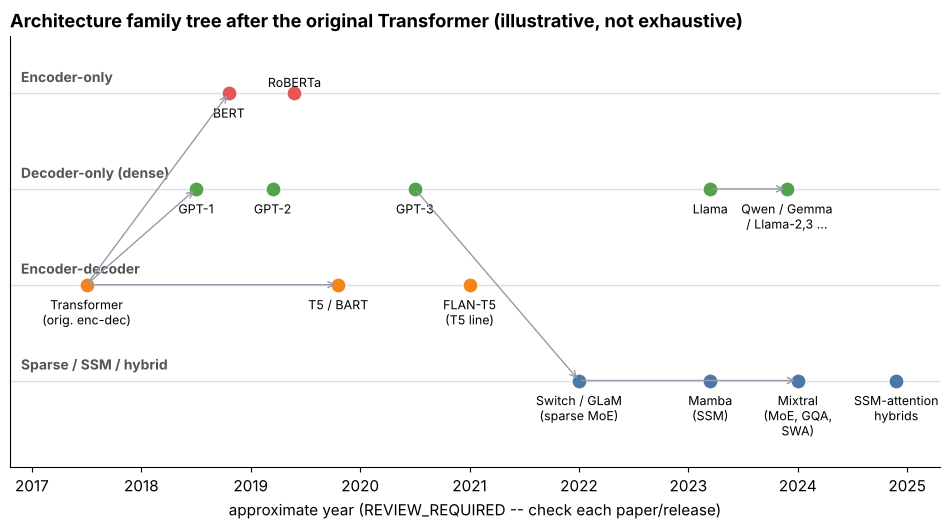

## 12.1 Architectural evolution after the original Transformer

Metadata:

- Tier: 12 — Modern Foundation-Model Architectures
- Phase: 2 — Transformers & Foundation Models
- Priority: High
- Difficulty: Beginner
- Interview Importance: High
- Hands-on Importance: Low
- Prerequisites: [Tier 8 Transformer Architecture](../tier-08-transformer-architecture/README.md), [Tier 7 Attention](../tier-07-attention/README.md)
- Leads To: [12.2 Dense Transformers](12.02-dense-transformers.md), [12.23 Architecture selection trade-offs](12.23-architecture-selection-trade-offs.md)

### 1. WHAT IS IT?

The sequence of design changes that turned the 2017 encoder-decoder Transformer into today's foundation-model architectures: decoder-only dominance, pre-norm + RMSNorm + gated FFNs, RoPE, GQA, local attention, sparse MoE, and SSM/hybrid layers.

### 2. WHY DOES IT EXIST?

Almost every change attacks one of three costs: **quality per FLOP** (better blocks, MoE), **memory at inference** (GQA, windows, SSM state) or **context length** (RoPE scaling, sparse/linear mixers). Knowing which cost a change targets lets you predict what it will break.

### 3. DETAILED EXPLANATION

The *block* is still attention + FFN with residuals (authoritative: [Tier 8 Transformer Architecture](../tier-08-transformer-architecture/README.md) and [Tier 7 Attention](../tier-07-attention/README.md)). What changed is the details and the layout:

| Axis | 2017 original | Common in recent open models | Targets |
|---|---|---|---|
| Layout | encoder-decoder | decoder-only dominates (see 12.4) | simplicity, scaling |
| Norm | post-LayerNorm | pre-norm, RMSNorm | trainability |
| FFN | ReLU, 2 matrices | gated (SwiGLU/GeGLU), 3 matrices | quality/FLOP |
| Position | sinusoidal | RoPE (+ scaling) | length generalisation |
| Attention heads | MHA | GQA / MQA | KV-cache memory |
| Attention span | full | sliding window mixed with global | long context cost |
| FFN | dense | sparse MoE | capacity per FLOP |
| Mixer | attention only | SSM or attention+SSM hybrids | linear-time long context |

Every row above is taught once, in its own concept of this tier (or its home tier); this concept is the map.



*Figure: lanes are architecture families; arrows show lineage. Years are approximate (REVIEW_REQUIRED). Look at how the sparse/SSM lane only appears after dense decoders dominate.*

### 4. HOW DOES IT WORK?

Read the evolution as **cause → fix → new problem** chains: full attention → KV cache too big → GQA/windows → exact long-range recall suffers → global layers or hybrids; dense FFN → compute per token too high for the capacity wanted → MoE → all experts must sit in memory + routing imbalance → load balancing and expert parallelism.

### 5. SIMPLE EXAMPLE

A car: the engine layout (piston + gearbox) is the same as in 1950, but fuel injection, turbo and hybrid drive each fixed one limit.

### 6. TECHNICAL EXAMPLE

Take a 2023-style open decoder: RMSNorm → GQA attention with RoPE → residual → RMSNorm → SwiGLU FFN → residual. Each element is individually a post-2017 change. Count them with [`lab/arch_matrix.py`](lab/arch_matrix.py) by switching `gated_ffn`, `n_kv_heads`, `n_experts`, `pattern` on an `ArchSpec`.

### 7. CODE

```python
import sys; sys.path.insert(0, "lab")
import arch_matrix as am
base = am.PRESETS["Dense MHA (illustrative)"]
for label, s in [("MHA", base),
                 ("+GQA", am.replace(base, n_kv_heads=8)),
                 ("+MoE 8x top2", am.replace(base, n_kv_heads=8, n_experts=8, top_k=2))]:
    print(label, am.total_params(s)/1e9, am.active_params(s)/1e9, am.kv_bytes_per_token(s)/1024)
```
Each step changes exactly the quantity it was designed to change: GQA cuts KV KiB/token, MoE raises total but not active parameters.

### 8. INPUT → PROCESS → OUTPUT

```
bottleneck (memory / compute / context)  →  architectural change  →  new side-effect to manage
```

### 9. ENTERPRISE USE CASE

An architecture review for a model purchase or self-hosting decision: map the candidate's config onto this table to understand its memory and latency profile before benchmarking.

### 10. AI ENGINEERING CONNECTION

Choosing a model for RAG, agents or fine-tuning (Tiers 17, 20, 10) depends on KV size, context length and active parameters, all consequences of these choices.

### 11. ADVANTAGES

One vocabulary for comparing very different model cards; predicts inference cost from config alone.

### 12. LIMITATIONS

Evolution is not strictly linear: old designs (encoders, enc-dec) remain best for some tasks; dates and attributions here are approximate (REVIEW_REQUIRED).

### 13. TRADE-OFFS

Each change buys one resource and spends another (e.g. MoE buys quality/FLOP, spends memory and routing complexity).

### 14. COMMON MISTAKES

Assuming newer means better for every task; assuming a model name implies its architecture (always read the config).

### 15. PERFORMANCE / COST CONSIDERATIONS

Cost shows up as: KV GiB per sequence, weights GiB, GFLOPs per token. All three are in the comparison matrix of [12.23 Architecture selection trade-offs](12.23-architecture-selection-trade-offs.md).

### 16. SECURITY CONSIDERATIONS

Architecture does not change the threat model by itself, but long context and tool use enlarge the prompt-injection surface (Tier 24).

### 17. INTERVIEW EXPLANATION

*"The block is the same; the details changed to cut KV-cache memory, FLOPs per token and context cost: pre-norm/RMSNorm/SwiGLU for quality, RoPE and GQA for long context and cheap serving, MoE for capacity, SSM hybrids for linear-time context."*

### 18. RAPID-FIRE ANSWER

Same Transformer block; better norm/FFN/positions, fewer KV heads, sparse FFN, and sometimes SSM layers.

### 19. INTERVIEW QUESTIONS

- **Basic:** Name three changes since the original Transformer.
- **Intermediate:** Which changes reduce KV-cache size?
- **Advanced:** Why did decoder-only win for general-purpose LLMs?
- **Scenario:** A model card says 8 KV heads and 32 heads; what did the authors optimise?

### 20. HANDS-ON EXERCISE

Pick one open model config, fill an `ArchSpec`, and list which rows of the table above it uses.

### 21. REVISION QUESTIONS

1. Which row of the table targets memory? 2. Which targets quality per FLOP? 3. What is the new problem each fix creates?

### 22. RELATED CONCEPTS

[12.2 Dense Transformers](12.02-dense-transformers.md), [12.7 Grouped-Query Attention (GQA) in modern models](12.07-grouped-query-attention-gqa-in-modern-models.md), [12.13 Mixture of Experts (MoE)](12.13-mixture-of-experts-moe.md), [12.17 State Space Models (SSMs)](12.17-state-space-models-ssms.md)

### 23. ONE-LINE MEMORY HOOK

*Same block, new bottleneck each time.*
