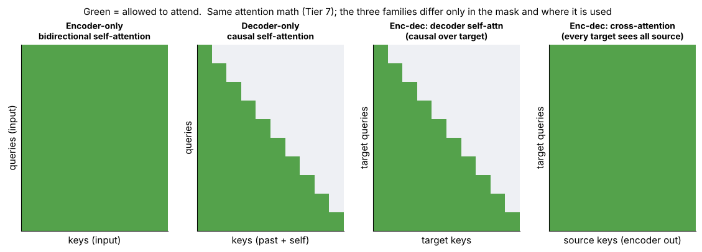

## 12.4 Decoder-only models as an architectural family

Metadata:

- Tier: 12 — Modern Foundation-Model Architectures
- Phase: 2 — Transformers & Foundation Models
- Priority: High
- Difficulty: Beginner
- Interview Importance: High
- Hands-on Importance: Medium
- Prerequisites: [Tier 7 Attention](../tier-07-attention/README.md), [Tier 8 Transformer Architecture](../tier-08-transformer-architecture/README.md)
- Leads To: [12.25 Architecture case study: GPT family](12.25-architecture-case-study-gpt-family.md), [12.27 Architecture case study: Llama family](12.27-architecture-case-study-llama-family.md)

### 1. WHAT IS IT?

Decoder-only models apply **causal** self-attention and predict the next token. Prompt and output live in one sequence; generation is an autoregressive loop with a KV cache.

### 2. WHY DOES IT EXIST?

One architecture and one objective (next-token prediction, Tier 9) scales cleanly and handles any task as text continuation, which is why it dominates general-purpose LLMs.

### 3. DETAILED EXPLANATION

Causal masking and the next-token objective are defined in [Tier 7 Attention](../tier-07-attention/README.md) and [Tier 8 Transformer Architecture](../tier-08-transformer-architecture/README.md). The architecture-level consequences are the interesting part:

* **Prefill** (parallel over the prompt, compute-bound) then **decode** (one token at a time, memory-bandwidth-bound; Tier 11).
* Memory per sequence = KV cache (see [12.7 Grouped-Query Attention (GQA) in modern models](12.07-grouped-query-attention-gqa-in-modern-models.md), [12.10 Sliding-window attention](12.10-sliding-window-attention.md)).
* Every modern long-context technique in this tier modifies a decoder-only model.



*Figure: second panel is the causal mask used by decoder-only models.*

### 4. HOW DOES IT WORK?

1. Embed tokens. 2. N blocks with causal attention. 3. Final norm + unembedding → logits. 4. Sample, append, reuse cached K/V.

### 5. SIMPLE EXAMPLE

Writing a sentence word by word where each new word can look only at what is already written.

### 6. TECHNICAL EXAMPLE

A 7B-class decoder at 8k context needs ~14 GiB of bf16 weights plus KV cache that depends on `H_kv` (about 4 GiB per sequence for 32 KV heads, 1 GiB for 8) — see the matrix.

### 7. CODE

```python
import sys; sys.path.insert(0, "lab")
import arch_matrix as am
s = am.PRESETS["Dense GQA-8 (illustrative)"]
print(am.cache_bytes(s, 8192)/2**30, "GiB per sequence;", am.max_concurrent_sequences(s, 80, 8192), "sequences on 80 GB")
```

### 8. INPUT → PROCESS → OUTPUT

```
prompt → prefill (fill KV) → loop: logits → sample → append → next step (reads KV)
```

### 9. ENTERPRISE USE CASE

Chat assistants, code completion, agents, structured extraction: one model, many tasks, steered by prompts.

### 10. AI ENGINEERING CONNECTION

Foundation of RAG, agents and tool use: the prompt is the program (Tiers 17-21).

### 11. ADVANTAGES

Simple scaling recipe; flexible in-context behaviour; efficient incremental decoding with a cache.

### 12. LIMITATIONS

Left-to-right only (no bidirectional context during generation); decode is memory-bound; KV cache limits concurrency.

### 13. TRADE-OFFS

Generality vs per-task efficiency (a small encoder may beat it on classification).

### 14. COMMON MISTAKES

Forgetting that cost has two phases; ignoring KV memory when planning concurrency.

### 15. PERFORMANCE / COST CONSIDERATIONS

Prefill ≈ n² attention work; decode per token ≈ 2·N FLOPs plus reading the full KV cache.

### 16. SECURITY CONSIDERATIONS

Prompt injection (Tier 24): instructions and data share one token stream.

### 17. INTERVIEW EXPLANATION

*"Decoder-only models use causal attention and next-token prediction; one sequence holds prompt and answer, generation reuses a KV cache, and almost all long-context and serving optimisations apply to this layout."*

### 18. RAPID-FIRE ANSWER

Causal attention + next-token loop + KV cache.

### 19. INTERVIEW QUESTIONS

- **Basic:** What does causal masking prevent?
- **Intermediate:** Why is decode memory-bound?
- **Advanced:** Why does decoder-only dominate despite being left-to-right?
- **Scenario:** Estimate concurrency of a 7B model on an 80 GB GPU at 8k context.

### 20. HANDS-ON EXERCISE

Use `max_concurrent_sequences` with MHA vs GQA vs MQA and report the ratio.

### 21. REVISION QUESTIONS

1. Phases of inference? 2. What lives in the KV cache? 3. Why does the cache grow linearly?

### 22. RELATED CONCEPTS

[12.3 Encoder-only models as an architectural family](12.03-encoder-only-models-as-an-architectural-family.md), [12.5 Encoder-decoder models as an architectural family](12.05-encoder-decoder-models-as-an-architectural-family.md), [12.7 Grouped-Query Attention (GQA) in modern models](12.07-grouped-query-attention-gqa-in-modern-models.md), [12.25 Architecture case study: GPT family](12.25-architecture-case-study-gpt-family.md)

### 23. ONE-LINE MEMORY HOOK

*Predict the next token, remember the past in a cache.*
