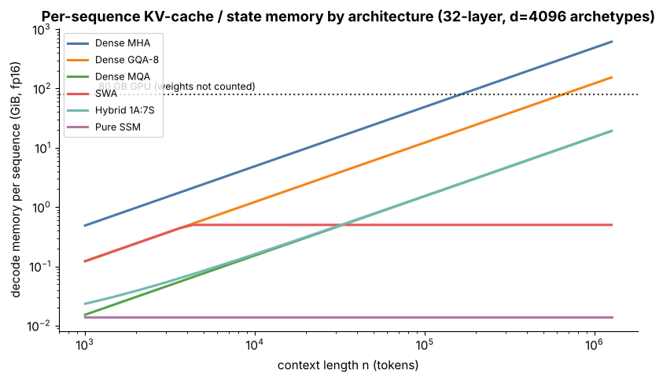

## 12.6 Multi-Query Attention (MQA) in modern models

Metadata:

- Tier: 12 — Modern Foundation-Model Architectures
- Phase: 2 — Transformers & Foundation Models
- Priority: High
- Difficulty: Intermediate
- Interview Importance: High
- Hands-on Importance: Medium
- Prerequisites: [Tier 7 Attention](../tier-07-attention/README.md) (MQA mechanics, §10)
- Leads To: [12.7 Grouped-Query Attention (GQA) in modern models](12.07-grouped-query-attention-gqa-in-modern-models.md)

### 1. WHAT IS IT?

MQA shares a **single** K/V head among all query heads. Mechanics and the cache formula are owned by [Tier 7 Attention](../tier-07-attention/README.md); this concept covers its role in modern models.

### 2. WHY DOES IT EXIST?

Decode is memory-bandwidth-bound by KV reads; cutting `H_kv` to 1 shrinks the cache by `H×`.

### 3. DETAILED EXPLANATION

KV bytes per token `= 2·L·H_kv·d_h·bytes`. With `H_kv = 1` this is `H` times smaller than MHA. Quality can drop slightly, which is why most recent large models chose GQA instead (see [12.7 Grouped-Query Attention (GQA) in modern models](12.07-grouped-query-attention-gqa-in-modern-models.md)).



*Figure: the lowest dense curve is MQA; log-log, per-sequence cache vs context.*

### 4. HOW DOES IT WORK?

All query heads attend with their own Q but the same K and V; K/V projections are `d×d_h` instead of `d×H·d_h`.

### 5. SIMPLE EXAMPLE

Thirty readers each with their own question but one shared dictionary.

### 6. TECHNICAL EXAMPLE

At n=8192, 32 layers, d_h=128, fp16: MHA 4 GiB, MQA 0.125 GiB per sequence; on 80 GB that is 15 vs 511 sequences (archetype, weights differ).

### 7. CODE

```python
import sys; sys.path.insert(0, "lab")
import arch_matrix as am
for n in ("Dense MHA (illustrative)", "Dense MQA (illustrative)"):
    s = am.PRESETS[n]; print(n, am.kv_bytes_per_token(s)/1024, "KiB/token")   # 512 vs 16
```

### 8. INPUT → PROCESS → OUTPUT

```
H query heads + 1 K head + 1 V head → cache ÷ H
```

### 9. ENTERPRISE USE CASE

High-concurrency serving where cache is the bottleneck.

### 10. AI ENGINEERING CONNECTION

Throughput and batch size in inference servers (Tier 11).

### 11. ADVANTAGES

Maximum cache and bandwidth saving.

### 12. LIMITATIONS

Possible quality loss; less capacity in attention.

### 13. TRADE-OFFS

Memory vs quality; GQA sits in between.

### 14. COMMON MISTAKES

Converting MHA→MQA without brief retraining.

### 15. PERFORMANCE / COST CONSIDERATIONS

Cache ÷ H; weight savings in K/V projections.

### 16. SECURITY CONSIDERATIONS

None specific.

### 17. INTERVIEW EXPLANATION

*"MQA uses one K/V head for all query heads, shrinking the KV cache by the head count at some quality risk, so many models prefer GQA."*

### 18. RAPID-FIRE ANSWER

One shared K/V head; cache ÷ H.

### 19. INTERVIEW QUESTIONS

- **Basic:** What does MQA share?
- **Intermediate:** KV saving factor?
- **Advanced:** Why did GQA replace MQA in many models?
- **Scenario:** Cache is your bottleneck at 64 users; what would you check?

### 20. HANDS-ON EXERCISE

Compute max concurrent sequences for MHA/GQA/MQA at 32k context.

### 21. REVISION QUESTIONS

1. Formula for KV bytes? 2. Parameter savings?

### 22. RELATED CONCEPTS

[12.7 Grouped-Query Attention (GQA) in modern models](12.07-grouped-query-attention-gqa-in-modern-models.md), [12.10 Sliding-window attention](12.10-sliding-window-attention.md)

### 23. ONE-LINE MEMORY HOOK

*One dictionary for all readers.*
