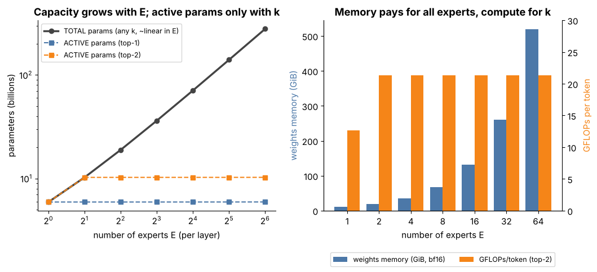

## 12.13 Mixture of Experts (MoE)

Metadata:

- Tier: 12 — Modern Foundation-Model Architectures
- Phase: 2 — Transformers & Foundation Models
- Priority: High
- Difficulty: Intermediate
- Interview Importance: High
- Hands-on Importance: Medium
- Prerequisites: [Tier 8 Transformer Architecture](../tier-08-transformer-architecture/README.md) (FFN), [Tier 9 Pre-training](../tier-09-foundation-model-pretraining/README.md) §12 (MoE training)
- Leads To: [12.14 Sparse MoE](12.14-sparse-moe.md)

### 1. WHAT IS IT?

Mixture of Experts replaces a layer's single FFN with **E expert FFNs** and a **router** that decides which experts process each token.

### 2. WHY DOES IT EXIST?

Increase parameter capacity without increasing per-token FLOPs proportionally.

### 3. DETAILED EXPLANATION

Idea: knowledge capacity scales with parameters, compute per token with *active* parameters. MoE decouples them. The training-side view (routing losses, expert parallelism) is in [Tier 9 Pre-training](../tier-09-foundation-model-pretraining/README.md); here we keep the architecture view and the cost accounting.



*Figure: left, total parameters rise linearly in E while active parameters stay flat; right, weights memory rises with E but GFLOPs/token stays flat for fixed top-k.*

[Explore: moe_explorer.html](interactive/moe_explorer.html)

### 4. HOW DOES IT WORK?

1. Router `W_r ∈ ℝ^{d×E}` scores each token. 2. Pick experts (see [12.15 Expert routing](12.15-expert-routing.md)). 3. Run chosen experts, weight outputs by router probabilities. 4. Add residual.

### 5. SIMPLE EXAMPLE

A hospital with specialists: each patient sees two, not all, but the hospital must employ them all.

### 6. TECHNICAL EXAMPLE

Mixtral-8×7B shape (8 experts, top-2): ~46.7 B total, ~12.9 B active in the lab (REVIEW_REQUIRED vs model card); weights alone need ~87 GiB in bf16.

### 7. CODE

```python
import sys; sys.path.insert(0, "lab")
import arch_matrix as am
m = am.PRESETS["Mixtral-8x7B-shape (case study)"]
print(am.total_params(m)/1e9, am.active_params(m)/1e9)        # ~46.7 ~12.9
```
Test: `test_moe_total_vs_active`.

### 8. INPUT → PROCESS → OUTPUT

```
token → router → experts (k of E) → weighted sum → next layer
```

### 9. ENTERPRISE USE CASE

Serve higher quality at a given FLOP/latency budget when memory is available (multi-GPU).

### 10. AI ENGINEERING CONNECTION

Quality-per-FLOP leader in many open families; complicates quantization and batching (Tier 11).

### 11. ADVANTAGES

More capacity per FLOP.

### 12. LIMITATIONS

All experts must be resident; routing instabilities; harder to fine-tune and serve.

### 13. TRADE-OFFS

Memory and complexity for compute efficiency.

### 14. COMMON MISTAKES

Comparing total params of an MoE to a dense model's.

### 15. PERFORMANCE / COST CONSIDERATIONS

Memory ∝ E, FLOPs ∝ k.

### 16. SECURITY CONSIDERATIONS

Expert routing can leak batch-composition effects; see [12.16 Expert load balancing](12.16-expert-load-balancing.md).

### 17. INTERVIEW EXPLANATION

*"MoE swaps the FFN for many experts and routes each token to a few, so total parameters grow with the number of experts but compute only with the number chosen; the price is memory and routing complexity."*

### 18. RAPID-FIRE ANSWER

Many FFN experts, few active per token.

### 19. INTERVIEW QUESTIONS

- **Basic:** What is an expert?
- **Intermediate:** Total vs active params?
- **Advanced:** Why does MoE need more memory?
- **Scenario:** Would you serve an 8-expert MoE on one 80 GB GPU?

### 20. HANDS-ON EXERCISE

Vary E and k in the explorer; find the E where weights exceed 80 GB.

### 21. REVISION QUESTIONS

1. Router shape? 2. FLOPs vs memory?

### 22. RELATED CONCEPTS

[12.14 Sparse MoE](12.14-sparse-moe.md), [12.15 Expert routing](12.15-expert-routing.md), [12.16 Expert load balancing](12.16-expert-load-balancing.md)

### 23. ONE-LINE MEMORY HOOK

*Pay memory for all experts, compute for a few.*
