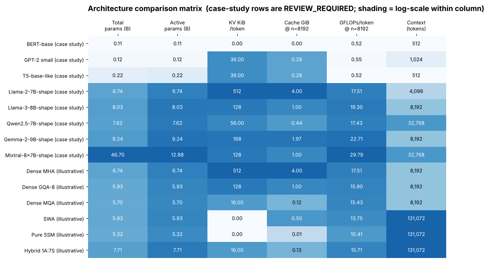

## 12.25 Architecture case study: GPT family

Metadata:

- Tier: 12 — Modern Foundation-Model Architectures
- Phase: 2 — Transformers & Foundation Models
- Priority: Medium
- Difficulty: Intermediate
- Interview Importance: Medium
- Hands-on Importance: Medium
- Prerequisites: [12.4 Decoder-only models as an architectural family](12.04-decoder-only-models-as-an-architectural-family.md)
- Leads To: [12.27 Architecture case study: Llama family](12.27-architecture-case-study-llama-family.md)

### 1. WHAT IS IT?

A labelled **case study** of the GPT family as an architecture: which of this tier's durable ideas it uses. **Case study (REVIEW_REQUIRED):** every number below comes from the lab's `PRESETS` and must be checked against the official config/model card before external use; no vendor API is needed.

### 2. WHY DOES IT EXIST?

Named families are examples; the durable lessons are the design choices (the rule of this tier: families are case studies, ideas are authoritative).

### 3. DETAILED EXPLANATION

The GPT family is a case study of decoder-only design, next-token prediction, scaling.

**Features used:** decoder-only layout ([12.4 Decoder-only models as an architectural family](12.04-decoder-only-models-as-an-architectural-family.md)), learned absolute positions in early members (later GPT-style models vary; REVIEW_REQUIRED), byte-level BPE (Tier 6), tied embeddings in the small early model.

The family illustrates the *scaling recipe* (Tier 9): same architecture, more data and parameters; details of newer closed models are not public and are not claimed here.



*Figure: find the GPT row(s) in the generated matrix; compare KV KiB/token and active parameters with neighbours.*

### 4. HOW DOES IT WORK?

Read the public config (layers, width, heads, KV heads, FFN width, vocabulary, window pattern, experts), fill an `ArchSpec`, and let the formulas produce parameters, KV cache and FLOPs.

### 5. SIMPLE EXAMPLE

Reading a car's spec sheet: the badge (GPT) matters less than engine, weight and gearbox.

### 6. TECHNICAL EXAMPLE

GPT-2-small shape: d=768, 12 layers, vocab 50257, 1024 positions, tied embeddings → ≈124 M parameters; 36 KiB KV/token in fp16 (REVIEW_REQUIRED).

### 7. CODE

```python
import sys; sys.path.insert(0, "lab")
import arch_matrix as am
print(am.total_params(am.PRESETS["GPT-2 small (case study)"])/1e6, "M")
```

### 8. INPUT → PROCESS → OUTPUT

```
public config → ArchSpec → params / KV / FLOPs → compare with other rows
```

### 9. ENTERPRISE USE CASE

Reference point for decoder-only economics.

### 10. AI ENGINEERING CONNECTION

Use as an example when explaining trade-offs to stakeholders; select models by measured behaviour on your tasks (Tier 31).

### 11. ADVANTAGES

Concrete, checkable examples of abstract ideas.

### 12. LIMITATIONS

Configs change between versions; numbers here may be outdated (REVIEW_REQUIRED); no quality claims are made.

### 13. TRADE-OFFS

Illustrates the trade-offs named in the features list.

### 14. COMMON MISTAKES

Treating family names as stable specifications; comparing parameters without active/total distinction.

### 15. PERFORMANCE / COST CONSIDERATIONS

See the matrix row: weights GiB, KV KiB/token, GFLOPs/token.

### 16. SECURITY CONSIDERATIONS

Check licences and provenance of weights (Tier 25); architecture does not change data-governance duties.

### 17. INTERVIEW EXPLANATION

*"The GPT family is a useful case study of decoder-only design, next-token prediction, scaling; I would read its config and compute parameters, KV cache and FLOPs rather than rely on the name."*

### 18. RAPID-FIRE ANSWER

GPT: a case study; compute from the config.

### 19. INTERVIEW QUESTIONS

- **Basic:** Which family is GPT?
- **Intermediate:** What did the GPT line demonstrate?
- **Advanced:** Why is only GPT-2 shape used here?
- **Scenario:** Explain to a client what we can and cannot know about closed models.

### 20. HANDS-ON EXERCISE

Edit the preset (e.g. change `n_kv_heads`) and describe the effect on KV KiB/token.

### 21. REVISION QUESTIONS

1. Which ideas does this family use? 2. Which numbers need verification?

### 22. RELATED CONCEPTS

[12.4 Decoder-only models as an architectural family](12.04-decoder-only-models-as-an-architectural-family.md), [12.24 Architecture case study: BERT family](12.24-architecture-case-study-bert-family.md)

### 23. ONE-LINE MEMORY HOOK

*GPT: the decoder-only scaling template.*
