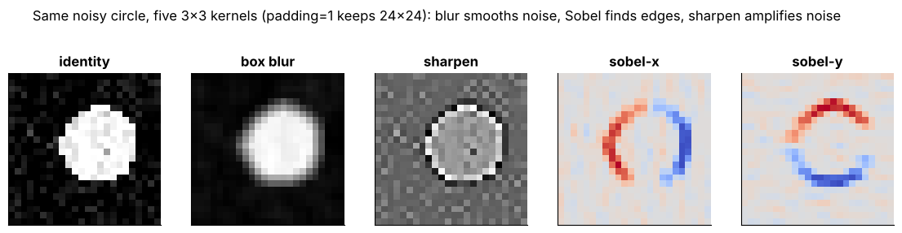

## 13.11 Feature maps

Metadata:

Tier: 13 — Vision AI
Phase: 2 — Transformers & Foundation Models
Priority: High
Difficulty: Beginner
Interview Importance: Medium
Hands-on Importance: High

Prerequisites: [13.5 Convolution](13.05-convolution.md), [13.6 Kernels/filters](13.06-kernels-filters.md)
Leads To: [13.12 Residual vision networks](13.12-residual-vision-networks.md), [13.14 Image embeddings](13.14-image-embeddings.md)

---

### 1. WHAT IS IT?

A feature map is the 2-D output of one filter applied across the input: a spatial map of 'how strongly this pattern appears here'. A layer outputs a stack of them, shape (C, H, W).

### 2. WHY DOES IT EXIST?

Feature maps are the network's intermediate representation; they preserve spatial layout so later layers (and dense tasks like detection/segmentation) can use position.

### 3. DETAILED EXPLANATION

**Shape evolution.** (3,16,16) -> conv16 -> (16,16,16) -> pool -> (16,8,8) -> conv32 -> (32,8,8) -> pool -> (32,4,4): spatial size falls, channels rise.

**Interpretation.** Early maps look like filtered images (edges); deep maps are abstract and low-resolution.

**Use.** Detection/segmentation heads read these maps directly; classification pools them to a vector ([13.14 Image embeddings](13.14-image-embeddings.md)).



*Look at: each panel is the feature map of one hand-made filter; learned networks stack dozens to hundreds of such maps per layer.*

### 4. HOW DOES IT WORK?

`out[c] = conv(input, kernel[c]) + bias[c]`, then nonlinearity. Maps are tensors you can capture with forward hooks.

### 5. SIMPLE EXAMPLE

The Sobel-x map of a square is bright on its left and right edges, dark elsewhere.

### 6. TECHNICAL EXAMPLE

TinyCNN's first layer yields a (16,16,16) tensor per image; the model's `embed` global-pools the final (32,4,4) map to 32 numbers before the linear layer.

### 7. CODE

```python
import sys; sys.path.insert(0, "lab")
import torch
from vision import make_dataset
from models import TinyCNN
x = torch.as_tensor(make_dataset(2, seed=0)[0])
m = TinyCNN()
first_block = m.f[:3]                 # conv -> ReLU -> pool
maps = first_block(x)
print(maps.shape)                     # torch.Size([2, 16, 8, 8])
```

### 8. INPUT → PROCESS → OUTPUT

Input: layer input. Process: per-channel convolution + activation. Output: (C,H',W') feature maps.

### 9. ENTERPRISE USE CASE

Explainability tooling (Grad-CAM style heatmaps, REVIEW_REQUIRED for method details) uses late feature maps to show where a classifier 'looked' - used in audits of medical models.

### 10. AI ENGINEERING CONNECTION

Feature maps of detectors/segmenters are the basis of FPN/U-Net designs ([13.26 Object detection](13.26-object-detection.md), [13.27 Image segmentation](13.27-image-segmentation.md)); in ViT the analogue is a grid of patch tokens ([13.17 Patch embeddings](13.17-patch-embeddings.md)).

### 11. ADVANTAGES

Spatially aligned, inspectable representation.

### 12. LIMITATIONS

High memory at early layers; deep maps hard to interpret.

### 13. TRADE-OFFS

More channels = more capacity vs memory/compute; lower resolution = cheaper vs coarser localization.

### 14. COMMON MISTAKES

Confusing channel count with spatial size; visualising raw maps without normalising (looks black); assuming each channel has a human-meaningful concept.

### 15. PERFORMANCE / COST CONSIDERATIONS

Activation memory = B*C*H*W*bytes per layer kept for backprop; checkpointing trades compute for memory.

### 16. SECURITY CONSIDERATIONS

Intermediate features can leak information about inputs; protect cached embeddings/activations like the data itself.

### 17. INTERVIEW EXPLANATION

A feature map is the output of one filter over the whole image: where in the image a pattern is present. A layer outputs C maps; as we go deeper, size shrinks and channels grow. Detection and segmentation heads consume these maps; classifiers pool them into an embedding.

### 18. RAPID-FIRE ANSWER

Spatial map of one filter's responses; a layer outputs C of them.

### 19. INTERVIEW QUESTIONS

**Basic.** What is a feature map?

**Intermediate.** Why do channels grow as size shrinks?

**Advanced.** How would you extract feature maps from a pretrained model?

**Scenario.** Activation memory blows up at batch 64; what are your options?

### 20. HANDS-ON EXERCISE

Print shapes after every layer of `TinyCNN().f`; compute activation memory per layer for batch 64.

### 21. REVISION QUESTIONS

1. Shape after Conv2d(3,16,3,p=1) on 16x16?
2. Why does early memory dominate?
3. Feature map vs embedding?

### 22. RELATED CONCEPTS

[13.5 Convolution](13.05-convolution.md), [13.6 Kernels/filters](13.06-kernels-filters.md), [13.14 Image embeddings](13.14-image-embeddings.md), [13.26 Object detection](13.26-object-detection.md), [13.27 Image segmentation](13.27-image-segmentation.md).

### 23. ONE-LINE MEMORY HOOK

A feature map is a heat map for one pattern.
