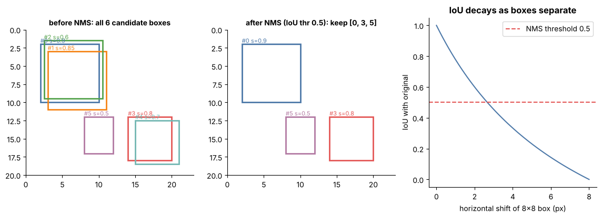

## 13.27 Image segmentation

Metadata:

Tier: 13 — Vision AI
Phase: 2 — Transformers & Foundation Models
Priority: High
Difficulty: Intermediate
Interview Importance: Medium
Hands-on Importance: Medium

Prerequisites: [13.11 Feature maps](13.11-feature-maps.md), [13.8 Padding](13.08-padding.md), [13.26 Object detection](13.26-object-detection.md)
Leads To: [13.31 Vision evaluation](13.31-vision-evaluation.md)

---

### 1. WHAT IS IT?

Image segmentation assigns a label to every pixel: semantic (class per pixel), instance (separate each object) or panoptic (both).

### 2. WHY DOES IT EXIST?

Boxes are too coarse for medical regions, road surface, background removal or measuring areas.

### 3. DETAILED EXPLANATION

**Architectures.** Encoder-decoder U-Net (skip connections link encoder feature maps to the decoder), FCN, DeepLab-style dilated convs, Mask R-CNN (instance masks), Transformer-based and promptable segmenters (e.g. SAM-style, REVIEW_REQUIRED).

**Output.** A (K,H,W) logit map -> argmax -> mask (H,W).

**Metrics.** Pixel accuracy (misleading with imbalance), IoU/Jaccard per class, mean IoU, Dice. IoU on masks is the same formula as for boxes ([13.26 Object detection](13.26-object-detection.md)).

**Loss.** Cross-entropy, Dice, or a mix (handles class imbalance).

**Padding & resolution matter** ([13.8 Padding](13.08-padding.md)): same-size outputs and careful border handling.



*Look at: IoU for boxes extends to masks as |A and B| / |A or B| over pixel sets.*

### 4. HOW DOES IT WORK?

Encoder downsamples (grows receptive field), decoder upsamples (transposed conv / interpolation) with skips restoring detail; per-pixel softmax.

### 5. SIMPLE EXAMPLE

A mask that is 1 on the circle's pixels and 0 elsewhere.

### 6. TECHNICAL EXAMPLE

Mask IoU on the lab's synthetic shapes: with `draw_shape` masks, `iou` generalises as `(a&b).sum()/(a|b).sum()`; the lab does not train a segmenter, to keep runs short.

### 7. CODE

```python
import sys; sys.path.insert(0, "lab")
import numpy as np
from vision import draw_shape
rng = np.random.default_rng(0)
a, b = draw_shape(0, 16, rng) > 0, draw_shape(0, 16, rng) > 0
print(round((a & b).sum() / (a | b).sum(), 3))      # mask IoU of two random circles
```

### 8. INPUT → PROCESS → OUTPUT

Input: image. Process: encoder-decoder. Output: per-pixel class map.

### 9. ENTERPRISE USE CASE

Radiology: tumour-volume measurement from segmentation masks; masks must be validated by clinicians and tracked per scanner.

### 10. AI ENGINEERING CONNECTION

Promptable segmentation models act as tools inside multimodal agents; segmentation heads share backbones with detection.

### 11. ADVANTAGES

Pixel-precise localization.

### 12. LIMITATIONS

Expensive labels; boundary errors; class imbalance.

### 13. TRADE-OFFS

Resolution vs memory (full-res masks are costly); semantic vs instance.

### 14. COMMON MISTAKES

Reporting pixel accuracy on imbalanced data; resizing masks with bilinear interpolation (use nearest); misaligned image/mask augmentations.

### 15. PERFORMANCE / COST CONSIDERATIONS

Activations at high resolution dominate memory; tile large images with overlap.

### 16. SECURITY CONSIDERATIONS

Medical/biometric masks are sensitive data; adversarial perturbations affect masks too.

### 17. INTERVIEW EXPLANATION

Segmentation labels each pixel. U-Net-style encoder-decoders with skip connections are the workhorse; I evaluate with per-class IoU/Dice, not pixel accuracy, and I use nearest-neighbour resizing for masks.

### 18. RAPID-FIRE ANSWER

Per-pixel classification (semantic/instance/panoptic).

### 19. INTERVIEW QUESTIONS

**Basic.** Semantic vs instance segmentation?

**Intermediate.** Why skip connections in U-Net?

**Advanced.** Why Dice loss for tiny structures?

**Scenario.** 98% pixel accuracy but the tumour is missed - explain.

### 20. HANDS-ON EXERCISE

Compute IoU and Dice for two synthetic masks; show Dice = 2*IoU/(1+IoU).

### 21. REVISION QUESTIONS

1. Mask IoU formula?
2. Why nearest resize?
3. U-Net structure?

### 22. RELATED CONCEPTS

[13.26 Object detection](13.26-object-detection.md), [13.8 Padding](13.08-padding.md), [13.31 Vision evaluation](13.31-vision-evaluation.md).

### 23. ONE-LINE MEMORY HOOK

Every pixel gets a vote.
