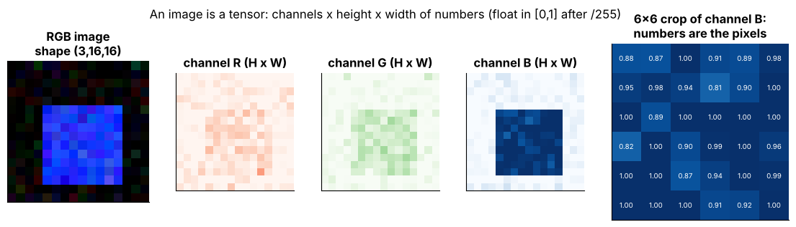
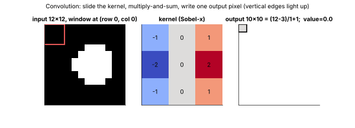
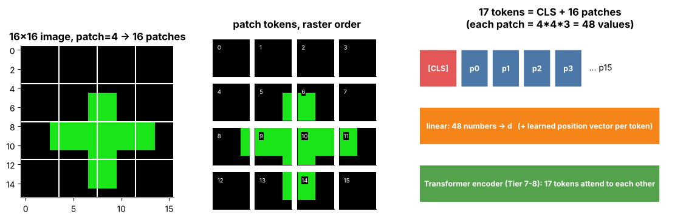
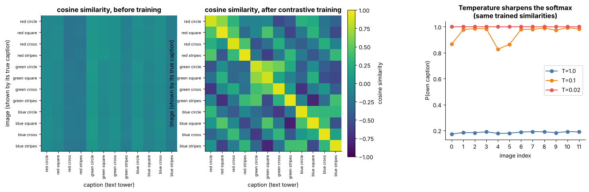
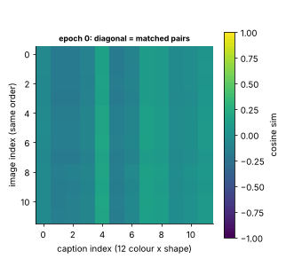

# Tier 13 — Vision AI

> **Phase 2 · Transformers & Foundation Models** · Author: Claude draft (see `CHAPTER_STATUS.md`) · Status: `AUTHOR_DRAFT` (Critic / Code-review / Final-review pending)
> Prerequisites: Tier 1 (vectors, dot products), Tier 3-4 (neural networks, training), [Tier 6](../tier-06-tokenization-embeddings/) (embeddings), [Tier 7](../tier-07-attention/) and [Tier 8](../tier-08-transformer-architecture/) (attention, Transformer blocks). Leads to: Tier 14 (audio/video), Tier 15 (evaluation), Tier 20 (multimodal retrieval).

**Tier goal.** After this tier you can explain an image as a tensor, derive and verify convolution output sizes, reason about receptive fields, explain why residual connections make deep nets trainable, patchify an image for a ViT and count tokens, train a toy CLIP-style contrastive model and measure retrieval recall, describe how VLMs, OCR, detection, segmentation and diffusion work, and evaluate and deploy vision systems sensibly.

This README is the **tier overview only**. Each roadmap concept has its own teaching file in this folder (`NN.CC-*.md`) (23-section standard format).

---

## 0 · How to use this tier

| Step | What | Where |
|---|---|---|
| 1. Read | One file per concept (start at 13.1) | the files `NN.CC-*.md` in this folder — index below |
| 2. **See** | Labelled figures and GIFs | [`figures/`](figures) — gallery below |
| 3. **Play** | Self-contained interactive pages (no network) | [`interactive/`](interactive) |
| 4. **Build** | Synthetic-image lab: CNN/ResNet/ViT, toy CLIP, retrieval | [`lab/`](lab) |
| 5. **Regenerate** | All figures from one script | `python figures/src/make_figures.py` |

## 1 · The big picture

```
 pixels (C,H,W) --preprocess--> encoder: CNN (conv/pool/residual)  or  ViT (patches -> tokens -> Transformer)
        |                              |
        |                       image embedding ---- contrastive training with text (CLIP) ---> shared space (zero-shot, retrieval)
        |                              |
        |                       patch tokens --projector--> LLM  = VLM (VQA, documents, charts)
        +--> task heads: detection (boxes+NMS), segmentation (masks), OCR (detect+recognize)
        +--> generation: diffusion (noise -> image)
```

All data in this tier is **synthetic** (numpy-drawn circles, squares, crosses, stripes in three colours), so everything runs on CPU in seconds with no downloads. Results show *methodology*, not benchmark performance.

## 2 · Visual gallery


*Fig 1 — Channels and raw pixel values of a synthetic image (13.1-13.2).*


*Fig 2 (GIF) — A Sobel kernel slides over the image and fills the output map; output is 10x10 for a 12x12 input (13.5).*


*Fig 3 — Blur, sharpen and Sobel kernels on the same noisy circle (13.6, 13.11).*


*Fig 4 — Receptive-field growth for three layer stacks; 2x2 max pooling (13.9-13.10).*


*Fig 5 — Residual block and measured gradient magnitude through 40 layers with and without shortcuts (13.12-13.13).*


*Fig 6 — 16x16 image -> 16 patches + CLS = 17 tokens (13.15-13.17).*


*Fig 7 — Toy CLIP similarity matrix before/after training, and temperature effect (13.19-13.21).*


*Fig 7b (GIF) — The diagonal of the similarity matrix brightens during training.*


*Fig 8 — Six candidate boxes before/after NMS and the IoU curve (13.26).*


*Fig 9 (GIF) — Forward noising, signal/noise weights and SNR over timesteps (13.30).*


*Fig 10 — VLM architecture and OCR/document pipeline (13.22, 13.25, 13.28).*


*Fig 11 — Lab results: test accuracy vs epochs and vs training-set size (13.4, 13.13, 13.15).*

## 3 · Interactive explorers

Open in a browser (download the repo; self-contained, no internet).

| Explorer | Adjustable controls | Teaches |
|---|---|---|
| [`conv_explorer.html`](interactive/conv_explorer.html) | image, editable 3x3 kernel + presets, stride, padding, input size, layer count, pool frequency | 13.5-13.11 |
| [`vit_patches.html`](interactive/vit_patches.html) | image size, patch size, embed dim, CLS toggle, click a patch | 13.15-13.17 |
| [`clip_temperature.html`](interactive/clip_temperature.html) | batch size, alignment quality, temperature, seed | 13.19-13.21 |
| [`detection_nms.html`](interactive/detection_nms.html) | drag/resize boxes, IoU threshold, score threshold, view mode | 13.26 |
| [`diffusion_noising.html`](interactive/diffusion_noising.html) | timestep, T, schedule, beta_end, play | 13.30 |

## 4 · Concept index (every roadmap item -> its file)

| Roadmap | Concept file |
|---|---|
| 13.1 | [Digital image representation](13.01-digital-image-representation.md) |
| 13.2 | [Pixels, channels and image tensors](13.02-pixels-channels-and-image-tensors.md) |
| 13.3 | [Image preprocessing](13.03-image-preprocessing.md) |
| 13.4 | [Convolutional Neural Networks (CNNs)](13.04-convolutional-neural-networks-cnns.md) |
| 13.5 | [Convolution](13.05-convolution.md) |
| 13.6 | [Kernels/filters](13.06-kernels-filters.md) |
| 13.7 | [Stride](13.07-stride.md) |
| 13.8 | [Padding](13.08-padding.md) |
| 13.9 | [Pooling](13.09-pooling.md) |
| 13.10 | [Receptive fields](13.10-receptive-fields.md) |
| 13.11 | [Feature maps](13.11-feature-maps.md) |
| 13.12 | [Residual vision networks](13.12-residual-vision-networks.md) |
| 13.13 | [ResNet](13.13-resnet.md) |
| 13.14 | [Image embeddings](13.14-image-embeddings.md) |
| 13.15 | [Vision Transformer (ViT)](13.15-vision-transformer-vit.md) |
| 13.16 | [Image patches](13.16-image-patches.md) |
| 13.17 | [Patch embeddings](13.17-patch-embeddings.md) |
| 13.18 | [Vision encoders](13.18-vision-encoders.md) |
| 13.19 | [Contrastive learning](13.19-contrastive-learning.md) |
| 13.20 | [CLIP](13.20-clip.md) |
| 13.21 | [Shared vision-language embedding spaces](13.21-shared-vision-language-embedding-spaces.md) |
| 13.22 | [Vision-language models (VLMs)](13.22-vision-language-models-vlms.md) |
| 13.23 | [Cross-modal attention concepts](13.23-cross-modal-attention-concepts.md) |
| 13.24 | [Visual instruction tuning](13.24-visual-instruction-tuning.md) |
| 13.25 | [OCR fundamentals](13.25-ocr-fundamentals.md) |
| 13.26 | [Object detection](13.26-object-detection.md) |
| 13.27 | [Image segmentation](13.27-image-segmentation.md) |
| 13.28 | [Document-image understanding](13.28-document-image-understanding.md) |
| 13.29 | [Chart/table visual understanding](13.29-chart-table-visual-understanding.md) |
| 13.30 | [Diffusion-model introduction](13.30-diffusion-model-introduction.md) |
| 13.31 | [Vision evaluation](13.31-vision-evaluation.md) |
| 13.32 | [Vision deployment/performance considerations](13.32-vision-deployment-performance-considerations.md) |

## 5 · Build: image-embedding, classification/retrieval and ViT/CNN comparison lab

The roadmap Build item is "image-embedding, classification/retrieval and ViT/VLM comparison laboratory". Because no models or datasets can be downloaded, the lab is a **from-scratch synthetic version**: a real VLM cannot be trained or run on CPU here, so the *ViT vs CNN* comparison is fully implemented and measured, while the *VLM* part is covered by concept files, the pipeline figure, and token-cost arithmetic (documented gap, not claimed as tested).

| File | What it is |
|---|---|
| [`lab/vision.py`](lab/vision.py) | synthetic image generator, conv output formula, naive conv, pooling, receptive fields, patchify/unpatchify, IoU, NMS |
| [`lab/models.py`](lab/models.py) | TinyCNN, TinyResNet (residual block), TinyViT, TextTower, `clip_loss`, `fit_classifier`, `fit_clip`, `retrieval_recall` |
| [`lab/run_lab.py`](lab/run_lab.py) | end-to-end run: three classifiers + toy CLIP + retrieval |
| [`lab/test_tier13.py`](lab/test_tier13.py) | 21 pytest tests |
| [`figures/src/make_figures.py`](figures/src/make_figures.py) | regenerates every figure/GIF |

```bash
cd lab && python -m pytest -q      # 21 passed
python run_lab.py                  # ~20 s on 2 CPU threads
```

**Measured results** (`run_lab.py`, seeded, 1,200 train / 400 test images, 16x16, chance = 25%; numbers will differ on other hardware/torch versions):

| Model | Params | Test accuracy |
|---|---|---|
| TinyCNN | 6,276 | 0.957 |
| TinyResNet | 10,404 | 0.957 |
| TinyViT (patch 4) | 20,484 | 0.870 |

Toy CLIP: text->image recall@1 over 12 captions = **1.00** after training vs about 0.08 chance (0.08 before training).

**What the tests prove.** Conv output-size formula equals PyTorch for several (n,k,s,p,dilation); naive loops equal `F.conv2d` to 1e-9; patchify/unpatchify is an exact round trip, raster-ordered, and the linear patch embedding equals a strided conv; IoU values; NMS keeps the expected boxes; contrastive loss is ~0 for matched pairs, ln N at huge temperature, scale-invariant and symmetric; a residual block is the identity when F=0; classifiers beat chance; retrieval recall after contrastive training is above 3x chance.

**Exercises.** (1) Add a rotation augmentation and see which classes confuse. (2) Replace TinyCNN with TinyViT in `fit_clip`. (3) Sweep patch size (2, 4, 8) and plot accuracy vs tokens. (4) Add a hard-negative term to `clip_loss`.

## 6 · Tier interview kit

**Basic.** What is an image tensor? What does a conv layer do? Why pool?
**Intermediate.** Output-size formula; why residuals help; ViT vs CNN inductive bias; how CLIP does zero-shot.
**Advanced.** Derive the receptive-field recurrence; compare VLM fusion designs; explain NMS failure modes; discuss diffusion guidance.
**Scenario.** *A VLM-based invoice extractor has 2% wrong totals.* (Validators, confidence routing, resolution/tiling, human review, per-field evaluation.)

**60-second tier summary.** *"Images are tensors. CNNs use shared local filters, stride/padding/pooling and residual blocks to build a feature hierarchy; ViTs cut the image into patch tokens and run a Transformer with weaker priors but better scaling. Contrastive training (CLIP) aligns image and text embeddings for zero-shot search; VLMs project visual tokens into an LLM. Detection, segmentation, OCR and diffusion are task heads and generative models on the same backbones. Evaluate with task-matched metrics and slices, and deploy by profiling then cutting pixels, tokens and precision."*

## 7 · Related tiers

Attention math -> [Tier 7](../tier-07-attention/); Transformer blocks -> [Tier 8](../tier-08-transformer-architecture/); pretraining data -> [Tier 9](../tier-09-foundation-model-pretraining/); fine-tuning/LoRA -> [Tier 10](../tier-10-fine-tuning-alignment/); inference optimization -> [Tier 11](../tier-11-llm-inference-optimization/); audio/video -> Tier 14; evaluation harness -> Tier 15; multimodal RAG -> Tier 20.

## 8 · Review status

| Item | State |
|---|---|
| Concept files (32) | `AUTHOR_DRAFT`; `python tools/check_concepts.py` reports OK |
| Code (`lab/`) | **TESTED** — `pytest`: 21 passed (Python 3.13, torch CPU, 2 threads); all python snippets in concept files were executed |
| Interactive pages | **TESTED** with `tools/check_interactive.py` (headless Chromium, no JS errors, sliders exercised) |
| Figures | regenerated by `figures/src/make_figures.py`; spot-checked visually |
| VLM training / real-model benchmarks | **not implemented** (no downloads); marked as such |
| Model sizes, benchmark claims, API names | `REVIEW_REQUIRED` (marked inline) |
| Critic / Code-review / Final-review | pending per `CHAPTER_STATUS.md` |
