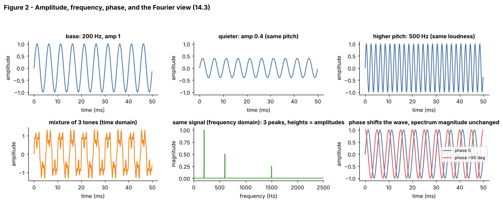

## 14.3 Amplitude and frequency

Metadata:

- Tier: 14 — Speech, Audio & Video AI
- Phase: 2 — Transformers & Foundation Models
- Priority: Critical
- Difficulty: Beginner
- Interview Importance: Medium
- Hands-on Importance: High
- Prerequisites: [14.1 Audio waveforms](14.01-audio-waveforms.md), [14.2 Sampling rate](14.02-sampling-rate.md)
- Leads To: [14.4 Spectrograms](14.04-spectrograms.md), [14.5 Mel spectrograms](14.05-mel-spectrograms.md), [14.6 Audio preprocessing](14.06-audio-preprocessing.md)

---

### 1. WHAT IS IT?

Amplitude is the height of the wave (related to loudness); frequency is how many cycles occur per second, in Hz (related to pitch). Phase is where in its cycle the wave starts. Any signal can be written as a sum of sines with different amplitudes, frequencies and phases (Fourier analysis).

### 2. WHY DOES IT EXIST?

Speech and music are mixtures of frequencies that change over time. Models and humans both care more about *which frequencies are present and how strong* than about the raw wiggle, so we need a vocabulary for that.

### 3. DETAILED EXPLANATION

**Sine wave.** `x(t) = A sin(2 pi f t + phi)`: amplitude `A`, frequency `f`, phase `phi`.

**Perception links (approximate).** Loudness follows amplitude on a roughly logarithmic scale (decibels: `20 log10(A1/A0)`); pitch follows frequency, also roughly logarithmically (an octave is a doubling). The mel scale ([14.5](14.05-mel-spectrograms.md)) formalises the pitch warping.

**Fourier transform.** The DFT turns `N` samples into `N/2+1` complex numbers; the magnitude at bin `k` tells how much of frequency `k * sr / N` is present, the angle tells the phase. A mixture of three tones becomes three peaks (Figure 2, bottom middle). Bin spacing `sr / N` is the *frequency resolution*: to separate 100 Hz and 110 Hz you need more than 0.1 s of signal.

**Harmonics and timbre.** A voiced speech sound or musical note has a fundamental frequency `f0` and integer multiples; the relative strengths of harmonics (shaped by the vocal tract resonances called formants) make 'a' sound different from 'i' even at the same pitch. Our synthetic phonemes imitate this by using *two* tones per symbol.

**Phase.** Shifting phase moves the wave sideways but leaves magnitude spectra unchanged (Figure 2, bottom right), which is why spectrograms that keep only magnitude lose phase and why vocoders ([14.17](14.17-vocoders.md)) must reinvent it.

### 4. HOW DOES IT WORK?



*Figure 2 - Top row: change amplitude (loudness) or frequency (pitch) separately. Bottom row: a 3-tone mixture looks messy in time but is three clean peaks in frequency; phase shifts the wave without changing the spectrum magnitude.*

```
x(t) = sum_k A_k sin(2 pi f_k t + phi_k)   <──inverse FFT──   spectrum {A_k, phi_k}
```

### 5. SIMPLE EXAMPLE

A choir: volume knob = amplitude, who sings high or low = frequency, who starts a beat late = phase. The FFT tells you each singer's volume and pitch from the recording of the whole choir.

### 6. TECHNICAL EXAMPLE

A formant-style synthetic vowel is a sum of a few sinusoids; the lab's phoneme generator in `ctc_asr.synth_utterance` uses `0.6 sin(2 pi f1 t) + 0.4 sin(2 pi f2 t)` with small random jitter, and the CTC model learns to read these frequency pairs from log-mel frames.

### 7. CODE

```python
# run inside lab/
import numpy as np
from audio_core import tone, rms

sr = 8000
mix = tone(200, 0.5, sr) + 0.5 * tone(600, 0.5, sr) + 0.25 * tone(1500, 0.5, sr)
spec = np.abs(np.fft.rfft(mix * np.hanning(len(mix)))) / len(mix) * 4
freqs = np.fft.rfftfreq(len(mix), 1 / sr)
peaks = [i for i in range(1, len(spec) - 1) if spec[i] > spec[i - 1] and spec[i] >= spec[i + 1] and spec[i] > 0.1]
print([round(float(freqs[i])) for i in peaks])      # [200, 600, 1500]: local maxima = the three tones
print(round(20 * np.log10(rms(0.5 * mix) / rms(mix)), 1))   # -6.0 dB: halving amplitude
```
Code: [`lab/audio_core.py`](lab/audio_core.py)

### 8. INPUT → PROCESS → OUTPUT

```
sum of tones (time) ──FFT──► peaks at f_k with heights A_k and phases phi_k (frequency)
```

### 9. ENTERPRISE USE CASE

Hearing-aid and noise-cancellation vendors work in the frequency domain: boost speech bands, attenuate hum at 50/60 Hz (the mains frequency) and its harmonics.

### 10. AI ENGINEERING CONNECTION

Explains why models consume spectrogram-like features ([14.4](14.04-spectrograms.md)) and why positional-encoding sinusoids in [Tier 6](../tier-06-tokenization-embeddings/README.md) look the way they do: the same Fourier idea applied to positions.

### 11. ADVANTAGES

Compact description of sound; separates content (frequencies) from level (amplitude).

### 12. LIMITATIONS

Stationary Fourier analysis hides *when* things happen; magnitude-only discards phase.

### 13. TRADE-OFFS

Time resolution versus frequency resolution (the uncertainty principle of the STFT, see [14.4](14.04-spectrograms.md)).

### 14. COMMON MISTAKES

- Confusing loudness (perceptual, logarithmic) with amplitude (linear).
- Forgetting the window function before an FFT (spectral leakage).
- Reading FFT bins as Hz without multiplying by `sr / N`.

### 15. PERFORMANCE / COST CONSIDERATIONS

FFT costs `O(N log N)`; frame length sets frequency resolution `sr / N`.

### 16. SECURITY CONSIDERATIONS

Frequency content can reveal speaker identity and health information; hum or ultrasonic tones can fingerprint devices or rooms. Treat derived features as sensitive too.

### 17. INTERVIEW EXPLANATION

*"Amplitude is how big the wave is, which maps to loudness, and frequency is how fast it repeats, which maps to pitch. The Fourier transform expresses any signal as a sum of sines, so a messy waveform becomes a few peaks. Speech models use that frequency view over short windows, because phonemes are identified by their frequency patterns."*

### 18. RAPID-FIRE ANSWER

Amplitude = size (loudness), frequency = cycles per second (pitch); Fourier writes any sound as a sum of sines.

### 19. INTERVIEW QUESTIONS

- **Basic:** What is the relationship between frequency and pitch?
- **Intermediate:** What does halving amplitude do in dB?
- **Advanced:** Why does a vowel at the same pitch sound different from another vowel?
- **Scenario:** A hum at 50 Hz pollutes recordings in one country. How would you detect and remove it using a spectrum?

### 20. HANDS-ON EXERCISE

Make a 3-tone mixture, shift each tone's phase by a random amount, and show the magnitude spectrum is unchanged while the waveform changes.

### 21. REVISION QUESTIONS

1. Write the equation of a sine wave.
2. What sets the frequency resolution of an FFT?
3. Why does phase not appear in a magnitude spectrogram?

### 22. RELATED CONCEPTS

[14.1 Audio waveforms](14.01-audio-waveforms.md), [14.2 Sampling rate](14.02-sampling-rate.md), [14.4 Spectrograms](14.04-spectrograms.md), [14.5 Mel spectrograms](14.05-mel-spectrograms.md)

### 23. ONE-LINE MEMORY HOOK

*Loudness is how tall, pitch is how fast; the FFT lists the ingredients.*
