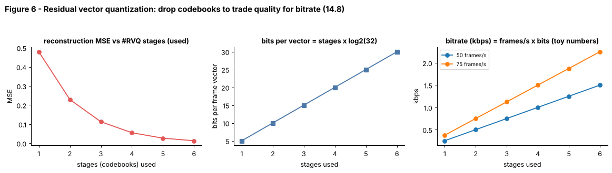

## 14.8 Audio tokenization and neural codecs

Metadata:

- Tier: 14 — Speech, Audio & Video AI
- Phase: 2 — Transformers & Foundation Models
- Priority: High
- Difficulty: Advanced
- Interview Importance: High
- Hands-on Importance: Medium
- Prerequisites: [14.4 Spectrograms](14.04-spectrograms.md), [14.5 Mel spectrograms](14.05-mel-spectrograms.md), [14.7 Audio embeddings](14.07-audio-embeddings.md)
- Leads To: [14.16 Text-to-Speech (TTS)](14.16-text-to-speech-tts.md), [14.17 Vocoders](14.17-vocoders.md), [14.19 Realtime speech systems](14.19-realtime-speech-systems.md)

---

### 1. WHAT IS IT?

Audio tokenization converts a continuous waveform into a short sequence of discrete integer tokens (like text tokens) so a language model can read and generate audio. A *neural audio codec* (SoundStream, EnCodec, DAC) does this with an encoder, a quantizer (usually residual vector quantization, RVQ) and a decoder.

### 2. WHY DOES IT EXIST?

Language-model machinery is built for discrete tokens. Audio at 16-24 kHz has thousands of samples per second, too many for a transformer. A codec compresses audio to about 50-75 token-frames per second, with several codebook tokens per frame, preserving enough detail to reconstruct speech.

### 3. DETAILED EXPLANATION

**Pipeline.** Waveform -> convolutional encoder (strided; downsamples by e.g. 320x) -> latent frames `[T', d]` -> quantizer -> integer codes -> decoder reconstructs waveform. The codec is trained end-to-end with reconstruction, adversarial (discriminator) and perceptual losses (`REVIEW_REQUIRED` for specifics per codec).

**Residual vector quantization (RVQ).** One codebook of size `K` with a single code per frame is too coarse. RVQ stacks `Q` codebooks: stage 1 quantizes the latent; stage 2 quantizes the *residual* left by stage 1; and so on. Each frame becomes `Q` integers, and bitrate = `frame_rate x Q x log2(K)`. Dropping later stages gives lower bitrate and quality: *bitrate scalability* (Figure 6).

**Semantic vs acoustic tokens.** Codec tokens mostly encode *acoustic* detail. Self-supervised models (HuBERT-style k-means tokens) give *semantic* tokens that mostly encode content. Some systems combine both (`REVIEW_REQUIRED`).

**Using tokens.** TTS and speech generation models predict codec tokens autoregressively (the VALL-E family treats TTS as codec language modeling, `REVIEW_REQUIRED`); speech-to-speech chat models read and emit them; the multi-codebook structure needs special sequencing schemes (flatten, delay pattern, hierarchical).

**Toy version in the lab.** `ResidualVQ` fits k-means codebooks on random vectors; `encode(X, n_stages)` returns codes, `decode` sums codebook entries, and a test asserts reconstruction error decreases monotonically with more stages. No encoder/decoder network is trained: the lab isolates the quantization idea.

### 4. HOW DOES IT WORK?



*Figure 6 - Left: MSE drops with each extra codebook. Middle: bits per vector = stages x log2(32). Right: bitrate = frames/s x bits (toy numbers, 50 and 75 frames/s).*

```
waveform ─► conv encoder ─► z [T',d] ─► RVQ: q1=VQ1(z), r1=z-q1, q2=VQ2(r1), r2=r1-q2 ... ─► codes [T',Q]
codes ─► sum of codebook vectors ─► conv decoder ─► waveform
```

### 5. SIMPLE EXAMPLE

Mailing a painting: first send a rough thumbnail (stage 1); then send a correction sheet showing what the thumbnail missed (stage 2); then a finer correction (stage 3). Each extra sheet costs more but is closer to the original.

### 6. TECHNICAL EXAMPLE

At 24 kHz, a codec with 75 frames/s and 8 codebooks of 1024 entries uses 75 x 8 x 10 = 6 000 bits/s = 6 kbps (illustrative arithmetic; real codec configs are `REVIEW_REQUIRED`) versus 384 kbps raw 16-bit audio.

### 7. CODE

```python
# run inside lab/
import numpy as np
from audio_core import ResidualVQ

X = np.random.default_rng(0).standard_normal((600, 8))
q = ResidualVQ(n_stages=4, codebook_size=16).fit(X)
for s in (1, 2, 3, 4):
    codes = q.encode(X, n_stages=s)                     # [600, s] integer tokens
    mse = float(np.mean((X - q.decode(codes)) ** 2))
    print(s, "stages:", q.bits_per_vector(s), "bits/vector, mse", round(mse, 3))
```
The MSE strictly decreases with stages (tested). Real codecs: EnCodec, SoundStream, DAC via their libraries (**not run here; verify APIs, `REVIEW_REQUIRED`**).
Code: [`lab/audio_core.py`](lab/audio_core.py) (`ResidualVQ`)

### 8. INPUT → PROCESS → OUTPUT

```
audio ─► encoder ─► latent frames ─► RVQ (Q stages) ─► [T', Q] ints ─► LM / storage / transmission
                                                       └─► decoder ─► reconstructed audio
```

### 9. ENTERPRISE USE CASE

Voice-over-IP and streaming products can use neural codecs for very low bitrates (a few kbps) at acceptable quality; generative-audio products use codec tokens as the vocabulary of their models.

### 10. AI ENGINEERING CONNECTION

This is the bridge between audio and the LLM world: after tokenization, [Tier 8](../tier-08-transformer-architecture/README.md)-style decoders can model speech like text, and TTS ([14.16](14.16-text-to-speech-tts.md)) and realtime speech systems ([14.19](14.19-realtime-speech-systems.md)) build on it. Tokenization theory is in [Tier 6](../tier-06-tokenization-embeddings/README.md).

### 11. ADVANTAGES

Large compression; discrete interface for LMs; scalable bitrate; neural decoders give natural sound at low bitrates.

### 12. LIMITATIONS

Quality drops on music/noise/unseen speakers; reconstruction artefacts; multiple codebooks complicate sequence modeling; training is expensive and tied to a sample rate.

### 13. TRADE-OFFS

More codebooks/frames: better fidelity, more tokens per second (cost, latency). Larger codebooks: finer detail, harder to predict.

### 14. COMMON MISTAKES

- Treating codec tokens as semantic content.
- Mixing codecs between tokenizer and decoder.
- Ignoring codebook collapse (unused codes) when training.
- Comparing bitrate across codecs without comparing quality.

### 15. PERFORMANCE / COST CONSIDERATIONS

Token rate directly controls LM cost: 75 frames/s x 8 codebooks = 600 tokens/s, so a minute is 36 000 tokens unless hierarchical modeling or fewer codebooks are used.

### 16. SECURITY CONSIDERATIONS

Codecs make high-quality voice cloning and synthetic speech easier: governance needs consent, watermarking and provenance (`REVIEW_REQUIRED`). Codes can leak identity just as audio can.

### 17. INTERVIEW EXPLANATION

*"A neural codec compresses audio into discrete tokens: an encoder downsamples the waveform, residual vector quantization stacks several codebooks so each stage refines the previous residual, and a decoder rebuilds audio. It gives LMs a vocabulary for speech and lets you trade bitrate for quality by dropping codebooks. The cost is many tokens per second and artefacts."*

### 18. RAPID-FIRE ANSWER

Codec = encoder + residual vector quantizer + decoder, turning audio into a few integer tokens per frame.

### 19. INTERVIEW QUESTIONS

- **Basic:** What is vector quantization?
- **Intermediate:** How does residual VQ differ from a single big codebook?
- **Advanced:** What is the difference between semantic and acoustic audio tokens?
- **Scenario:** You must build a speech LM with a 4 000-token context. How do frame rate and number of codebooks limit you and what do you change?

### 20. HANDS-ON EXERCISE

Fit `ResidualVQ` on 8-D Gaussian vectors with 6 stages and plot MSE vs stages and bitrate vs stages. At what stage do returns diminish?

### 21. REVISION QUESTIONS

1. Write the bitrate formula for an RVQ codec.
2. Why quantize residuals?
3. Why can't codec tokens alone be treated like words?

### 22. RELATED CONCEPTS

[14.7 Audio embeddings](14.07-audio-embeddings.md), [14.16 Text-to-Speech (TTS)](14.16-text-to-speech-tts.md), [14.17 Vocoders](14.17-vocoders.md), [14.19 Realtime speech systems](14.19-realtime-speech-systems.md), [Tier 6 Tokenization & Embeddings](../tier-06-tokenization-embeddings/README.md), [Tier 8 Transformer Architecture](../tier-08-transformer-architecture/README.md)

### 23. ONE-LINE MEMORY HOOK

*A codec is a zip file for sound whose words are the vocabulary of a speech language model.*
