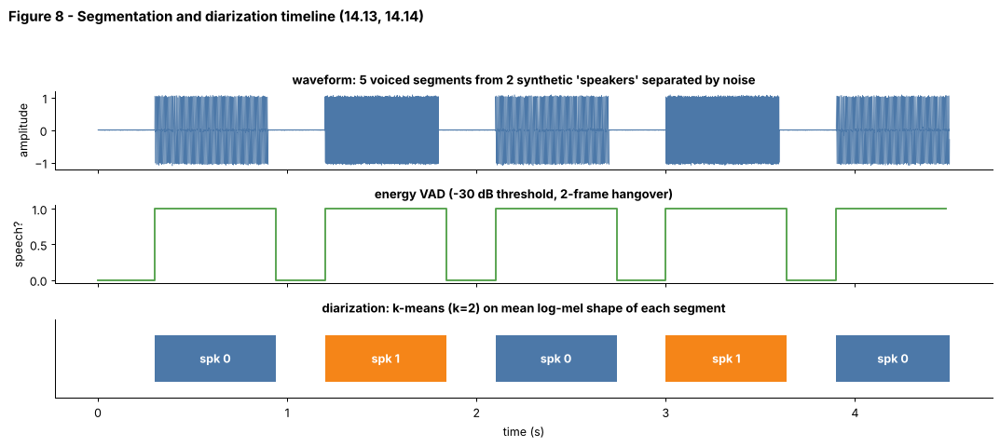

## 14.14 Speaker diarization

Metadata:

- Tier: 14 — Speech, Audio & Video AI
- Phase: 2 — Transformers & Foundation Models
- Priority: High
- Difficulty: Advanced
- Interview Importance: High
- Hands-on Importance: Medium
- Prerequisites: [14.7 Audio embeddings](14.07-audio-embeddings.md), [14.13 Speech segmentation](14.13-speech-segmentation.md)
- Leads To: [14.18 Streaming speech](14.18-streaming-speech.md), [14.29 Audio-video-text alignment](14.29-audio-video-text-alignment.md), [14.30 Multimodal synchronization](14.30-multimodal-synchronization.md)

---

### 1. WHAT IS IT?

Speaker diarization answers 'who spoke when': it segments audio and assigns each segment to an anonymous speaker label (spk0, spk1, ...). It does not identify who the speakers are, and it is separate from transcribing what they said.

### 2. WHY DOES IT EXIST?

Meetings, interviews and calls have several speakers; transcripts without speaker labels are hard to use. Diarization enables speaker-attributed minutes, per-speaker analytics and agent-vs-customer separation.

### 3. DETAILED EXPLANATION

**Classical pipeline.** (1) VAD ([14.13](14.13-speech-segmentation.md)); (2) cut speech into short windows (1-2 s) or speaker-change-delimited segments; (3) extract a speaker embedding for each ([14.7](14.07-audio-embeddings.md): x-vector/ECAPA-style); (4) cluster embeddings (agglomerative, spectral, or VBx; the number of speakers may be unknown); (5) resegment/smooth.

**End-to-end neural diarization (EEND)** models directly predict per-frame speaker activity, handling overlap (several speakers at once) which clustering pipelines cannot represent (`REVIEW_REQUIRED` for current state of the art).

**Metric: diarization error rate (DER)** = (missed speech + false alarm + speaker confusion) / total reference speech, usually with a collar around boundaries (`REVIEW_REQUIRED` for exact scoring conventions).

**Toy version in the lab.** `speaker_features` (mean mean-subtracted log-mel of loud frames) + `cluster_speakers` (k-means, farthest-first init) separate two synthetic 'voices' with different fundamentals, as in Figure 8 (bottom). Real voices need learned embeddings; a test asserts the toy clusters exactly two synthetic speakers.

**Hard cases.** Overlapped speech, many speakers, short turns, similar voices, far-field noise, unknown speaker count.

### 4. HOW DOES IT WORK?



*Figure 8 - Bottom row: segments labelled by k-means over spectral-shape embeddings: spk 0 vs spk 1 alternate as in the generating script.*

```
audio ─► VAD ─► segments ─► embedding per segment ─► cluster (k known or estimated) ─► speaker labels ─► merge with ASR words
```

### 5. SIMPLE EXAMPLE

At a dinner party you can't catch what anyone says through the wall, yet you can tell 'the low voice' from 'the bright voice' and note when each talks.

### 6. TECHNICAL EXAMPLE

A meeting tool merges ASR word timestamps ([14.15](14.15-timestamps-alignment.md)) with diarization segments by maximal overlap, producing 'Speaker 2 (00:31-00:44): ...'. Overlapped words are assigned to the dominant speaker or flagged.

### 7. CODE

```python
# run inside lab/
import numpy as np
from audio_core import tone, noise, speaker_features, cluster_speakers

sr = 8000
def seg(f, s): return tone(f, 0.4, sr) + 0.3 * tone(2 * f, 0.4, sr) + noise(0.4, sr, 0.01, seed=s)
voices = [200, 200, 600, 600, 200, 600]
F = np.stack([speaker_features(seg(f, i), sr) for i, f in enumerate(voices)])
print(cluster_speakers(F, k=2))      # e.g. [0 0 1 1 0 1]  (label ids may swap)
```
Code: [`lab/audio_core.py`](lab/audio_core.py) | tests: `test_diarization_separates_two_synthetic_voices`.

### 8. INPUT → PROCESS → OUTPUT

```
audio ─► VAD ─► windows ─► speaker embeddings ─► clustering ─► [(t0,t1,spk), ...] ─► attribute transcript
```

### 9. ENTERPRISE USE CASE

Sales-call analytics separates agent from customer; healthcare and legal products need speaker-attributed records but also must handle consent and mislabelling risk.

### 10. AI ENGINEERING CONNECTION

Diarized transcripts are cleaner input for LLM summarisation ('what did Alice commit to?'). Wrong speaker labels create wrong attributions, so diarization quality is a safety factor for action-item extraction.

### 11. ADVANTAGES

Adds structure to transcripts; works without enrolling speakers; modular.

### 12. LIMITATIONS

Unknown speaker count, overlap, short utterances, domain shift; error propagation from VAD; anonymous labels only.

### 13. TRADE-OFFS

Clustering pipelines: modular but cannot handle overlap. EEND: handles overlap, harder to scale to long meetings.

### 14. COMMON MISTAKES

- Confusing diarization with speaker identification/verification.
- Ignoring overlap.
- Fixing k when the count varies.
- Scoring without a collar or with different reference rules.

### 15. PERFORMANCE / COST CONSIDERATIONS

Embedding extraction dominates; clustering is cheap for tens of segments, quadratic in the number of segments for agglomerative methods.

### 16. SECURITY CONSIDERATIONS

Diarization plus embeddings enables voice profiling; require consent, avoid cross-session identity linking without lawful basis, and be careful with speaker-attributed transcripts in HR or legal contexts (`REVIEW_REQUIRED` legal).

### 17. INTERVIEW EXPLANATION

*"Diarization labels who spoke when. I run VAD, extract a speaker embedding per segment, cluster the embeddings, and align the clusters with ASR timestamps. The hard parts are overlap, unknown speaker counts and short turns; the metric is DER, which combines missed speech, false alarms and speaker confusion."*

### 18. RAPID-FIRE ANSWER

Segment audio and cluster segments by voice to answer 'who spoke when' (anonymous labels).

### 19. INTERVIEW QUESTIONS

- **Basic:** What is the difference between diarization and speaker identification?
- **Intermediate:** What are the stages of a clustering-based diarization system?
- **Advanced:** Why can clustering not handle overlapped speech?
- **Scenario:** Your summariser attributes a decision to the wrong person. Trace the possible causes in the pipeline and add checks.

### 20. HANDS-ON EXERCISE

Generate 3 synthetic speakers with different harmonic ratios, run `cluster_speakers` with k=3 and compute the purity of the clusters; then add noise at 10 dB SNR and observe.

### 21. REVISION QUESTIONS

1. Define DER.
2. Why is speaker count often unknown?
3. What does EEND predict?

### 22. RELATED CONCEPTS

[14.7 Audio embeddings](14.07-audio-embeddings.md), [14.13 Speech segmentation](14.13-speech-segmentation.md), [14.15 Timestamps/alignment](14.15-timestamps-alignment.md), [14.29 Audio-video-text alignment](14.29-audio-video-text-alignment.md), [14.30 Multimodal synchronization](14.30-multimodal-synchronization.md)

### 23. ONE-LINE MEMORY HOOK

*Diarization doesn't know your name, only that voice B spoke again.*
