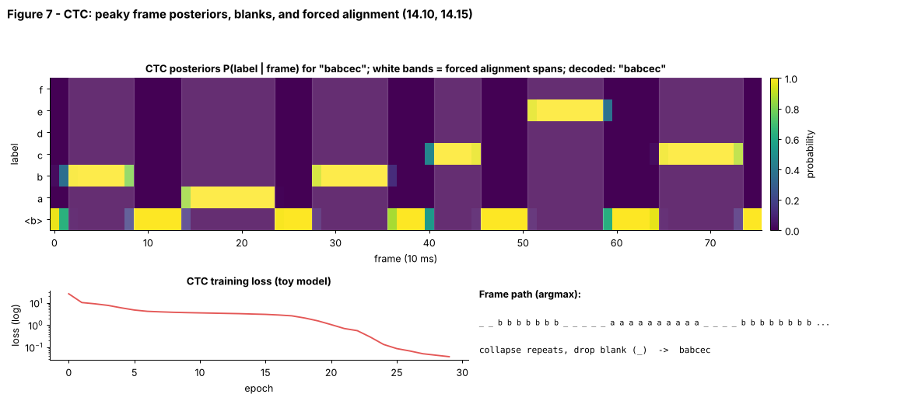

## 14.15 Timestamps/alignment

Metadata:

- Tier: 14 — Speech, Audio & Video AI
- Phase: 2 — Transformers & Foundation Models
- Priority: High
- Difficulty: Intermediate
- Interview Importance: Medium
- Hands-on Importance: High
- Prerequisites: [14.10 CTC](14.10-ctc.md), [14.9 Automatic Speech Recognition (ASR)](14.09-automatic-speech-recognition-asr.md)
- Leads To: [14.14 Speaker diarization](14.14-speaker-diarization.md), [14.29 Audio-video-text alignment](14.29-audio-video-text-alignment.md), [14.30 Multimodal synchronization](14.30-multimodal-synchronization.md)

---

### 1. WHAT IS IT?

Timestamps/alignment attach start and end times to the words (or characters) of a transcript. *Forced alignment* takes known audio plus known text and finds the most likely time span for each unit.

### 2. WHY DOES IT EXIST?

Subtitles, search-in-audio, video editing, karaoke, clip extraction and speaker attribution need to know *when* each word occurs; plain transcripts have no timing.

### 3. DETAILED EXPLANATION

**Sources of timestamps.** (1) *Segment-level* tokens from the ASR itself (Whisper-style timestamp tokens in 20 ms steps, approximate, `REVIEW_REQUIRED`); (2) *CTC-based forced alignment*: use per-frame posteriors and a Viterbi trellis constrained to the known text; (3) *DTW on cross-attention* of encoder-decoder models; (4) classical HMM aligners (e.g. Montreal Forced Aligner, `REVIEW_REQUIRED`).

**CTC forced alignment (implemented in the lab).** Extend the transcript with blanks: `_ c _ a _ b _`. A path moves from state `s` to `s`, `s+1`, or `s+2` (skipping a blank only if the two neighbouring labels differ). Run Viterbi over the frame log-posteriors; backtrack to get the best state per frame; the first and last frames of each label state give its span (`forced_align`, Figure 7 white bands). Time of frame `t` = `t x hop / sr`.

**Resolution.** Frame spans are only as precise as the frame rate (10 ms here, 20-40 ms after encoder subsampling) and peaky CTC outputs tend to mark just the spike frame, not the whole sound.

**Evaluation.** Word boundary error versus human annotation (mean absolute difference, percent within 20/50/100 ms; conventions `REVIEW_REQUIRED`).

### 4. HOW DOES IT WORK?



*Figure 7 - Each white band is one aligned character span from `forced_align`; the bands sit over the corresponding probability spikes.*

```
posteriors [T,V] + text 'bab' ─► trellis over [_ b _ a _ b _] ─► Viterbi ─► frame per state ─► [(char, t_start, t_end)]
```

### 5. SIMPLE EXAMPLE

You have a recording and the lyrics: aligning means sliding each lyric line to where the singer actually sings it.

### 6. TECHNICAL EXAMPLE

A subtitle tool transcribes with ASR, then runs forced alignment against the transcript to give word start/end times; the lab test checks that spans keep the transcript order and that repeated letters get separate spans.

### 7. CODE

```python
# run inside lab/ -- forced alignment on hand-made peaky posteriors for 'aab'
import numpy as np
from ctc_asr import forced_align, VOCAB

path = [0, 1, 1, 0, 1, 2, 2, 0]                   # _ a a _ a b b _
lp = np.full((len(path), len(VOCAB)), np.log(0.01)); lp[np.arange(len(path)), path] = np.log(0.94)
print(forced_align(lp, "aab"))   # [('a', 1, 3), ('a', 4, 5), ('b', 5, 7)]  (char, start, end exclusive)
```
Code: [`lab/ctc_asr.py`](lab/ctc_asr.py) | tests: `test_forced_align_recovers_order_and_repeats`, `test_forced_alignment_on_trained_model`.

### 8. INPUT → PROCESS → OUTPUT

```
audio + transcript ─► frame posteriors ─► Viterbi trellis ─► [(unit, t_start, t_end)] ─► SRT / WebVTT / search index
```

### 9. ENTERPRISE USE CASE

Media companies generate captions with word-level timing; legal and compliance teams jump to the exact second a phrase was spoken; e-learning platforms highlight words as they are read.

### 10. AI ENGINEERING CONNECTION

Alignment is the glue between ASR text and the timeline used by diarization ([14.14](14.14-speaker-diarization.md)), video clipping ([14.24](14.24-scene-shot-segmentation.md)) and audio-video-text retrieval ([14.29](14.29-audio-video-text-alignment.md)).

### 11. ADVANTAGES

Precise timing without extra supervision; works from the same posteriors used for recognition.

### 12. LIMITATIONS

Needs a correct transcript; peaky CTC spans are short; errors in text or speech disfluencies break alignments; coarse frame rates.

### 13. TRADE-OFFS

Frame rate/model downsampling vs timing precision; speed (CTC) vs accuracy of specialised aligners.

### 14. COMMON MISTAKES

- Treating approximate segment timestamps as word-level.
- Aligning text that does not match the audio (normalise numbers, remove annotations).
- Ignoring encoder stride when converting frames to seconds.

### 15. PERFORMANCE / COST CONSIDERATIONS

Viterbi cost `O(T x S)` with `S = 2|text|+1`; the lab version is pure Python and fine for short clips, production uses vectorised/GPU code.

### 16. SECURITY CONSIDERATIONS

Timestamps make evidence searchable: protect them with the transcript; edited transcripts with original timestamps can mislead (record provenance).

### 17. INTERVIEW EXPLANATION

*"Forced alignment finds when each word in a known transcript occurs. With CTC I build a trellis over the blank-extended transcript, run Viterbi on frame posteriors, and read each label's first and last frame, converting frames to seconds with hop and stride. Precision is limited by frame rate and the text must match the audio."*

### 18. RAPID-FIRE ANSWER

Viterbi over a blank-extended transcript on frame posteriors gives per-word start and end times.

### 19. INTERVIEW QUESTIONS

- **Basic:** What does forced alignment need as input?
- **Intermediate:** How do you convert a frame index to seconds?
- **Advanced:** Why is the blank included in the trellis?
- **Scenario:** Subtitles lag the audio by 300 ms after a model upgrade that doubled the encoder stride. What is wrong?

### 20. HANDS-ON EXERCISE

Run `forced_align` on a trained-model posterior and compare predicted spans with the true frame labels in the dataset (`lab` array). Compute mean absolute boundary error in ms.

### 21. REVISION QUESTIONS

1. What are the allowed transitions in the CTC trellis?
2. Why are CTC spans often too short?
3. Name two other sources of timestamps.

### 22. RELATED CONCEPTS

[14.10 CTC](14.10-ctc.md), [14.14 Speaker diarization](14.14-speaker-diarization.md), [14.24 Scene/shot segmentation](14.24-scene-shot-segmentation.md), [14.29 Audio-video-text alignment](14.29-audio-video-text-alignment.md), [14.30 Multimodal synchronization](14.30-multimodal-synchronization.md)

### 23. ONE-LINE MEMORY HOOK

*Alignment is the highlighter that follows the singer.*
