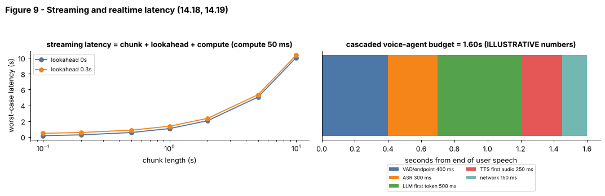

## 14.18 Streaming speech

Metadata:

- Tier: 14 — Speech, Audio & Video AI
- Phase: 2 — Transformers & Foundation Models
- Priority: High
- Difficulty: Advanced
- Interview Importance: High
- Hands-on Importance: High
- Prerequisites: [14.9 Automatic Speech Recognition (ASR)](14.09-automatic-speech-recognition-asr.md), [14.10 CTC](14.10-ctc.md), [14.13 Speech segmentation](14.13-speech-segmentation.md)
- Leads To: [14.19 Realtime speech systems](14.19-realtime-speech-systems.md), [14.31 Streaming/realtime video considerations](14.31-streaming-realtime-video-considerations.md)

---

### 1. WHAT IS IT?

Streaming speech processes audio as it arrives, emitting partial results with bounded delay, instead of waiting for the full recording. The key metrics are latency (how late are words) and accuracy/stability (how often partial words change).

### 2. WHY DOES IT EXIST?

Voice assistants, live captions and phone agents cannot wait until the speaker stops: users expect words within a few hundred milliseconds.

### 3. DETAILED EXPLANATION

**Latency decomposition.** Worst-case delay of a chunked recogniser = `chunk + lookahead + compute` (Figure 9, left; lab `streaming_latency`). Algorithmic latency (chunk + lookahead) is set by the architecture; compute latency by hardware. The real-time factor `RTF = compute / audio` must be < 1 or the system falls behind forever.

**Architectural options.**
- *Causal / chunked encoders:* limit attention to current chunk plus a bounded left context (and optional lookahead); caches carry state.
- *CTC and transducers:* naturally frame-synchronous, so they emit as frames arrive ([14.10](14.10-ctc.md)).
- *Attention encoder-decoders:* need tricks (chunked/monotonic attention, or re-running a full model on a sliding window and committing stable prefixes) (`REVIEW_REQUIRED`).

**Partial vs final results.** Interim hypotheses can change; *stabilisation* (commit only text that has not changed in K updates) trades latency for flicker.

**Chunk-size trade-off.** Small chunks reduce latency but the model sees less context and per-chunk overhead rises; large chunks improve accuracy. Left context recovers some accuracy at little latency cost.

**Lab emulation.** `streaming_greedy(model, feats, chunk=20, context=10)` runs the (bidirectional) toy model on each chunk plus 10 frames of left context, commits only the new chunk's frames and collapses the concatenated path; it is a *pseudo-streaming* approximation (the GRU is still bidirectional inside each window), enough to show the latency/context trade-off. A test checks it stays near offline accuracy.

### 4. HOW DOES IT WORK?



*Figure 9 - Left: worst-case latency grows almost linearly with chunk length; lookahead adds a constant. Right: illustrative stage budget of a cascaded voice agent ([14.19](14.19-realtime-speech-systems.md)).*

Play with the numbers: [explore: `latency_sync_cost.html`](interactive/latency_sync_cost.html) (section 1: chunk, lookahead, compute).

```
mic ─► 20 ms frames ─► [chunk + left context + lookahead] ─► model ─► partial text ─► stabiliser ─► UI
```

### 5. SIMPLE EXAMPLE

A live sign-language interpreter: she cannot wait for the speaker to finish; she lags by a few words, and sometimes corrects herself a moment later.

### 6. TECHNICAL EXAMPLE

With chunk 320 ms, lookahead 160 ms and 60 ms compute, worst-case latency is 540 ms and RTF is 0.19 (calculator on the explorer page). The lab's chunk=20 frames of 10 ms means 200 ms chunks.

### 7. CODE

```python
# run inside lab/ (trains the toy model, ~12 s)
import torch; torch.set_num_threads(2)
from ctc_asr import FramewiseCTC, make_dataset, train, transcribe, streaming_greedy
from audio_core import streaming_latency, cer

tr, te = make_dataset(200, seed=1), make_dataset(10, seed=2)
m = FramewiseCTC(); train(m, tr, epochs=24)
for chunk in (10, 20, 60):
    errs = [cer(t, streaming_greedy(m, f, chunk=chunk, context=15)[0]) for f, t, *_ in te]
    print("chunk", chunk * 10, "ms: CER", round(sum(errs) / len(errs), 3),
          "worst latency", round(streaming_latency(chunk * 0.01, 0.0, 0.01), 2), "s")
```
Code: [`lab/ctc_asr.py`](lab/ctc_asr.py) (`streaming_greedy`), [`lab/audio_core.py`](lab/audio_core.py) (`streaming_latency`).

### 8. INPUT → PROCESS → OUTPUT

```
audio stream ─► chunker (+context) ─► incremental model ─► partial hypotheses ─► stabilise ─► final on endpoint
```

### 9. ENTERPRISE USE CASE

Live captioning for broadcasts and meetings, dictation and call-agent assist need partial results within a second; enterprises measure p50/p95 'time to first partial' and 'final latency after endpoint'.

### 10. AI ENGINEERING CONNECTION

Streaming ASR feeds realtime LLM agents ([14.19](14.19-realtime-speech-systems.md)); the same state-caching ideas appear in LLM serving ([Tier 11](../tier-11-llm-inference-optimization/README.md)).

### 11. ADVANTAGES

Low perceived latency, responsive UX, bounded memory.

### 12. LIMITATIONS

Less context hurts accuracy; partial hypotheses flicker; implementing streaming for attention models is complex.

### 13. TRADE-OFFS

Chunk/lookahead vs accuracy; stabilisation vs flicker; CTC/transducer (stream-native) vs encoder-decoder (accurate, offline-first).

### 14. COMMON MISTAKES

- Measuring only average latency (tail matters).
- Ignoring network jitter.
- RTF > 1 under load.
- Showing unstable partials as if final.
- Chunking without left context.

### 15. PERFORMANCE / COST CONSIDERATIONS

Per-stream state (caches) limits concurrency per GPU; batch across streams; autoscale on active streams and p95 latency.

### 16. SECURITY CONSIDERATIONS

Long-lived streaming connections need authentication, rate limits and idle timeouts; do not log raw audio by default; backpressure to avoid memory blow-up.

### 17. INTERVIEW EXPLANATION

*"Streaming ASR emits words while the person is still talking. Latency is roughly chunk plus lookahead plus compute, so I pick a small chunk with some left context, use a frame-synchronous model like CTC or a transducer, and stabilise partial text. The trade-off is context and accuracy versus delay, and I track tail latency and RTF."*

### 18. RAPID-FIRE ANSWER

Incremental recognition with bounded delay: latency = chunk + lookahead + compute, traded against accuracy.

### 19. INTERVIEW QUESTIONS

- **Basic:** What is RTF and what should it be?
- **Intermediate:** Why is latency = chunk + lookahead + compute?
- **Advanced:** Why are CTC/transducers more stream-friendly than encoder-decoders?
- **Scenario:** p95 latency doubles at peak traffic though p50 is fine. What are likely causes and fixes?

### 20. HANDS-ON EXERCISE

Sweep `chunk` and `context` in `streaming_greedy`, tabulate CER vs worst-case latency, and pick an operating point for a 300 ms budget.

### 21. REVISION QUESTIONS

1. Define lookahead.
2. What is stabilisation?
3. Why track tail latency?

### 22. RELATED CONCEPTS

[14.9 Automatic Speech Recognition (ASR)](14.09-automatic-speech-recognition-asr.md), [14.10 CTC](14.10-ctc.md), [14.13 Speech segmentation](14.13-speech-segmentation.md), [14.19 Realtime speech systems](14.19-realtime-speech-systems.md), [14.31 Streaming/realtime video considerations](14.31-streaming-realtime-video-considerations.md), [Tier 11 LLM Inference Optimization](../tier-11-llm-inference-optimization/README.md)

### 23. ONE-LINE MEMORY HOOK

*Streaming is speed-reading with a short memory: lower delay, less context.*
