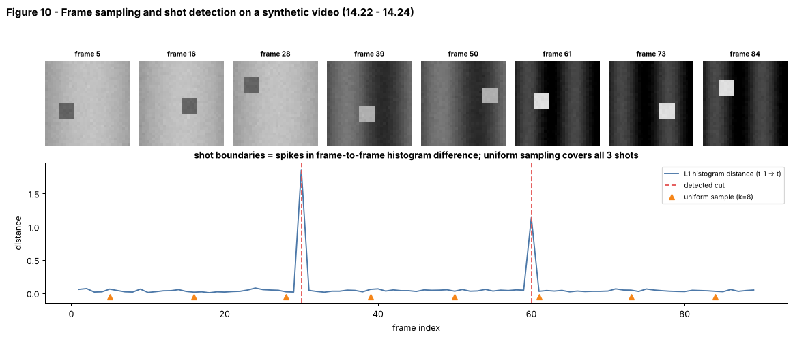

## 14.21 Video as spatial + temporal data

Metadata:

- Tier: 14 — Speech, Audio & Video AI
- Phase: 2 — Transformers & Foundation Models
- Priority: Critical
- Difficulty: Beginner
- Interview Importance: Medium
- Hands-on Importance: High
- Prerequisites: 
- Leads To: [14.22 Video frames](14.22-video-frames.md), [14.23 Frame sampling](14.23-frame-sampling.md), [14.25 Temporal representation](14.25-temporal-representation.md), [14.26 Temporal attention](14.26-temporal-attention.md), [Tier 13 Vision AI](../tier-13-vision-ai/README.md)

---

### 1. WHAT IS IT?

Video is a sequence of images over time: a tensor `[T, H, W, C]` (frames, height, width, channels), usually with an audio track. It has two kinds of structure: *spatial* (what is in each frame, like images) and *temporal* (how things change from frame to frame, motion and events).

### 2. WHY DOES IT EXIST?

Image models see one instant; many questions (what happened, in what order, how fast, who did it) need time. Video is also enormous, so understanding how to represent and compress it is the first design decision.

### 3. DETAILED EXPLANATION

**Numbers.** 1080p at 30 fps is 1920x1080x3 bytes x 30 = about 187 MB/s raw; codecs (H.264/H.265/AV1) compress by orders of magnitude by exploiting temporal redundancy (`REVIEW_REQUIRED` for exact ratios). Models work on much smaller inputs: e.g. 8-32 frames at 224x224.

**Spatial vs temporal redundancy.** Neighbouring frames are nearly identical, so most pixels in frame `t+1` can be predicted from frame `t`. This redundancy is why aggressive frame sampling often works ([14.23](14.23-frame-sampling.md)) and why compressing across time is cheap; the exceptions are fast motion and cuts ([14.24](14.24-scene-shot-segmentation.md)).

**Hierarchy of time.** Frame -> clip (a few seconds) -> shot (continuous camera take) -> scene (a coherent situation across several shots) -> video. Different tasks operate at different levels: action recognition on clips, summarisation on scenes, QA on whole videos.

**Where the cost is.** Tokens: a ViT-style model with 16x16 patches turns a 224x224 frame into 196 tokens; 32 frames are 6 272 tokens before any attention ([14.26](14.26-temporal-attention.md), [14.33](14.33-audio-video-performance-and-cost-considerations.md)).

**Lab data.** `synth_video(n_frames, size, shots)` makes a grayscale clip with a moving square, shot-specific background brightness/texture and hard cuts at known frames, so shot detection, sampling and attention costs can be tested exactly.

### 4. HOW DOES IT WORK?



*Figure 10 - Top: sampled frames from three shots (background brightness changes at each cut, the square moves within a shot). Bottom: frame-to-frame histogram distance; spikes are the cuts.*

```
video file ─► decode ─► frames [T,H,W,C] ─► (resize, normalise) ─► sample/patchify ─► model
                     └─► audio track ─► [14.1-14.8]
```

### 5. SIMPLE EXAMPLE

A flip-book: each page is an image, and the story comes from how pages change. If you only looked at one page you'd miss the motion.

### 6. TECHNICAL EXAMPLE

Our synthetic video is 90 frames of 32x32: 92 160 values (737 KB as float64); a 10-minute 1080p source is about 600x30x6.2 MB = over 110 GB uncompressed.

### 7. CODE

```python
# run inside lab/
from video_core import synth_video, video_token_count

v = synth_video(n_frames=90, size=32, shots=(30, 60))
print(v.shape, v.dtype, round(v.nbytes / 1e3), "KB")        # (90, 32, 32) float64 737 KB
print(video_token_count(frames=32, size=224, patch=16))     # 6272 tokens for 32 frames of 224x224
```
Code: [`lab/video_core.py`](lab/video_core.py)

### 8. INPUT → PROCESS → OUTPUT

```
camera/file ─► decoder ─► [T,H,W,C] frames (+ audio) ─► resize/normalise ─► sampler ─► patch tokens ─► model
```

### 9. ENTERPRISE USE CASE

Video platforms store many encodes per title, run moderation, search and recommendation models on sampled frames and audio, and budget GPU time per minute of video.

### 10. AI ENGINEERING CONNECTION

Video understanding reuses [Tier 13 Vision AI](../tier-13-vision-ai/README.md) (patches, ViT) and [Tier 7](../tier-07-attention/README.md) attention, plus a temporal axis; video-language models ([14.28](14.28-video-language-models.md)) feed visual tokens to LLMs.

### 11. ADVANTAGES

Rich information: motion, causality, audio-visual cues; abundant data.

### 12. LIMITATIONS

Huge, redundant, expensive to label; long-range dependencies; decoding/IO cost often exceeds model cost.

### 13. TRADE-OFFS

Spatial resolution vs temporal coverage vs token budget: you can rarely afford all three.

### 14. COMMON MISTAKES

- Treating video as unrelated images (losing order).
- Ignoring the audio track.
- Decoding full video when only a few frames are needed (seek instead).
- Confusing shot with scene.

### 15. PERFORMANCE / COST CONSIDERATIONS

Cost scales with frames x tokens per frame (and attention is quadratic in total tokens). Decode with hardware decoders, sample before decode where possible.

### 16. SECURITY CONSIDERATIONS

Video exposes faces, locations and bystanders (privacy law, consent); metadata can leak GPS/time. Moderation and provenance (deepfakes) matter; limit retention.

### 17. INTERVIEW EXPLANATION

*"Video is a stack of frames over time, so it has spatial structure like an image plus temporal structure like a sequence. It is huge and highly redundant, so the key design choices are how many frames, at what resolution, and how to turn them into a manageable number of tokens while preserving motion."*

### 18. RAPID-FIRE ANSWER

A [T,H,W,C] tensor with spatial and temporal structure, huge and redundant.

### 19. INTERVIEW QUESTIONS

- **Basic:** What are the dimensions of a video tensor?
- **Intermediate:** Why is video so redundant across frames?
- **Advanced:** Distinguish shot, scene and clip.
- **Scenario:** Your video model is too slow. Which three knobs (frames, resolution, tokens per frame) do you try and how do you test accuracy impact?

### 20. HANDS-ON EXERCISE

Compute raw bytes and ViT token counts for 1 minute of 720p video at 1, 2 and 30 fps. Which setting would you ever feed to an LLM?

### 21. REVISION QUESTIONS

1. Why does temporal redundancy allow frame sampling?
2. What is a tubelet (preview of 14.25)?
3. Name two sources of cost in video models.

### 22. RELATED CONCEPTS

[14.22 Video frames](14.22-video-frames.md), [14.23 Frame sampling](14.23-frame-sampling.md), [14.25 Temporal representation](14.25-temporal-representation.md), [14.26 Temporal attention](14.26-temporal-attention.md), [Tier 13 Vision AI](../tier-13-vision-ai/README.md)

### 23. ONE-LINE MEMORY HOOK

*Video = images x time, and almost all of it is repeats.*
